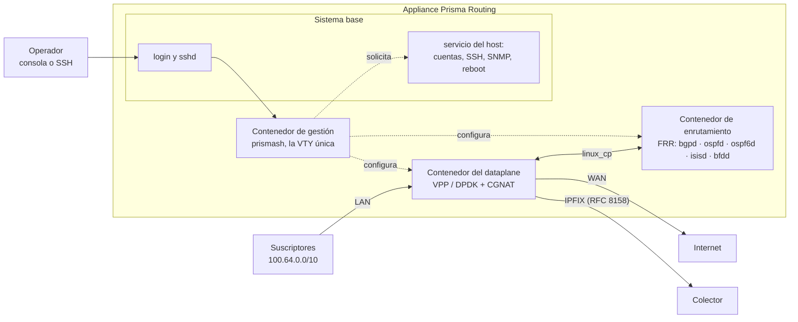

# Prisma Routing — visión general

Enrutador por software con CGNAT integrado, construido sobre **VPP/DPDK** en el plano de datos y **FRR** en el plano de control, entregado como appliance Debian instalable a partir de una ISO. Esta página dice qué es el producto, de qué está hecho y qué deliberadamente no hace — para quien lo está evaluando o necesita explicarle el equipo a alguien.

El diferencial es el **CGNAT por bloque de puertos**: en lugar de registrar cada flujo NAT, el equipo le da a cada suscriptor un **bloque contiguo de puertos**. Eso reduce el log de terabytes a un registro por bloque con **BPA** (*Bulk Port Allocation*, bloques asignados bajo demanda), o a **cero** con el **determinístico** (bloque calculado por fórmula).

## Por qué bloque de puertos

El Marco Civil (Ley 12.965/2014 de Brasil; los requisitos de retención varían según el país) exige un año de retención de los registros de conexión. El log por flujo en CGNAT genera un volumen impracticable. Este equipo **exporta** los registros y no guarda ninguno — quien los guarda durante el año es el colector. Las dos formas, elegidas por pool:

* **Determinístico** (`mode deterministic`) — la dirección pública y el bloque de puertos se *calculan* a partir de la definición del pool. No existe evento de asignación, por lo tanto no hay nada que exportar. La prueba entregada a una autoridad es *"el algoritmo, más la configuración vigente en ese instante"*, y por eso el equipo mantiene un trail fechado de la configuración. La única excepción son los bloques de una `reserve`, que la fórmula no produce y por eso se exportan uno por uno.
* **BPA** (`mode bpa`) — los bloques se asignan dinámicamente, bajo demanda y en escalones, con un registro IPFIX por asignación y por liberación (RFC 8158), no por flujo.

BPA es solo el modo dinámico: el determinístico no es un tipo de BPA. Los dos juntos son el *CGNAT por bloque de puertos*.

## Arquitectura

En un equipo instalado, el dataplane, el enrutamiento y la gestión corren cada uno en su propio contenedor, sobre un sistema base Debian 12 con kernel propio.

* **El dataplane** hace el reenvío y la traducción. Las placas que usa salen de Linux y pasan a ser suyas.
* **El enrutamiento** es FRR, que ve cada interfaz del dataplane a través de un par en Linux (`linux_cp`) e instala las rutas en la tabla de reenvío del dataplane.
* **La gestión** es donde corre `prismash`: la VTY única, que configura CGNAT, interfaces, enrutamiento y el sistema desde la misma interfaz. Cada login entra en ella con su propia cuenta y su propio rol.
* **El sistema base** se encarga de lo que el contenedor de gestión no puede hacer por sí solo — cuentas, SSH, SNMP, resolvedores, reinicio y apagado. La VTY **solicita** esos cambios a un servicio del host, que solo acepta una lista cerrada de comandos. `start shell`, restringido a administradores, abre un shell **en el sistema base**, no en el contenedor.
* **Los registros** de bloque que van al colector por TCP, y normalmente también el IPFIX por UDP, salen de un contenedor propio, con memoria limitada, para que un colector lento o la reposición de un archivo de desborde no le cuesten paquetes al dataplane. Sin ese contenedor levantado, el dataplane vuelve a enviarlos él mismo en cerca de un segundo.
* **El PPPoE**, cuando está configurado, corre en un quinto contenedor, con límites de memoria propios: una falla suya no se lleva el reenvío, el enrutamiento ni la VTY. Un equipo sin PPPoE no lo inicia.

Todo cambio en el dataplane pasa por su API binaria, por una conexión abierta al inicio de cada sesión de la VTY y mantenida mientras dura — no por la línea de comandos de texto del dataplane, que sale con código cero incluso cuando falla.

Además del CGNAT de IPv4, el mismo equipo hace **[NAT64](/s/wiki-es/doc/nat64-suscriptores-solo-ipv6-en-el-mismo-espacio-publico-45g9ORUleS)** (suscriptores solo IPv6 saliendo por el mismo espacio público, en los mismos bloques de puertos) y puede **terminar suscriptores PPPoE**, autenticados por RADIUS y traducidos por el CGNAT. El monitoreo es por SNMP, y una [API gRPC de gestión](/s/wiki-es/doc/api-de-gestion-grpc-para-quien-integra-rPfqyevXTu), apagada por defecto, permite que un sistema externo configure y lea el equipo con las mismas reglas de la VTY.

:::info
Si el contenedor de gestión no está levantado, el login cae en la VTY del propio sistema base, como antes. Un equipo con ese contenedor detenido sigue siendo accesible.

:::

## Dimensionamiento

200 mil suscriptores en modo determinístico con bloques de 512 puertos requieren un `/21` de IPv4 público. BPA con sobresuscripción necesita bastante menos.

El mínimo es **6 GB de RAM** (8 recomendados) y una CPU con **SSE4.2**. Por debajo de 6 GB el equipo arranca y no reenvía nada. La memoria que recibe el CGNAT para sesiones es un número que usted define.

## Estado por componente

| Componente | Estado |
|------------|--------|
| Núcleo de mapeo determinístico | Verificado contra el modelo de referencia en Python, mapeo por mapeo, el pool entero |
| Dataplane (traducción, handoff, modo BPA, fragmentos, errores ICMP, estado TCP) | Verificado con tráfico inyectado y real |
| Enrutamiento (BGP, OSPF, IS-IS, BFD, política de enrutamiento) | Verificado — las rutas llegan a la FIB de VPP |
| Logging IPFIX (UDP y TCP) | Verificado con colector decodificando |
| VTY (`prismash`) | Candidata, `commit`, `rollback`, roles; cada línea se rechaza donde se escribe, incluidas las de enrutamiento |
| Appliance (ISO, kernel, contenedores, tuning) | Cada versión que publica ISO se instala en un disco y se reinicia desde él antes de salir, también en una máquina virtual sin páginas de 1 GB; el autotest de arranque reporta listo |
| **Alta disponibilidad** | **Activo/standby implementado**: VRRP en la interfaz del dataplane, en IPv4 y en IPv6 (un pool NAT64 también cambia de equipo); la prueba de aceptación (uplink arrancado, dataplane detenido, dataplane muerto) pasa, con todo suscriptor manteniendo dirección pública y bloque. Las sesiones **no** se sincronizan: las conexiones en curso se caen |
| **Throughput** | **Bits por segundo NO medidos** — eso exige una placa que DPDK maneje de forma nativa. Se mide el costo de cada paquete en ciclos de CPU en los nodos de traducción |

El proyecto permanece en `0.x.x` hasta ser declarado listo para producción. Se permiten cambios incompatibles y se anuncian.

:::info
**Los números medidos en máquina virtual no son capacidad.** Con placa virtio, lo que se mide es el hipervisor, no el equipo. No se afirma ningún número de throughput hasta que se mida en placa real.

:::

## Ausencias deliberadas

No son carencias — son decisiones registradas:

* **Sincronización de sesiones entre los equipos de un par** — no existe, y el costo es el motivo: en un equipo de 200 mil suscriptores, replicar toda creación y eliminación de sesión es un flujo comparable al propio log. El activo/standby existe y preserva dirección y bloque; las conexiones en curso se caen.
* **Números de throughput** — no se afirma nada sin medición en hardware.
* **Log por flujo** — rechazado. Es exactamente lo que el bloque de puertos existe para evitar.
* **NPTv6 y DPI** más allá de lo que un ALG necesita reescribir — fuera de alcance.
* **Migración gradual de pool** — daría dos mapeos para un suscriptor, y la aritmética inversa no sabría distinguirlos.

# Ver también

* [Determinístico y BPA — conceptos y mapeo](/s/wiki-es/doc/deterministico-y-bpa-conceptos-y-mapeo-LgBbN0YDcl) — la aritmética detrás
* [Alta disponibilidad](/s/wiki-es/doc/alta-disponibilidad-bjNhRjSh49) — el par, qué preserva la conmutación y qué corta
* [Dimensionamiento y requisitos](/s/wiki-es/doc/dimensionamiento-y-requisitos-FuEOaBC4vd) — RAM, CPU y direcciones públicas para su caso
* [Primeros pasos](/s/wiki-es/doc/primeros-pasos-1atRsTUyKZ) — donde esto se convierte en una máquina en producción
