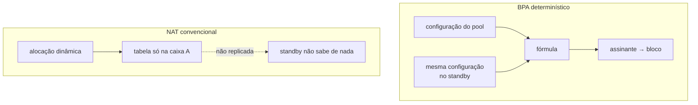

# Alta disponibilidade

O que acontece hoje quando esta caixa cai, o que o modo determinístico já resolve de graça, e o que ainda falta para um failover de verdade. Para quem está desenhando redundância.


:::warning
**Alta disponibilidade não está implementada.** Esta página descreve a análise e o piso que o produto já oferece, não um recurso existente. Não dimensione um projeto contando com failover automático.

O que já existe é a **conferência de igualdade** entre as duas caixas — `show cgnat ha`, descrito mais abaixo. Ele não elege ninguém, não move endereço e não assume serviço: só responde se uma troca colocaria os assinantes onde eles já estão.

:::

# O que o modo determinístico dá de graça

Num CGNAT convencional o mapeamento assinante → (IP público, porta) é resultado de alocação dinâmica: ele existe **apenas** na tabela da caixa que o criou. Um standby não sabe de nada, e um failover muda o endereço público de todo mundo.



| Depois do failover | NAT convencional | BPA determinístico |
|--------------------|------------------|--------------------|
| IP público do assinante | muda             | **não muda**       |
| Bloco de portas    | muda             | **não muda**       |
| Conexões em curso  | caem             | caem               |
| Conexões novas     | precisam de alocação nova | funcionam de imediato |
| Estado a sincronizar para o acima | a tabela inteira | **nenhum**         |

A linha que importa: conexões em curso caem nos dois casos, mas sob BPA elas se restabelecem **no mesmo endereço público**. Para o assinante, a diferença entre "caiu e voltou" e "caiu, voltou e agora meu IP é outro" é grande — a segunda quebra tudo que dependia do endereço.

Isso não é HA. É o piso de onde a HA parte, e ele já é mais alto que o usual.

# O que ainda falta

Preservar conexões em curso exige sincronizar a tabela de sessões, porque o caminho de volta precisa da **porta privada** — e nenhuma fórmula produz isso.

| Desenho | Custo | O que preserva |
|---------|-------|----------------|
| Ativo/standby sem sincronismo | \~zero | endereço público e bloco; conexões caem |
| Sincronismo de sessão por multicast | alto: cada criação e remoção de sessão vira mensagem | conexões em curso |
| Ativo/ativo com particionamento de assinantes | médio | metade do tráfego não afetada por uma falha |

O sincronismo de sessão é o único que preserva conexões e o mais caro: numa caixa de 200 mil assinantes com centenas de sessões cada, replicar toda criação e remoção é um fluxo de plano de controle comparável ao próprio log.

O **modo dinâmico** acrescenta um requisito: a alocação de blocos teria de ser coordenada, ou as duas caixas alocariam blocos diferentes ao mesmo assinante.

# A proposta para uma primeira versão

Ativo/standby com VRRP nos dois lados — público e interno —, **sem** sincronismo de sessão, e configuração idêntica garantida pela trilha que já existe.

É honesto sobre o que entrega: não preserva conexões, preserva endereços. Para um provedor, já remove o pior sintoma de um failover de CGNAT.

A construir:


1. Integração com `keepalived` ou o VRRP do FRR, coerente com o `linux_cp`.
2. Verificação de que as duas caixas carregam a **mesma** configuração de pool. **Já existe**, até onde uma caixa sem sessão com a outra consegue ir.
3. Um `show cgnat ha` comparando uma impressão digital de configuração entre os pares. **Já existe.**
4. Uma verificação com duas instâncias e uma falha forçada, confirmando que o assinante mantém endereço e bloco.


:::warning
O item 2 não pode ser pulado. No modo determinístico, duas caixas com configuração diferente falham **em silêncio**: o failover começa a mapear assinantes para blocos errados sem erro visível, e os logs das duas caixas parecem perfeitamente saudáveis. Igualdade de configuração é requisito, não conveniência.

:::

# Conferir se as duas caixas concordam

A pergunta é uma só: uma troca de caixa deixaria cada assinante no mesmo endereço público e no mesmo bloco de portas? `show cgnat ha` responde isso e nada além disso.

Para que a caixa possa comparar, ela precisa ter a configuração da outra. Não existe sessão entre as duas — o VRRP ainda não existe —, então a configuração da parceira chega como arquivo: salve a configuração da outra caixa e copie o arquivo para `/etc/prisma-routing/peer.conf` desta.

Quando as duas divergem:

```
prisma> show cgnat ha
  this box
    mapping fingerprint  50e2b92f23c2707c
    pools                residencial

  role
    neither box elects one: this VTY has no virtual router and nothing here
    takes a service address over. What is checked below is whether a takeover
    WOULD land subscribers where they already are.

  peer, from /etc/prisma-routing/peer.conf
    mapping fingerprint  9e7394fc505d2eff
    pools                residencial
    copied               2026-09-12 09:14:31

warning: pool 'residencial' does not map subscribers the same way on the two
    boxes, so a failover moves them to other public addresses and port
    blocks, and neither box logs anything
    this box: block-size 2048
    the peer: block-size 1024
```

A caixa diz **qual pool** difere e **quais linhas** diferem, não só que os números batem ou não batem. Quando concordam, a última parte vira uma frase só:

```
  the two boxes map every subscriber to the same public address and the same
  port block
```

A mesma comparação roda em `commit check` e em `commit`: uma alteração que afasta o par avisa na hora em que é feita, e não na hora em que a outra caixa é necessária.


:::info
O aviso **nunca recusa o commit**, e isso é de propósito. As duas caixas não podem ser alteradas no mesmo instante: toda ampliação de capacidade legítima afasta o par entre o primeiro commit e o segundo. Uma recusa dispararia em todo procedimento correto, e o jeito de escapar dela seria parar de copiar a configuração da parceira — o que tira a conferência, não a divergência.

:::

## Quais campos precisam ser iguais

Os que mudam o **mapeamento**. No modo determinístico o endereço público e o bloco de portas do assinante são função da definição do pool, então o que precisa bater é exatamente o que muda essa conta — e é a mesma lista de campos que, quando alterada, derruba as sessões do pool.

| Precisam ser iguais nas duas caixas | Podem diferir |
|-------------------------------------|---------------|
| `inside`, `outside`                 | `timeout ...` |
| `block-size`, `ports`               | `alg` de cada protocolo, `tcp-mss` |
| `policy`, `mode`                    | `bypass source`, `bypass destination` |
| `reserve`                           | `max-sessions`, `max-session-rate` |
| `vrf`, `outside-vrf`                | `forward ...`, `block-stride`, `max-blocks`, `utilisation-alarm` |

A coluna da direita o dataplane altera num pool que está passando tráfego, e nenhum desses ajustes move assinante nenhum. Duas caixas que diferem só ali estão corretas, e avisar sobre elas seria ensinar o operador a ignorar o aviso que importa.

## O que a conferência nunca faz

Ela pode dizer "diferem", pode dizer "concordam" e pode dizer "não sei" — e a terceira resposta nunca vira a segunda.

| Situação | O que a caixa diz |
|----------|-------------------|
| Não há arquivo da parceira | Que não há, e que isso não é uma concordância |
| O arquivo está vazio, truncado ou sem pool nenhum | O motivo, nunca "iguais" |
| O arquivo tem uma linha que esta VTY não sabe ler | Qual linha, porque o pool comparado não seria o que a parceira tem |
| O dataplane não responde | Que parou aí: sem ele esta caixa não sabe o que ela própria mapeia |


:::warning
O arquivo da parceira é uma **cópia**, e cópia tem idade. Por isso o relatório mostra a data ao lado da impressão digital: uma impressão digital que bate com uma configuração que a outra caixa parou de usar semana passada é a mesma falsa concordância que a conferência existe para remover. Copie de novo sempre que alterar a parceira.

:::

# O que fazer enquanto isso

* Mantenha a configuração dos pares idêntica e versionada, e confira com `show cgnat ha` depois de toda alteração — a trilha de configuração de cada caixa é a evidência do que foi feito, e a conferência é a evidência de que as duas continuam concordando.
* Trate uma troca manual como uma janela: os assinantes voltam nos mesmos endereços, mas as conexões em curso caem.
* Se você opera modo dinâmico, lembre que o bloco **não** é reproduzível por fórmula: ali o failover muda de fato o bloco do assinante.

# Ver também

* [BPA — conceitos e mapeamento](/doc/bpa-conceitos-e-mapeamento-uh9nF6sRaa) — por que a fórmula dispensa sincronismo
* [Ampliar capacidade sem derrubar assinantes](/doc/ampliar-capacidade-sem-derrubar-assinantes-rWQkaj9r1u) — o outro lugar onde configuração idêntica importa
* [Prisma Routing — visão geral](/doc/prisma-routing-visao-geral-cNtWoccoy5) — o estado de cada componente
