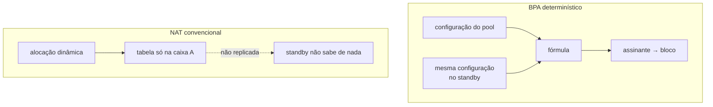

# Alta disponibilidade

O que acontece hoje quando esta caixa cai, o que o modo determinístico já resolve de graça, e o que ainda falta para um failover de verdade. Para quem está desenhando redundância.

:::warning
**Alta disponibilidade não está implementada.** Esta página descreve a análise e o piso que o produto já oferece, não um recurso existente. Não dimensione um projeto contando com failover automático.

:::

# O que o modo determinístico dá de graça

Num CGNAT convencional o mapeamento assinante → (IP público, porta) é resultado de alocação dinâmica: ele existe **apenas** na tabela da caixa que o criou. Um standby não sabe de nada, e um failover muda o endereço público de todo mundo.

| Depois do failover | NAT convencional | BPA determinístico |
|--------------------|------------------|--------------------|
| IP público do assinante | muda             | **não muda**       |
| Bloco de portas    | muda             | **não muda**       |
| Conexões em curso  | caem             | caem               |
| Conexões novas     | precisam de alocação nova | funcionam de imediato |
| Estado a sincronizar para o acima | a tabela inteira | **nenhum**         |

A linha que importa: conexões em curso caem nos dois casos, mas sob BPA elas se restabelecem **no mesmo endereço público**. Para o assinante, a diferença entre "caiu e voltou" e "caiu, voltou e agora meu IP é outro" é grande — a segunda quebra tudo que dependia do endereço.

Isso não é HA. É o piso de onde a HA parte, e ele já é mais alto que o usual.

# O que ainda falta

Preservar conexões em curso exige sincronizar a tabela de sessões, porque o caminho de volta precisa da **porta privada** — e nenhuma fórmula produz isso.

| Desenho | Custo | O que preserva |
|---------|-------|----------------|
| Ativo/standby sem sincronismo | \~zero | endereço público e bloco; conexões caem |
| Sincronismo de sessão por multicast | alto: cada criação e remoção de sessão vira mensagem | conexões em curso |
| Ativo/ativo com particionamento de assinantes | médio | metade do tráfego não afetada por uma falha |

O sincronismo de sessão é o único que preserva conexões e o mais caro: numa caixa de 200 mil assinantes com centenas de sessões cada, replicar toda criação e remoção é um fluxo de plano de controle comparável ao próprio log.

O **modo dinâmico** acrescenta um requisito: a alocação de blocos teria de ser coordenada, ou as duas caixas alocariam blocos diferentes ao mesmo assinante.

# A proposta para uma primeira versão

Ativo/standby com VRRP nos dois lados — público e interno —, **sem** sincronismo de sessão, e configuração idêntica garantida pela trilha que já existe.

É honesto sobre o que entrega: não preserva conexões, preserva endereços. Para um provedor, já remove o pior sintoma de um failover de CGNAT.

A construir:

1. Integração com `keepalived` ou o VRRP do FRR, coerente com o `linux_cp`.
2. Verificação de que as duas caixas carregam a **mesma** configuração de pool.
3. Um `show bpa ha` comparando um hash de configuração entre os pares.
4. Uma verificação com duas instâncias e uma falha forçada, confirmando que o assinante mantém endereço e bloco.

:::warning
O item 2 não pode ser pulado. No modo determinístico, duas caixas com configuração diferente falham **em silêncio**: o failover começa a mapear assinantes para blocos errados sem erro visível, e os logs das duas caixas parecem perfeitamente saudáveis. Igualdade de configuração é requisito, não conveniência.

:::

# O que fazer enquanto isso

* Mantenha a configuração dos pares idêntica e versionada — a trilha de configuração de cada caixa é a evidência disso.
* Trate uma troca manual como uma janela: os assinantes voltam nos mesmos endereços, mas as conexões em curso caem.
* Se você opera modo dinâmico, lembre que o bloco **não** é reproduzível por fórmula: ali o failover muda de fato o bloco do assinante.

# Ver também

* [BPA — conceitos e mapeamento](/doc/bpa-conceitos-e-mapeamento-uh9nF6sRaa) — por que a fórmula dispensa sincronismo
* [Ampliar capacidade sem derrubar assinantes](/doc/ampliar-capacidade-sem-derrubar-assinantes-rWQkaj9r1u) — o outro lugar onde configuração idêntica importa
* [HexaRouting — visão geral](/doc/hexarouting-visao-geral-cNtWoccoy5) — o estado de cada componente
