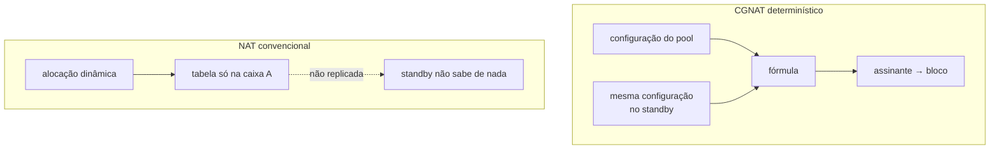

# Alta disponibilidade

O que acontece quando esta caixa cai, como montar o par ativo/standby, o que a troca preserva e o que ela derruba. Para quem está desenhando redundância.


:::info
**Ativo/standby está implementado.** Duas caixas sustentam um endereço de serviço entre elas com VRRP (RFC 5798) **na interface do dataplane**, e a verificação de aceitação — duas instâncias, três formas de perder a ativa — passa inteira.

**O que continua não existindo é sincronismo de sessão.** Conexões em curso caem no failover, como caem em qualquer NAT. O que não muda é o endereço público e o bloco de portas do assinante.

:::

# O que o modo determinístico dá de graça

Num CGNAT convencional o mapeamento assinante → (IP público, porta) é resultado de alocação dinâmica: ele existe **apenas** na tabela da caixa que o criou. Um standby não sabe de nada, e um failover muda o endereço público de todo mundo.



| Depois do failover | NAT convencional | CGNAT determinístico |
|--------------------|------------------|----------------------|
| IP público do assinante | muda             | **não muda**         |
| Bloco de portas    | muda             | **não muda**         |
| Conexões em curso  | caem             | caem                 |
| Conexões novas     | precisam de alocação nova | funcionam de imediato |
| Estado a sincronizar para o acima | a tabela inteira | **nenhum**           |

A linha que importa: conexões em curso caem nos dois casos, mas no determinístico elas se restabelecem **no mesmo endereço público**. Para o assinante, a diferença entre "caiu e voltou" e "caiu, voltou e agora meu IP é outro" é grande — a segunda quebra tudo que dependia do endereço.

Isso não é HA. É o piso de onde a HA parte, e ele já é mais alto que o usual.

**Isso vale para pools determinísticos.** Um pool BPA (`mode dynamic`) aloca blocos sob demanda, e a caixa que assume não sabe o que a outra alocou: nele, a troca se comporta como a coluna do NAT convencional — o assinante volta com outro bloco, e possivelmente outro endereço público.

# O que ainda falta

Preservar conexões em curso exige sincronizar a tabela de sessões, porque o caminho de volta precisa da **porta privada** — e nenhuma fórmula produz isso.

| Desenho | Custo | O que preserva |
|---------|-------|----------------|
| Ativo/standby sem sincronismo | \~zero | endereço público e bloco; conexões caem |
| Sincronismo de sessão por multicast | alto: cada criação e remoção de sessão vira mensagem | conexões em curso |
| Ativo/ativo com particionamento de assinantes | médio | metade do tráfego não afetada por uma falha |

O sincronismo de sessão é o único que preserva conexões e o mais caro: numa caixa de 200 mil assinantes com centenas de sessões cada, replicar toda criação e remoção é um fluxo de plano de controle comparável ao próprio log.

O **modo dinâmico (BPA)** acrescenta um requisito: a alocação de blocos teria de ser coordenada, ou as duas caixas alocariam blocos diferentes ao mesmo assinante. Nada disso existe hoje.

# Como montar o par

Ativo/standby com VRRP nos dois lados — público e interno —, **sem** sincronismo de sessão. É honesto sobre o que entrega: não preserva conexões, preserva endereços.

Em cada caixa, um roteador virtual por lado, com o mesmo `vrid` dos dois lados e prioridade diferente:

```
interface ens18
 ipv4 address 100.64.3.252/22
 cgnat inside
 vrrp 1 address 100.64.3.254
 vrrp 1 priority 200
 vrrp 1 track ens19 decrement 150
 exit
interface ens19
 ipv4 address 200.150.0.11/24
 cgnat outside
 vrrp 2 address 200.150.0.254
 vrrp 2 priority 200
 vrrp 2 track ens18 decrement 150
 exit
```

Na outra caixa, os endereços dela e prioridade menor (100, por exemplo). Os assinantes apontam para `100.64.3.254` e o trânsito manda o pool para `200.150.0.254` — endereços que **nenhuma das duas** possui como endereço próprio.

**Onde o roteador virtual roda, e por que isso é a decisão inteira.** O FRR traz VRRP e o `keepalived` era a outra alternativa; os dois rodam no Linux, que nesta caixa é o par `linux_cp`. O par não é por onde os pacotes passam — a interface do dataplane é. Um par montado assim moveria um endereço no Linux e deixaria a FIB e o CGNAT na caixa que morreu. O dataplane já trazia a resposta: o plugin VRRP do próprio VPP, carregado em toda caixa, sem roteador virtual nenhum porque nada pedia um.

**O MAC virtual é o que faz o CPE não precisar saber de nada.** Quem assume o endereço assume o MAC `00:00:5e:00:01:<vrid>` junto e manda um ARP gratuito; o CPE continua mandando para o mesmo MAC e o quadro passa a chegar na outra caixa.

`**track**` **é a falha que o resto não cobre.** Uma caixa com o uplink arrancado continua viva e continua anunciando: segura o endereço do gateway e não alcança nada. Com `track`, a prioridade cai pelo decremento e a parceira assume. Escolha o decremento de forma que a queda leve a prioridade **abaixo** da da outra.

**O endereço virtual não responde ping.** Quem não é dono do endereço não responde ICMP por ele — é o padrão da RFC 5798 (seção 6.4.3). O monitoramento deve pingar o endereço **próprio** de cada caixa, que é o que diz se aquela caixa está viva; o endereço virtual só diz qual das duas está com ele. Encaminhar **através** dele funciona normalmente.

O intervalo de anúncio não é configurável: é o padrão de um segundo da RFC, o que põe uma troca em torno de três segundos e meio. Ele precisa ser igual nas duas caixas, e um ajuste por caixa é um jeito por caixa de errar.

**A prioridade da configuração decide, e a preempção está ligada.** Uma caixa que volta retoma o serviço: o par termina onde a configuração diz, não onde a última falha o deixou.

**Mudar um roteador virtual é uma troca, não um ajuste.** Um roteador virtual não se edita no lugar: qualquer campo alterado num roteador que já existe faz a caixa parar de anunciar enquanto ele é refeito, a parceira assume o endereço e a preempção o devolve — duas eleições, a poucos segundos uma da outra, e as conexões em curso caem nas duas. O `commit` diz isso antes de aplicar. Criar um roteador novo não custa nada, porque não há endereço a perder.

**O** `**commit check**` **recusa o que o** `**commit**` **não conseguiria aplicar**: um roteador virtual sem endereço, e um `track` ou um `vrrp` numa interface que o dataplane não tem.

# O que a verificação de aceitação mede

A verificação de aceitação foi escrita **antes** da implementação, para que ela fosse julgada contra o requisito e não o contrário. Todas as 22 conferências dela passam:

| O que foi medido | Resultado |
|------------------|-----------|
| O tráfego traduzido do assinante através do endereço de serviço, antes de qualquer falha | Funciona, e o lado de fora vê o endereço e o bloco que a fórmula dá |
| **Uplink arrancado**, com a caixa viva e segurando o endereço do assinante | Sobrevive: o `track` derruba a prioridade e a parceira assume, no mesmo endereço público e numa porta do mesmo bloco |
| **Dataplane parado** do jeito que o próprio serviço para | Sobrevive, em torno de quatro segundos |
| **Dataplane morto** com SIGKILL | Sobrevive, em torno de três segundos |
| Uma conexão TCP em curso na troca | **Cai**, e uma nova do mesmo assinante pega o mesmo endereço e o mesmo bloco |

A última linha é a promessa desta página dita ao contrário: ninguém deve ler uma execução verde como "as conexões sobreviveram".

O que **não** foi medido aqui: se a placa de rede real avisa que o cabo saiu. A interface de laboratório não avisa, então o laboratório derruba a porta no dataplane também — que é o estado que uma placa com o cabo fora reporta em hardware.


:::warning
A igualdade de configuração não pode ser pulada. No modo determinístico, duas caixas com configuração diferente falham **em silêncio**: o failover começa a mapear assinantes para blocos errados sem erro visível, e os logs das duas caixas parecem perfeitamente saudáveis. Igualdade de configuração é requisito, não conveniência.

:::

# Conferir se as duas caixas concordam

A pergunta é uma só: uma troca de caixa deixaria cada assinante no mesmo endereço público e no mesmo bloco de portas? `show cgnat ha` responde isso e nada além disso.

Para que a caixa possa comparar, ela precisa ter a configuração da outra. **O VRRP não carrega configuração nenhuma** — a RFC anuncia uma prioridade e um endereço, e nada mais —, então a configuração da parceira chega como arquivo: rode `save` na outra caixa e copie o arquivo que ele grava, `/etc/prisma-routing/prisma-routing.conf`, para `/etc/prisma-routing/peer.conf` desta.

**Numa caixa que faz par, o** `**commit**` **recusa uma mudança que divergiria.** Com `vrrp` em alguma interface e um `peer.conf` legível, uma candidata que mapearia assinantes de forma diferente da parceira é recusada pelo nome do pool, e `commit diverge` é a palavra de quem sabe o que está fazendo — porque duas caixas não se commitam no mesmo instante, e toda ampliação correta diverge o par entre o primeiro commit e o segundo. A página *commit, rollback e save* descreve a recusa inteira.

**A tela lê os roteadores virtuais das duas caixas, e não só o mapeamento.** O arquivo da parceira é a configuração que ela salvou, então ele carrega os `vrrp` dela também — e duas caixas que mapeiam todo assinante igual ainda podem ser um par que nunca troca:

```
  the pair
    every virtual router this box carries has one on the peer with the same id,
    the same address and a different priority
```

Dois achados, e os dois são erro de configuração sem sintoma até o dia em que importa:

* **a mesma prioridade nas duas caixas.** A RFC 5798 desempata pelo endereço de origem maior, então o par funciona e quem fica com o serviço é decidido por algo que ninguém escreveu. O primeiro failover cai onde o endereçamento puser.
* **um** `**vrid**` **que só uma das caixas sustenta.** Não existe standby para aquele endereço: a caixa que está com ele está sozinha. Endereço virtual diferente sob o mesmo `vrid` é esse mesmo achado duas vezes, uma para cada caixa.

A comparação é pelo `**vrid**` **e pelo endereço**, nunca pelo nome da interface: as duas caixas sustentam um endereço sob um `vrid`, e como a porta se chama de cada lado é problema de cada uma — `ens18` aqui pode ser `ens19` lá e o par está certo.

Quando as duas divergem:

```
prisma> show cgnat ha
  this box
    mapping fingerprint  50e2b92f23c2707c
    pools                residencial

  role
    ens18 vrrp 1   master, holding the address
      address(es)        100.64.3.254
      virtual mac        00:00:5e:00:01:01
      priority           200

  peer, from /etc/prisma-routing/peer.conf
    mapping fingerprint  9e7394fc505d2eff
    pools                residencial
    copied               2026-09-12 09:14:31

  the pair
    every virtual router this box carries has one on the peer with the same id,
    the same address and a different priority

warning: pool 'residencial' does not map subscribers the same way on the two
    boxes, so a failover moves them to other public addresses and port
    blocks, and neither box logs anything
    this box: block-size 2048
    the peer: block-size 1024
```

A caixa diz **qual pool** difere e **quais linhas** diferem, não só que os números batem ou não batem. Quando concordam, a última parte vira uma frase só:

```
  the two boxes map every subscriber to the same public address and the same
  port block
```

A mesma comparação roda em `commit check` e em `commit`: uma alteração que afasta o par aparece na hora em que é feita, e não na hora em que a outra caixa é necessária.


:::info
**Numa caixa que não faz par, isto é um aviso e nunca uma recusa**, e é de propósito: sem `vrrp` em interface nenhuma, um `peer.conf` ali é material de comparação, e um arquivo em `/etc` não cria um relacionamento que a configuração não declara.

**Numa caixa que faz par, é recusa — com uma palavra que passa por cima.** As duas caixas não podem ser alteradas no mesmo instante: toda ampliação de capacidade legítima afasta o par entre o primeiro commit e o segundo. Uma recusa sem saída dispararia em todo procedimento correto, e o jeito de escapar dela viraria parar de copiar a configuração da parceira — o que tira a conferência, não a divergência. Por isso existe o `commit diverge`.

:::

## Quais campos precisam ser iguais

Os que mudam o **mapeamento**. No modo determinístico o endereço público e o bloco de portas do assinante são função da definição do pool, então o que precisa bater é exatamente o que muda essa conta — e é a mesma lista de campos que, quando alterada, derruba as sessões do pool.

| Precisam ser iguais nas duas caixas | Podem diferir |
|-------------------------------------|---------------|
| `inside`, `outside`                 | `timeout ...` |
| `block-size`, `ports`               | `alg` de cada protocolo, `tcp-mss` |
| `policy`, `mode`                    | `bypass source`, `bypass destination` |
| `reserve`                           | `max-sessions`, `max-session-rate` |
| `vrf`, `outside-vrf`                | `forward ...`, `block-stride`, `max-blocks`, `utilisation-alarm` |

A coluna da direita o dataplane altera num pool que está passando tráfego, e nenhum desses ajustes move assinante nenhum. Duas caixas que diferem só ali estão corretas, e avisar sobre elas seria ensinar o operador a ignorar o aviso que importa.

## O que a conferência nunca faz

Ela pode dizer "diferem", pode dizer "concordam" e pode dizer "não sei" — e a terceira resposta nunca vira a segunda.

| Situação | O que a caixa diz |
|----------|-------------------|
| Não há arquivo da parceira | Que não há, e que isso não é uma concordância |
| O arquivo está vazio, truncado ou sem pool nenhum | O motivo, nunca "iguais" |
| O arquivo tem uma linha que esta VTY não sabe ler | Qual linha, porque o pool comparado não seria o que a parceira tem |
| O dataplane não responde | Que parou aí: sem ele esta caixa não sabe o que ela própria mapeia |


:::warning
O arquivo da parceira é uma **cópia**, e cópia tem idade. Por isso o relatório mostra a data ao lado da impressão digital: uma impressão digital que bate com uma configuração que a outra caixa parou de usar semana passada é a mesma falsa concordância que a conferência existe para remover. Copie de novo sempre que alterar a parceira.

:::

# Operando o par

* Mantenha a configuração das duas caixas idêntica e versionada, e **copie o** `**peer.conf**` **de novo sempre que alterar a parceira** — a recusa do `commit` só enxerga o que o arquivo diz, e o arquivo tem idade.
* Confira com `show cgnat ha` depois de toda alteração: ele diz o papel de cada roteador virtual, o MAC virtual, a prioridade que a caixa está **anunciando** — que não é a configurada quando algo rastreado está fora — e se as duas mapeiam igual. Uma caixa anunciando menos do que foi configurada tem um cabo fora, não um problema de VRRP.
* Olhando uma porta só, `show interface <nome>` diz se aquela porta está segurando o endereço de serviço ou esperando.
* No boot, o self-test do console diz se os roteadores virtuais do arquivo salvo estão de fato no dataplane, e quantos estão segurando endereço e quantos estão de reserva. Um `vrrp` que o dataplane recusou não aparece em `show running-config`, e sem essa linha a parceira ficaria sozinha sem ninguém saber.
* Para tirar a caixa que está com o serviço para manutenção, siga a receita *Fazer manutenção numa caixa que faz par*: baixar a prioridade, conferir nas duas caixas, trabalhar, restaurar.
* Trate uma troca como uma janela: os assinantes voltam nos mesmos endereços, mas as conexões em curso caem.
* Monitore o endereço **próprio** de cada caixa, não o virtual.
* Se você opera BPA (modo dinâmico), lembre que o bloco **não** é reproduzível por fórmula: ali o failover muda de fato o bloco do assinante.

# Ver também

* [Determinístico e BPA — conceitos e mapeamento](/doc/bpa-conceitos-e-mapeamento-uh9nF6sRaa) — por que a fórmula dispensa sincronismo
* [Ampliar capacidade sem derrubar assinantes](/doc/ampliar-capacidade-sem-derrubar-assinantes-rWQkaj9r1u) — o outro lugar onde configuração idêntica importa
* [Receitas do dia a dia](/doc/receitas-do-dia-a-dia-IcocgdbXW2) — *Fazer manutenção numa caixa que faz par*
* [commit, rollback e save](/doc/commit-rollback-e-save-jqCB7kxPuA) — a recusa `commit diverge` por inteiro
* [Prisma Routing — visão geral](/doc/prisma-routing-visao-geral-cNtWoccoy5) — o estado de cada componente
