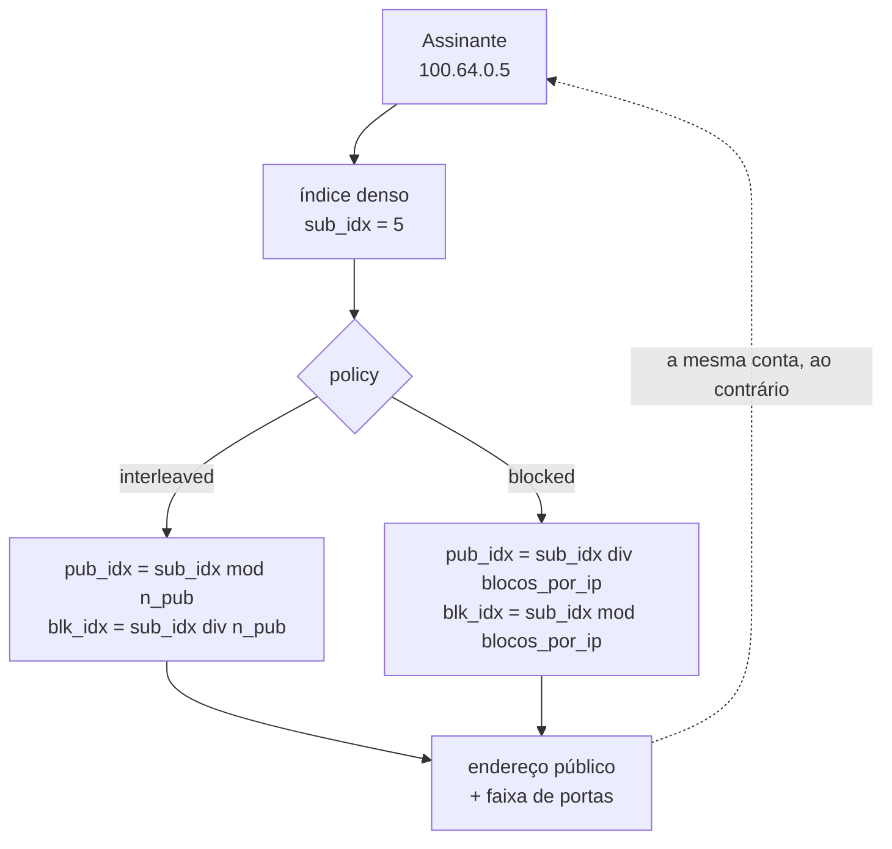

# Determinístico e BPA — conceitos e mapeamento

A aritmética que substitui a tabela de alocação, e as consequências práticas dela. Leia antes de mexer em qualquer campo de mapeamento de um pool.

# Como o mapeamento funciona

Um pool define dois **conjuntos de endereços** e um tamanho de bloco. Cada conjunto é uma lista de prefixos, possivelmente não contíguos, apresentados como um espaço de índices denso `[0, quantidade)`.

## Regras que o mapeamento impõe

* **Prefixos dentro de um conjunto não podem se sobrepor.** Sobreposição quebra a bijeção endereço↔índice, e bijeção quebrada significa **um assinante registrado como outro** — falha de conformidade legal, não apenas bug. Prefixos sobrepostos são recusados na configuração.
* `**block-size**` **precisa ser potência de dois.**
* A capacidade de um pool não passa de 2^28 assinantes.

## Por que `interleaved` é o padrão

Com `interleaved`, assinantes consecutivos caem em endereços públicos **diferentes**. Se um endereço público entrar em blacklist, o dano se espalha fino em vez de derrubar um bairro inteiro atrás de uma OLT.

Com `blocked`, vizinhos ficam no mesmo endereço público — útil quando se quer concentrar, mas concentra também o risco de reputação.

# A consequência que mais derruba rede

:::warning
**O mapeamento é aritmético, não uma tabela.** Não existe registro de alocação para consultar — e isso significa que **mudar a definição do pool muda a função**.

:::

Não ter tabela é o ponto inteiro do modo determinístico: é o que dispensa o log de alocação e, junto com isso, o que deixa as duas direções de tráfego serem fatiadas entre workers sem lock nenhum.

Acrescentar um prefixo público move **todos** os assinantes naquele instante e encerra todas as sessões do pool. Nada é corrompido, respostas passadas continuam resolvíveis, mas:

* todos os clientes caem ao mesmo tempo;
* a máquina não reporta nada de anormal, porque nada de anormal aconteceu.

Por isso o `commit` recusa mudanças assim até que sejam pedidas pelo nome, com `**commit remap**`. E por isso a conta — quantos assinantes se movem, e para onde dois deles vão — sai no `commit check`, antes de qualquer coisa acontecer, e de novo na recusa do `commit`.

# Sharding: por que o handoff existe

O estado de sessão e o bitmap de portas por assinante são **por worker e sem lock**. Isso só é seguro se **as duas direções de um assinante chegarem ao mesmo worker** — e o RSS da NIC não dá essa garantia: a saída faz hash no endereço privado, a entrada no público.

O equipamento resolve isso encaminhando o pacote ao worker dono do assinante, antes de traduzir — e isso é verificado sobre pacotes reais, não sobre contadores.

# Determinístico e BPA: duas formas de CGNAT por bloco

Os dois dão a cada assinante um **bloco contíguo de portas**, em vez de um registro por fluxo. O que muda é como o bloco é atribuído, e com isso o que precisa ser registrado:

* **Determinístico** — o bloco sai de uma **fórmula** sobre a configuração do pool. Para achar quem usava um IP e uma porta basta a conta, sem log nenhum de alocação. É o `mode deterministic`.
* **BPA** — *Bulk Port Allocation* — os blocos são **alocados dinamicamente**, sob demanda: o assinante recebe uma primeira alocação e ganha mais blocos em degraus, conforme enche os que tem. Cada alocação e cada liberação vira um registro, e são esses registros que respondem quem usava a porta. É o `mode dynamic`, com `block-size` como degrau e `max-blocks` como teto.

Os comandos `show bpa ...` e os contadores do dataplane usam o nome `bpa` para os dois modos. É o nome do módulo que faz as duas coisas, e continua assim para não quebrar scripts e caixas instaladas, mas não quer dizer que um pool determinístico seja BPA.

|     | Determinístico (`mode deterministic`) | BPA (`mode dynamic`) |
|-----|-------------------------------------|--------------------|
| Como o bloco é atribuído | por fórmula                         | sob demanda        |
| Log de alocação | **nenhum**                          | um registro IPFIX por bloco |
| Endereços públicos necessários | todos os assinantes precisam caber  | sobreassinatura possível |
| Prova para autoridade | algoritmo + configuração vigente (trilha) | os registros IPFIX |
| Blocos estendidos | não                                 | sim — assinante que enche o bloco recebe outro |

200 mil assinantes em determinístico com blocos de 512 portas exigem um `/21` público. Em dinâmico com sobreassinatura, bem menos.

# Tráfego que não é traduzido

O `bypass` faz um prefixo sair sem tradução — e, o que importa tanto quanto, **sem alocar nada**.

A segunda metade é a que costuma faltar em outros equipamentos: um bypass aplicado *depois* da alocação sai sem tradução, mas já consumiu uma porta do bloco de um assinante que nunca precisou dela. Aqui as duas propriedades são verificadas sobre o pacote.

# O que muda sem reconstruir o pool

Ver a página de configuração de pool. A regra: **muda o mapeamento → reconstrói; não muda → aplica no lugar**.

Isso não é otimização, é correção. Derrubar a base inteira de assinantes para desligar um ALG, limitar uma máquina infectada ou dar uma porta de entrada a um cliente não é mudança que alguém pediria.

# Ver também

* [Configuração de pool](/doc/configuracao-de-pool-btyS572Ih6) — onde a teoria vira campo configurável
* [Logging IPFIX e trilha de auditoria](/doc/logging-ipfix-e-trilha-de-auditoria-lREEjJu1Bq) — a consequência legal do modo escolhido
