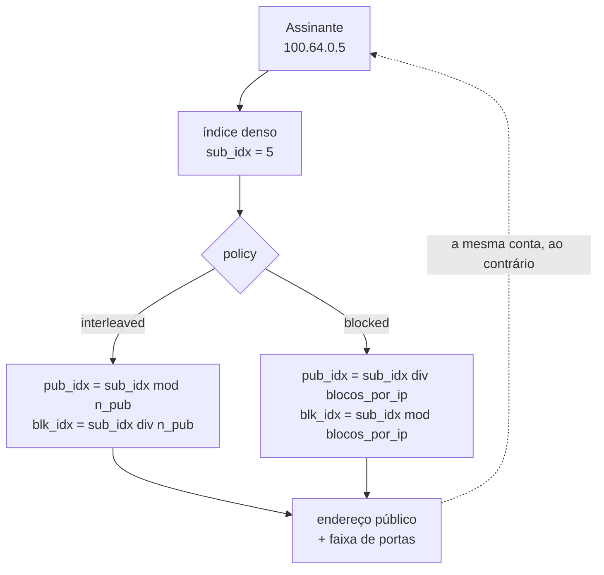

# Determinístico e BPA — conceitos e mapeamento

Como o bloco de portas de um assinante é decidido em cada um dos dois modos de pool, e as consequências práticas disso. Leia antes de escolher o modo de um pool ou de mexer em qualquer campo de mapeamento.

# Determinístico e BPA: duas formas de CGNAT por bloco

Os dois dão a cada assinante um **bloco contíguo de portas**, em vez de um registro por fluxo. O que muda é como o bloco é atribuído, e com isso o que precisa ser registrado:

* **Determinístico** — o bloco sai de uma **fórmula** sobre a configuração do pool. Para achar quem usava um IP e uma porta basta a conta, sem log nenhum de alocação. É o `mode deterministic`.
* **BPA** — *Bulk Port Allocation* — os blocos são **alocados dinamicamente**, sob demanda: o assinante recebe uma primeira alocação e ganha mais blocos em degraus, conforme enche os que tem. Cada alocação e cada liberação vira um registro, e são esses registros que respondem quem usava a porta. É o `mode dynamic`, com `block-size` como degrau, `max-blocks` como teto e, se quiser uma primeira alocação maior que o degrau, `initial-allocation`.

BPA é **só** o modo dinâmico. Determinístico não é um tipo de BPA: o guarda-chuva dos dois é *CGNAT por bloco de portas*, e a escolha é entre determinístico e BPA.

O módulo do dataplane que faz as duas coisas se chama `bpa`, e esse nome aparece em contadores e identificadores internos para os dois modos. Continua assim para não quebrar scripts e caixas instaladas, mas não quer dizer que um pool determinístico seja BPA. Na VTY, os comandos são `show cgnat ...`.

|     | Determinístico (`mode deterministic`) | BPA (`mode dynamic`) |
|-----|-------------------------------------|--------------------|
| Como o bloco é atribuído | por fórmula                         | sob demanda        |
| Log de alocação | **nenhum** — exceto os blocos da `reserve`, registrados um a um | um registro IPFIX por bloco alocado e por bloco liberado |
| Endereços públicos necessários | todos os assinantes precisam caber  | sobreassinatura possível |
| Prova para autoridade | algoritmo + configuração vigente (trilha), mais os registros dos blocos da reserva | os registros IPFIX |
| Bloco extra para quem enche o seu | só com `reserve` configurada | sim, até `max-blocks` |

200 mil assinantes em determinístico com blocos de 512 portas exigem um `/21` público. Em BPA com sobreassinatura, bem menos.

:::info
**Um pool BPA sem exportação é um pool que ninguém consegue responder.** Em BPA o registro exportado é a única prova de quem estava atrás de uma porta pública. O `commit check` e o `commit` avisam, nomeando o pool, quando um pool dinâmico — ou um determinístico com `reserve` — não tem coletor configurado. É aviso e não recusa, porque um pool montado antes do coletor existir é uma configuração correta.

:::

# Como o mapeamento determinístico funciona

Um pool define dois **conjuntos de endereços** e um tamanho de bloco. Cada conjunto é uma lista de prefixos, possivelmente não contíguos, apresentados como um espaço de índices denso `[0, quantidade)`. No modo determinístico, o bloco do assinante é esta conta:

Em BPA não há essa conta para o assinante: o bloco vem de uma lista de blocos livres, e só o registro exportado liga o bloco a quem o recebeu.

## Regras que o mapeamento impõe

* **Prefixos dentro de um conjunto não podem se sobrepor.** Sobreposição quebra a bijeção endereço↔índice, e bijeção quebrada significa **um assinante registrado como outro** — falha de conformidade legal, não apenas bug. Prefixos sobrepostos são recusados na configuração.
* Um prefixo `/0` é recusado: "todos os endereços" não é um pool.
* `block-size` **precisa ser potência de dois.**
* A capacidade de um pool não passa de 2^28 assinantes.

## Por que `interleaved` é o padrão

Com `interleaved`, assinantes consecutivos caem em endereços públicos **diferentes**. Se um endereço público entrar em blacklist, o dano se espalha fino em vez de derrubar um bairro inteiro atrás de uma OLT.

Com `blocked`, vizinhos ficam no mesmo endereço público — útil quando se quer concentrar, mas concentra também o risco de reputação.

## A reserva: a única exceção do determinístico

No determinístico, a fórmula entrega **todos** os blocos a algum assinante, então não sobra bloco para quem enche o seu: sem mais nada, o pacote é descartado. `reserve <n>` separa **n blocos de cada endereço público** da fórmula e os entrega a assinantes que encheram o próprio bloco.

Esses blocos são exatamente os que o algoritmo **não** produz, então a configuração não responde por eles: cada um é exportado como uma alocação, igual a um bloco de BPA. E a `reserve` faz parte da definição do pool — mudá-la remapeia os assinantes, porque tira capacidade da fórmula.

# A consequência que mais derruba rede

:::warning
**O mapeamento determinístico é aritmético, não uma tabela.** Não existe registro de alocação para consultar — e isso significa que **mudar a definição do pool muda a função**.

:::

Não ter tabela é o ponto inteiro do modo determinístico: é o que dispensa o log de alocação e, junto com isso, o que deixa as duas direções de tráfego serem fatiadas entre workers sem lock nenhum.

Acrescentar um prefixo público move **todos** os assinantes naquele instante e encerra todas as sessões do pool. Nada é corrompido, respostas passadas continuam resolvíveis, mas:

* todos os clientes caem ao mesmo tempo;
* a máquina não reporta nada de anormal, porque nada de anormal aconteceu.

Por isso o `commit` recusa mudanças assim até que sejam pedidas pelo nome, com `commit remap`. E por isso a conta — quantos assinantes se movem, e para onde alguns deles vão — sai no `commit check`, antes de qualquer coisa acontecer, e de novo na recusa do `commit`.

# Sharding: por que o handoff existe

O estado de sessão e o mapa de portas por assinante são **por worker e sem lock**. Isso só é seguro se **as duas direções de um assinante chegarem ao mesmo worker** — e o RSS da placa não dá essa garantia: a saída faz hash no endereço privado, a entrada no público.

O equipamento resolve isso encaminhando o pacote ao worker dono do assinante, antes de traduzir — e isso é verificado sobre pacotes reais, não sobre contadores. O dono é calculado **do próprio pacote, por aritmética**: na volta, a partir do endereço público e da porta. É isso que dispensa uma tabela compartilhada entre workers.

Com `cgnat-workers <n>`, em `system` > `cpu`, só os últimos `n` workers são donos de assinantes e traduzem; os outros apenas recebem pacotes da placa e os entregam ao dono. Sem esse ajuste, todo worker faz as duas coisas. A página [Dimensionamento e requisitos](/doc/dimensionamento-e-requisitos-f42dC4k45s) diz como escolher.

## Em BPA, o pool é fatiado por worker

Alocar blocos seria estado compartilhado entre workers. Em vez disso, os blocos de um pool dinâmico são **divididos entre os workers**, e cada worker só entrega a um assinante blocos da sua própria fatia. O worker de um assinante é fixado pelo endereço dele, não por um contador — então nada equilibra as fatias.

A consequência prática: **a sobreassinatura é medida por worker, não no pool inteiro.** Uma fatia pode esgotar enquanto outra ainda tem blocos livres, e um assinante pode ser recusado com blocos sobrando ao lado.

Por isso o `show cgnat pool` mostra, abaixo da capacidade, o número que o pool **garante** para qualquer conjunto de assinantes, quando esse número é menor que a capacidade. **É contra esse piso que se dimensiona um pool BPA.** A perda é nula quando os endereços internos são entregues em sequência a partir do início da faixa — um pool DHCP enchendo de baixo para cima — e é grande em pools pequenos com muitos workers.

:::info
Existe um mecanismo que empresta um bloco livre de um worker para outro, no ciclo de um segundo em que a caixa já expira blocos ociosos. Ele funciona, mas **vem desligado**: em laboratório, toda regulagem que serve o assinante recusado também empresta um bloco que o próximo assinante do próprio worker queria. Até isso ser medido com tráfego real, dimensione pelo piso.

:::

No determinístico não há fatia a perder: o bloco é a conta, e o piso é igual à capacidade.

# Tráfego que não é traduzido

O `bypass` faz um prefixo sair sem tradução — e, o que importa tanto quanto, **sem alocar nada**.

A segunda metade é a que costuma faltar em outros equipamentos: um bypass aplicado *depois* da alocação sai sem tradução, mas já consumiu uma porta do bloco de um assinante que nunca precisou dela. Aqui as duas propriedades são verificadas sobre o pacote.

Tráfego de um assinante destinado **à própria caixa** — o gateway, o endereço do uplink, o SSH ou o DNS dela — também passa sem tradução e sem sessão.

# O que muda sem reconstruir o pool

Ver a página de configuração de pool. A regra: **muda o mapeamento → reconstrói; não muda → aplica no lugar**. Mapeamento é prefixo, `block-size`, `ports`, `policy`, `mode`, `vrf`, `outside-vrf` e `reserve`; o resto — timeouts, ALGs, limites, MSS, bypass, encaminhamentos, `max-blocks`, `initial-allocation` — é aplicado num pool com tráfego.

Isso não é otimização, é correção. Derrubar a base inteira de assinantes para desligar um ALG, limitar uma máquina infectada ou dar uma porta de entrada a um cliente não é mudança que alguém pediria.

# Ver também

* [Configuração de pool](/doc/configuracao-de-pool-btyS572Ih6) — onde a teoria vira campo configurável
* [Logging IPFIX e trilha de auditoria](/doc/logging-ipfix-e-trilha-de-auditoria-lREEjJu1Bq) — a consequência legal do modo escolhido
* [Quando o bloco de um assinante enche](/doc/quando-o-bloco-de-um-assinante-enche-kb1sJTtCKx) — `max-blocks`, `reserve` e o que o operador vê
* [Alta disponibilidade](/doc/alta-disponibilidade-Zc1pBKocic) — por que a fórmula dispensa sincronismo, e por que BPA não tem essa garantia
