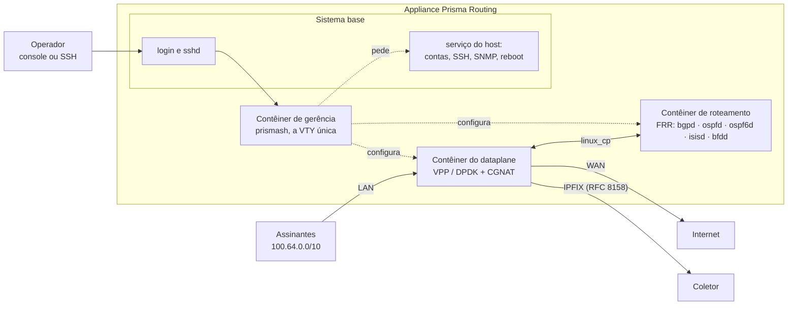

# Prisma Routing — visão geral

Roteador por software com CGNAT embutido, construído sobre **VPP/DPDK** no plano de dados e **FRR** no plano de controle, entregue como appliance Debian instalável a partir de uma ISO. Esta página diz o que o produto é, do que é feito e o que ele deliberadamente não faz — para quem está avaliando ou precisa explicar a caixa a alguém.

O diferencial é o **CGNAT por bloco de portas**: em vez de registrar cada fluxo NAT, o equipamento dá a cada assinante um **bloco contíguo de portas**. Isso reduz o log de terabytes para um registro por bloco com **BPA** (*Bulk Port Allocation*, blocos alocados sob demanda), ou para **zero** com o **determinístico** (bloco calculado por fórmula).

## Por que bloco de portas

O Marco Civil (Lei 12.965/2014) exige um ano de guarda de registros de conexão. Log por fluxo em CGNAT gera volume impraticável. Esta caixa **exporta** os registros e não guarda nenhum — quem guarda pelo ano é o coletor. As duas formas, escolhidas por pool:

* **Determinístico** (`mode deterministic`) — o endereço público e o bloco de portas são *calculados* a partir da definição do pool. Não existe evento de alocação, logo não há o que exportar. A prova entregue a uma autoridade é *"o algoritmo, mais a configuração vigente naquele instante"*, e por isso a caixa mantém uma trilha datada da configuração. A única exceção são os blocos de uma `reserve`, que a fórmula não produz e por isso são exportados um a um.
* **BPA** (`mode bpa`) — os blocos são alocados dinamicamente, sob demanda e em degraus, com um registro IPFIX por alocação e por liberação (RFC 8158), não por fluxo.

BPA é só o modo dinâmico: o determinístico não é um tipo de BPA. Os dois juntos são o *CGNAT por bloco de portas*.

## Arquitetura

Numa caixa instalada, o dataplane, o roteamento e a gerência rodam cada um no seu contêiner, sobre um sistema base Debian 12 com kernel próprio.

* **O dataplane** faz o encaminhamento e a tradução. As placas que ele usa saem do Linux e passam a ser dele.
* **O roteamento** é o FRR, que enxerga cada interface do dataplane por um par no Linux (`linux_cp`) e instala as rotas na tabela de encaminhamento do dataplane.
* **A gerência** é onde o `prismash` roda: a VTY única, que configura CGNAT, interfaces, roteamento e o sistema pela mesma interface. Cada login entra nela com a própria conta e o próprio papel.
* **O sistema base** guarda o que o contêiner de gerência não pode fazer sozinho — contas, SSH, SNMP, resolvedores, reinício e desligamento. A VTY **pede** essas mudanças a um serviço do host, que só aceita uma lista fechada de comandos. O `start shell`, restrito a administradores, abre um shell **no sistema base**, não no contêiner.
* **Os registros** de bloco que vão ao coletor por TCP, e normalmente também o IPFIX por UDP, saem de um contêiner próprio, com memória limitada, para que um coletor lento ou a reposição de um arquivo de transbordo não custem pacotes ao dataplane. Sem esse contêiner no ar, o dataplane volta a enviá-los ele mesmo em cerca de um segundo.
* **O PPPoE**, quando configurado, roda num quinto contêiner, com limites de memória próprios: uma falha dele não leva o encaminhamento, o roteamento nem a VTY junto. Uma caixa sem PPPoE não o inicia.

Toda mudança no dataplane vai pela sua API binária, por uma conexão aberta no início de cada sessão da VTY e mantida enquanto ela dura — não pela linha de comando de texto do dataplane, que sai com código zero mesmo quando falha.

Além do CGNAT de IPv4, a mesma caixa faz [**NAT64**](/s/wiki/doc/nat64-assinantes-so-ipv6-no-mesmo-espaco-publico-4Se191EJRd) (assinantes só IPv6 saindo pelo mesmo espaço público, nos mesmos blocos de portas) e pode **terminar assinantes PPPoE**, autenticados por RADIUS e traduzidos pelo CGNAT. O monitoramento é por SNMP, e uma [API gRPC de gerência](/s/wiki/doc/api-de-gerencia-grpc-para-quem-integra-TCbE6aUHgs), desligada por padrão, permite que um sistema externo configure e leia a caixa pelas mesmas regras da VTY.

:::info
Se o contêiner de gerência não estiver de pé, o login cai na VTY do próprio sistema base, como antes. Uma caixa com esse contêiner parado continua acessível.

:::

## Dimensionamento

200 mil assinantes em modo determinístico com blocos de 512 portas exigem um `/21` de IPv4 público. BPA com sobreassinatura precisa de bem menos.

O mínimo é **6 GB de RAM** (8 recomendados) e uma CPU com **SSE4.2**. Abaixo de 6 GB a caixa sobe e não encaminha nada. A memória que o CGNAT recebe para sessões é um número que você define.

## Estado por componente

| Componente | Estado |
|------------|--------|
| Núcleo de mapeamento determinístico | Verificado contra o modelo de referência em Python, mapeamento a mapeamento, o pool inteiro |
| Dataplane (tradução, handoff, modo BPA, fragmentos, erros ICMP, estado TCP) | Verificado com tráfego injetado e real |
| Roteamento (BGP, OSPF, IS-IS, BFD, política de roteamento) | Verificado — rotas chegam à FIB do VPP |
| Logging IPFIX (UDP e TCP) | Verificado com coletor decodificando |
| VTY (`prismash`) | Candidata, `commit`, `rollback`, papéis; cada linha é recusada onde é digitada, inclusive as de roteamento |
| Appliance (ISO, kernel, contêineres, tuning) | Cada versão que publica ISO é instalada num disco e reinicializada a partir dele antes de sair, também numa máquina virtual sem páginas de 1 GB; o self-test reporta pronto |
| **Alta disponibilidade** | **Ativo/standby implementado**: VRRP na interface do dataplane, em IPv4 e em IPv6 (um pool NAT64 também troca de caixa); o teste de aceitação (uplink arrancado, dataplane parado, dataplane morto) passa, com todo assinante mantendo endereço público e bloco. Sessões **não** são sincronizadas: conexões em curso caem |
| **Throughput** | **Bits por segundo NÃO medidos** — isso exige uma placa que o DPDK dirija nativamente. O custo de cada pacote em ciclos de CPU nos nós de tradução é medido |

O projeto permanece em `0.x.x` até ser declarado pronto para produção. Mudanças incompatíveis são permitidas e vêm anunciadas.

:::info
**Números medidos em máquina virtual não são capacidade.** Com placa virtio, o que se mede é o hipervisor, não a caixa. Nenhum número de vazão é afirmado até ser medido em placa real.

:::

## Ausências deliberadas

Não são lacunas — são decisões registradas:

* **Sincronismo de sessão entre as caixas de um par** — não existe, e o custo é o motivo: numa caixa de 200 mil assinantes, replicar toda criação e remoção de sessão é um fluxo comparável ao próprio log. O ativo/standby existe e preserva endereço e bloco; conexões em curso caem.
* **Números de throughput** — nada é afirmado sem medição em hardware.
* **Log por fluxo** — recusado. É exatamente o que o bloco de portas existe para evitar.
* **NPTv6 e DPI** além do que um ALG precisa reescrever — fora de escopo.
* **Migração graciosa de pool** — daria dois mapeamentos para um assinante, e a aritmética reversa não saberia distingui-los.

# Ver também

* [Determinístico e BPA — conceitos e mapeamento](/s/wiki/doc/deterministico-e-bpa-conceitos-e-mapeamento-uh9nF6sRaa) — a aritmética por trás
* [Alta disponibilidade](/s/wiki/doc/alta-disponibilidade-Zc1pBKocic) — o par, o que a troca preserva e o que ela derruba
* [Dimensionamento e requisitos](/s/wiki/doc/dimensionamento-e-requisitos-f42dC4k45s) — RAM, CPU e endereços públicos para o seu caso
* [Primeiros passos](/s/wiki/doc/primeiros-passos-TAWDdSrYG7) — onde isso vira uma máquina no ar
