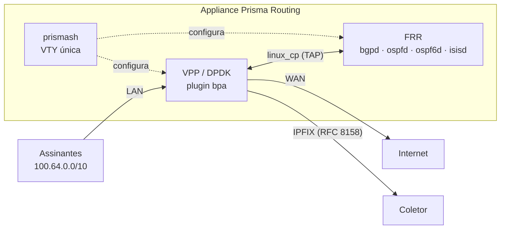

# Prisma Routing — visão geral

Roteador por software com CGNAT embutido, construído sobre **VPP/DPDK** no plano de dados e **FRR** no plano de controle, entregue como appliance Debian instalável a partir de uma ISO.

O diferencial é o **BPA** (*Bloco de Portas Alocadas*): em vez de registrar cada fluxo NAT, o equipamento aloca um **bloco contíguo de portas por assinante**. Isso reduz o log de terabytes para um registro por bloco — ou para **zero**, no modo determinístico.

## Por que BPA

O Marco Civil (Lei 12.965/2014) exige um ano de guarda de registros de conexão. Log por fluxo em CGNAT gera volume impraticável. Esta caixa **exporta** os registros e não guarda nenhum — quem guarda pelo ano é o coletor. Com BPA:

* **Modo determinístico** — o endereço público e o bloco de portas são *calculados* a partir da definição do pool. Não existe evento de alocação, logo não há o que exportar. A prova entregue a uma autoridade é *"o algoritmo, mais a configuração vigente naquele instante"*.
* **Modo dinâmico** — o bloco é alocado sob demanda, com um registro IPFIX por alocação (RFC 8158), não por fluxo.

## Arquitetura

* **VPP** faz a tradução, no plugin `bpa`.
* **FRR** cuida do roteamento, alcançado pelo TAP do `linux_cp`.
* **prismash** é a VTY única — configura CGNAT e roteamento pela mesma interface.

A VTY conversa com o dataplane via **vat2**, um processo por chamada sobre a API binária — não é conexão persistente, e não é a linha de comando de texto do dataplane, que sai com código zero mesmo quando falha.

## Dimensionamento

200 mil assinantes em modo determinístico com blocos de 512 portas exigem um `/21` de IPv4 público. Modo dinâmico com sobreassinatura precisa de bem menos.

## Estado por componente

| Componente | Estado |
|------------|--------|
| Núcleo de mapeamento BPA | Verificado contra o modelo de referência em Python, mapeamento a mapeamento, o pool inteiro |
| Dataplane (tradução, handoff, modo dinâmico, fragmentos, erros ICMP, estado TCP) | Verificado com tráfego injetado e real |
| Roteamento (BGP, OSPF, IS-IS) | Verificado — rotas chegam à FIB do VPP |
| Logging IPFIX (UDP e TCP) | Verificado com coletor decodificando |
| VTY (`prismash`) | Funcionando, com completar por TAB e `?` contextual |
| Appliance (ISO, tuning, systemd) | ISO dá boot limpo, self-test reporta pronto |
| **HA / failover** | **NÃO implementado** |
| **Throughput** | **NÃO medido** — nenhum número de desempenho foi aferido |

O projeto permanece em `0.x.x` até ser declarado pronto para produção. Mudanças incompatíveis são permitidas e vêm anunciadas.

## Ausências deliberadas

Não são lacunas — são decisões registradas:

* **Sincronismo de sessão entre as caixas de um par** — recusado por custo: numa caixa de 200 mil assinantes, replicar toda criação e remoção de sessão é um fluxo comparável ao próprio log. O ativo/standby existe e preserva endereço e bloco; conexões em curso caem.
* **Números de throughput** — nada é afirmado sem medição em hardware.
* **Log por fluxo** — recusado. É exatamente o que o BPA existe para evitar.
* **NPTv6 e DPI** além do que um ALG precisa reescrever — fora de escopo.
* **Migração graciosa de pool** — daria dois mapeamentos para um assinante, e a aritmética reversa não saberia distingui-los.

# Ver também

* [BPA — conceitos e mapeamento](/doc/bpa-conceitos-e-mapeamento-uh9nF6sRaa) — a aritmética por trás
* [Primeiros passos](/doc/primeiros-passos-TAWDdSrYG7) — onde isso vira uma máquina no ar
