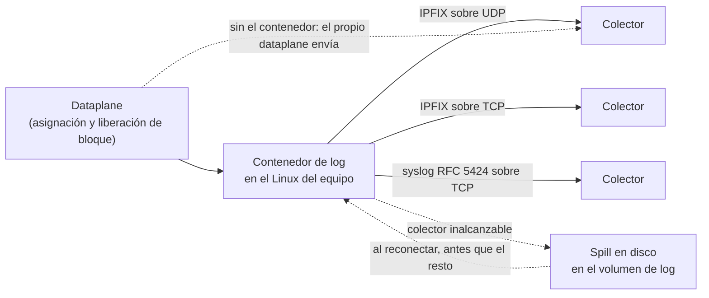
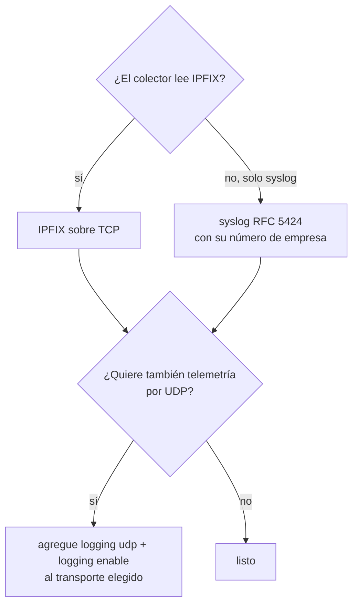
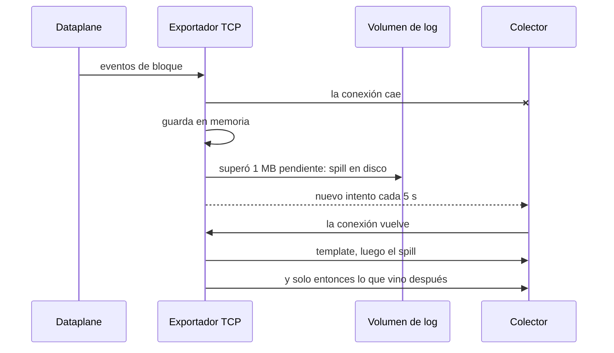

# Adónde van los registros: colector, transporte y retención

Para quien opera CGNAT y necesita responder a una orden judicial: dónde quedan los registros de quién usaba cada IP pública y puerto, cómo salen del equipo y qué pasa cuando el colector se cae. Los comandos en detalle están en [Logging IPFIX y trail de auditoría](/s/wiki-es/doc/logging-ipfix-y-trail-de-auditoria-LHGHuvEHJy); aquí está el porqué de cada elección.

# El problema

El Marco Civil da Internet (Ley 12.965/2014 de Brasil; los requisitos de retención varían según el país) exige que el proveedor guarde durante un año los registros de conexión. Con CGNAT, identificar a un suscriptor a partir de *(IP pública, puerto, instante)* exige el mapeo que era válido en ese instante.

En modo determinístico ese mapeo es una fórmula: la configuración vigente responde, y lo que hay que guardar es el trail de configuración. En modo BPA, y en los bloques que un pool determinístico entrega desde la `reserve`, el bloque se elige en el momento en que el suscriptor lo pide, y **el registro exportado es la única prueba** de quién tenía un puerto público.

Ese registro tiene que existir en algún lugar durante un año, tiene que sobrevivir a una caída del colector y tiene que poder leerse sin ayuda de quien lo escribió.

# La idea: el equipo exporta, el colector guarda


:::info
**El equipo no guarda registros de conexión.** Los exporta a medida que ocurren, y quien guarda el año que exige la ley es su colector. En el volumen de log del equipo quedan solo el trail de configuración y el spill (desborde) del exportador, los registros que un colector caído todavía no recibió.

:::



El registro es por **bloque**, no por flujo (RFC 8158): uno en la asignación, uno en la liberación, uno cuando se agotan los puertos. El orden de magnitud, en modo BPA, es de unos 80 MB por día para 200 mil suscriptores, contra cerca de 1,6 GB por día de un NAT que registrara cada flujo. Un año de retención queda en el orden de las decenas de gigabytes, y es **en el disco del colector**, no del equipo.

## Tres transportes, y qué pide cada uno

Los tres pueden estar activos al mismo tiempo, y todos se configuran en `nat` > `cgnat`:

| Transporte | Comando | Por dónde sale | Qué tiene que estar correcto | Sirve para |
|------------|---------|----------------|------------------------------|------------|
| IPFIX sobre UDP | `logging udp <colector> src <origen> [port <n>]` y `logging enable` | por el contenedor de log, desde un socket atado a la dirección `src`; por el propio dataplane cuando el exportador está en una VRF, cuando el contenedor no puede usar el `src` o cuando no está en marcha | el colector alcanzable desde el `src`; `src` obligatorio, una dirección que el colector reconozca como de este equipo; puerto 4739 si no se indica nada | telemetría: bajo congestión pierde registros sin aviso, y no lleva la identidad del suscriptor |
| IPFIX sobre TCP | `logging tcp <colector> [port <n>]` | por el Linux del equipo, desde el contenedor de log (desde el propio dataplane si el contenedor no está en marcha) | el colector alcanzable por las rutas del Linux; puerto 4739 si no se indica nada | **retención legal**: spill en disco, reenvío en orden, identidad del suscriptor en el registro |
| syslog RFC 5424 sobre TCP | `logging syslog <colector> enterprise <n> [port <n>] [facility <0-23>] [severity <0-7>]` | por el Linux del equipo, por el mismo camino del IPFIX sobre TCP | el colector alcanzable por las rutas del Linux; puerto 601 si no se indica nada; un número de empresa (PEN) de la IANA, obligatorio | el colector que solo lee syslog, que es la mayoría; misma garantía que el IPFIX sobre TCP |

Los dos transportes TCP abren la conexión **desde el equipo**: lo que tiene que estar abierto es el puerto del colector, en su firewall y en cualquiera que haya en el camino. Un intento que falla se repite cada 5 segundos.

`logging tcp` no cuenta como destino para `logging enable`: son dos caminos separados, y `enable` activa el de UDP.




:::warning
**Una retención legal solo por UDP es una retención con huecos.** Un datagrama perdido es un registro perdido, sin nada en el equipo ni en el colector que lo delate, y perder un `natEvent 17` (la liberación) hace que la consulta natural apunte al suscriptor equivocado. Use TCP o syslog para la retención; el UDP, si quiere, al lado.

:::

# Qué tiene que guardar el colector

Guardar las líneas no basta. Para que un registro responda a una orden judicial dentro de once meses, el colector tiene que guardar también lo que les da sentido:

| Qué | Por qué |
|-----|---------|
| **El template IPFIX** de cada exportador | sin él los registros son bytes. El equipo envía el template al comienzo de cada conexión TCP y lo repite cada minuto; el registro de bloque sobre TCP usa el template **258**. Un colector con el 256 de una versión antigua en caché simplemente espera el nuevo |
| **El marcador de reinicio**, `systemInitTimeMilliseconds` (IE 160) | el último valor por exportador y dominio de observación. Mientras no cambia, una asignación sin liberación sigue vigente; cuando cambia, toda asignación abierta de antes terminó en ese reinicio. Es lo que distingue un equipo que se cayó de uno que sigue reteniendo el bloque. En syslog llega como la línea `BOOT-MARKER`. Por UDP el equipo lo reenvía cada 30 segundos; por TCP y por syslog va una vez por boot, al comienzo del flujo |
| **El número de empresa** de cada exportador syslog | cada línea lleva el dato estructurado como `cgnat@<número>`, y por él el colector reconoce de quién es el formato. El número es suyo, no tiene valor por defecto, y el equipo rechaza `logging syslog` sin él |
| **La identidad del suscriptor** | `subscriberId` en syslog, elemento 371 `userName` en IPFIX sobre TCP. Viene siempre, con el nombre de la tabla de identidad o `unknown`. Es un dato personal, y es la razón por la que el log necesita protección. El UDP no la lleva |
| **El instante de cada registro, en UTC** | es el instante del evento con precisión de milisegundo, igual en los dos formatos, lo que permite poner IPFIX y syslog lado a lado |

La liberación repite la identidad que dijo la asignación, así que cualquiera de los dos registros de un bloque responde por sí solo. Aun así, guarde los dos: la liberación es lo que cierra el intervalo, y sin ella la pregunta *"¿quién tenía este puerto a las 14 h?"* tiene dos respuestas.

# Qué pasa cuando el colector desaparece

En los transportes TCP, un colector caído no cuesta registros mientras haya dónde escribir:



* **Cola.** El dataplane pone cada evento en una cola por núcleo de trabajo, con un tope de 8192 eventos, y el contenedor de log los lee de una cola propia, con un tope de 65536. Si el exportador se queda atrás más allá de eso, el excedente se descarta y se cuenta, nunca se acumula sin límite.
* **Spill.** Con el colector caído, lo que el socket no aceptó queda en memoria hasta superar 1 MB; a partir de ahí va a un archivo en el volumen de log, uno por transporte: `/var/log/prisma-routing/ipfix-spill.bin` y `/var/log/prisma-routing/syslog-spill.bin`. Un colector conectado y lento no pierde la conexión: lo que espera va al archivo cuando pasa 10 segundos sin aceptar nada, o cuando supera 8 MB. **Cada archivo se detiene en 256 MB.**
* **Reenvío.** Al reconectar, el archivo vuelve **antes** que cualquier registro nuevo, de a un trozo por vez, porque una asignación tiene que llegar al colector antes que su liberación. Cada registro mantiene la marca del instante en que ocurrió el evento, no la de la entrega.
* **Descarte.** Solo ocurre cuando no hay dónde escribir (el archivo en su techo de 256 MB, el volumen lleno, o el archivo imposible de abrir), y se cuenta. Al detenerse el equipo, cuando el contador muere junto con el proceso, la pérdida se escribe en el registro del sistema.

El límite honesto del TCP: los bytes que el socket aceptó cuentan como enviados, y los pocos registros escritos en el instante en que la conexión cae pueden perderse. El IPFIX sobre TCP no tiene confirmación de recepción. Es mucho mejor que el UDP, pero no es absoluto, y por eso los contadores quedan a la vista.

## Dimensionar el volumen de log

El instalador pregunta cuántos gigabytes darle al volumen del trail y del spill; el valor por defecto es 30 GB. En una instalación sin preguntas, la respuesta va en `prisma-routing.log-gb=<n>` o `log-gb` en el archivo de respuestas.

**El tamaño del volumen no cambia cuánto tiempo aguanta el equipo un colector inalcanzable.** El spill de cada transporte se detiene en 256 MB, sea cual sea el volumen, y lo que pasa de eso se descarta y se cuenta. El volumen guarda esos archivos, el trail de configuración y, en un equipo que es el BNG, el historial de sesiones PPPoE; nada ahí es el historial de conexiones.

Lo que aguanta el techo, a partir de la estimación de cerca de 80 MB por día para 200 mil suscriptores en modo BPA:

| Suscriptores en modo BPA | Spill por día, aproximado | Lo que aguantan 256 MB |
|--------------------------|--------------------------:|------------------------|
| 50 mil                   | 20 MB                     | cerca de 12 días       |
| 200 mil                  | 80 MB                     | cerca de 3 días        |
| 1 millón                 | 400 MB                    | menos de un día        |

Es una estimación de orden de magnitud, con un bloque renegociado unas cinco veces por día por suscriptor activo; su rotación de bloques cambia el número. Una línea syslog es texto y ocupa varias veces lo que ocupa un registro IPFIX: por syslog, el mismo techo aguanta bastante menos tiempo. En modo determinístico sin `reserve` casi nada se exporta, y el volumen sirve prácticamente solo al trail.


:::warning
**Un colector caído por más tiempo del que aguanta el techo es pérdida de registros**, y un volumen lleno también. El spill pasa a descartarse (contado, pero descartado), y esos registros no llegan nunca al colector. Monitoree el colector, no solo el equipo: el spill existe para cubrir una caída corta, no para sustituir al colector.

:::

Si el equipo tiene un segundo disco, el instalador ofrece espejar ese volumen en él. Lo que hay ahí son registros que el colector todavía no recibió, y un disco que se los lleva abre un hueco en el año de retención que nada en el equipo recompone.

# La consecuencia práctica: verificar

```
show cgnat logging
```

La pantalla tiene una parte para el UDP y una para cada transporte TCP. Qué leer en cada una:

| Línea | Qué responde |
|-------|--------------|
| `state` | si la exportación por UDP está activa |
| `exporter` | adónde va el UDP. `none: nothing is sent over UDP` quiere decir que nada sale por UDP, **incluso con** `**state enabled**` |
| `sender` | quién envía el UDP: el contenedor de log, o el dataplane y por qué |
| `exhaustion` | cuántas repeticiones de puertos agotados no se volvieron registro: va uno por suscriptor cada 10 segundos |
| `queue`, `export` | eventos descartados con una cola llena, la de un núcleo del dataplane o la del contenedor de log |
| `boot marker` | el template del marcador, cuántos se enviaron y el instante de inicio de esta encarnación del dataplane |
| `TCP streams carried by` | quién lleva los dos transportes TCP: `the log container` o `the dataplane` |
| `TCP transport` y `syslog transport` | cada una con el colector y el estado de la conexión: `connected`, `connecting` o `disconnected`; un transporte desactivado aparece como `disabled` |
| `enterprise` | en syslog: el número de empresa, la facility y la severity en uso |
| `spill` | por transporte: bytes que fueron al disco, cuántos ya volvieron al colector y cuántos se descartaron, desde el inicio |
| `file` | por transporte: los bytes en el archivo de spill ahora, el techo de 256 MB y cuánto ya rechazó el techo |

Qué buscar:

* `**disconnected**` **por más de algunos segundos**: el colector está caído o es inalcanzable por las rutas del Linux. Los bytes en disco en la línea `spill` suben mientras eso dure.
* **Descartados en la línea** `**spill**` **por encima de cero**: hubo registros perdidos. Revise el espacio del volumen de log y el colector.
* **La línea** `**file**` **acercándose a 256 MB**: el colector lleva caído demasiado tiempo, y lo que venga después del techo se va a perder.
* **Bytes en disco y reenviados iguales, con la conexión** `**connected**`: el colector volvió y recibió todo lo que había quedado atrás.

Para la exportación por UDP, el autotest de arranque compara lo que pide la configuración con lo que tiene el dataplane y falla cuando no coinciden. Y `commit check` advierte, nombrando el pool, cuando un pool BPA (o determinístico con `reserve`) queda en un equipo en el que nada exporta.

El propio equipo también registra cuándo un colector desaparece y cuándo vuelve: `show log kind collector`. Ese registro va a los colectores de syslog de `system` > `logging`, y por SNMP los avisos `recordsTransportChange` y `recordsLost` le dicen lo mismo a la NMS.

Antes de dar la retención por montada, haga la prueba que importa: con tráfico de suscriptores pasando, tire el colector por algunos minutos, tráigalo de vuelta, y verifique en el **colector** que las asignaciones y liberaciones del intervalo llegaron.

# Ver también

* [Logging IPFIX y trail de auditoría](/s/wiki-es/doc/logging-ipfix-y-trail-de-auditoria-LHGHuvEHJy) — los comandos, el formato del registro, la identidad del suscriptor y el trail de configuración
* [Determinístico y BPA — conceptos y mapeo](/s/wiki-es/doc/deterministico-y-bpa-conceptos-y-mapeo-LgBbN0YDcl) — por qué un modo necesita exportación y el otro casi no
* [Instalación del appliance](/s/wiki-es/doc/instalacion-del-appliance-MgWUcARKzM) — el tamaño del volumen de log y el espejo en dos discos
* [Dimensionamiento y requisitos](/s/wiki-es/doc/dimensionamiento-y-requisitos-FuEOaBC4vd) — el disco del equipo y el volumen del log
* [Monitoreo y SNMP](/s/wiki-es/doc/monitoreo-y-snmp-zQ9bTfrh8z) — seguir el equipo desde la NMS
