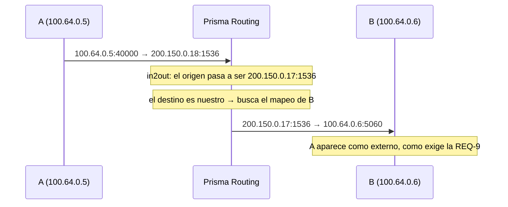

# Comportamiento NAT y compatibilidad

Si las aplicaciones de sus suscriptores van a funcionar detrás de este CGNAT, y qué cambia cuando usted endurece el filtrado. Para quien recibe tickets de juegos, cámaras, VoIP o peer-to-peer.

# Este equipo es full cone

Son tres propiedades, y las tres están presentes:

| Propiedad | RFC 4787 | Qué significa en la práctica |
|-----------|----------|------------------------------|
| Mapeo independiente del destino | REQ-1    | un socket interno mantiene el mismo puerto externo con quien sea que hable |
| Filtrado independiente del destino | REQ-8    | cualquier host puede alcanzar un mapeo abierto |
| Hairpinning | REQ-9    | un suscriptor alcanza a otro por la dirección pública |

Esto no es una promesa: cada una se verifica **sobre el paquete**, y la tercera entregando un paquete proveniente de un host con el que el suscriptor nunca habló.

# Un suscriptor, una dirección pública

Una cuarta propiedad, el **emparejamiento de direcciones** (RFC 4787 REQ-2, que la RFC 6888 convierte en el estándar exigido a un CGN): todo el tráfico de un suscriptor sale por la **misma** dirección pública. Un suscriptor que envía desde una dirección y recibe en otra rompe las aplicaciones que verifican de dónde vino la respuesta, porque ellas ven dos pares diferentes donde hay uno solo.

| Dónde | Cómo queda |
|-------|------------|
| pool determinístico sin `reserve` | siempre emparejado: el suscriptor tiene un solo bloque, y la fórmula lo coloca en una sola dirección |
| pool dinámico, o determinístico con `reserve` | **preferencia**, no regla. Cuando el suscriptor llena el bloque y obtiene otro (hasta `max-blocks`), o recibe varios de una vez con `initial-allocation`, el equipo busca primero un bloque libre en la dirección pública que él ya usa. Si no hay, toma uno en otra dirección en lugar de rechazar — rechazar le costaría tráfico al cliente |

Por ser preferencia, el equipo muestra la tasa de **su** pool en lugar de prometer una. En `show cgnat blocks`, todo pool en el que un suscriptor puede obtener más de un bloque trae una línea que empieza por `RFC 4787 REQ-2 paired:`, con cuántas extensiones cayeron en la dirección del propio suscriptor frente al total. Una tasa lejos del total es un pool ajustado de direcciones públicas, no un defecto: es el número para llevar a la conversación sobre capacidad.

# Hairpinning: el síntoma que nadie atribuye al CGNAT

Dos suscriptores detrás del mismo CGNAT alcanzándose por la dirección pública.



Sin hairpinning el paquete sale traducido correctamente y se enruta hacia una dirección que el propio equipo posee, sin nada que lo envíe de vuelta. El síntoma es específico y difícil de atribuir:

* una cámara que responde desde la calle pero no desde el vecino;
* un servicio alojado en casa que funciona para todo el mundo **menos** para quien es del mismo proveedor;
* un juego que hospeda partidas para todos, menos para los jugadores del mismo ISP.

B ve a A por la dirección **pública** de A, como exige la RFC. Mostrar la dirección privada filtraría la topología interna y rompería la respuesta, porque B respondería a una dirección que no sabe enrutar.

Un paquete dirigido a una de nuestras direcciones públicas **sin sesión en ese puerto** se descarta, no se reenvía — y se cuenta por separado de un hairpin exitoso, para que ambos sean distinguibles.

# Filtrado: quién puede responder

Dos modos, por pool:

| Modo | Quién alcanza un mapeo abierto | Costo |
|------|--------------------------------|-------|
| `filter endpoint-independent` (predeterminado) | cualquiera                     | el tráfico no solicitado llega al suscriptor |
| `filter address-dependent` | solo el remoto que el suscriptor contactó | algunas aplicaciones peer-to-peer dejan de funcionar |

```
configure
 nat
  cgnat
   pool residencial
    filter address-dependent
    exit
   exit
  exit
 commit
```

Es un ajuste **aplicado sin reconstruir**: no tira sesiones.

Un [Reenvío de puertos (port forward)](/s/wiki-es/doc/reenvio-de-puertos-port-forward-Px7qrbVWaq) queda **fuera** de este filtrado. `address-dependent` pregunta "¿el suscriptor habló con usted antes?", y en un forward la respuesta es no por definición; si entrara en el filtro, el puerto abierto funcionaría solo para quien el suscriptor respondió por última vez.


:::info
La elección es suya, no del producto. `address-dependent` reduce el escaneo y el tráfico no solicitado que llega al suscriptor; a cambio, rompe parte del peer-to-peer y de los juegos que dependen de una conexión proveniente de un tercero. `endpoint-independent` es el predeterminado porque es lo que mantiene esas aplicaciones funcionando.

:::

La verificación **no** entra en la clave de búsqueda, a propósito. Poner la dirección remota en la clave le daría al suscriptor un puerto externo diferente por destino — mapeo *dependiente* del destino — y rompería exactamente las aplicaciones peer-to-peer que este producto existe para mantener funcionando. Filtrado y mapeo son decisiones separadas, y solo la primera cambia aquí.

# Fragmentos

Un fragmento que no es el primero **no lleva encabezado de capa 4**, y por lo tanto no tiene puerto para coincidir con una sesión. Sin tratamiento se descarta, y el DNS grande, las VPN y los juegos fallan **de forma intermitente** — el síntoma más difícil de diagnosticar que existe.

VPP hace un reensamblado virtual superficial: guarda los puertos del primer fragmento y los adjunta a los siguientes. No hay nada que configurar; está activo en el camino.


:::info
Conviene saber que este tratamiento tiene un modo de falla costoso: si los puertos guardados se leen en el orden de bytes equivocado, el nodo no encuentra la sesión y abre otra — **quemando un puerto por fragmento**. Un suscriptor que fragmenta mucho agota su propio bloque por sí solo. Si usted ve un suscriptor consumiendo puertos sin tráfico que lo justifique, es la primera hipótesis a verificar.

:::

# Errores ICMP, y por qué algunos sitios no cargan

Un error ICMP — *fragmentation needed*, *time exceeded*, *destination unreachable* — no es un paquete sobre sí mismo. Lleva **dentro de él** una copia del paquete que causó el error, y es esa copia embebida la que dice de qué sesión habla. La dirección ahí dentro es la del suscriptor, privada, escrita antes de la traducción.

Un equipo que traduce el encabezado externo e ignora el interno le entrega al suscriptor una advertencia sobre una conexión que él no reconoce. Su pila la descarta, y la advertencia se pierde. Dos cosas se rompen cuando esto sucede:

| Lo que se pierde | El síntoma que llega a soporte |
|------------------|--------------------------------|
| PMTUD (*fragmentation needed*) | "algunos sitios no cargan" — la conexión se abre, intercambia poco, y se traba en el primer paquete grande |
| *time exceeded*  | el `traceroute` del suscriptor deja de funcionar |

Este equipo reescribe el paquete embebido. Y reescribe junto con él lo que casi todo el mundo olvida: el **checksum del ICMP cubre el paquete embebido completo**, incluido el checksum del encabezado IP que está ahí dentro. Traducir con el checksum incorrecto es peor que no traducir — la pila del suscriptor descarta el paquete, el PMTUD sigue roto, y el contador del equipo dice que salió bien.


:::info
Para TCP común existe una segunda red de protección, el *MSS clamp* (`tcp-mss` en el pool), que evita el problema antes de que necesite advertencia. **Dentro de un túnel no existe MSS que ajustar**, y ahí el error ICMP es la única señal que tiene el suscriptor — es el caso detallado en [Protocolos y ALG](/s/wiki-es/doc/protocolos-y-alg-EQ2SXh1xAu), con lo que le exige a usted y dónde se detiene.

:::

# El límite honesto

La sesión recuerda **una** dirección remota, actualizada con cada paquete de salida. Un puerto de origen reutilizado para dos remotos solo acepta respuesta del más reciente.

Es una aproximación, y está dicha porque quien opera merece saber dónde se detiene: rastrear el conjunto de remotos significaría estado por remoto en un camino de datos cuyo propósito es justamente no tener ninguno.

# Cómo verificar

```
show cgnat subscriber <ip-interna>
show cgnat drops
show cgnat blocks
```

Si una aplicación entrante no funciona, `show cgnat drops` separa el motivo — un paquete sin sesión en el puerto se cuenta por separado de un hairpin que salió bien. Si la queja es de una aplicación que extraña la dirección de origen, la línea `RFC 4787 REQ-2 paired:` de `show cgnat blocks` dice cuánto del pool está emparejado.

# Ver también

* [Protocolos y ALG](/s/wiki-es/doc/protocolos-y-alg-EQ2SXh1xAu) — cuando el problema no es el filtrado, sino que el protocolo lleva direcciones en el payload
* [Cuando se llena el bloque de un suscriptor](/s/wiki-es/doc/cuando-se-llena-el-bloque-de-un-suscriptor-LJuUIMODBQ) — los bloques extendidos, de donde sale la tasa de emparejamiento
* [Configuración de pool](/s/wiki-es/doc/configuracion-de-pool-Y3cACG9QHA) — `filter` y los demás campos aplicados sin reconstruir
* [Timeouts y los pisos de las RFC](/s/wiki-es/doc/timeouts-y-los-pisos-de-las-rfc-IgDiScQthb) — la otra causa común de "se desconecta solo"
