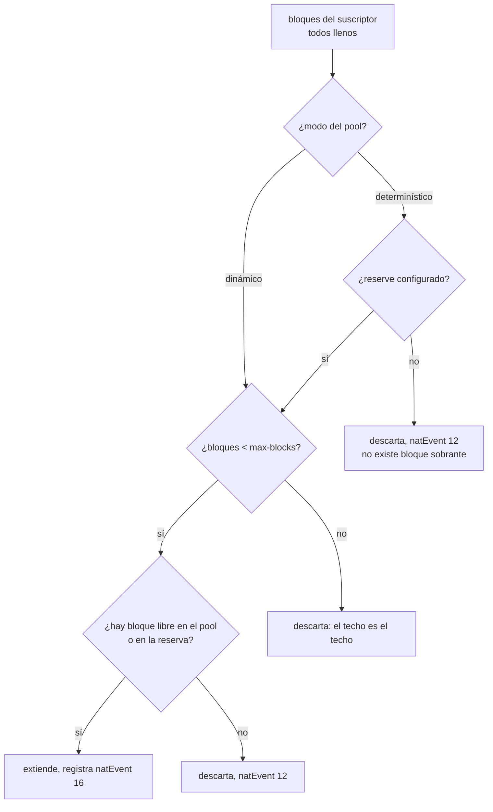

# Cuando se llena el bloque de un suscriptor

Un suscriptor que llena su propio bloque deja de navegar mientras el equipo está sano y los vecinos no sienten nada. Esta página muestra cómo descubrir si es eso, qué hacer, y cómo impedir que un host infectado consuma el pool entero.

# El síntoma

De forma predeterminada, un suscriptor que llena el bloque **es descartado**, y el log registra `natEvent 12`. Es correcto y es terrible: el cliente se queda sin internet, el equipo no reporta nada anormal, y el operador no tiene adónde apuntar cuando el cliente llama.

Lo que hace que esto sea común es que el culpable generalmente no es el cliente: un host infectado abre miles de sesiones y agota su **propio** bloque. Los vecinos que comparten la misma dirección pública no se ven afectados — es exactamente para eso que se asigna un bloque por suscriptor — y es también por eso que el CGNAT carga con la culpa de una infección del otro lado de la red de acceso.

# Descubrir si es eso

```
show cgnat subscriber 100.64.3.19
```

La respuesta trae una línea de rechazos:

```
sessions 4   refusals: ports 0, session cap 6, rate cap 0
```

Encima de esa línea vienen los bloques que tiene, cada uno con la dirección pública, el rango de puertos y cuántos están en uso — un bloque de extensión viene marcado como tal. Y cada contador de rechazo que no está en cero recibe, debajo, una línea que explica lo que significa.

Son **tres contadores separados, y cada uno lleva a una acción diferente**:

| Contador | Qué significa | Qué hacer |
|----------|---------------|-----------|
| `ports`  | el bloque del suscriptor está lleno | venda más puertos, o aumente `max-blocks` (en un pool determinístico, eso requiere `reserve`) |
| `session cap` | está en el límite configurado | el límite está funcionando, o es demasiado bajo para ese cliente |
| `rate cap` | abre sesiones más rápido de lo permitido | normalmente es una infección, no el cliente |


:::info
Un solo contador para los tres no respondería ninguna de las preguntas. Es la diferencia entre saber que "algo fue rechazado" y saber si usted vende más puertos, ajusta un límite o llama al cliente para avisarle de una infección.

:::

En un pool BPA hay un caso que ninguno de los tres contadores muestra: el suscriptor que todavía **no tiene bloque** y es rechazado porque la porción de su worker se agotó, aun con bloques libres en la porción de otro worker. Para él, `show cgnat subscriber` indica en la primera línea cuál es su worker y, debajo, que no tiene estado vivo — ningún bloque, ninguna sesión —, en lugar de la línea de rechazos. `show cgnat blocks` muestra cuántos bloques de cada porción están en uso. Lo que el pool garantiza sea cual sea la dirección, y qué hacer cuando es esto, está en [Ampliar la capacidad sin tirar suscriptores](/s/wiki-es/doc/ampliar-la-capacidad-sin-tirar-suscriptores-eHEJEg47aX).

Para encontrar quién está más cerca del límite antes de que alguien llame:

```
show cgnat top
```

Lista los suscriptores más cargados con los puertos que tiene cada uno, por ejemplo `3/512`.

# Cuántos están cerca del límite, y la alarma que avisa sola

`show cgnat top` responde **quién**. No responde **cuántos**, y esa es la pregunta que decide si usted tiene un cliente infectado o un pool mal dimensionado.

```
show cgnat pool
```

Junto con la capacidad del pool, imprime la distribución de cuánto está usando cada suscriptor de su propio bloque:

```
utilisation  2 subscriber(s) holding a block
   75-89%  1
      100%  1
alarm at     75% of a subscriber's block
```

La forma importa más que el promedio. Con 200 mil suscriptores, un pool se ve medio vacío mientras mil clientes están pegados al límite — y el promedio no muestra ni una cosa ni la otra. Lo que resuelve es la **forma**: cuántos están cerca del final del bloque, y si ese número está avanzando.


:::info
Este histograma se calcula en el momento en que usted ejecuta el comando, recorriendo los mapas de puertos que el asignador ya mantiene de todos modos. No se cuenta nada por paquete y no se toca la tabla de sesiones — ejecutar esto en un equipo cargado no cuesta tráfico.

:::

## La alarma, una vez por cruce

El histograma responde cuando usted pregunta. La alarma avisa sin que se le pregunte, y viene desactivada:

```
configure
 nat
  cgnat
   pool residencial
    utilisation-alarm 75
    exit
   exit
  exit
 commit
```

Cuando un suscriptor cruza el umbral, sale **una** línea en el log, que nombra quién es, cuánto está usando y de qué se adelanta:

```
subscriber 5 of pool residencial is 75% through its 512 ports on 200.150.10.7:
past the 75% alarm. RFC 8158 natEvent 12 would only report this once the
customer had already started losing traffic.
```

Esa última frase es la razón por la que existe la alarma. El `natEvent 12` con el que abre esta página es correcto y llega tarde: reporta el agotamiento, es decir, reporta el instante en que el cliente **empezó a perder tráfico** — cuando la llamada a soporte ya está en la cola. La alarma reporta el camino hasta ahí.

El umbral va de 1 a 100, por pool, y `no utilisation-alarm` vuelve a desactivar la alarma. La línea sale en el log del dataplane, con nivel de advertencia. Es un ajuste **aplicado sin reconstruir**: activarlo, cambiarlo o desactivarlo no tira a nadie.

Y habla **una vez por cruce**, no una vez por asignación. Después de la línea, el suscriptor puede seguir llenándose y no se dice nada más.


:::info
Esto es diseño, no ahorro. Una línea por asignación por encima del umbral es un log que nadie puede guardar — y el suscriptor que dispara la alarma es, por definición, el que está asignando más rápido, es decir, el que produciría más líneas. Diez puntos de histéresis limpian la marca, para que un suscriptor detenido exactamente sobre el umbral no genere una línea cada vez que un puerto se libera y se vuelve a tomar.

:::

La alarma se evalúa **donde se toma un puerto**, y en ningún otro lugar — la utilización solo sube ahí. La consecuencia práctica: un suscriptor que vació su bloque y nunca más asignó nada mantiene la marca levantada. No es una respuesta equivocada, es un estado detenido: la alarma habla de un suscriptor que **se está llenando**, y quien dejó de pedir puertos no se está llenando.

# Bloques extendidos

Con `max-blocks` por encima de 1 (el máximo es 255), un suscriptor cuyos bloques están todos llenos recibe **otro**. De dónde sale ese bloque depende del modo del pool:

* en un pool **dinámico** (BPA), de una lista de bloques libres — entregar el segundo es la misma operación que entregar el primero;
* en un pool **determinístico**, solo de una **reserva** separada para eso con `reserve`. Sin reserva, no existe bloque sobrante, y el suscriptor que se llena se descarta como antes.

```
configure
 nat
  cgnat
   pool residencial
    max-blocks 2
    exit
   exit
  exit
 commit
```



El techo importa tanto como la extensión: sin él, un host infectado consume el pool que necesitan todos los demás suscriptores, y el operador cambia un reclamo de cliente por una caída.

Toda extensión se registra como `natEvent 16` y su liberación como `natEvent 17`. Una extensión no es derivable de nada — ni de la fórmula, ni del primer bloque — así que un bloque que el log no registra no se puede atribuir a nadie.

## La reserva de un pool determinístico

En un pool determinístico la fórmula atribuye **todos** los bloques a alguien. Un bloque entregado como extensión sin reserva sería un bloque que la fórmula le da a otra persona — y entregarlo rompería el mapeo de esa persona sin ningún error en ninguna parte. `reserve <n>` resuelve esto quitando `n` bloques de **cada** dirección pública de la fórmula y guardándolos para extensiones:

```
configure
 nat
  cgnat
   pool residencial
    reserve 1
    max-blocks 2
    exit
   exit
  exit
 commit remap
```

`show cgnat pool` muestra la cuenta: cuántos bloques por dirección sigue usando la fórmula y cuántos quedaron guardados.


:::warning
**Activar o cambiar la reserva es un cambio de capacidad.** La fórmula pasa a tener menos bloques por dirección, el pool se reconstruye, y todas sus sesiones se caen. Por eso el `commit` común lo rechaza, y hay que pedirlo por su nombre con `commit remap`. Cuántos suscriptores pierden el bloque o cambian de lugar depende de la política del pool: ejecute `commit check` antes, que le da la cuenta exacta. Hágalo en una ventana de mantenimiento.

:::


:::info
**El bloque de la reserva no sale de la fórmula, así que tiene que ir al log.** En un pool determinístico con reserva, cada bloque de extensión se exporta como `natEvent 16` y se libera como `natEvent 17`, exactamente como en un pool dinámico — es lo único que un pool determinístico registra por suscriptor. Un pool con reserva y sin exportación configurada recibe una advertencia en `commit check` y en `commit`: sin el registro, nadie puede decir de quién era un puerto de esa reserva.

:::

Una reserva menor que el número de workers del dataplane se acepta, con advertencia: los workers que quedaron sin bloque reservado no pueden extender a sus suscriptores. Y la reserva agotada se cuenta aparte en `show cgnat blocks`, separada del suscriptor que llegó a `max-blocks` — una pide una reserva mayor, la otra un techo mayor.

# Empezar pequeño y hacer crecer solo a quien lo necesita

`block-size` y `max-blocks` juntos ya son un **rango de puertos por suscriptor**, y así es como un pool dinámico atiende a un medidor inteligente y a una casa con uso intensivo al mismo tiempo:

```
configure
 nat
  cgnat
   pool residencial
    block-size 64
    max-blocks 8
    exit
   exit
  exit
 commit
```

El medidor se queda con **64 puertos** y nunca pide el segundo bloque. La casa con uso intensivo llega a los 512 sola, un bloque a la vez, a medida que llena cada uno - sin que nadie configure nada para ella. Con un bloque único de 512 puertos, el medidor le costaría al pool los mismos 512.

`show cgnat pool` muestra el rango en puertos:

```
  per sub      64-512 ports (1-8 blocks, grown one at a time as each fills)
```

Si todo suscriptor nuevo necesita más de un bloque desde el inicio, `initial-allocation <puertos>` entrega de una vez una primera asignación mayor, y el crecimiento sigue un bloque a la vez a partir de ella. "Primero 512, después de 256 en 256" es `block-size 256`, `max-blocks 10` e `initial-allocation 512`. El valor tiene que ser un número entero de bloques y no puede superar `max-blocks`; vale solo en pool dinámico, se aplica sin reconstruir y cambia lo que recibe el **próximo** suscriptor nuevo, sin tocar a quien ya tiene bloque. Cada bloque de esa primera asignación es un `natEvent 16` propio. `show cgnat pool` pasa a mostrar el rango a partir de ella.

El precio del bloque pequeño es el **volumen de registros**: cada bloque entregado se convierte en un registro propio en el log. La casa que llega a ocho bloques genera ocho registros donde un bloque grande generaría uno. Elija el bloque más pequeño que todavía deje a la mayoría de los suscriptores dentro de **uno**, y use `max-blocks` para la minoría.


:::warning
`block-size` **reconstruye el pool** y tira todas sus sesiones. `max-blocks` no. Cambiar los dos a la vez es un cambio de mapeo, y `commit` lo rechaza hasta que se pida por su nombre.

:::

# Dónde caen los bloques extra

El bloque extra cae, siempre que sea posible, **en la misma dirección pública** del suscriptor. Ese es el emparejamiento de direcciones que describe la RFC 4787 REQ-2 y que la RFC 6888 REQ-2 exige como comportamiento predeterminado de un CGNAT: un cliente que sale por dos direcciones al mismo tiempo aparece como dos computadoras para quien está del otro lado, y es lo que hace que la llamada SIP se conecte y quede sin audio - el medio se anuncia en una dirección y la señalización vino de otra.

Es una **preferencia, no una regla**. Si no hay bloque libre en esa dirección, el equipo entrega cualquier otro en lugar de dejar al cliente sin tráfico. Cuánto de eso se cumplió en su pool está en `show cgnat blocks`:

```
  RFC 4787 REQ-2 paired: 412 of 419 extension(s) on the holder's own address
```

`block-stride` es otra pregunta, y decide la distancia entre los bloques de un mismo suscriptor **dentro** de esa dirección:

```
configure
 nat
  cgnat
   pool residencial
    block-stride 1
    exit
   exit
  exit
 commit
```

| Valor | Qué ocurre |
|-------|------------|
| `0` (predeterminado) | el bloque libre más cercano en la dirección del suscriptor |
| `1`   | pegados: el segundo bloque empieza donde termina el primero |
| `n`   | `n × block-size` puertos de distancia, en la misma dirección pública |

**Pegado** deja al suscriptor con un rango continuo de puertos, y es la opción de quien atiende órdenes judiciales e investigaciones: un intervalo en lugar de varios. **Separado** distribuye al suscriptor por el rango de su propia dirección pública, y es la opción de quien no quiere que observar un intervalo desde afuera diga mucho sobre un cliente.

`block-stride` vale solo en pool **dinámico**, y se rechaza en uno determinístico: allí la extensión sale de la reserva, que tiene su propia regla de posición, y la distancia nunca se leería.

Cambiar la distancia se aplica **sin reconstruir**: nadie se cae, y ningún bloque ya entregado se mueve - vale del próximo bloque en adelante.

El ajuste nunca le cuesta tráfico a un cliente: si el bloque indicado ya está con otro suscriptor, el equipo entrega cualquier otro. `show cgnat blocks` cuenta los dos casos, y es donde se verifica si la distancia se está cumpliendo:

```
  stride 1: 412 extensions placed where it says, 7 fell back to the free list
```

Solo ceros en la primera columna significa que la distancia elegida no cabe en este equipo - el equipo avisa en el momento en que se crea el pool y dice cuál sirve.

# Límites por suscriptor

Dos límites, por pool. **Cero significa ilimitado**, para que una configuración escrita antes de que existieran estos límites no empiece a rechazar nada que funcionaba ayer cuando el equipo corre una versión nueva.

```
configure
 nat
  cgnat
   pool residencial
    max-sessions 512
    max-session-rate 50
    exit
   exit
  exit
 commit
```

| Límite | Qué impide |
|--------|------------|
| `max-sessions` | que un suscriptor tenga más mapeos de los que se le vendieron |
| `max-session-rate` | un escaneo — que se mantiene por debajo de cualquier techo de sesiones simultáneas mientras consume el bloque a la velocidad a la que los temporizadores liberan |

`max-sessions` cuenta sesiones simultáneas de un suscriptor; `max-session-rate` cuenta sesiones nuevas por segundo. Los dos se aplican **sin reconstruir**, sin tirar a nadie, y `no max-sessions` o `no max-session-rate` vuelve a ilimitado. La verificación ocurre antes de que se tome un puerto del bloque, así que un paquete rechazado por límite no consume ningún puerto.

La tasa es un **token bucket**, no una ventana de un segundo. Una ventana permite que un escáner gaste el presupuesto de dos ventanas justo en el cambio, que es exactamente la ráfaga que el límite existe para impedir. El bucket guarda el valor de un segundo, así que la ráfaga permitida es un número que usted acordó, no un artefacto de cuándo cambió el reloj.

## Lo que los límites no rechazan

Un mapeo abierto por un **ALG** en nombre de una conexión de control — datos de FTP, puerto de medios anunciado, llamada PPTP — nunca es rechazado por ninguno de los dos límites. Un puerto anunciado que no funciona es justamente la falla que el ALG existe para evitar.

Aun así **cuentan** para el total simultáneo, porque ocupan puertos como cualquier otra cosa: exentos de ser rechazados, no de ser contados.

Un límite tampoco **cierra nunca una sesión que ya existe**. Limita lo que se puede crear; tirar mapeos anteriores a él haría que configurar un límite fuera una caída por sí misma. Para terminar las sesiones de un suscriptor, `clear cgnat subscriber <ip>` lo hace sin tocar la configuración.

# Cómo verificar

```
show cgnat subscriber <ip del suscriptor>
show cgnat top
```


:::success
Los tres rechazos en cero y el suscriptor lejos del total del bloque: el problema no está aquí. Si `rate cap` sube solo, usted encontró una infección antes de que el cliente llamara.

:::

# Ver también

* [Configuración de pool](/s/wiki-es/doc/configuracion-de-pool-Y3cACG9QHA) - `max-blocks`, `reserve`, `initial-allocation`, `block-stride`, `max-sessions` y `max-session-rate`
* [Monitoreo y SNMP](/s/wiki-es/doc/monitoreo-y-snmp-zQ9bTfrh8z) — los suscriptores cerca del límite y los rechazos, vistos desde el NMS
* [Dimensionamiento y requisitos](/s/wiki-es/doc/dimensionamiento-y-requisitos-FuEOaBC4vd) — elegir `block-size` para que esto sea raro
* [Ampliar la capacidad sin tirar suscriptores](/s/wiki-es/doc/ampliar-la-capacidad-sin-tirar-suscriptores-eHEJEg47aX) — cuando el pool entero, y no un suscriptor, está en el límite
