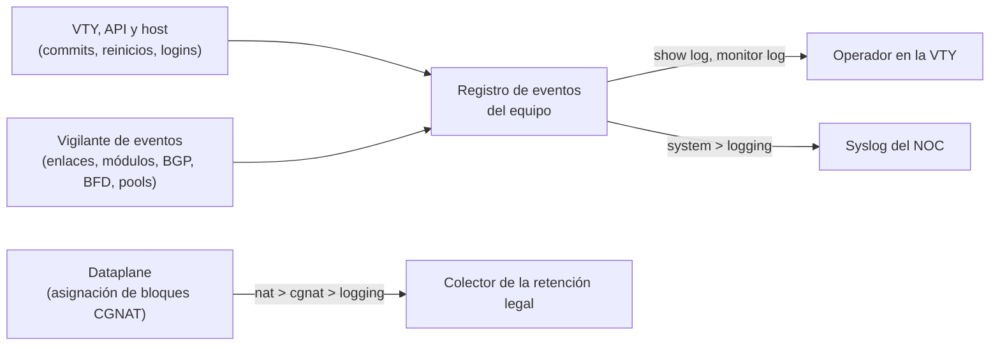

# Enviar el log de eventos del equipo al syslog del NOC

Para quien quiere ver en el syslog del NOC lo que pasa en el equipo — commits, reinicios y su causa, enlaces, módulos, sesiones BGP y BFD, pools sin bloques, logins — sin tener que entrar en él. Esta página dice qué es ese registro, cómo leerlo en el propio equipo, cómo enviarlo a uno o más colectores syslog y cómo comprobar que está llegando.

:::warning
**Esto no es la exportación de los registros del CGNAT.** Quién usó qué IP pública y puerto, para responder a una orden judicial, sale por `nat` > `cgnat` > `logging` (IPFIX o syslog) y está en [Logging IPFIX y trail de auditoría](/s/wiki-es/doc/logging-ipfix-y-trail-de-auditoria-LHGHuvEHJy) y [Adónde van los registros: colector, transporte y retención](/s/wiki-es/doc/adonde-van-los-registros-colector-transporte-y-retencion-mICkEG4K9V). El log de eventos de esta página **no lleva** ningún registro de conexión: configurar solo `system` > `logging` deja al equipo sin la retención que exige la ley.

:::

# Dos registros, dos configuraciones

El equipo tiene dos flujos de log que no se mezclan: una configuración nunca toca la otra, y ninguno lleva las líneas del otro. Deben ir a colectores distintos — el del NOC y el de la retención legal.



| | Log de eventos (esta página) | Registros del CGNAT |
|---|---|---|
| Qué dice | lo que le pasó al equipo | quién tenía qué IP pública y puerto |
| Para qué sirve | operación, NOC, auditoría interna | responder a una orden judicial, retención de un año |
| Dónde se configura | `system` > `logging` | `nat` > `cgnat` > `logging` |
| En el propio equipo | `show log`, `monitor log`, `show system logging` | `show cgnat logging`, `monitor cgnat logging` |
| En el syslog | APP-NAME `prisma-routing`, facility `daemon` (3) | APP-NAME `prisma-cgnat`, facility `local0` (16) si no se indica |

El APP-NAME y la facility distintos permiten que un colector que recibe los dos los separe con un filtro.

# Qué entra en el registro

El registro lo escribe quien actúa — la VTY, la API, los scripts del host — y un vigilante en el host que lee el estado del equipo cada pocos segundos y registra lo que cambió desde la lectura anterior. Nada se copia del journal ni de los logs del FRR, así que la rutina que llena el journal no aparece aquí. Vive en el volumen de registros del equipo, sobrevive a reinicios y actualizaciones, y tiene tamaño limitado: dos archivos de 256 KiB, unos 3000 eventos; el más antiguo sale.

Cada evento tiene la hora, un **nivel**, un **origen**, un **tipo** y una frase, con quién lo hizo y desde dónde cuando se sabe.

| Nivel | Cuándo |
|---|---|
| `error` | una alarma de módulo, el equipo renunciando al dataplane |
| `warning` | algo que pide atención: enlace caído, sesión BGP saliendo de Established, arranque que nadie pidió, login con contraseña equivocada |
| `notice` | un cambio normal: commit, enlace de vuelta, sesión arriba, login |
| `info` | rutina: logout, la cabeza del trail de sesiones PPPoE |

| Origen (`source`) | Quién lo vio |
|---|---|
| `vty` | una sesión de la VTY |
| `api` | la API de gestión |
| `host` | el host: el arranque, los logins, las placas que tiene Linux, el equipo renunciando al dataplane, el plano de control PPPoE |
| `dataplane` | los puertos del dataplane, sus módulos, los pools, la exportación de log del CGNAT |
| `routing` | el FRR: sesiones BGP y BFD |

| Tipo (`kind`) | Qué es |
|---|---|
| `commit`, `rollback`, `confirm`, `confirm-expired` | la configuración cambió, volvió atrás, se confirmó, o un `commit confirmed` venció y se deshizo |
| `asked` | un reinicio, actualización, reboot o apagado pedido, y por quién |
| `start`, `boot`, `upgraded` | el dataplane, el enrutamiento o el plano de control PPPoE arrancó, **con la causa**; el equipo arrancó; una actualización terminó |
| `settings` | la configuración de SNMP, de la API o de `system` > `logging` aplicada o rechazada por un commit |
| `link` | el enlace de un puerto cayó o volvió, administrativo o no; cayó y volvió entre dos lecturas, con cuántas veces |
| `transceiver` | módulo insertado, retirado, cambiado; RX o temperatura más allá de un aviso o alarma, y de vuelta |
| `bgp`, `bfd` | sesión arriba, o caída con el motivo del FRR o el diagnóstico del bfdd |
| `pool` | pool CGNAT sin bloque libre, y con bloque libre de nuevo |
| `collector` | la exportación de los registros del CGNAT perdió o alcanzó su colector |
| `login` | login, logout, login con contraseña equivocada |
| `gave-up` | el equipo renunció al dataplane, o un `system dataplane restart` no terminó |
| `exit`, `radius`, `trail` | con PPPoE: el plano de control se detuvo, un servidor RADIUS cayó o volvió, la cabeza del trail de sesiones |

Dos reglas evitan que el registro se vuelva ruido. Algo que cae y vuelve sin parar sale cuatro veces en 5 minutos y, desde ahí, una línea por ventana de 5 minutos con la cuenta. Y lo que **ya** estaba mal cuando el vigilante arrancó — un puerto habilitado sin enlace, un módulo más allá del aviso, una sesión configurada que no subió — se dice una vez por arranque, en presente, empezando por `standing at start:`.

# 1. Lea el registro en el propio equipo

Cualquier cuenta puede leerlo. Sin filtro, los últimos 50 eventos, el más nuevo al final:

```
prisma> show log
prisma> show log last 20
prisma> show log since 2h
prisma> show log severity warning
prisma> show log source routing
prisma> show log kind bgp since 1d
prisma> show log since 1d source vty | match rollback
```

`since` acepta `45s`, `30m`, `1h`, `2d`, `1w` o una fecha ISO (`2026-10-05`, `2026-10-05T14:00`); la hora sale en la zona horaria del equipo. `severity` muestra ese nivel y los más graves. Los filtros se combinan. Una línea más ancha que la consola se dobla, con la continuación sangrada; la primera línea lleva la hora, el nivel, el origen y el comienzo de la frase.

Para seguirlo en vivo, `monitor log`, con los mismos filtros, hasta Ctrl-C:

```
prisma> monitor log
prisma> monitor log severity warning
prisma> monitor log kind link last 5
prisma> monitor log source routing seconds 300
```

`severity`, `source` y `kind` eligen lo que se sigue; `last` y `since`, lo que se muestra antes. Sin ninguno de los dos, empieza ahora. `seconds <n>` se detiene solo.

`show logging`, sin `log`, es otra cosa: la configuración de log de cada daemon del FRR.

# 2. Configure los destinos syslog

Hace falta una cuenta con `role administrator`. En modo de configuración:

```
configure
 system
  logging
   host 192.0.2.10
   host 192.0.2.11 protocol tcp severity warning
   exit
  exit
 commit
```

`host <dirección> [port <n>] [protocol udp|tcp] [severity <nivel>] [source-address <dirección>] [vrf <nombre>]`:

| Opción | Si no se indica | Qué hace por usted |
|---|---|---|
| `<dirección>` | — | el colector, IPv4 o IPv6. **Dirección, nunca nombre**: el equipo cuyo DNS cayó es justamente el que más necesita enviar sus eventos |
| `protocol udp\|tcp` | `udp` | UDP: un datagrama por evento. TCP: un flujo con encuadre por conteo de octetos (RFC 6587), y nada se pierde mientras el colector está fuera (abajo) |
| `port <n>` | 514 en UDP, 601 en TCP | el puerto del colector |
| `severity error\|warning\|notice\|info` | `info` (todo) | el nivel mínimo enviado: ese y los más graves |
| `source-address <dirección>` | la que elija la ruta | la dirección de origen que ve el colector; de la misma familia que el colector |
| `vrf <nombre>` | las rutas del Linux del equipo | la VRF por donde sale el evento; tiene que ser un `vrf <nombre> table <n>` de la configuración, si no el `commit check` lo rechaza |

Son hasta cuatro destinos, uno por dirección: un segundo `host` para la misma dirección reemplaza al primero, y `no host <dirección>` deja de enviar a él. `show this`, dentro de `logging`, muestra lo configurado.

**Vale en el** `**commit**`**, sin reiniciar nada.** El commit dice cuántos destinos quedaron (`logging: 2 remote syslog destination(s)`), el registro gana un evento `settings`, y el vigilante empieza a enviar en menos de un segundo. Recuerde el `save` para que la configuración sobreviva al arranque.

:::info
**Un destino nuevo empieza desde ahora.** Lo que ya estaba en el registro antes del commit no se envía; para el pasado, use `show log`. Desde ahí, cada destino guarda hasta dónde ya recibió.

:::

# 3. Elija UDP o TCP

Quien envía es el propio vigilante de eventos, y su cola es el propio registro: cada destino guarda su posición, que solo avanza después de un envío que salió bien, y esa posición sobrevive a un reinicio del vigilante y a un reboot.

* **En TCP, nada se pierde y nada se repite** mientras el colector está fuera: el equipo reintenta cada 30 s y, cuando vuelve, envía lo que esperó, en orden. El límite es el tamaño del registro — un colector fuera por más tiempo del que cubren los unos 3000 eventos pierde lo que ya salió del registro. Una conexión que cae en medio de un envío puede hacer que el colector vea un evento repetido, nunca un hueco.
* **En UDP, el equipo solo sabe que el envío falló si el sistema lo dice** (un puerto inalcanzable respondido, una ruta que no existe). Un colector que simplemente desaparece no se nota, y lo enviado en ese tiempo se pierde.

Para el NOC que necesita la línea de tiempo completa, TCP.

:::info
**Con PPPoE, la cabeza del trail de sesiones sale por aquí, en nivel** `**info**`**.** Es la copia fuera del equipo con la que `show pppoe history verify` compara el trail. Un destino con `severity notice` o más grave no la recibe: deje al menos un colector en `info`.

:::

# 4. Gestión en una VRF: por dónde sale el evento

El destino sin `vrf` sale por las rutas del Linux del equipo. Con la gestión en una VRF propia (`system` > `management` > `vrf <nombre>`), lo que el propio equipo origina — y eso incluye estos eventos — sale por las rutas de la gestión, **a menos que** la tabla principal tenga una ruta específica hacia el colector. Un destino con `vrf <nombre>` sale siempre por esa VRF, tenga la tabla principal la ruta que tenga:

```
configure
 system
  logging
   host 2001:db8:100::10 protocol tcp source-address 2001:db8:100::2 vrf mgmt
   exit
  exit
 commit
```

Use `vrf` cuando quiera que el camino no dependa de lo que aprenda la tabla principal, y `source-address` cuando el colector o su firewall filtran por origen. La gestión en VRF está en [Enrutamiento, SSH, usuarios y SNMP](/s/wiki-es/doc/enrutamiento-ssh-usuarios-y-snmp-aAKbYtvEg3).

# 5. Lo que llega al colector

RFC 5424, un mensaje por evento: facility `daemon`, el nivel del evento como severidad syslog (`error` 3, `warning` 4, `notice` 5, `info` 6), el nombre del equipo como HOSTNAME, APP-NAME `prisma-routing`, el tipo del evento en mayúsculas como MSGID, y los campos del evento como datos estructurados bajo el número de empresa del producto, `event@67033`. La hora va en UTC. Un commit hecho desde la VTY y un login con contraseña equivocada, en un equipo llamado `edge-1`, llegan así (un mensaje por línea):

```
<29>1 2026-10-07T14:02:11.250Z edge-1 prisma-routing - COMMIT [event@67033 source="vty" kind="commit" account="ana" origin="ssh 192.0.2.50"] configuration committed: NOC syslog (by ana, from ssh 192.0.2.50)
<28>1 2026-10-07T14:02:51.250Z edge-1 prisma-routing - LOGIN [event@67033 source="host" kind="login" subject="noc" reason="authentication failed" origin="ssh 203.0.113.9"] failed login as noc (from ssh 203.0.113.9)
```

Los parámetros posibles son `source`, `kind`, `subject` (la interfaz, el vecino, el pool, la cuenta), `reason`, `account`, `origin`, `cause` y `component`; un parámetro vacío no va. Filtrar en el colector por MSGID (`LINK`, `BGP`, `LOGIN`, `COMMIT`...) o por el parámetro `kind` da lo mismo que `show log kind` en el equipo.

Los mismos eventos también salen por la API de gestión (`ListEvents` y el flujo `WatchEvents`). Los que tienen un objeto en la MIB — enlace, sesión BGP y BFD, pool sin bloques, módulo — también se vuelven notificaciones SNMP; los logins, commits y reinicios, no: esos solo salen por aquí. Vea [Monitoreo y SNMP](/s/wiki-es/doc/monitoreo-y-snmp-zQ9bTfrh8z).

# Cómo comprobar

**1. El equipo dice si está entregando.** Cualquier cuenta puede ejecutar:

```
prisma> show system logging
```

Una línea por destino, con la dirección, el puerto, el protocolo y el nivel mínimo, y debajo lo que el vigilante dijo de él:

```
192.0.2.10:514 udp  info and above
  sending
  sent 12 event(s) since the watcher started, the last at 2026-10-07 14:02:11
[2001:db8:100::10]:601 tcp  warning and above  from 2001:db8:100::2  vrf mgmt
  ready
  sent 0 event(s) since the watcher started
```

| Lo que aparece | Lo que significa |
|---|---|
| `ready` | el destino se leyó y todavía no hubo evento de su nivel para enviar |
| `sending` | el último envío salió bien |
| `not reached: <reason>; tried again every 30 s` | el colector no se alcanzó, con el motivo que dio el sistema (`connection refused`, por ejemplo); en TCP nada de lo que esperaba se pierde |
| `not forwarding yet: the watcher (prisma-routing-events-watch) has not said` | el vigilante todavía no pasó desde el commit, o está detenido hace más de un minuto |
| `no remote syslog destination: the record stays on the box ('show log')` | nada configurado en `system` > `logging` |

**2. Provoque un evento y mire los dos lados.** Abra una sesión SSH nueva en el equipo: en menos de 10 s el registro gana un `login` en nivel `notice`. Para un destino con `severity warning`, un intento con la contraseña equivocada genera un `login` en nivel `warning`. En el equipo:

```
prisma> show log kind login last 5
```

En el colector, la misma línea, con APP-NAME `prisma-routing` y MSGID `LOGIN`. En el equipo, `show system logging` pasa a `sending` y el contador sube.

:::success
`sending` en `show system logging`, el mismo evento en `show log` y en el colector: el log de eventos del equipo está llegando al NOC.

:::
