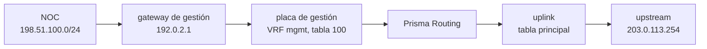
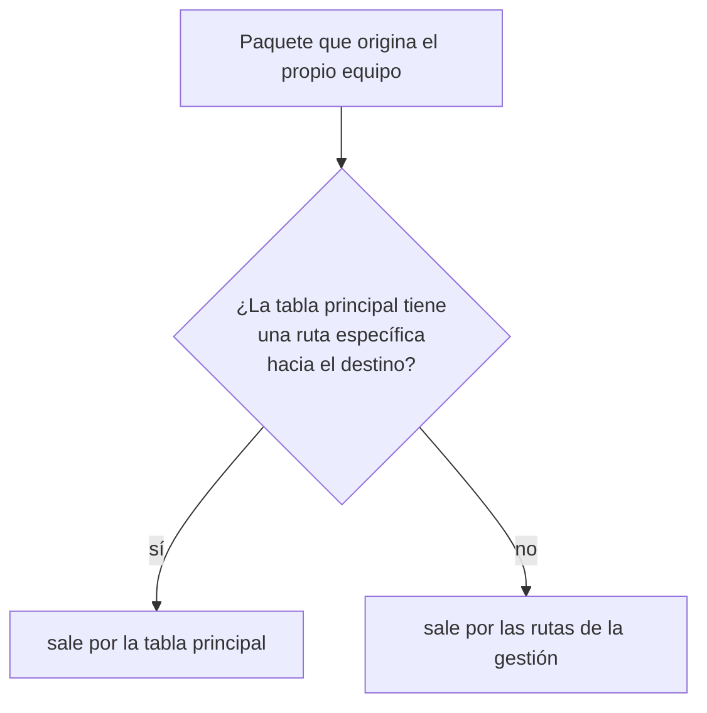

# Gestión en una VRF propia

Cómo poner la placa de gestión en una VRF propia, para que la ruta default de la tabla principal quede libre para los suscriptores y el equipo siga respondiendo SSH, API y SNMP por el gateway de gestión. Para quien va a poner un equipo en producción con una red de gestión separada del uplink — o ya lo puso y descubrió que la default de los suscriptores no toma.

# Por qué separarlas

En la instalación el equipo recibe una dirección de gestión y un **gateway**. Ese gateway es su ruta default, y queda en la tabla principal — la misma en la que el dataplane reenvía a los suscriptores.

Cuando escribe la default de los suscriptores en el enrutamiento (`router static`, `0.0.0.0/0 next-hop` hacia el upstream), las dos defaults compiten por la misma tabla, y **gana la del instalador**: entra en Linux con más prioridad que cualquier ruta del enrutamiento. El resultado depende de la placa de gestión:

* en una placa que el dataplane emparejó, el tráfico de los suscriptores sale por el gateway de **gestión**;
* en una placa que solo tiene Linux, la default del enrutamiento queda de lado y el dataplane se queda **sin ninguna default** para los suscriptores: el tráfico hacia internet se descarta.

La salida no es borrar la default del instalador — es el camino por el que usted llega al equipo. Es sacar la gestión de la tabla principal: la placa de gestión y sus rutas van a una VRF propia, y la tabla principal queda solo con lo que es de los suscriptores.



# Antes de empezar: cuál es su placa de gestión

La configuración es la misma para los dos tipos de placa, pero lo que el equipo hace por debajo es distinto, y lo que acepta el bloque de la interfaz también:

| La placa de gestión es… | Dónde aparece | Qué acepta su bloque `interface` |
|-------------------------|---------------|----------------------------------|
| **emparejada por el dataplane** — el equipo tomó la placa y la dirección de gestión vive en el par Linux que el dataplane mantiene para ella (equipo de una sola placa, o placa nombrada en `system` > `dataplane`) | en `show interface`, como puerto del dataplane | `vrf` y el resto del bloque, como cualquier interfaz |
| **solo de Linux** — la placa reservada para Linux en la instalación; en una máquina virtual, normalmente una virtio al lado de las placas que toma el dataplane | en `show hardware`, debajo de `Reserved for Linux:` | solo `vrf` |

:::info
**Placa solo de Linux: a partir de la 0.155.19.** Hasta la 0.155.18 el `commit` pasaba el `commit check` y fallaba al aplicar (`the dataplane does not have it`). En un equipo más antiguo, actualice antes de seguir esta página.
:::

En una placa solo de Linux, la dirección, la MTU y la descripción siguen siendo de Linux — la dirección queda donde la puso el instalador, en `/etc/network/interfaces.d/prisma-routing` — y el `commit check` rechaza cualquier cosa además de `vrf` en su bloque.

# 1. Escriba la configuración

Con la gestión en `192.0.2.10/24` y `2001:db8:6::10/64` en la placa `enp1s0`, el gateway de gestión en `192.0.2.1` y `2001:db8:6::1`, el NOC en `198.51.100.0/24` y el upstream de los suscriptores en `203.0.113.254`:

```
configure
 vrf mgmt table 100
 interface enp1s0
  vrf 100
  exit
 vrf mgmt
  ip route 0.0.0.0/0 192.0.2.1
  ip route 198.51.100.0/24 192.0.2.1
  ipv6 route ::/0 2001:db8:6::1
  exit
 router static
  0.0.0.0/0 next-hop 203.0.113.254
  exit
 system
  management
   vrf mgmt
   exit
  exit
```

| Línea | Qué cambia |
|-------|------------|
| `vrf mgmt table 100` | crea la VRF `mgmt` en Linux, en la tabla 100 |
| `interface enp1s0` / `vrf 100` | la placa de gestión entra en la tabla 100, con sus direcciones, IPv4 e IPv6 |
| `vrf mgmt` / `ip route`, `ipv6 route` | las rutas de la gestión, dentro de la VRF: las dos defaults y cualquier otra red desde la que administra el equipo |
| `router static` / `0.0.0.0/0 next-hop` | la default de los suscriptores, en la tabla principal — que ya no tiene con quién competir |
| `system` > `management` > `vrf mgmt` | le dice al equipo que sus servicios viven en la VRF: sin esto la placa va a la VRF y el equipo **no** responde por ella |

El `router static` es solo la tabla principal. Las rutas estáticas de una VRF van en su bloque `vrf <nombre>`, cerrado con `exit` o `exit-vrf`. El `vrf` de una interfaz y las VRF de Linux están en [Configuración de interfaz](/s/wiki-es/doc/configuracion-de-interfaz-5s5Ar68nsg). El próximo salto de cada ruta de la VRF tiene que estar en una red que la placa de gestión alcanza; si no, el `commit check` la rechaza con `this next hop is on no connected network:`.

Para que el SSH responda **solo** en la gestión, liste sus dos direcciones en `ssh listen-address`, como en `snmp` y en `api`: `ssh listen-address 192.0.2.10 2001:db8:6::10`. Con la gestión en la VRF el `commit` acepta esas direcciones.

# 2. Compruebe antes de aplicar

```
commit check
```

Qué rechaza, y por qué:

| El rechazo empieza con | Qué falta |
|------------------------|-----------|
| `management vrf mgmt: no such VRF here` | la línea `vrf mgmt table 100` |
| `management vrf mgmt: no interface is in it` | el `vrf 100` en la placa de gestión: sin nadie dentro, el tráfico del propio equipo iría a una tabla sin salida |
| `interface enp1s0: Linux's, so 'vrf' alone applies` | la placa es solo de Linux y su bloque tiene algo además de `vrf` |
| `interface enp1s0: vrf 100 has no VRF device` | la placa es solo de Linux y ningún `vrf <nombre> table 100` crea su tabla |
| `this next hop is on no connected network:` | una ruta de la VRF apunta a un gateway que la placa de gestión no alcanza |

El `commit check` también rechaza un `vrf` en una interfaz que no tienen ni el dataplane ni Linux — normalmente un nombre mal escrito.

# 3. Aplique con `commit confirmed`

Está cambiando el camino por el que llega al equipo. Aplique con vuelta atrás:

```
commit confirmed 10
```

Después, **abra una sesión nueva** hacia la dirección de gestión, por IPv4 y por IPv6, y confirme desde ella:

```
commit
```

La sesión en la que escribió el `commit confirmed` en general sigue viva durante el cambio, pero lo que prueba que funcionó es una conexión nueva llegando por la VRF.

Si ya nada alcanza al equipo, nadie confirma, y en 10 minutos deshace todo por sí solo: la placa sale de la VRF, las reglas y los ajustes del kernel se van, y — en una placa solo de Linux — la default del instalador vuelve a la tabla principal. El equipo vuelve a responder SSH, API y SNMP por la tabla principal. La vuelta atrás está armada en el equipo, no en su sesión: perder la conexión no la cancela — el mecanismo está en [commit, rollback y save](/s/wiki-es/doc/commit-rollback-y-save-6sAWJkXNO3).

:::warning
**Sacar la gestión de la VRF corta las sesiones SSH abiertas por ella.** Vale para un `commit confirmed` que expira y para `no vrf` dentro de `management`. El equipo atiende las conexiones nuevas por la tabla principal.
:::

# 4. Guarde

`commit` lo pone en vigor; solo `save` lo hace sobrevivir al reboot. Después de confirmar, en el modo operacional:

```
save
```

Un `save` dentro de la ventana del `commit confirmed` graba un cambio todavía no confirmado, y el equipo avisa. Confirme primero, guarde después.

# Qué llega y qué sale

**Qué llega.** El sshd, la API y el snmpd siguen escuchando en la tabla principal; con `system` > `management` > `vrf`, el equipo activa los ajustes del kernel que permiten que un servicio de la tabla principal atienda una conexión que llega por la VRF, escuche en la dirección de gestión aunque esté en la VRF, y conserve el IPv6 de la placa cuando cambia de tabla. La respuesta sigue a la conexión. Un servicio que ya estaba arriba antes del `commit` atiende después de él, sin reinicio.

**Qué sale.** Lo que el propio equipo origina pasa por dos reglas, por familia: primero la tabla principal **sin su default**, después la tabla de la gestión. En la práctica:



La default de los suscriptores nunca lleva el tráfico del equipo: es justamente la ruta que la primera regla ignora.

| Tráfico | Sale por |
|---------|----------|
| SSH, API, prisma-web, consultas SNMP (entrando, IPv4 e IPv6) | la gestión: la respuesta sigue a la conexión |
| traps SNMP | la gestión |
| DNS, NTP, descargas del `system upgrade`, RADIUS | la gestión, salvo que la tabla principal tenga una ruta específica hacia el servidor |
| `system logging` (el registro de eventos) | la gestión, salvo que la tabla principal tenga la ruta; un destino con `vrf mgmt` va por la VRF de todos modos |
| syslog e IPFIX por TCP del contenedor de log | la gestión, salvo que la tabla principal tenga una ruta específica hacia el colector — un colector del lado de los suscriptores se alcanza por su ruta en la principal |
| IPFIX por UDP generado por el dataplane | **la tabla principal**, siempre |

:::warning
**El IPFIX por UDP no sigue a la gestión.** El dataplane arma esos paquetes y los envía por su propia tabla de reenvío, sin pasar por las reglas de Linux. Un colector que solo se alcanza por la red de gestión necesita una ruta específica hacia él en la tabla principal — o el export por TCP. Sin eso los registros de traducción no llegan al colector.
:::

Un servicio que escucha en la tabla principal también atiende en una VRF de cliente cuyo lado Linux alcance la dirección del equipo. Téngalo en cuenta si una VRF de cliente tiene ruta hacia la red de gestión.

# Qué sobrevive a un reboot

Con la configuración guardada, cada arranque vuelve a poner todo, en este orden:

1. antes de que suban el dataplane, el snmpd, el sshd y la API, el equipo activa los ajustes del kernel y las reglas de su propio tráfico — nombran la tabla 100, no el dispositivo, así que no dependen de que la VRF ya exista;
2. la carga de la configuración crea la VRF `mgmt` y pone la placa en ella;
3. el camino de vuelta de la gestión — la default del instalador — va a la tabla de la VRF, nunca a la principal, donde volvería a ganarle a la default de los suscriptores.

En una placa solo de Linux el arranque empieza con la placa como la dejó el instalador, dirección y default en la tabla principal; la carga de la configuración la mueve a la VRF con sus direcciones y sus defaults. Una placa solo de Linux con `vrf` y nada más no se trata como placa faltante: se aplica en el arranque.

Las mismas reglas y ajustes se ponen de nuevo en cada `commit` que cambia `system` > `management`, y la VRF de la placa se lee de vuelta de Linux: el `show running-config` muestra el `vrf 100`, y el siguiente `commit` no toca la placa.

# Cómo comprobar

**1. El equipo dice dónde está la gestión:**

```
show system management
```

Con la gestión en la VRF y todo en vigor, la pantalla es:

```
configured:
  management VRF       mgmt, table 100
in effect:
  the box's own        by table 100, after main without its default
  listeners            answer on a VRF, and may bind its addresses
  IPv6 addresses       kept when a card moves between VRFs
  interfaces in it     enp1s0
```

`configured` es lo que pide la configuración; `in effect` es lo que el host tiene ahora. Si los dos difieren, la pantalla termina diciéndolo — un `commit` que cambie `system` > `management`, o el próximo arranque, los pone de acuerdo. Sin gestión en VRF, la línea `management VRF` dice `none: the main table`.

**2. La default de los suscriptores está en el dataplane:**

```
show route 0.0.0.0/0
```

Con más de una tabla la pantalla separa las VRF. En la tabla principal la default tiene que apuntar al upstream (`203.0.113.254` en el ejemplo), no al gateway de gestión, y no puede estar descartando. Las rutas de la gestión están en el enrutamiento, en `show ip route vrf mgmt`.

**3. La gestión responde:** desde fuera, una sesión SSH nueva hacia `192.0.2.10` y otra hacia `2001:db8:6::10`, y una consulta SNMP a cada una, si usa SNMP.

:::success
`show system management` con `in effect` igual a `configured`, la default de la tabla principal apuntando al upstream y un SSH nuevo entrando por las dos direcciones de gestión: los suscriptores tienen la tabla principal para ellos solos, y la gestión tiene su propio camino.
:::
