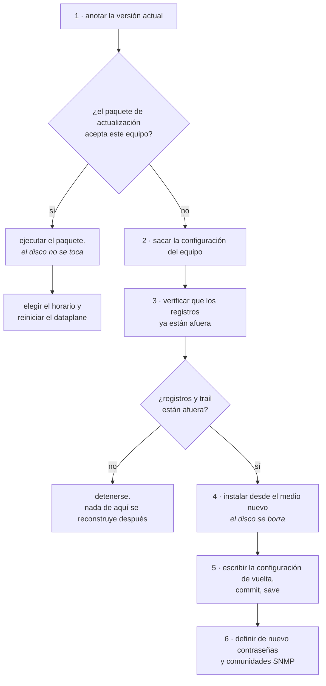

# Llevar el equipo a una versión nueva

Cómo instalar una versión nueva de Prisma Routing en un equipo que ya está en producción. Existen dos caminos y cuestan cosas muy diferentes: el **paquete de actualización**, que cambia los archivos del producto y no toca el disco, y la **reinstalación desde el medio de instalación**, que borra el disco entero. Esta página dice cuál de los dos es el suyo, qué cuesta cada uno y en qué orden hacerlo.

# Cuál de los dos es el suyo

|     | El paquete de actualización | La reinstalación desde el medio |
|-----|-----------------------------|---------------------------------|
| Cuándo | Siempre que el paquete acepte el equipo | Cuando el paquete rechaza, o cuando la máquina es nueva |
| El disco | Intacto                     | **Borrado**                     |
| Configuración, cuentas, comunidades SNMP | Se mantienen                | Desaparecen                     |
| Trail de configuración y spill del exportador | Se mantienen                | Desaparecen                     |
| Interrupción | Solo el reinicio del dataplane, y en el horario que usted elija | La ventana entera, con arranque desde el medio |
| Publicado para | Toda versión, a partir de la 0.79.0 | Solo las versiones completas (las que cambian el primer o el segundo número) |
| Tamaño de la descarga | Cerca de 200 MB, con las imágenes de los contenedores | Cientos de megabytes            |

**El paquete es el camino normal.** La reinstalación existe para la máquina nueva y para el caso en que la versión nueva cambia la plataforma debajo del producto. Usted no necesita adivinar cuál es: el paquete lo verifica solo y **rechaza antes de escribir cualquier cosa**, diciendo qué tiene el equipo y qué necesita la versión nueva.

# El paquete de actualización

**El camino corto es desde la propia VTY**, con el equipo alcanzando internet (y resolviendo nombres: `dns server`, si la gestión no tiene DNS):

```
prisma> system upgrade
prisma> system upgrade <versión>
```

Sin versión, dice qué versión ejecuta el equipo y cuál es la más nueva publicada, y no cambia nada. Con la versión, descarga el paquete y el `sha256` del directorio público de versiones (el mismo del paso 2), rechaza el paquete antes de abrir cualquier cosa si la suma no coincide, y ejecuta el mismo `upgrade` de los pasos de abajo, mostrando todo lo que dice. Una versión igual o más antigua que la del equipo se rechaza: volver de versión es el camino manual.

Tres cosas que hay que saber de él:

* **Solo** `**root**` **o una cuenta con** `**operator**` **puede ejecutarlo** (el grupo `prisma-operator`, desde la 0.149.26), como `system reboot`. La consulta, sin versión, la puede hacer cualquier cuenta.
* **Ctrl-C no interrumpe** mientras el `upgrade` se ejecuta: un equipo actualizado a medias es peor que una actualización lenta.
* **Si el** `**upgrade**` **se detiene a la mitad**, la VTY dice con qué estado salió y en qué directorio quedó guardado el paquete, para quien vaya a leer lo que pasó.

**La descarga muestra el progreso y no se queda atascada en una conexión mala.** Cada pocos segundos la VTY dice cuánto llegó ya, de cuánto, a qué tasa y cuánto falta (`downloaded 45.2 of 189.0 MB at 9.7 MB/s, about 15 s left`). Una conexión que pasa 30 s sin recibir nada, que queda por debajo de 125 KB/s (1 Mbit/s) durante 30 s, o que se cae a la mitad se abandona, y el resto se pide en una conexión nueva, desde donde se detuvo, con el nombre resuelto de nuevo y la dirección anterior intentada en último lugar; la VTY informa cada una (`resuming at 14.1 MB on a new connection, 2 of 6`). Son hasta seis conexiones, y la sexta no se abandona por ser lenta: un equipo con enlace lento termina de todos modos. Si el paquete descargado no coincide con el `sha256`, se descarga una vez más desde cero, y la VTY lo dice; si la segunda tampoco coincide, se rechaza y no se cambió nada.

Al final dice `upgraded to <versión>` y recuerda el `save`. Vale lo mismo que para el camino manual: `save` antes de reiniciar, y el dataplane sigue siendo el antiguo hasta que usted elija la hora del paso 4.

A partir de la versión 0.148.0, la propia VTY pasa a la versión nueva enseguida, sin reinicio: pocos segundos después del `upgraded to`, el contenedor de gestión se recrea con la imagen nueva, la sesión que hizo el upgrade se cae y el próximo login ya es de la versión nueva. Un login hecho en esos segundos espera a que vuelva la VTY, hasta 20 segundos, en lugar de fallar. El contenedor que exporta los registros de CGNAT también pasa a la imagen nueva en ese momento; mientras no vuelve, el propio dataplane retoma el envío. El dataplane y los daemons de enrutamiento **no** se tocan en este paso y siguen en las imágenes anteriores hasta el reinicio o un `system dataplane restart`. Antes de la 0.148.0, la VTY seguía en la versión anterior hasta el reinicio, aunque el equipo indicara la versión nueva.

**Las imágenes de las versiones antiguas se borran.** Cada upgrade carga cuatro imágenes nuevas, y antes de esta corrección no se borraba ninguna: un equipo de prueba llegó al 96% de la raíz después de una serie de parches. Ahora, justo después del upgrade y en cada arranque, el equipo borra las imágenes `prisma-*` que ningún contenedor usa y que no son ni de la versión instalada ni de la versión anterior a ella — esta se queda, como camino de vuelta. El log del arranque (y del `refresh-the-vty`) dice qué se borró y cuánto espacio se recuperó. Las imágenes de otros repositorios nunca se tocan, y si el equipo no puede decir con certeza qué versión es, no borra nada y dice por qué.

Los pasos de abajo son el mismo proceso a mano, para un equipo que no alcanza internet.


:::info
**El paquete no lleva el kernel ni paquetes del sistema.** Lleva los archivos del producto y las imágenes de los contenedores, y nada de lo que instala el Debian de abajo: un equipo actualizado con el paquete sigue con el kernel con el que fue instalado. Una actualización de seguridad del kernel de Debian llega a un equipo solo por el medio de una versión completa. Por el mismo motivo, el `qemu-guest-agent` que el medio instala desde la 0.156.0 no llega por el paquete: en una máquina virtual actualizada, instálelo con `apt-get install qemu-guest-agent`, en un shell del equipo.

:::


:::info
**Desde la 0.125.0 el paquete lleva las imágenes de los contenedores**, por eso tiene cerca de 200 MB y no algunos megabytes. Un equipo que fue actualizado en lugar de instalado, y todavía ejecuta el dataplane y el enrutamiento como servicios de systemd, **pasa a los contenedores en el próximo arranque**, igual que un equipo instalado desde el medio. Un equipo que ya se ejecuta en los contenedores pasa a usar las imágenes de la versión nueva, y ya no las de la versión anterior.

:::

## 1. Anote la versión que se está ejecutando

```
prisma> show version
```

Guarde la salida entera en el ticket de cambio. Es lo que dice de dónde vino el equipo, y es con ella que usted compara al final.

## 2. Descargue el paquete de la versión nueva

Cada versión está en una carpeta propia en <https://prismarouting.com.br/releases/>, con el paquete y su `sha256` lado a lado. La carpeta `latest/` ofrece siempre el paquete de actualización más nuevo y, a su lado, la ISO más nueva, cada uno con su `sha256`. El medio de instalación solo existe para las versiones completas: una versión que cambia solo el tercer número publica únicamente el paquete de actualización, y entonces la ISO en `latest/` es la de la última versión completa. Eso es lo que quieren decir los números: una versión que cambia solo el tercer número cambia solo lo que lleva el paquete; el kernel, el VPP, el FRR y el propio medio solo cambian en una versión que cambia el primero o el segundo. En el propio equipo, reemplazando `<versión>` por el número:

```
curl -fO https://prismarouting.com.br/releases/<versión>/prisma-routing-<versión>-upgrade.tar.gz
curl -fO https://prismarouting.com.br/releases/<versión>/prisma-routing-<versión>-upgrade.tar.gz.sha256
sha256sum -c prisma-routing-<versión>-upgrade.tar.gz.sha256
```

Continúe solo si la última línea termina en `OK`. Cualquier otra respuesta quiere decir que el archivo que llegó no es el que se publicó. Descárguelo de nuevo y no ejecute el paquete.

La carpeta tiene todas las versiones que todavía saben actualizar un equipo, a partir de la 0.79.0, que fue la primera con el nombre actual. En las versiones de la 0.79.0 a la 0.82.0 el `sha256` se calculó cuando el archivo se copió ahí, porque esas versiones se publicaron sin él.


:::warning
**Ejecute** `**save**` **después de actualizar y antes de reiniciar.** Dos cambios de forma hacen que un equipo actualizado rechace su propio archivo guardado en el arranque y suba **sin ninguna configuración**:

* a partir de la 0.125.2, el CGNAT está en los niveles `nat` > `cgnat`, y la forma de una línea (`nat cgnat pool ...`, `nat cgnat interface ...`) ya no se acepta. **Esto vale para todo equipo que tenga CGNAT configurado**;
* a partir de la 0.122.10, la forma `route <prefijo> <próximo-salto>` dentro de `router static` ya no se acepta.

La configuración sigue vigente después del paquete, porque no reinicia nada, y el `save` graba lo que está vigente ya en la forma nueva. Es solo eso: `save`, y solo entonces reiniciar. Para verificar antes, `show running-config` ya muestra el bloque `nat` > `cgnat` que el `save` va a grabar.

Las revisiones de rollback anteriores a la actualización siguen en la forma antigua, y el `save` no llega a ellas. Volver a una de ellas después de actualizar se rechaza: el `commit check` señala la línea en la forma antigua y no se aplica nada. Si necesita volver a la configuración de antes, vuelva primero el equipo a la versión anterior.

:::

## 3. Descomprima y ejecute

```
tar xzf prisma-routing-<versión>-upgrade.tar.gz
cd prisma-routing-<versión>-upgrade
sudo sh upgrade
```

El paquete verifica la plataforma del equipo, cambia los archivos del producto y dice, archivo por archivo, qué escribió. Si la plataforma no coincide, se detiene ahí mismo y **no se escribió nada**: el equipo sigue exactamente como era antes del comando.


:::info
**La configuración no se toca.** `/etc/prisma-routing/prisma-routing.conf`, las revisiones de rollback y el ajuste de tuning que usted editó siguen donde estaban. El paquete reescribe los archivos del producto, no los suyos.

**Con una excepción, hecha una sola vez, para que nada cambie solo: la MTU, al pasar a la 0.152.1 desde una versión anterior.** Hasta la 0.152.1 una interfaz sin `mtu` subía en 9000; a partir de ahí sube en 1500. Para que el equipo siga como estaba, el paquete escribe `mtu 9000` en toda interfaz de la configuración guardada que no tenía `mtu` (y en las revisiones de rollback, manteniendo sus fechas), dice cuáles fueron en la salida — el bloque `==> interface MTUs` — y registra en el `show log` la línea "interfaces with no mtu pinned at 9000, the default before 0.152.1: ..." con la lista. También deja `/etc/prisma-routing/mtu-9000-kept`: con ese archivo, la placa sigue aceptando tramas de hasta 9000, como antes. Un `no mtu` suyo después de eso se respeta y no vuelve: la interfaz pasa a 1500.

:::

## 4. Elija cuándo reiniciar el dataplane

Este es el paso que cuesta algo, y es suyo.

El paquete cambia el dataplane **en disco** y no reinicia nada. Hasta el próximo reinicio del dataplane, el equipo sigue traduciendo con el dataplane antiguo, que ya estaba cargado en memoria.

Quien cuenta esa historia es la línea `plugin` del `show version`, y **no** la línea `dataplane`. La pantalla tiene, en este orden: la versión de Prisma Routing instalada, en la primera línea; `dataplane:`, la versión del propio VPP; `plugin:`, el build con que se cargó el dataplane; `routing:`, la de FRR; y `daemons:`, los daemons de enrutamiento que se están ejecutando.

La línea `dataplane` es la del VPP y no se mueve en un cambio de versión de Prisma Routing. La que queda atrás es `plugin`: es el build con que se cargó el dataplane en el último arranque. Compárela con el número de la **primera** línea - y cuando las dos no coinciden el equipo lo dice en voz alta, con un párrafo debajo de la línea `plugin` que explica que solo un reinicio del dataplane las iguala. Cuando coinciden no dice nada, que es el estado normal.

La línea `plugin` responde de cuatro maneras, y tres de ellas no son divergencia: que el build es tal, que el dataplane no está respondiendo, que el dataplane respondió y no informa ningún build, o que no hay con qué comparar.

Cuando llegue la hora, el reinicio se hace desde la propia VTY:

```
prisma> save
prisma> system dataplane restart
```

Dice lo que cuesta antes de actuar y luego actúa, sin preguntar. Ejecuta de nuevo el ajuste de tuning, sube el dataplane en las imágenes y el plugin de la versión nueva, y reaplica la configuración **guardada** cuando vuelve — por eso el `save` antes. Cuando termina, `show interface` dice cuándo el equipo volvió a reenviar. El final del propio `upgrade` lista las mismas opciones, con el costo de cada una.


:::warning
**Reiniciar el dataplane tira todas las sesiones y todos los bloques de puertos.** Cada suscriptor detrás del equipo vuelve a traducirse desde cero. Es rápido, pero no es gratis, y por eso el paquete no lo hace por su cuenta.

Un reinicio del equipo hace lo mismo. En los dos casos la detención es ordenada: antes de salir, el dataplane cierra en el log cada bloque que tenía.

:::

Mientras la línea `plugin` esté detrás de la primera, el equipo está ejecutando un producto nuevo con un dataplane antiguo. Es un estado válido y previsto, pero no es donde el equipo debe pasar la semana.

# Cuando el paquete rechaza

El rechazo viene con las dos versiones de la plataforma escritas, la que tiene el equipo y la que necesita la versión nueva. Ocurre cuando la versión nueva trae también una plataforma nueva debajo, y el paquete lleva solo los archivos del producto: no instala ningún paquete del sistema y no accede a la red.

En ese caso el camino es el medio de instalación, y borra el disco. **Lea la sección de abajo entera antes de empezar.**

# La reinstalación desde el medio


:::warning
**Reinstalar borra el disco entero, incluido el volumen de log.**

Ese volumen guarda el trail de configuración - lo que permite decir qué definición de pool estaba vigente en un instante pasado, y sin él la respuesta a una orden judicial sobre el mes pasado deja de ser sostenible - y el spill del exportador, que son registros que el colector todavía no recibió - y, en un equipo que es el BNG, el historial de sesiones PPPoE, que dice quién tenía cada dirección interna. Los registros de bloque en sí no quedan aquí: el equipo los exporta.

Mueren en la reinstalación y **ningún comando de este producto los trae de vuelta**. Un equipo reinstalado sigue respondiendo por el año de retención que ya corría.

:::

## De HexaRouting a Prisma Routing: el paquete rechaza, y por qué

El producto cambió de nombre. **Ningún equipo que ejecute HexaRouting acepta el paquete de actualización de Prisma Routing** — rechaza antes de escribir cualquier cosa, diciendo esto:

```
This box runs HexaRouting, and this artifact installs Prisma Routing.

  The product was renamed and NOTHING MIGRATES.
```

El rechazo es el punto. Todo lo que lleva un equipo instalado cambió de nombre junto con el producto:

| Antes | Ahora |
|-------|-------|
| `/etc/hexarouting/hexarouting.conf` | `/etc/prisma-routing/prisma-routing.conf` |
| `/etc/hexarouting/rollback/` | `/etc/prisma-routing/rollback/` |
| `hexarouting.service` y las demás unidades | `prisma-routing.service` y las demás |
| `hexash`, el shell de login de las cuentas | `prismash` |
| grupos `hexa-admin` y `hexa-cgnat` | `prisma-admin` y `prisma-cgnat` |
| variables `HEXA_*` en `tune.env` | `PRISMA_*` |
| claves de línea de comandos `hexarouting.*` | `prisma-routing.*` |
| `/var/log/hexarouting` | `/var/log/prisma-routing` |

**Nada de esto lo migra ningún programa.** Si los archivos nuevos se instalaran junto a los antiguos, el equipo volvería del próximo arranque con la configuración antigua en el disco, unidades nuevas que no la ven, interfaces que nadie levantó y operadores cuyo shell de login ya no existe.

**El camino es la reinstalación desde el medio**, con los pasos que ya están en esta página. Dos cosas más, y las dos antes de escribir `yes`:

### Las cuentas del producto tienen que crearse de nuevo

Una cuenta creada por la versión antigua tiene `/usr/bin/hexash` grabado como shell en `/etc/passwd`, y ese archivo no existe en el equipo nuevo. La reinstalación ya borra las cuentas — lo que importa es la lista: **anote quién tiene cuenta y con qué rol antes de borrar el disco**, porque después no sale de ningún lado.

### El volumen de los registros: cómo mantener el año de retención

`/var/log/hexarouting` es un sistema de archivos separado, con el trail de configuración y el spill del exportador. La reinstalación **no lo borra**, siempre que su disco quede fuera de la instalación — pero el equipo nuevo busca en `/var/log/prisma-routing`, y no va a mirar en la ruta antigua.

El procedimiento es este, y le corresponde al operador: un programa que renombrara puntos de montaje bajo obligación de retención sería una migración de datos hecha por quien no está mirando.

**1. Antes de reinstalar, anote cuál es el disco de los registros y cómo está montado:**

```
# findmnt -no SOURCE /var/log/hexarouting
/dev/sdb1
# blkid /dev/sdb1
/dev/sdb1: UUID="...." TYPE="ext4"
```

Anote el **UUID**, no el `/dev/sdb1`: los nombres de disco cambian de un arranque a otro, y el UUID no.

**2. Instale la versión nueva apuntando la instalación solo al disco del sistema.** El instalador pregunta en qué disco instalar; el disco de los registros no es ese. Si la máquina tiene espejo de registros, los dos discos del espejo quedan fuera.

**3. En el equipo nuevo, monte el volumen antiguo en la ruta nueva.** El equipo nuevo ya creó `/var/log/prisma-routing` en el disco del sistema; monte el volumen antiguo encima:

```
prisma> start shell
# mkdir -p /var/log/prisma-routing
# mount UUID=<el uuid anotado> /var/log/prisma-routing
# ls /var/log/prisma-routing
```

El `ls` tiene que mostrar los archivos del volumen antiguo: `config-history.log`, que es el trail de configuración, y, si el exportador quedó debiendo registros a un colector, sus archivos de spill.

**4. Deje esto grabado, o el próximo arranque vuelve sin los registros:**

```
# echo "UUID=<el uuid anotado>  /var/log/prisma-routing  ext4  defaults  0 2" >> /etc/fstab
# systemctl daemon-reload
# mount -a
```

**5. Verifique en el autotest del próximo arranque.** La línea de los registros tiene que decir que el volumen es un sistema de archivos separado. Si dice que los registros están en el disco del sistema, el `mount` no funcionó, y lo que se está grabando ahí se va junto con la próxima reinstalación.

Los archivos de registro en sí no cambian de formato: lo que estaba escrito sigue siendo legible, y el año de retención que ya corría sigue corriendo.

## Lo que no sobrevive

| Qué | ¿Sobrevive a la reinstalación? |
|-----|--------------------------------|
| La configuración vigente | **No.** Tiene que llevarla afuera y escribirla de vuelta |
| Las contraseñas de las cuentas y las comunidades SNMP | **No**, y no se pueden copiar de la pantalla: el equipo las enmascara al imprimir la configuración |
| Las revisiones de rollback | **No**                         |
| El trail de configuración, el spill del exportador y el historial de sesiones PPPoE | **No**                         |
| Lo que ya se exportó a un colector IPFIX | **Sí** - está fuera del equipo, y la reinstalación no lo alcanza |
| Lo que ya se copió a un syslog remoto | **Sí**, por el mismo motivo    |

Las dos últimas líneas son la razón del orden de los pasos de abajo: lo que sobrevive es exactamente lo que ya estaba fuera del equipo antes de que alguien escribiera `yes`.



## 2. Lleve la configuración fuera del equipo

```
prisma> show running-config
```

Es lo que está vigente en este instante. Copie la salida entera fuera de la sesión: está escrita para escribirse de vuelta en el prompt, una línea por vez, y es el único formato de exportación que existe.


:::warning
**Las contraseñas y comunidades SNMP salen enmascaradas.** El equipo no imprime hash de contraseña ni comunidad SNMP en la pantalla, a propósito: un hash que aparece en una pantalla compartida durante un incidente es un hash que salió de la empresa.

La consecuencia es que la copia que usted se llevó **no restaura ningún acceso**. Después de la reinstalación las cuentas y las comunidades se definen de nuevo, a mano. Decida cuáles van a ser **antes** de la ventana.

:::

## 3. Verifique que los registros ya estén fuera del equipo

**Modo BPA.** Los eventos de asignación van al colector IPFIX mientras el equipo trabaja, y lo que ya llegó al colector no se ve afectado. Lo que muere es lo que existe solo en el volumen del equipo. Si la exportación está detenida o atrasada, el hueco entre el colector y el equipo es lo que usted va a perder.

**Modo determinístico.** No hay asignación que exportar: la prueba es el algoritmo más la configuración que estaba vigente, y es el trail el que dice cuál era. Verifique el trail y compare el resumen de arriba con la copia en su syslog remoto:

```
show cgnat history verify
  7 entries checked, chain intact
  head  seq 7 sha256 4e98de83…81f4
```

Si no hay copia remota del trail, **deténgase aquí**. No se reconstruye después.

## 4. Instale desde el medio nuevo

El procedimiento es el de [Instalación del appliance](/s/wiki-es/doc/instalacion-del-appliance-MgWUcARKzM) y no cambia. Tres puntos que son diferentes cuando la máquina no es nueva:

* **El disco destino es el mismo de antes**, con todo lo que tiene, y la confirmación con la palabra `yes` borra el disco entero.
* **La pregunta sobre cuántos gigabytes quedan para el volumen de log vuelve a hacerse.** Responda al menos el mismo número de antes: responder menos deja menos espacio para el trail, para el spill del exportador y, en un equipo que es el BNG, para el historial de sesiones PPPoE, sin que nada lo advierta.
* **Si el equipo tenía espejo de registros en dos discos**, el segundo disco se pregunta de nuevo y se borra con el mismo `yes`.

## 5. Escriba la configuración de vuelta

Entre con la contraseña definida durante la instalación y escriba, en modo de configuración, la configuración que se llevó en el paso 2.

`commit` hace que valga ahora; `save` hace que sobreviva al próximo arranque. Son cosas diferentes y las dos son necesarias: un equipo que recibió la configuración y no la guardó vuelve vacío en el primer reinicio.


:::warning
**Un cambio remoto va con** `**commit confirmed**`**.** Un equipo recién instalado es un equipo en el que nadie verificó todavía qué interfaz es cuál, y es exactamente donde una dirección en el lugar equivocado corta el propio acceso de quien está escribiendo.

:::

## 6. Defina de nuevo lo que salió enmascarado

Las cuentas y sus contraseñas, y las comunidades SNMP. Nada de eso vino en la copia del paso 2, y un equipo que enruta sin que su NMS lo vea es un equipo que nadie va a notar cuando se esté enfermando.

# Cómo verificar

**Después del paquete de actualización:**

* `show version` trae la versión nueva en la primera línea, la de Prisma Routing instalado. La línea `plugin` solo la acompaña después de que se reinicie el dataplane (`system dataplane restart` o un reinicio), y hasta entonces queda en el build antiguo a propósito.
* Después del reinicio del dataplane la línea `plugin` pasa a coincidir con la primera, y el párrafo de divergencia desaparece.
* La configuración sigue ahí: `show running-config` trae de vuelta lo que ya estaba vigente, sin que nadie escriba nada.
* Un suscriptor real navega, y `show cgnat subscriber` con su IP responde con la dirección pública y el rango de puertos.

**Después de la reinstalación:**

* El autotest del primer arranque sale **sin ninguna línea** `**[FAIL]**`.
* `show version` responde con la versión nueva, y la línea `plugin` coincide con ella desde el primer arranque: el equipo entero subió nuevo, así que no hay build antiguo cargado.
* `show running-config` trae de vuelta lo que usted escribió, comparable línea por línea con la copia del paso 2, menos los valores enmascarados.
* Un suscriptor real navega, y `show cgnat subscriber` con su IP responde con la dirección pública y el rango de puertos.


:::success
Autotest sin `**[FAIL]**`, `show version` en la versión nueva y un suscriptor traduciendo: el cambio terminó.

Si el camino fue la reinstalación, lo que **no** vuelve es lo que no salió del equipo antes. Por eso los pasos 2 y 3 vienen antes del 4, y no después.

:::

# Ver también

* [Instalación del appliance](/s/wiki-es/doc/instalacion-del-appliance-MgWUcARKzM) - el instalador en detalle, el volumen de registros y el espejo en dos discos
* [Logging IPFIX y trail de auditoría](/s/wiki-es/doc/logging-ipfix-y-trail-de-auditoria-LHGHuvEHJy) - qué guarda el trail y cómo verificar que no fue adulterado
* [Ampliar la capacidad sin tirar suscriptores](/s/wiki-es/doc/ampliar-la-capacidad-sin-tirar-suscriptores-eHEJEg47aX) - el otro cambio que cuesta una interrupción, y cómo medirla antes
* [Acceso, login y roles](/s/wiki-es/doc/acceso-login-y-roles-ZiA9s69LH4) - las cuentas y los roles que recrea el paso 6
