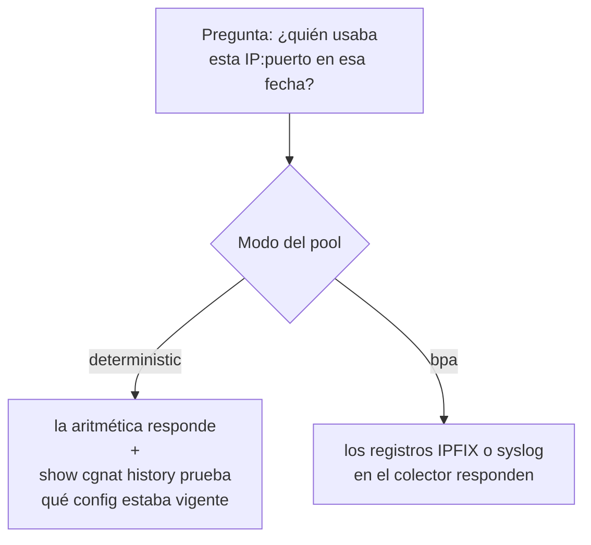
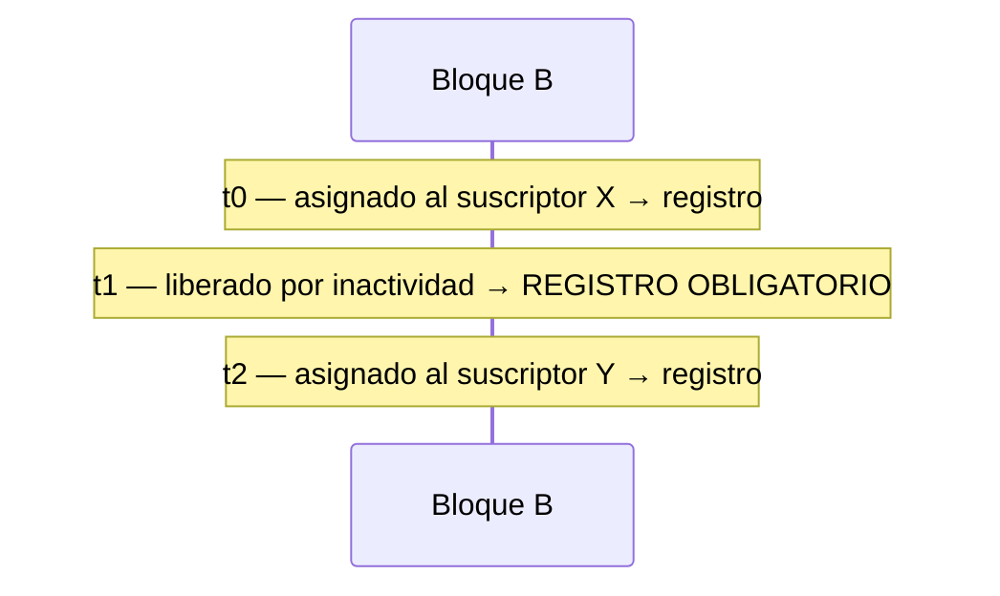

# Logging IPFIX y trail de auditoría

Dos cosas diferentes con el mismo objetivo — poder responder *"¿quién estaba usando esta IP pública, en este puerto, en este instante?"* — y que se aplican a modos diferentes.




:::info
**El equipo no guarda los registros de conexión: los exporta, y quien guarda el año de retención es su colector.** El volumen de log del equipo tiene solo dos cosas: el trail de configuración y el spill (desborde) del exportador, los registros que un colector caído todavía no recibió. El spill de cada transporte se detiene en 256 MB, sea cual sea el tamaño del volumen: ese techo es lo que dice cuánto tiempo aguanta el equipo exportando hacia un colector inalcanzable, y nada ahí es historial.

:::

# Modo determinístico: la configuración **es** el log

No existen eventos de asignación por suscriptor, así que no hay nada que exportar. La prueba ofrecida a una autoridad es:

> el algoritmo, más la configuración que estaba vigente en ese instante

Eso solo se sostiene mientras se sepa **qué** configuración estaba vigente. Para eso existe el **trail de configuración**.

**Una excepción: la** `**reserve**`**.** Un pool determinístico con `reserve` guarda bloques fuera de la fórmula para entregarlos a quien llena su propio bloque. Esos son justamente los bloques que la fórmula **no** produce, así que cada uno sale como `natEvent 16` al entregarse y `natEvent 17` al volver, igual que un bloque de un pool BPA — y un pool así necesita la exportación activada como un pool BPA.

## El trail de configuración

Propiedades que no son accidentales:

* **Append-only** — nada se reescribe.
* `**fsync**` **en cada entrada** — sobrevive a un corte de energía.
* **Lleva la definición entera, no un diff** — reconstruir el estado de una fecha sumando diffs desde el comienzo es frágil; guardar el estado completo no lo es.
* **Registra al operador que hizo el cambio**, capturado en el instante en que se aplica el cambio.
* **No solo la definición del pool**: cada forward agregado o eliminado, y cada interfaz activada o desactivada del CGNAT, con el lado (`inside` u `outside`) en la línea. Los pools dicen *cómo* traducir y las interfaces dicen *dónde*; un trail que omitiera lo segundo describiría un mapeo que tal vez ni siquiera estaba vigente.
* **Cada entrada termina con un número de secuencia y un resumen SHA-256**, que es lo que permite probar que no fue editada (más abajo).

Cada entrada nombra a quien hizo el cambio en uno de estos formatos:

| En la línea | Qué quiere decir |
|-------------|------------------|
| `by marina uid 1001 via api` | la VTY conocía el nombre de la cuenta y el uid con que actuaba |
| `by marina uid 0 via api` | marina, **actuando como root** — lo que ninguno de los dos campos dice por sí solo |
| `by uid 1001 via api` | el sistema no pudo nombrar la cuenta; el número es lo que se sabe |
| `by unattributed via cli` | escrito directamente en el dataplane, donde no hay sesión a la que preguntar |
| `by unattributed via api` | un cliente de la API que no envió ninguna identidad |

Una entrada que no puede atribuirse a alguien **lo dice**, con la palabra `unattributed`. Omitir el campo sería indistinguible de una entrada en la que nadie fue responsable — y un pedido sin nombre y sin uid se registra como no atribuido, nunca se le acredita a root.


:::info
**Lo que la atribución es, y lo que no es.** Es el registro de qué operador hizo qué entre las personas que ya tienen acceso al equipo — que es lo que es un trail de auditoría. No es una prueba contra quien tiene acceso: el cliente declara su propia identidad, y quien alcanza la API ya puede reconfigurar el equipo.

:::

```
show cgnat history
```

En el trail, un pool BPA aparece como `mode dynamic`, la palabra de antes de la 0.151.0: una entrada nunca se reescribe, y las nuevas usan la misma palabra que las antiguas.

# Modo BPA: IPFIX por bloque

Un registro por **asignación de bloque** (RFC 8158) — no por flujo. Es la diferencia entre algunos registros por suscriptor por día y uno por conexión.

Tres transportes, que pueden estar activos al mismo tiempo:

| Transporte | Por dónde sale | Cuándo usarlo |
|------------|----------------|---------------|
| IPFIX sobre UDP | por el contenedor de log del equipo, desde un socket en la dirección `src`; por el propio dataplane cuando el exportador está en una VRF, cuando el contenedor no puede usar esa dirección o cuando no está en marcha | telemetría. Pierde registros bajo congestión, sin aviso |
| IPFIX sobre TCP | por el Linux del equipo (el contenedor de log; el propio dataplane, si el contenedor no está en marcha), con spill en disco si el colector se cae | **retención legal**. Lleva la identidad del suscriptor, como el syslog; el UDP no |
| syslog (RFC 5424 sobre TCP) | por el Linux, con el mismo spill | el colector que solo lee syslog, que es la mayoría |


:::warning
**Un pool BPA sin ninguna exportación es un pool que no puede responder a una orden judicial.** En modo BPA el registro exportado es la única prueba de quién tenía un puerto público. `commit check` y `commit` advierten, nombrando el pool, cuando un pool BPA — o determinístico con `reserve` — va a quedar en un equipo en el que nada exporta: ni UDP activado con colector, ni colector TCP, ni syslog. Es una advertencia y no un rechazo, porque un pool montado antes de que exista el colector es una configuración correcta; pero no lo deje llevando suscriptores así.

:::

## Configurar

La exportación por UDP necesita saber **adónde** ir antes de activarse. Son dos comandos, en este orden:

```
configure
 nat
  cgnat
   logging udp <colector> src <origen> [port <n>]   destino del UDP
   logging enable                                  activa la exportación UDP
   exit
  exit
 commit
```

`src` es la dirección de origen de los paquetes IPFIX y **no es opcional**: sin ella el equipo rechaza. Use una dirección que el colector reconozca como de este equipo — normalmente la de gestión. Sin `port`, vale 4739, el puerto registrado por la RFC 7011.

Los demás comandos, todos dentro de `nat` > `cgnat`:

| Comando | Qué hace |
|---------|----------|
| `logging tcp <colector> [port <n>]` | exportación por TCP |
| `logging tcp disable` | desactiva el transporte TCP |
| `logging syslog <colector> enterprise <n> [port <n>] [facility <0-23>] [severity <0-7>]` | exporta los mismos eventos como líneas syslog (RFC 5424) |
| `logging syslog disable` | desactiva el transporte syslog |
| `logging udp disable` | borra el destino UDP |
| `logging disable` | desactiva la exportación UDP |

El destino UDP vuelve en `show running-config`, sobrevive a `save`, a `rollback` y al arranque — y se reaplica en el orden correcto, el destino antes que el estado.

### Si activa la exportación sin decir adónde

`commit check` rechaza antes de aplicar cualquier cosa:

```
error: cgnat logging enable: UDP export has no collector
    nothing would leave this box; add 'logging udp <collector> src <source>'
    beside it under 'nat' / 'cgnat', or export over TCP with 'logging tcp
    <collector>'
    the dataplane refuses the statement, and it would refuse it half way
    through this commit
```

`logging tcp` **no** satisface ese requisito: los dos transportes son caminos independientes, y `logging enable` activa el de UDP.

El rechazo vale cuando es **este cambio** el que crea el problema. En un equipo que ya está en ese estado — exportación activada y el destino borrado por debajo — la misma frase sale como `warning:` y el commit pasa, porque si no la única configuración que el equipo no podría aplicar sería justamente la que lo corrige.


:::warning
**En versiones hasta la 0.63.0 la exportación por UDP no funcionaba en ningún appliance instalado.** No había comando en la VTY que dijera a qué colector enviar, así que el dataplane rechazaba `logging enable` — y, hasta la 0.63.0, el `commit` respondía `commit complete` por encima de ese rechazo. Una operación que creía estar guardando registros de retención legal no estaba guardando nada.

Si usted opera en modo BPA (llamado `dynamic` hasta la 0.151.0) y activó la exportación por UDP en una versión anterior, trátelo como un hueco de retención en ese período: los registros de ese intervalo no existen. La exportación por TCP nunca se vio afectada.

:::

### Verificar que realmente está exportando

```
show cgnat logging       estado de la exportación y adónde va
```

Una línea `exporter` con dirección es la prueba de que existe un destino; `exporter none` significa que nada sale por UDP, **incluso con el estado** `**enabled**` — borrar el destino no desactiva la exportación, solo la deja sin adónde ir.

La misma pantalla tiene una parte para el transporte TCP y otra para el syslog. Cada una dice el colector y si está `connected`, `connecting` o `disconnected`, cuánto se envió ya y cuánto está pendiente, y la línea `spill`: bytes en el disco, cuántos ya volvieron al colector y cuántos se descartaron. Un transporte desactivado aparece como `disabled`.

Encima de las dos, una línea dice quién lleva los flujos TCP: `TCP streams carried by the log container`, el contenedor de log del equipo, o `TCP streams carried by the dataplane` cuando no está en marcha. En la parte del UDP, la línea `sender` dice lo mismo para el IPFIX sobre UDP y, cuando es el dataplane, por qué. Y la línea `file` de cada transporte dice cuántos bytes tiene ahora el archivo de spill, su techo (256 MB) y cuánto ya rechazó el techo.

El autotest de arranque también verifica esto, y compara dos cosas diferentes: lo que se le ordenó hacer al equipo y lo que el dataplane realmente tiene. Si la configuración pide exportación y el dataplane no la tiene, el arranque falla y dice cuál de las dos mitades no funcionó — porque una configuración rechazada es indistinguible de una que está funcionando cuando se mira solo el archivo.

```
show cgnat logging       estado de la exportación
show cgnat blocks        bloques actualmente asignados (y cuántos están retenidos)
```

Los bloques en uso ahora; los registros ya exportados están en el colector.

### Ver los registros en vivo

`show cgnat logging` muestra contadores. Para ver los propios registros que el equipo está exportando, uno por línea, mientras ocurren:

```
monitor cgnat logging
```

```
monitor cgnat logging   Ctrl-C to stop
  each block event as the dataplane exports it, at the time its record carries.
  Whether an event reached a collector is not known one by one: the '--' lines
  say what each stream sent.
21:26:05 BOOT      this dataplane has been up since 2026-10-02 21:26:01
21:26:10 ALLOC     100.64.0.5      > 200.150.0.16    1024-17407  pool din
21:26:10 EXHAUSTED 100.64.0.12     no free block in pool din
21:26:12 RELEASE   100.64.0.5      > 200.150.0.16    1024-17407  pool din
21:26:15 -- ipfix-udp 10.0.0.2:4739  by the dataplane:  +7 sent
21:26:15 -- +30 exhaustion repeats held back
```

Cada línea es un evento de bloque: `ALLOC` (el suscriptor recibió el bloque), `RELEASE` (lo devolvió), `EXHAUSTED` (lo pidió y no había bloque libre; uno por suscriptor cada 10 segundos, no uno por paquete rechazado), con la IP del suscriptor, la IP pública, el rango de puertos y el pool por su nombre. La hora es la misma que va en el registro. Cuando el equipo conoce la identidad del suscriptor (login PPPoE o DHCP), aparece justo debajo.

Las líneas `--` salen cada 10 segundos, solo cuando algo cambió, y dicen por transporte cuánto se envió, cuánto está esperando y cuánto se perdió. La pantalla no sabe si **un** registro específico llegó al colector — la exportación cuenta por transporte, no por registro — y lo dice en el encabezado.

Filtros, que pueden combinarse:

```
monitor cgnat logging subscriber 100.64.0.5      solo ese suscriptor
monitor cgnat logging public 200.150.0.16:2000   solo quien usa ese puerto público
monitor cgnat logging event release              solo un tipo de evento
monitor cgnat logging pool din                   solo ese pool
monitor cgnat logging seconds 60                 se detiene solo después de 60 s
monitor cgnat logging raw                        la forma en el cable
```

Con `raw`, cada evento sale como el registro IPFIX campo por campo (323 hora, 230 tipo de evento, 8 suscriptor, 225 IP pública, 361/362 puertos, 283 pool, 371 identidad) y, si el syslog está configurado, la línea RFC 5424 exactamente como la recibe el colector.

El monitor solo lee: no detiene, no atrasa y no le quita nada a la exportación. Si se queda atrás (un terminal lento, por ejemplo), dice cuántas líneas no mostró.

## Un bloque retenido por reenvío de puertos también es un evento

Un [Reenvío de puertos (port forward)](/s/wiki-es/doc/reenvio-de-puertos-port-forward-Px7qrbVWaq) en un pool BPA retiene el bloque del suscriptor mientras exista el forward. Retener genera una **asignación** y soltar genera una **liberación**, como cualquier otro bloque: en modo BPA el log es el único registro de quién tuvo un bloque, y un bloque retenido sin registro es un mapeo que nadie puede atribuir después.

Un segundo forward dentro de un bloque que ya está retenido **no** genera otro registro — el evento es del bloque, no del forward. Dos asignaciones del mismo bloque sin una liberación entre ellas es exactamente el hueco que hace que una consulta futura responda mal.

## Por qué existe TCP

Con UDP, la pregunta *"¿el colector lo recibió?"* no tiene respuesta — y la pregunta que realmente importa es **"¿qué pasa cuando el colector se cae?"**. Con UDP, la respuesta es silencio: los registros de retención legal desaparecen sin que nada lo indique.

Es exactamente ese el caso que verifica el producto: tirar el colector y verificar qué pasa con los registros.

# Ponerle nombre al suscriptor en el registro

Una orden judicial nombra a una persona. El registro nombra una dirección privada en un instante. Unir las dos cosas exigía un segundo sistema y un paso manual, hecho bajo presión por quien está de guardia — que es exactamente la condición en que se envía la respuesta equivocada.

El equipo pasa a llevar la identidad en el propio registro:

```
nat
 cgnat
  identity file /etc/prisma-routing/subscribers.map
  identity none
  exit
 exit
```

El archivo es un suscriptor por línea, escrito por su sistema de aprovisionamiento:

```
# los comentarios y las líneas en blanco se ignoran
100.64.0.5   joao.silva@isp
100.64.0.6   pppoe-4471
```

**O directamente del archivo de leases de su DHCP**, si usted ejecuta IPoE y ya tiene la respuesta:

```
nat
 cgnat
  identity dhcp-leases /var/lib/dhcp/dhcpd.leases
  exit
 exit
```

La gramática es la del ISC dhcpd. La identidad es el `client-hostname` cuando el lease tiene uno, y la dirección `hardware ethernet` cuando no lo tiene — lo primero es lo que reconoce soporte, lo segundo es lo que siempre existe. Un lease sin ninguno de los dos no se convierte en entrada, y esa dirección queda `unknown` en lugar de recibir algo inventado.

**Solo cuenta el lease** `**active**`**.** El archivo guarda todo lease que el servidor escribió alguna vez, y uno `free` todavía lleva el nombre del último cliente — nombrar a un suscriptor a partir de uno de esos es dar la respuesta equivocada a una orden judicial con apariencia de correcta. Una dirección renovada aparece varias veces y **gana la última**, que es lo contrario de la regla del mapa estático; por eso son dos comandos y no uno que adivine por el comienzo del archivo.

**El archivo se lee entero o se rechaza entero.** Una línea que no es comentario ni `<dirección> <identidad>` se rechaza indicando qué línea, y la tabla vigente no cambia — un aprovisionamiento que escribió una línea torcida puede haber escrito otra, y una tabla a la que le falta un suscriptor en silencio es justamente la falla que esto existe para evitar. Una dirección repetida también se rechaza: dos identidades para una dirección son dos respuestas a la pregunta que hace el juez, y elegir una sería el equipo decidiendo a qué suscriptor nombrar. Un nombre de más de 31 caracteres se lleva en parte, y el `show cgnat identity` cuenta cuántos se cortaron: el suscriptor existe, y un nombre parcial es mejor que ningún registro.

**O del accounting que su BNG ya envía**, si la autenticación es PPPoE y la respuesta ya existe en un RADIUS:

```
nat
 cgnat
  identity radius secret <secreto compartido> [port <n>]
  identity radius disable
  exit
 exit
```

Sin `port`, el equipo escucha en el 1813, el puerto de accounting de RADIUS. `identity radius disable` cierra el listener.

Aquí el equipo no es el servidor RADIUS: no autentica a nadie y no responde Access-Request. Es un segundo destino del accounting, del que lee una sola cosa — qué suscriptor está en qué dirección. Un `Start` o un `Interim` que trae dirección y nombre dice quién está ahí, un `Stop` quita el nombre, y un `Interim` sin dirección no cambia nada, porque adivinar de qué dirección hablaba es exactamente como un suscriptor termina nombrado en el registro de otro.

**El secreto es obligatorio y se verifica en todo paquete**, y el paquete que no coincide se descarta sin respuesta. Sin esa verificación, cualquiera que alcance el puerto nombraría a cualquier suscriptor en cualquier dirección, y el log de compliance pasaría a aceptar dictado. Los dos rechazos se cuentan por separado — un autenticador malo es el equipo de otro (o el secreto de este equivocado), un paquete malformado es el cliente roto de alguien:

```
prisma> show cgnat identity
identity table: 3 entry(s), read 2026-09-18T06:41:02Z
radius accounting: listening on port 1813
  packets    2 received, 1 applied, 1 answered
  refused    1 bad authenticator, 0 malformed
```

**El secreto no vuelve en ninguna pantalla.** El `show configuration` imprime `secret <set, not shown>`, y el archivo guardado guarda el valor real — el equipo necesita levantar su propio listener después de un reinicio. Es el mismo tratamiento que ya tiene la community SNMP.

**La identidad se toma en el instante de la asignación**, no en el momento en que sale el registro. Entre una cosa y otra el lease puede haber cambiado de dueño, y un registro que nombra a quien tiene la dirección después es un registro bien formado, guardado, y equivocado.

**Y la liberación repite el nombre que dijo la asignación.** El bloque guarda el nombre con que fue anunciado, y el registro de liberación lee ese nombre de vuelta, aunque la tabla haya cambiado en el medio - un lease que cambió de dueño, un `Stop` del RADIUS, un mapa reescrito. Así cualquiera de los dos registros responde por sí solo a una orden judicial, y lo que dice sobre el mes pasado es lo que era verdad el mes pasado. Cuando no hay nombre guardado - un suscriptor que la tabla nunca tuvo -, la liberación consulta la tabla vigente en ese instante.

**Una dirección que el equipo no conoce se convierte en** `**unknown**`**, y el registro sale así de todos modos.** Un registro faltante es peor que un registro incompleto, y el colector necesita distinguir "el equipo no sabe" de "el equipo no lo dijo".

**Es un dato personal, y nada imprime una entrada.** El `show cgnat identity` dice cuántas entradas existen y cuándo se leyó el archivo - y, en un equipo sin tabla, que todo registro va a decir `unknown`:

```
prisma> show cgnat identity
identity table: 3 entry(s), read 2026-09-18T06:41:02Z
```

Ninguna otra pantalla de este equipo lleva identidad. Su presencia en el log es la razón por la que el log está protegido.

**En los dos transportes que la llevan:** en syslog va como `subscriberId` dentro del dato estructurado; en IPFIX sobre TCP va como elemento **371** `**userName**`. El id del template del registro de bloque pasó de 256 a 258 por eso — IPFIX no permite que un id signifique dos conjuntos de campos, y un colector con el 256 en caché leería los primeros bytes de la identidad como id de pool. Si su colector guarda templates, simplemente va a esperar el nuevo, que el equipo reenvía cada minuto.

El exportador **UDP** no cambió: sigue con los siete campos de la RFC 8158 y sin identidad.

**Suscriptor solo IPv6, de un** [**pool NAT64**](/s/wiki-es/doc/nat64-suscriptores-solo-ipv6-en-el-mismo-espacio-publico-45g9ORUleS)**:** quien lo nombra es el `Delegated-IPv6-Prefix` (atributo 123 de la RFC 4818), el prefijo que delegó el BNG. El registro lleva el nombre de la delegación que **cubre** el prefijo del suscriptor: un /56 delegado a cada cliente de un pool cortado en /56, o un /48 que cubre todos los /56 de una empresa. Una delegación más larga que el suscriptor — un /60 dentro de un /56 — cubre solo parte de él, y el registro dice `unknown`. Una delegación nueva sustituye a cualquier otra con la que se superponga: el prefijo delegado ahora es de ese cliente, y la entrada antigua es un `Stop` que no llegó.

**Cuando el propio equipo es el BNG** (PPPoE), quién tenía cada dirección interna lo registra él mismo: el historial de sesiones, `show pppoe history`, escrito al inicio y al fin de cada sesión, responda o no el RADIUS, encadenado por hashes como el trail de configuración y guardado en el mismo volumen de log. La dirección interna y el instante de un registro de bloque llevan al suscriptor con `show pppoe history address <dirección> at <hora>`; vea *Configuración de PPPoE*.

**El accounting se lee cada segundo, con o sin exportación activada.** Antes solo se leía después de que salía el primer template IPFIX — hasta un intervalo de template después del `logging enable` —, y todo bloque asignado en ese lapso salía `unknown` aunque el BNG ya hubiera dicho quién era.

# Cuando su colector solo habla syslog

La mayoría de los colectores de ISP leen syslog y nada más. Los mismos eventos salen como líneas **RFC 5424**, sin cambiar lo que se registra: un registro por asignación y por liberación, nunca por flujo.

```
nat
 cgnat
  logging syslog 10.0.0.9 enterprise 44444
  exit
 exit
```

Una línea de asignación llega así:

```
<134>1 2026-09-18T02:40:59.123Z cgnat-sp-01 prisma-cgnat - BLOCK-ALLOC
[cgnat@44444 natEvent="16" subscriber="100.64.0.5" public="200.150.0.16"
portStart="1024" portEnd="1027" pool="0" subscriberId="joao.silva@isp"]
100.64.0.5 -> 200.150.0.16 ports 1024-1027 pool 0
```

(partida aquí en tres líneas para que quepa en la página; llega como una sola línea.)

El campo que viene después de `prisma-cgnat -` dice qué es la línea, y es por él que se filtra:

| Nombre | Evento |
|--------|--------|
| `BLOCK-ALLOC` | bloque asignado (`natEvent` 16) |
| `BLOCK-RELEASE` | bloque liberado (`natEvent` 17); la frase al final dice `released` en lugar de la flecha |
| `PORTS-EXHAUSTED` | puertos agotados (`natEvent` 12) |
| `BOOT-MARKER` | el marcador de reinicio, con el instante en que comenzó esta encarnación del dataplane |

`subscriberId` viene siempre: con el nombre de la tabla de identidad, o `unknown` cuando el equipo no sabe quién estaba en la dirección.

**La hora es la misma del registro IPFIX, con la misma precisión de milisegundo, en UTC.** Eso es lo que permite poner los dos lado a lado: un log cuyo reloj no puede compararse con el otro no corrobora nada — y corroborar es la razón de que exista un segundo transporte.

**El número de empresa es suyo, y no tiene valor por defecto.** La RFC 5424 reserva un nombre de dato estructurado sin sufijo `@empresa` para nombres registrados en la IANA, y este producto no tiene uno. Inventar uno pondría, en el log de todo operador, un nombre que mañana significa otra cosa para quien lo registre. Entonces el equipo **rechaza** el comando sin `enterprise <n>` — en el prompt, donde se puede resolver, y no en un año de líneas que el colector interpretó mal.

El transporte es TCP, con encuadre por conteo de octetos (RFC 6587): el tamaño y un espacio antes de cada línea. El puerto por defecto es 601. Vale lo mismo que para el IPFIX sobre TCP — si el colector se cae, los bytes van a un archivo de spill en el propio equipo y vuelven al reconectar, en orden. Cada transporte tiene su propio archivo.

Los dos pueden estar activos al mismo tiempo: el colector del proveedor leyendo syslog y otro leyendo IPFIX. `logging syslog disable` desactiva solo el syslog.

| Usted escribió | El equipo dice |
|----------------|----------------|
| `logging syslog 10.0.0.9` | `an enterprise number is required`, con el porqué |
| `... enterprise 9 sideways 2` | `not an option of this statement`, listando las que sí lo son |
| `... enterprise 9 port 70000` | `port is 0-65535` |
| `... enterprise 9 facility 24` | `facility is 0-23` |

# El formato del registro (RFC 8158)

Cada registro exportado tiene estos campos:

| IE  | Nombre | Bits | Obligatorio | Contenido |
|----:|--------|-----:|-------------|-----------|
| 323 | `observationTimeMilliseconds` | 64   | sí          | instante del evento, en UTC |
| 230 | `natEvent` | 8    | sí          | 16, 17 o 12 |
| 8   | `sourceIPv4Address` | 32   | sí          | dirección del suscriptor |
| 225 | `postNATSourceIPv4Address` | 32   | sí          | dirección pública asignada |
| 361 | `portRangeStart` | 16   | sí          | inicio del bloque |
| 362 | `portRangeEnd` | 16   | no          | fin del bloque |
| 283 | `natPoolId` | 32   | no          | índice del pool |

Y un **segundo template**, con dos campos, que lleva el marcador de reinicio:

| IE  | Nombre | Bits | Contenido |
|----:|--------|-----:|-----------|
| 323 | `observationTimeMilliseconds` | 64   | instante en que se escribió el marcador |
| 160 | `systemInitTimeMilliseconds` | 64   | instante en que comenzó esta encarnación del dataplane |


:::warning
**Los registros recolectados por TCP en versiones hasta la 0.34.0 tienen ese campo equivocado.** Llevaban segundos desde el arranque del VPP en lugar de la hora del día — el colector decodificaba una asignación como `00:00:05`. El exportador UDP, que llevaba los mismos eventos, decodificaba la hora correcta.

Tres consecuencias, y la tercera es la que importa para la retención legal:

* los registros de arranques diferentes **no se pueden ordenar**, porque el reloj vuelve a cero en cada reinicio y el log anda hacia atrás;
* los dos transportes no podían corroborarse entre sí, que es la única razón para ejecutar los dos;
* **un pedido que nombra una hora del día — que es todo pedido que este log existe para responder — no podía resolverse.**

Corregido en la **0.35.0**. Un log ya recolectado por TCP puede repararse si se conoce la hora de arranque del equipo; **nada recupera el ordenamiento entre reinicios**. Si usted opera en modo BPA y recolectó por TCP en una versión anterior, trátelo como un problema de retención, no de cosmética.

:::

**Un suscriptor de un** [**pool NAT64**](/s/wiki-es/doc/nat64-suscriptores-solo-ipv6-en-el-mismo-espacio-publico-45g9ORUleS) tiene un template propio, porque IPFIX no tiene un campo que sea "una dirección IPv4 o IPv6". Es la misma tabla con la dirección IPv6 en lugar de la IPv4, como indica la sección 4.6.10 de la RFC 8158 — más el tamaño del prefijo, que la RFC no lista y este equipo necesita: el suscriptor es el prefijo delegado, y solo la dirección nombraría un /128 de él.

| IE  | Nombre | Bits | Contenido |
|----:|--------|-----:|-----------|
| 27  | `sourceIPv6Address` | 128  | el prefijo delegado del suscriptor, dirección de red |
| 29  | `sourceIPv6PrefixLength` | 8    | su tamaño, el `subscriber-length` del pool |

Los demás campos son los mismos y en el mismo orden. En syslog el suscriptor sale como prefijo, `subscriber="2001:db8:1200:ab00::/56"`. Un pool NAT64 determinístico no registra ningún bloque, como el IPv4: el trail de configuración guarda el prefijo IPv6 interno, el `subscriber-length` y el `nat64-prefix`, y con ellos la fórmula responde por cualquier instante.

Los tres valores de `natEvent` usados:

| Valor | Evento |
|------:|--------|
| **16** | bloque asignado (incluye extensión) |
| **17** | bloque liberado |
| **12** | puertos agotados (uno por suscriptor cada 10 segundos) |

# Por qué la liberación es obligatoria

Este es el punto más fácil de perder, y cambia la respuesta jurídica.



Un juez pregunta quién tenía (IP, puerto en B) en **t1.5**. La consulta natural — *"la última asignación antes de ese instante"* — responde **X**.


:::warning
Es incorrecto: en t1.5 nadie tenía ese bloque. El proveedor entregaría a un suscriptor inocente.

En t0.5 y t2.5 la misma consulta acierta. El error aparece **solo en el hueco**, que es exactamente donde nadie prueba.

:::

Por eso el `natEvent 17` en la liberación es corrección, no capricho.

# Cuando el equipo se detiene, y cuando se cae

El mismo hueco aparece en el reinicio, y por un motivo más común que la inactividad: **todo reinicio planificado** dejaría atrás un bloque retenido en el instante de la detención, sin ninguna liberación.

El paquete de actualización **no** pasa por aquí: cambia los archivos y no reinicia nada, así que los bloques del dataplane antiguo se cierran cuando usted lo reinicie, en el horario que elija. La reinstalación desde el medio sí pasa, porque empieza deteniendo el equipo.

## Detención planificada

Una detención ordenada del dataplane - `system dataplane restart`, `system reboot`, `system shutdown` - **libera todos los bloques antes de salir**. Sale un `natEvent 17` por cada bloque todavía retenido, en todo transporte activo, con la marca del **instante de la detención**.

Lo mismo vale para un pool borrado, o cambiado por un cambio de prefijo o de tamaño de bloque: cada bloque que tenía se cierra con un `natEvent 17` en el instante del cambio, antes de que el pool deje de saber de quién era.

El instante es el de la detención y no uno anterior a propósito: el equipo no observó el momento en que el bloque dejó de usarse, y un registro que adivinara ese momento sería un registro inventado.

## Cuando el colector está atrasado en el momento de la detención

Las liberaciones se escriben en el instante de la detención, pero el colector puede no estar listo para recibirlas todas de una vez. Dos casos, y el segundo es el común:

* un colector lento, o que dejó de leer sin cerrar la conexión;
* un equipo con **muchos bloques retenidos**. La detención escribe una liberación por bloque, de una sola vez, y eso es más de lo que cabe en el socket en una pasada.

En los dos casos los bytes que sobraron **no se pierden** mientras haya dónde escribir: van a un archivo en el disco del propio equipo, `/var/log/prisma-routing/ipfix-spill.bin` para el IPFIX sobre TCP y `/var/log/prisma-routing/syslog-spill.bin` para el syslog, y vuelven en la próxima conexión con el colector, en el orden en que se escribieron. Son los mismos archivos que cubren un colector caído, y cada uno se detiene en 256 MB.

Lo que esto cambia para quien opera:

* después de un reinicio, parte de las liberaciones puede llegar al colector **algunos segundos después de que el equipo vuelva**, y no en el instante de la detención. La marca de cada registro sigue siendo el instante de la detención, que es lo que responde a una orden judicial;
* mientras la exportación por TCP no vuelva a conectarse, el archivo queda en el disco. Un equipo apagado en forma definitiva deja esos registros ahí - copie el archivo antes de dar de baja el equipo;
* el estado de la exportación muestra, por transporte, cuántos bytes fueron al archivo, cuántos ya volvieron y cuántos se descartaron. El descarte solo ocurre cuando no hay dónde escribir o cuando el archivo llegó a su techo de 256 MB, y se cuenta - nunca es silencioso. Un descarte en la propia detención, cuando el contador muere junto con el proceso, se informa en el registro del sistema con cuántos bytes no pudieron escribirse.

```
show cgnat logging
```


:::info
Medido con el colector leyendo normalmente y 4001 bloques retenidos: 70 kB de liberaciones todavía estaban en el buffer de salida en el instante en que terminó el proceso, cerca de 1500 registros. Todos llegaron al colector en el reinicio siguiente.

:::

## Corte de energía

Un equipo que pierde energía, que es terminado por el kernel por falta de memoria o que entra en pánico **no emite nada** - y no hay nada que hacer al respecto: no existe un instante en que podría haber escrito el registro. Sus asignaciones quedan abiertas.

Por eso la detención ordenada por sí sola **no** resuelve el problema. Cierra los casos que el equipo vio venir, y dejaría a quien lee el log convencido de que toda asignación abierta es una asignación vigente - equivocándose justamente en los equipos que se cayeron.

## El marcador de reinicio

Para separar los dos casos, el equipo anuncia **cuándo comenzó esta encarnación del dataplane**, en un segundo template, en el campo `systemInitTimeMilliseconds` (IE 160) - que la IANA registra exactamente como *"el instante absoluto de la última (re)inicialización del dispositivo IPFIX"*. El anuncio sale cada 30 segundos por UDP, y una vez por boot, al comienzo del flujo, por TCP y por syslog.

Con eso, una asignación sin liberación pasa a tener tres lecturas, y no dos:

| Lo que tiene el colector | Lectura |
|--------------------------|---------|
| asignación y liberación  | el suscriptor tuvo esos puertos entre los dos instantes - respuesta exacta |
| asignación sin liberación, y el valor del marcador **no** cambió después | **todavía vigente**: el suscriptor tiene esos puertos ahora |
| asignación sin liberación, y el marcador anunció un valor **nuevo** después | **terminó en ese reinicio**: el equipo se cayó reteniendo el bloque y no observó el final. La respuesta honesta es la ventana entre el último registro de la encarnación anterior y el nuevo instante de inicio - no un instante |


:::info
El valor del marcador queda **latched** al inicio del proceso y no se recalcula. Lo que importa es que **cambie** cuando el proceso se sustituye; un valor recalculado en cada envío saltaría con cada ajuste de reloj y se leería como un reinicio que no hubo.

En compensación, un equipo cuyo reloj todavía estaba mal cuando subió el dataplane lleva un valor absoluto incorrecto hasta que se reinicie. Sigue siendo diferente del de la encarnación anterior, que es para lo que lo lee el colector.

:::


:::warning
**Un colector que no conoce el IE 160 sigue viendo asignaciones abiertas y no puede distinguirlas.** Eso no es un defecto del equipo: los registros salen, el segundo template se anuncia junto con el primero, y quien decodifica es el colector. Al elegir o configurar un colector para retención legal, confirme que guarda el `systemInitTimeMilliseconds` por exportador y reprocesa las asignaciones abiertas cuando ese valor cambia.

:::

## Verificar

La línea del marcador aparece en el estado de la exportación, con el template que lo lleva, cuántos salieron ya y el instante de inicio de esta encarnación:

```
show cgnat logging
```

Si el número de marcadores enviados no sale de cero con la exportación activada, el colector no tiene cómo separar los dos casos de arriba - trátelo como que la exportación está rota, no como cosmética.

# Verificar que el trail no fue adulterado

Cada entrada del trail lleva un número de secuencia y un resumen SHA-256 sobre **el resumen anterior y el propio texto**. Cambiar un byte cambia el resumen de esa entrada y de todas las siguientes — una alteración no se puede hacer "cerrar" corrigiendo solo la línea en la que está.

```
show cgnat history verify
  7 entries checked, chain intact
  head  seq 7 sha256 4e98de83…81f4
```

Tres formas en que un trail puede estar mal, y se informan **por separado**:

| Qué se hizo | Qué se informa |
|-------------|----------------|
| se alteró el texto de una entrada | `BROKEN at entry 2` — la entrada entera, y que no coincide con su propio resumen |
| se eliminó una entrada del medio | `BROKEN before entry 4` — la secuencia salta de 2 a 4 |
| se eliminaron entradas del final | `TRUNCATED: the file ends at entry 5 and this dataplane wrote up to 7` |

La **secuencia se verifica antes que el resumen**, y ese orden es el diagnóstico: eliminar una entrada también rompe el resumen de la siguiente, así que un verificador que mirara el hash primero informaría toda eliminación como alteración — de la línea inocente después del hueco, enviando a quien investiga a una línea que nadie tocó.

Las entradas escritas antes de que existiera la cadena siguen siendo legibles y se informan como **no cubiertas**, nunca contadas como limpias. Un archivo sin ninguna entrada encadenada se informa como `no chained entries: nothing here is covered` — nunca como íntegro, porque perder la cadena entera es lo primero que alguien intentaría.


:::info
**Lo que esto prueba, y lo que no prueba.** Detecta un trail que fue **editado**, y dice dónde. Lo que no hace es impedir que alguien con acceso de escritura al archivo **y** a este algoritmo reescriba el trail entero recalculando todos los resúmenes. Una cadena que verifica prueba que el archivo no fue editado — no que es el mismo archivo. Compare el resumen de arriba con la copia en su syslog remoto.

:::

# Lo que se rechaza

**El log por flujo no existe y no va a existir.** Es precisamente lo que el bloque de puertos se hizo para evitar. Un CGNAT que registra cada flujo genera un volumen que ningún proveedor puede guardar durante un año de forma útil.

# Ver también

* [Comandos show](/s/wiki-es/doc/comandos-show-yfCeHVInDX) — cómo leer `show cgnat translation` y qué prueba
* [Recetas del día a día](/s/wiki-es/doc/recetas-del-dia-a-dia-maiZboGbqY) — el procedimiento para atender una orden judicial
* [Reenvío de puertos (port forward)](/s/wiki-es/doc/reenvio-de-puertos-port-forward-Px7qrbVWaq) — el bloque retenido por un forward, y por qué es una asignación
* [Llevar el equipo a una versión nueva](/s/wiki-es/doc/llevar-el-equipo-a-una-version-nueva-m1PIajBXEF) — qué guarda el volumen de log, y qué borra una reinstalación
* [Enviar el log de eventos del equipo al syslog del NOC](/s/wiki-es/doc/enviar-el-log-de-eventos-del-equipo-al-syslog-del-noc-CUCA15bcYb) — el log de eventos del propio equipo (commits, enlaces, logins) es otro flujo
