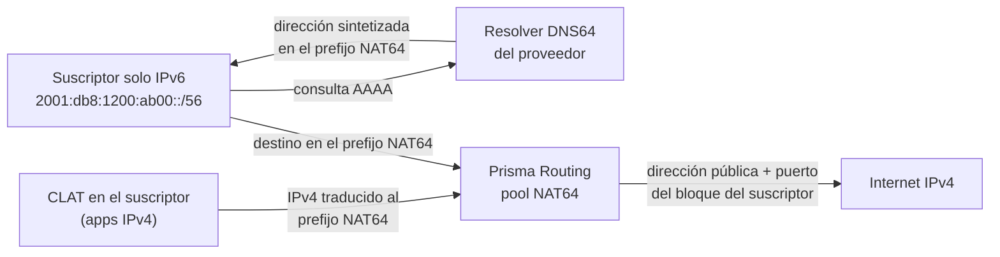

# NAT64 — suscriptores solo IPv6 en el mismo espacio público

Cómo poner en servicio un pool NAT64 para suscriptores que reciben solo IPv6 — FTTH o acceso móvil con prefijo delegado — y hacer que lleguen a la internet IPv4 por el mismo espacio público, dividido en bloques de puertos, que el CGNAT ya usa. Para quien opera el equipo y responde por sus registros.

# Cuándo usarlo

Un pool NAT64 es el CGNAT con el lado de adentro en IPv6. El lado de afuera es la misma dirección IPv4 escasa, repartida por puerto en bloques, y la pregunta que tiene que responder es la misma: quién tenía esa dirección pública y ese puerto en ese instante. Por eso usa la misma tabla de sesiones, los mismos bloques, el mismo logging y el mismo trail de configuración.

| Situación | Qué usar |
|-----------|----------|
| Suscriptor con IPv4 privada (100.64.0.0/10), con o sin IPv6 | un pool en `nat` > `cgnat` |
| Suscriptor **solo IPv6**, con prefijo delegado, que necesita llegar a destinos IPv4 | un pool en `nat` > `nat64`, esta página |
| Una aplicación IPv4 dentro de un suscriptor solo IPv6 (juego, VPN, dirección literal) | el mismo pool NAT64, con un CLAT del lado del suscriptor (464XLAT) |

DS-Lite, MAP-E/MAP-T y NPTv6 no forman parte del producto.

**El suscriptor es el prefijo, nunca el /128.** La dirección de un host dentro de un /64 cambia con las extensiones de privacidad, así que un mapeo determinístico atado a ella no podría existir. El prefijo delegado es estable, y es lo que RADIUS atribuye a una persona (Delegated-IPv6-Prefix). El pool corta sus prefijos internos en el largo `subscriber-length`, y cada pedazo es un suscriptor con su bloque.



# Antes de empezar

Necesita tres cosas definidas:

| Qué | Ejemplo en esta página | Por qué |
|-----|------------------------|---------|
| Los prefijos IPv6 de los suscriptores y el tamaño que recibe cada uno | `2001:db8:1200::/48`, cada suscriptor un /56 | son el lado de adentro del pool |
| El prefijo público IPv4 | `203.0.113.0/29`       | es el lado de afuera, como en un pool IPv4 |
| El prefijo NAT64 (RFC 6052) | `64:ff9b:1::/48`       | es adonde el suscriptor manda el tráfico destinado a IPv4 |

El prefijo NAT64 tiene largo 32, 40, 48, 56, 64 o 96. Sin `nat64-prefix`, el pool usa el prefijo bien conocido `64:ff9b::/96` — y, bajo él, las direcciones IPv4 que no son globales (privadas, compartidas, loopback, documentación y similares) nunca se alcanzan, como manda la RFC 6052.

# Paso a paso


1. **Marque la interfaz de los suscriptores como lado de adentro.** Es la misma marca que en un pool IPv4: la traducción NAT64 corre en las interfaces `cgnat inside`, y solo mientras existe un pool NAT64.

   ```
   configure
    interface enp2s0
     ipv6 address 2001:db8:ffff::1/64
     cgnat inside
     exit
   ```

   La interfaz pública sigue con `cgnat outside`, como en cualquier pool.
2. **Cree el pool en** `nat` **>** `nat64`. Un prefijo IPv6 en `prefix-inside` es lo que lo hace un pool NAT64.

   ```
    nat
     nat64
      pool v6
       prefix-inside 2001:db8:1200::/48
       subscriber-length 56
       nat64-prefix 64:ff9b:1::/48
       prefix-outside 203.0.113.0/29
       block-size 1024
       exit
      exit
     exit
   ```

   La cuenta de capacidad es la de un pool IPv4: un /48 en /56 son 256 suscriptores; 8 direcciones públicas, cada una con 63 bloques de 1024 puertos (puertos 1024 a 65535), dan 504 lugares. Un pool acepta hasta 2^28 suscriptores, y con IPv6 ese es un rechazo que se encuentra de verdad: `2001:db8::/32` en /56 cabe; en /64, no.
3. **Dé a la red las dos rutas que el pool necesita.** El prefijo NAT64 tiene que llegar a este equipo por el lado IPv6, y los prefijos de los suscriptores necesitan ruta de vuelta — como los suscriptores IPv4 detrás de un BNG.

   ```
    router static
     64:ff9b:1::/48 next-hop blackhole
     2001:db8:1200::/48 next-hop 2001:db8:ffff::2
     exit
   ```

   La ruta `blackhole` no retiene tráfico de ningún suscriptor: la traducción ocurre antes de la consulta de ruta. Solo le da a BGP algo para anunciar. Si el equipo tiene BGP, anuncie el prefijo NAT64 en la familia IPv6 (`network 64:ff9b:1::/48` bajo `address-family ipv6 unicast`); cuando nada lo anuncia, el `commit check` avisa, y el aviso ya trae las dos líneas que lo resuelven. El prefijo público IPv4 se anuncia como el de cualquier pool.
4. **Verifique y aplique.**

   ```
    commit check
    commit
    exit
   save
   ```

   El `commit check` rechaza por nombre lo que un pool NAT64 no acepta (vea **Límites**) y el pool escrito en el lugar antiguo, dentro de `cgnat`.
5. **Anuncie el prefijo NAT64 a los CLAT (PREF64).** Para 464XLAT, el CLAT del suscriptor tiene que conocer el prefijo NAT64, y en un equipo con más de un pool, o con un prefijo que no es el bien conocido, no tiene cómo adivinarlo. El equipo pone el prefijo en sus anuncios de router (la opción PREF64, RFC 8781), en la interfaz de los suscriptores:

   ```
   configure
    interface enp2s0
     no ipv6 nd suppress-ra
     ipv6 nd nat64 64:ff9b:1::/48
     exit
    commit
   ```

   `ipv6 nd nat64` sin prefijo anuncia `64:ff9b::/96`, y la línea puede repetirse, un prefijo por línea. El `commit check` rechaza la línea en una interfaz que no anuncia y rechaza un prefijo que ningún pool NAT64 del equipo traduce — un CLAT que aprendiera ese prefijo mandaría su IPv4 a un lugar donde el equipo descarta.
6. **Configure DNS64 en su resolver, con el mismo prefijo.** El equipo no es el resolver del suscriptor, así que no sintetiza registros AAAA ni responde `ipv4only.arpa` (RFC 7050). El resolver DNS64 que usted opera tiene que sintetizar con el mismo prefijo que el pool traduce y que el equipo anuncia; si los dos difieren, los dos métodos de descubrimiento no coinciden, y algunos CLAT prefieren la respuesta del DNS.


:::warning
**Antes de actualizar un equipo que tiene un pool NAT64 dentro de** `cgnat`**.** La forma antigua — un pool NAT64 escrito dentro de `nat` > `cgnat` — se rechaza en el `commit check` y cuando se carga el archivo guardado, nombrando la forma nueva, y nada la mueve sola. Reescriba el pool en `nat` > `nat64` antes de la actualización, o el equipo arranca sin aceptar ese archivo.

:::

# Los campos del pool

`nat64` guarda pools y nada más. Las interfaces, el logging, los timeouts y la memoria siguen en `cgnat`, compartidos por los dos tipos de pool. Un nombre de pool es un solo pool en los dos niveles: no existe `v6` en `cgnat` y otro `v6` en `nat64`.

| Campo | Qué hace por usted |
|-------|--------------------|
| `prefix-inside <prefijo IPv6>` | los prefijos de los suscriptores; puede repetirse. IPv6 es lo que hace NAT64 al pool, y un lado de adentro es de una sola familia |
| `subscriber-length <32-128>` | el largo del prefijo de un suscriptor; obligatorio en un pool NAT64, y ningún `prefix-inside` puede ser más largo que él |
| `nat64-prefix <prefijo IPv6>` | dónde están los destinos IPv4 (RFC 6052); `no nat64-prefix` vuelve a `64:ff9b::/96` |
| `prefix-outside <prefijo IPv4>` | el espacio público, como en un pool IPv4; nunca IPv6 |
| `block-size`, `ports`, `policy` | el bloque de cada suscriptor, por la misma fórmula de un pool IPv4 |
| `mode deterministic` o `mode bpa` | bloque por fórmula o bajo demanda; en `mode bpa` valen `max-blocks`, `initial-allocation` y `block-stride`, como en un pool IPv4 |
| `reserve` | bloques extra para quien llena el suyo, en un pool determinístico; registrados por el prefijo |
| `forward <proto> <puerto> to <host IPv6> <puerto>` | un puerto público del bloque del suscriptor fijado a un host de su prefijo — vea [Reenvío de puertos (port forward)](/s/wiki-es/doc/reenvio-de-puertos-port-forward-Px7qrbVWaq) |
| `tcp-mss` | ajuste del MSS en los dos sentidos; `auto` queda 20 por debajo del de IPv4, el tamaño extra del encabezado IPv6 |
| `vrf`, `outside-vrf` | la tabla IPv6 de los suscriptores y la tabla IPv4 por donde sale el tráfico traducido; dos clientes pueden tener el mismo prefijo interno y el mismo prefijo NAT64 en VRF distintas |
| `max-sessions`, `max-session-rate`, `utilisation-alarm` | los mismos límites y la misma alarma de un pool IPv4 |
| `alg ftp on` | FTP64 (RFC 6384): traduce EPSV/EPRT del cliente IPv6 a PASV/PORT del servidor IPv4. **Apagado a menos que usted lo pida**, al contrario de los ALG IPv4 |

Cambiar lo que define el mapeo — prefijos, `subscriber-length`, `nat64-prefix`, `block-size`, `ports`, `policy`, `mode`, `reserve` o VRF — reconstruye el pool, como en un pool IPv4: vea [Configuración de pool](/s/wiki-es/doc/configuracion-de-pool-Y3cACG9QHA).

# Cómo quedan los registros

El logging es el del CGNAT, configurado en `cgnat`, y sigue las mismas reglas — [Logging IPFIX y trail de auditoría](/s/wiki-es/doc/logging-ipfix-y-trail-de-auditoria-LHGHuvEHJy) tiene el resto. Lo que cambia es cómo se nombra al suscriptor: **siempre por el prefijo delegado**, nunca por el índice interno que usa la aritmética del pool — ese índice, leído como dirección IPv4, apuntaría a un cliente que no tiene nada que ver.

| Dónde | Cómo aparece el suscriptor NAT64 |
|-------|----------------------------------|
| IPFIX | un template propio: `sourceIPv6Address` (la dirección de red del prefijo) y `sourceIPv6PrefixLength` (el `subscriber-length`) en lugar de la dirección IPv4 de origen, con la dirección pública, el inicio y el fin del bloque y el pool |
| Syslog | `subscriber="2001:db8:1200:ab00::/56"` |
| RADIUS | el Delegated-IPv6-Prefix es lo que liga el prefijo a una persona |
| Trail de configuración (`show cgnat history`) | el pool registrado por su prefijo interno IPv6, su `subscriber-length` y su `nat64-prefix` — lo que permite recalcular el mapeo de cualquier instante |

Los eventos son los de IPv4: asignación, liberación y bloque agotado (registrado una vez por intervalo, por más paquetes que se rechacen).


:::info
**Un pool determinístico no genera eventos de bloque**, como en IPv4: el mapeo es la fórmula más la configuración fechada en el trail. Para responder a una orden judicial sobre un pool determinístico, el trail es la prueba; en un pool `mode bpa`, es el registro exportado.

:::

# Consultar y limpiar

Los comandos `show nat64` responden solo por NAT64. Si se les pregunta por un suscriptor IPv4, o por una dirección pública de un pool CGNAT, rechazan y dicen qué `show cgnat` responde. `show cgnat` sigue siendo el equipo entero: NAT44 y NAT64 comparten la tabla de sesiones, los bloques y el espacio público.

| Comando | Qué responde |
|---------|--------------|
| `show nat64 pool` | los pools NAT64 como los tiene el dataplane — los que traen una línea `inside6`; sin ninguno, la respuesta es `no NAT64 pools configured` |
| `show nat64 subscriber <dirección IPv6>` | todo sobre un suscriptor, por **cualquier** dirección dentro de su prefijo: la dirección pública y el bloque |
| `show nat64 translation <dirección pública> <puerto>` | quién estaba detrás de esa dirección y ese puerto: el prefijo del suscriptor, el pool y el bloque. En un pool determinístico la respuesta vale para cualquier instante (es la fórmula); en un pool `mode bpa`, solo para ahora — para el pasado, la respuesta es el registro |
| `clear nat64 subscriber <dirección IPv6>` | termina todas las sesiones de un suscriptor, por cualquier dirección del prefijo; en un pool `mode bpa`, el bloque vuelve a quedar libre después del hold-down |
| `show cgnat top`, `blocks`, `forward`, `alg`, `drops`, `memory` | los dos tipos de pool juntos; `top` nombra al suscriptor NAT64 por su prefijo |

# En un par activo/standby

El modelo de alta disponibilidad es el de IPv4: nada se sincroniza entre los equipos, y un pool determinístico pone el mismo prefijo en la misma dirección pública y el mismo bloque en los dos, porque el bloque es función de la configuración. `subscriber-length` y `nat64-prefix` entran en la comparación de mapeo del par, así que `show cgnat ha` y el rechazo de commit en un par divergente ven los dos.

Lo que un pool NAT64 necesita además es un gateway IPv6 que acompañe al maestro. Una dirección IPv6 bajo un `vrrp <vrid>` en la interfaz de los suscriptores crea el router virtual IPv6 de ese id, con la prioridad, el tracking y el preempt del IPv4:

```
interface enp2s0
 ipv6 address 2001:db8:ffff::2/64
 ipv4 address 100.64.3.252/22
 vrrp 1 address 100.64.3.254
 vrrp 1 address fe80::1
 vrrp 1 address 2001:db8:ffff::1
 vrrp 1 priority 200
 vrrp 1 track enp1s0 decrement 150
 exit
```

* **El link-local primero** (RFC 5798): es hacia donde los suscriptores — o el BNG delante de ellos — apuntan su ruta. El `commit check` rechaza un router IPv6 sin link-local.
* **Los anuncios de router del equipo no son los del router virtual.** Un suscriptor que toma la ruta por defecto de un anuncio apunta al link-local del propio equipo, que no cambia de lugar. Apunte al link-local virtual.
* **El tracking es por familia.** Un router IPv4 que rastrea un lado de suscriptores solo IPv6 nunca lo ve arriba, y el `commit check` avisa: dele una dirección IPv4 a ese lado o rastree otra cosa.
* En un par cuyos routers virtuales son todos IPv4, el `commit check` avisa sobre cada pool NAT64: el gateway de los suscriptores IPv6 no acompañaría al maestro.

Medido en laboratorio con un suscriptor solo IPv6: el tráfico traducido volvió entre 2,8 y 4,0 segundos después de un cable de uplink desconectado, de un dataplane detenido y de un dataplane matado, siempre en la misma dirección pública y en un puerto del mismo bloque. Las conexiones abiertas se caen, como en IPv4: un flujo UDP vuelve en un puerto nuevo del mismo bloque, una conexión TCP se reinicia.


:::info
**Un pool NAT64** `mode bpa` **en un par no tiene esa medición.** Como en un pool BPA IPv4, el nuevo maestro asigna desde cero, así que el bloque del suscriptor — y tal vez la dirección — cambia en una conmutación. El paso a paso del par está en [Montar un par activo/standby](/s/wiki-es/doc/montar-un-par-activostandby-RHAskyjrZc).

:::

# Límites

| Qué | Por qué |
|-----|---------|
| `bypass` se rechaza, para siempre | un paquete IPv6 al prefijo NAT64 llega a IPv4 solo traducido; no existe camino sin traducción que un bypass pueda nombrar |
| Todo ALG excepto FTP se rechaza, para siempre | RTSP y SIP llevan direcciones en el cuerpo, que ninguna RFC traduce entre IPv6 e IPv4; PPTP usa GRE e IPsec usa ESP, que el NAT64 stateful no transporta. IPsec cruza como NAT-T en UDP 4500, sin ALG |
| `prefix-list-inside` y `prefix-list-outside` se rechazan | son conjuntos IPv4; los lados de un pool NAT64 son sus prefijos |
| Un lado de adentro con IPv4 e IPv6 juntos se rechaza | un pool NAT44 y un pool NAT64 son dos pools |
| Un `prefix-outside` IPv6 se rechaza | el lado de afuera es siempre IPv4 |
| Una dirección pública pertenece a un solo pool | NAT44 o NAT64, nunca los dos |
| Una sesión NAT64 cuesta cerca de un tercio más de memoria que una IPv4 | la clave interna lleva la dirección IPv6 entera |
| Un paquete no solicitado al puerto público se descarta y se cuenta como `no session`, sin respuesta | como en un pool IPv4 |
| Un datagrama IPv4 fragmentable que pasaría de 1280 bytes en IPv6 se corta en 1280 | no se sabe que el camino hasta el suscriptor sea mayor que eso |

La traducción sigue la RFC 7915: TCP y UDP (un UDP IPv4 con checksum cero recibe uno, porque IPv6 no acepta cero), ICMP echo en los dos sentidos, errores ICMP con el paquete citado también traducido, y fragmentos en los dos sentidos.

# Cómo comprobar

```
show nat64 pool
```

El pool aparece con su línea `inside6`. Si la respuesta es `no NAT64 pools configured`, el pool no llegó al dataplane: vuelva al `commit check`.

```
show nat64 subscriber 2001:db8:1200:ab00::10
```

Cualquier dirección dentro del /56 de un suscriptor devuelve su dirección pública y su bloque. Genere tráfico de ese suscriptor hacia un destino IPv4 y compruebe el camino de vuelta:

```
show nat64 translation 203.0.113.3 44100
```

Con una dirección pública y un puerto que estén en el bloque del suscriptor, la respuesta es su prefijo. `show cgnat top` muestra al suscriptor por su prefijo, con los puertos en uso. En el colector, el registro de un pool `mode bpa` trae el prefijo (`sourceIPv6Address` y `sourceIPv6PrefixLength` en IPFIX, `subscriber="…/56"` en syslog).

Del lado del suscriptor: un CLAT que escucha los anuncios de la interfaz debe aprender el prefijo NAT64 por la opción PREF64, y una consulta AAAA de un nombre solo IPv4 a su resolver debe volver dentro del mismo prefijo.


:::success
El pool listado en `show nat64 pool`, el suscriptor con el bloque correcto en `show nat64 subscriber`, la traducción respondiendo con su prefijo y el colector recibiendo el registro con el prefijo: sus suscriptores solo IPv6 están saliendo por el mismo espacio público del CGNAT, y cada puerto sigue siendo respondible.

:::
