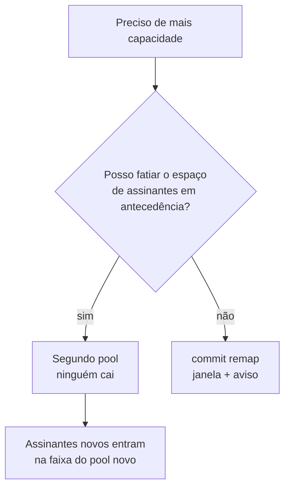

# Ampliar capacidade sem derrubar assinantes

Como acrescentar capacidade a um CGNAT em produção. Existe um caminho que derruba todos os assinantes e um que não derruba ninguém — esta página mostra os dois e diz quando cada um se aplica.

# Por que ampliar é perigoso aqui

O mapeamento é `índice do assinante → (endereço público, bloco de portas)`, **calculado** a partir dos conjuntos de endereços do pool, do tamanho do bloco, da faixa de portas e da política. Qualquer coisa que mude o **divisor** muda a resposta para quase todo mundo.

| Mudança | O que se move |
|---------|---------------|
| acrescentar ou remover um prefixo público | o divisor muda: **todos** os assinantes |
| mudar `block-size` | blocos por endereço mudam: quase todos — ficam parados só os cujo bloco começa na mesma porta |
| mudar `ports` | igual ao tamanho de bloco |
| mudar `policy` | `interleaved` e `blocked` dividem o índice de formas diferentes: **todos** |
| mudar `mode` | determinístico e dinâmico não são o mesmo mapeamento |
| acrescentar ou remover prefixo **inside** | muda o índice de todo endereço depois dele |
| timeouts, ALGs, `max-blocks`, MSS, limites, forwards, bypass | **nada** — são ajustes aplicados no lugar |

# O que não muda, mesmo no pior caso

* **Respostas passadas continuam resolvíveis.** A trilha registra a definição completa, datada em UTC, a cada mudança. Um pedido sobre o mês passado é respondido com a definição do mês passado.
* **Nada é corrompido.** Sessões terminam; elas não ficam erradas.
* **O log continua completo.** No modo dinâmico os eventos de alocação e liberação não são afetados; no determinístico não há nenhum a afetar.

# Meça antes

```
configure
 cgnat pool residencial
  outside 45.170.16.0/26
  exit
 commit check
```

`commit check` **não estima**: o dataplane segura as duas definições e roda a mesma aritmética que rodaria depois. Ele responde quantos assinantes se movem e para onde dois deles vão.


:::info
A diferença entre um operador que ouve *"isso muda o mapeamento"* e um que ouve *"1024 de 1024 assinantes se movem, e 100.64.0.5 sai de 200.150.0.17:1536-2047 para 200.150.0.33:2048-2559"* é saber o que está prestes a fazer. Registre esse número no chamado de mudança: **é o número de clientes que vão ligar.**

:::

# O procedimento que custa uma parada

Aceite quando o pool é pequeno, a janela está acordada, ou a alternativa abaixo não pode ser arranjada.


1. `commit check` e leia a contagem. Registre no chamado.
2. Escolha uma janela. Toda sessão do pool termina — não graciosamente, não após um timeout, mas **no instante do commit**.
3. `commit remap`.
4. Confirme no pacote, não na configuração:

```
show cgnat subscriber <endereço-que-você-conhece>
```

e verifique que ele segura o bloco que a nova definição prevê.

Os assinantes reconectam sozinhos — um CPE reabre as sessões em segundos — mas o que era longo (uma VPN, uma sessão SSH, um download) se foi.

# O procedimento que NÃO custa parada

**Acrescente capacidade como um segundo pool, em vez de crescer o primeiro.**

Um pool é selecionado pelo prefixo interno, então um pool novo servindo uma fatia **diferente** do espaço de assinantes tem o próprio mapeamento e não perturba o existente.

```
cgnat pool residencial          ← intocado, mantém o mapeamento
 inside 100.64.0.0/22
 outside 200.150.0.16/28
 exit
cgnat pool residencial-2        ← a capacidade nova
 inside 100.64.4.0/22
 outside 45.170.16.0/26
 exit
```



Regras que acompanham:

* Assinantes existentes **não devem** ser movidos entre os pools enquanto em serviço: mover um é o mesmo re-mapeamento, um cliente por vez.
* Assinantes novos são endereçados na faixa interna do pool novo conforme são provisionados.
* Os dois pools convivem indefinidamente. **Não há requisito de fundi-los** — e fundir depois é exatamente a parada que isso evitou.
* Cada pool tem o próprio registro de auditoria, então uma resposta sobre um assinante nomeia o pool que o atendeu.

O custo é fatiar o espaço de endereços com antecedência e carregar dois pools em vez de um. É o preço de não desconectar todo mundo, e costuma ser barato.

Caixas multi-cliente têm uma terceira opção: amarrar pools a **VRFs**, para que uma mesma faixa interna seja servida por dois pools sem sobreposição. Isso resolve tenancy, não capacidade — dois pools na mesma VRF continuam não podendo reivindicar a mesma faixa.

# O que não é oferecido, de propósito

**Migração graciosa.** Não existe modo em que sessões antigas mantêm o mapeamento antigo enquanto as novas usam o novo. Isso significaria dois mapeamentos para um assinante, e a aritmética reversa — a propriedade pela qual o modo determinístico existe — não saberia distingui-los. Uma caixa que respondesse a uma ordem judicial com *"depende de qual das duas definições estava em vigor para aquela sessão específica"* teria aberto mão do que foi construída para oferecer.

**Crescimento automático de capacidade.** Pelo mesmo motivo: um mapeamento que muda sem alguém mandar é um mapeamento que ninguém consegue reconstruir.

# Como conferir

```
show cgnat pool
show cgnat subscriber <ip de cada pool>
show cgnat history
```


:::success
Cada pool listado com a definição esperada, um assinante de cada um devolvendo o bloco previsto, e a trilha registrando a mudança com o operador que a fez.

:::

# Ver também

* [BPA — conceitos e mapeamento](/doc/bpa-conceitos-e-mapeamento-uh9nF6sRaa) — a aritmética que torna isso inevitável
* [Dimensionamento e requisitos](/doc/dimensionamento-e-requisitos-f42dC4k45s) — a conta de endereços públicos
* [commit, rollback e save](/doc/commit-rollback-e-save-jqCB7kxPuA) — por que `commit remap` existe
