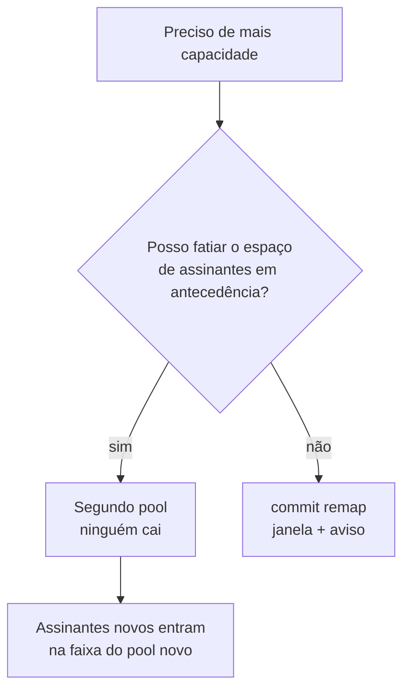

# Ampliar capacidade sem derrubar assinantes

Como acrescentar capacidade a um CGNAT em produção. Existe um caminho que derruba todos os assinantes e um que não derruba ninguém — esta página mostra os dois e diz quando cada um se aplica.

# Por que ampliar é perigoso aqui

O mapeamento é `índice do assinante → (endereço público, bloco de portas)`, **calculado** a partir dos conjuntos de endereços do pool, do tamanho do bloco, da faixa de portas e da política. Qualquer coisa que mude o **divisor** muda a resposta para quase todo mundo.

| Mudança | O que se move |
|---------|---------------|
| acrescentar ou remover um prefixo público | o divisor muda: **todos** os assinantes |
| mudar `block-size` | blocos por endereço mudam: quase todos — ficam parados só os cujo bloco começa na mesma porta |
| mudar `ports` | igual ao tamanho de bloco |
| mudar `policy` | `interleaved` e `blocked` dividem o índice de formas diferentes: **todos** |
| mudar `mode` | determinístico e dinâmico não são o mesmo mapeamento — e esta é a única mudança de mapeamento que o `commit` **não** recusa: a conta só é feita quando o pool em vigor e o novo são os dois determinísticos, então trocar o modo é aplicado sem o aviso abaixo |
| acrescentar ou remover prefixo **inside** | muda o índice de todo endereço depois dele |
| mudar `reserve` | a capacidade que a fórmula pode usar muda. Com `interleaved` **ninguém se move**: só perdem o bloco os assinantes acima da nova capacidade. Com `blocked` o divisor é a contagem de blocos, e quase todos se movem. Nos dois casos é mudança de capacidade e pede `commit remap` |
| mudar `vrf` ou `outside-vrf` | **nenhum assinante se move**, e mesmo assim toda sessão do pool termina: a aritmética não muda, então o `commit` não pede `commit remap`, mas o pool é reconstruído |
| timeouts, ALGs, `filter`, `max-blocks`, `initial-allocation`, `block-stride`, `tcp-mss`, limites por assinante, `utilisation-alarm`, forwards, bypass | **nada** — são ajustes aplicados no lugar, num pool carregando tráfego |

:::info
**Em pool dinâmico não existe a recusa desta página.** A contagem de quem se move só faz sentido onde o bloco é uma fórmula. Num pool `mode dynamic`, mudar prefixo, tamanho de bloco, faixa de portas, política, VRF ou modo reconstrói o pool do mesmo jeito — toda sessão dele termina no instante do `commit` —, mas o `commit` passa sem pedir `commit remap` e sem imprimir conta nenhuma. Os blocos que o pool segurava são liberados com um `natEvent 17` cada, carimbado no instante da mudança, então o log continua fechado. Trate a mudança como a parada que ela é: janela, aviso, e depois `show cgnat blocks` para ver os blocos voltando a ser alocados.

:::

# O que não muda, mesmo no pior caso

* **Respostas passadas continuam resolvíveis.** A trilha registra a definição completa, datada em UTC, a cada mudança. Um pedido sobre o mês passado é respondido com a definição do mês passado.
* **Nada é corrompido.** Sessões terminam; elas não ficam erradas.
* **O log continua completo.** No modo dinâmico os eventos de alocação e liberação não são afetados, e trocar o pool fecha com uma liberação cada bloco que ele segurava; no determinístico não há nenhum a afetar, a não ser os blocos entregues de uma `reserve`, que também são fechados.

# Meça antes

```
configure
 nat
  cgnat
   pool residencial
    outside 45.170.16.0/26
    exit
   exit
  exit
 commit check
```

O `commit check` mede, sem tocar no equipamento: ele avisa que a mudança re-mapeia assinantes, imprime a conta e até dois assinantes de exemplo, e lembra que o `commit` vai recusar. O `commit` comum imprime a mesma conta ao **recusar** a mudança, e só aplica quando ela é pedida pelo nome. Os dois funcionam também de dentro do bloco do pool, sem precisar sair dele.

E a conta **não é estimativa**: o dataplane segura as duas definições e roda a mesma aritmética que rodaria depois. Ele responde quantos assinantes se movem, quantos têm estado vivo naquele instante, e para onde dois deles vão. Um assinante que a definição nova não atende mais conta como movido — e o exemplo diz que ele passa a ser atendido por bloco nenhum, que é a mesma parada para o cliente e pior para você, porque nada vai registrá-lo.

Ao `commit` comum, a recusa é esta:

```
error: this change re-maps subscribers that already have mappings
    1024 of 1024 subscribers change public address or port block; 61 hold live
    state right now
    100.64.0.0 moves from 200.150.0.16:1024-1535 to 45.170.16.0:1024-1535
    100.64.0.1 moves from 200.150.0.17:1024-1535 to 45.170.16.1:1024-1535
    every session on this pool ends when it is applied. Past answers stay
    resolvable - the configuration trail records which definition was in force
    - but the subscribers do not.
    if that is what you mean, type: commit remap
```


:::info
A diferença entre um operador que ouve *"isso muda o mapeamento"* e um que lê a linha acima é saber o que está prestes a fazer.

Registre esse primeiro número no chamado de mudança: **é o número de clientes que vão ligar.**

:::

# Antes de ampliar um pool dinâmico: a conta é por worker

Num pool dinâmico os blocos são repartidos entre os workers do dataplane, e cada assinante tira bloco só da fatia do próprio worker — qual é a fatia dele é aritmética sobre o endereço interno, não um contador. Por isso um assinante pode ser recusado com blocos livres na fatia ao lado, e a capacidade que o pool pode prometer é menor que o total de blocos.

`show cgnat pool` diz esse número quando ele é menor que o total: uma linha com quantos assinantes o pool atende **seja qual for o endereço deles**, e o motivo — os blocos repartidos entre os workers. Dimensione por ela, não pelo total. A perda é nula quando o seu DHCP entrega endereços internos em sequência a partir do começo da faixa, e pesa em pool pequeno com muitos workers.

O dataplane sabe emprestar um bloco de uma fatia para outra, mas nesta versão isso vem **desligado** e não tem comando na VTY: medido, todo ajuste que empresta cedo o bastante para atender o recusado também empresta o bloco que o próximo assinante do próprio worker ia querer. Se o seu pool dinâmico recusa com blocos livres, a resposta hoje é capacidade — mais endereços públicos ou um segundo pool, pelos caminhos abaixo.

# O procedimento que custa uma parada

Aceite quando o pool é pequeno, a janela está acordada, ou a alternativa abaixo não pode ser arranjada.


1. `commit check` (ou `commit`) e leia a contagem. Registre no chamado.
2. Escolha uma janela. Toda sessão do pool termina — não graciosamente, não após um timeout, mas **no instante do commit**.
3. `commit remap`.
4. Confirme no pacote, não na configuração:

```
show cgnat subscriber <endereço-que-você-conhece>
```

e verifique que ele segura o bloco que a nova definição prevê.

Os assinantes reconectam sozinhos — um CPE reabre as sessões em segundos — mas o que era longo (uma VPN, uma sessão SSH, um download) se foi.

# O procedimento que NÃO custa parada

**Acrescente capacidade como um segundo pool, em vez de crescer o primeiro.**

Um pool é selecionado pelo prefixo interno, então um pool novo servindo uma fatia **diferente** do espaço de assinantes tem o próprio mapeamento e não perturba o existente.

```
nat
 cgnat
  pool residencial      ← intocado, mantém o mapeamento
   inside 100.64.0.0/22
   outside 200.150.0.16/28
   exit
  pool residencial-2    ← a capacidade nova
   inside 100.64.4.0/22
   outside 45.170.16.0/26
   exit
  exit
 exit
```



Regras que acompanham:

* Assinantes existentes **não devem** ser movidos entre os pools enquanto em serviço: mover um é o mesmo re-mapeamento, um cliente por vez.
* Assinantes novos são endereçados na faixa interna do pool novo conforme são provisionados.
* Os dois pools convivem indefinidamente. **Não há requisito de fundi-los** — e fundir depois é exatamente a parada que isso evitou.
* Cada pool tem o próprio registro de auditoria, então uma resposta sobre um assinante nomeia o pool que o atendeu.

O custo é fatiar o espaço de endereços com antecedência e carregar dois pools em vez de um. É o preço de não desconectar todo mundo, e costuma ser barato.

Em pool dinâmico o mesmo caminho vale, pelo mesmo motivo: o pool novo tem os próprios blocos e o existente não é reconstruído.

Caixas multi-cliente têm uma terceira opção: amarrar pools a **VRFs**, para que uma mesma faixa interna seja servida por dois pools sem sobreposição. Isso resolve tenancy, não capacidade — dois pools na mesma VRF continuam não podendo reivindicar a mesma faixa.

:::info
**Numa caixa que forma par com outra** (um endereço de serviço em `vrrp`), qualquer mudança de mapeamento feita numa só delas deixa as duas mapeando os assinantes de forma diferente, e o `commit` recusa também por isso até ouvir `commit diverge`. É o esperado: as duas caixas não recebem o `commit` no mesmo instante. Faça a mesma mudança na outra logo em seguida e confira com `show cgnat ha`; o procedimento está em [Alta disponibilidade](/doc/alta-disponibilidade-Zc1pBKocic).

:::

# O que não é oferecido, de propósito

**Migração graciosa.** Não existe modo em que sessões antigas mantêm o mapeamento antigo enquanto as novas usam o novo. Isso significaria dois mapeamentos para um assinante, e a aritmética reversa — a propriedade pela qual o modo determinístico existe — não saberia distingui-los. Uma caixa que respondesse a uma ordem judicial com *"depende de qual das duas definições estava em vigor para aquela sessão específica"* teria aberto mão do que foi construída para oferecer.

**Crescimento automático de capacidade.** Pelo mesmo motivo: um mapeamento que muda sem alguém mandar é um mapeamento que ninguém consegue reconstruir.

# Como conferir

```
show cgnat pool
show cgnat subscriber <ip de cada pool>
show cgnat history
```


:::success
Cada pool listado com a definição esperada, um assinante de cada um devolvendo o bloco previsto, e a trilha registrando a mudança com o operador que a fez. Num pool dinâmico, `show cgnat blocks` volta a contar alocações depois da mudança.

:::

# Ver também

* [Determinístico e BPA — conceitos e mapeamento](/doc/bpa-conceitos-e-mapeamento-uh9nF6sRaa) — a aritmética que torna isso inevitável
* [Dimensionamento e requisitos](/doc/dimensionamento-e-requisitos-f42dC4k45s) — a conta de endereços públicos
* [commit, rollback e save](/doc/commit-rollback-e-save-jqCB7kxPuA) — por que `commit remap` existe
