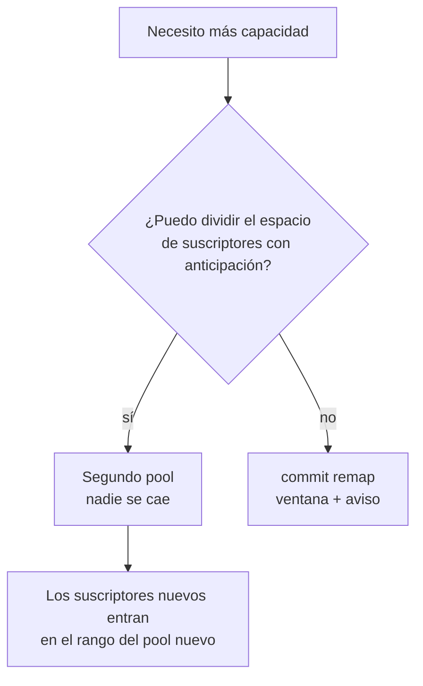

# Ampliar la capacidad sin tirar suscriptores

Cómo agregar capacidad a un CGNAT en producción. Existe un camino que tira a todos los suscriptores y uno que no tira a nadie — esta página muestra los dos y dice cuándo se aplica cada uno.

# Por qué ampliar es peligroso aquí

El mapeo es `índice del suscriptor → (dirección pública, bloque de puertos)`, **calculado** a partir de los conjuntos de direcciones del pool, del tamaño del bloque, del rango de puertos y de la política. Cualquier cosa que cambie el **divisor** cambia la respuesta para casi todo el mundo.

| Cambio | Qué se mueve |
|--------|--------------|
| agregar o quitar un prefijo público | el divisor cambia: **todos** los suscriptores |
| cambiar `block-size` | cambian los bloques por dirección: casi todos — solo quedan quietos aquellos cuyo bloque empieza en el mismo puerto |
| cambiar `ports` | igual que el tamaño de bloque |
| cambiar `policy` | `interleaved` y `blocked` dividen el índice de formas diferentes: **todos** |
| cambiar `mode` | determinístico y dinámico no son el mismo mapeo — y este es el único cambio de mapeo que el `commit` **no** rechaza: el cálculo solo se hace cuando el pool vigente y el nuevo son ambos determinísticos, por lo que cambiar el modo se aplica sin la advertencia de abajo |
| agregar o quitar un prefijo **inside** | cambia el índice de toda dirección posterior a él |
| cambiar `reserve` | cambia la capacidad que la fórmula puede usar. Con `interleaved` **nadie se mueve**: solo pierden el bloque los suscriptores por encima de la nueva capacidad. Con `blocked` el divisor es la cantidad de bloques, y casi todos se mueven. En ambos casos es un cambio de capacidad y requiere `commit remap` |
| cambiar `vrf` u `outside-vrf` | **ningún suscriptor se mueve**, y aun así toda sesión del pool termina: la aritmética no cambia, por lo que el `commit` no pide `commit remap`, pero el pool se reconstruye |
| timeouts, ALGs, `filter`, `max-blocks`, `initial-allocation`, `block-stride`, `tcp-mss`, límites por suscriptor, `utilisation-alarm`, forwards, bypass | **nada** — son ajustes aplicados sin reconstruir, en un pool que lleva tráfico |


:::info
**En un pool dinámico no existe el rechazo de esta página.** El conteo de quién se mueve solo tiene sentido donde el bloque es una fórmula. En un pool `mode bpa`, cambiar prefijo, tamaño de bloque, rango de puertos, política, VRF o modo reconstruye el pool de la misma manera — toda sesión suya termina en el instante del `commit` —, pero el `commit` pasa sin pedir `commit remap` y sin imprimir cálculo alguno. Los bloques que el pool retenía se liberan con un `natEvent 17` cada uno, sellado en el instante del cambio, por lo que el log sigue cerrado. Trate el cambio como la interrupción que es: ventana, aviso, y luego `show cgnat blocks` para ver los bloques volviendo a asignarse.

:::

# Lo que no cambia, incluso en el peor caso

* **Las respuestas pasadas siguen siendo resolubles.** El trail registra la definición completa, fechada en UTC, en cada cambio. Un requerimiento sobre el mes pasado se responde con la definición del mes pasado.
* **Nada se corrompe.** Las sesiones terminan; no quedan erróneas.
* **El log sigue completo.** En el modo dinámico los eventos de asignación y liberación no se ven afectados, y cambiar el pool cierra con una liberación cada bloque que retenía; en el determinístico no hay ninguno que afectar, salvo los bloques entregados desde una `reserve`, que también se cierran.

# Mida antes

```
configure
 nat
  cgnat
   pool residencial
    prefix-outside 45.170.16.0/26
    exit
   exit
  exit
 commit check
```

El `commit check` mide, sin tocar el equipo: advierte que el cambio remapea suscriptores, imprime el cálculo y hasta dos suscriptores de ejemplo, y recuerda que el `commit` va a rechazar. El `commit` común imprime el mismo cálculo al **rechazar** el cambio, y solo lo aplica cuando se pide por su nombre. Ambos funcionan también desde dentro del bloque del pool, sin necesidad de salir de él.

Y el cálculo **no es una estimación**: el dataplane retiene las dos definiciones y ejecuta la misma aritmética que ejecutaría después. Responde cuántos suscriptores se mueven, cuántos tienen estado vivo en ese instante, y hacia dónde van dos de ellos. Un suscriptor al que la nueva definición ya no atiende cuenta como movido — y el ejemplo dice que pasa a ser atendido por ningún bloque, que es la misma interrupción para el cliente y peor para usted, porque nada lo va a registrar.

Con el `commit` común, el rechazo es este:

```
error: this change re-maps subscribers that already have mappings
    1024 of 1024 subscribers change public address or port block; 61 hold live
    state right now
    100.64.0.0 moves from 200.150.0.16:1024-1535 to 45.170.16.0:1024-1535
    100.64.0.1 moves from 200.150.0.17:1024-1535 to 45.170.16.1:1024-1535
    every session on this pool ends when it is applied. Past answers stay
    resolvable - the configuration trail records which definition was in force
    - but the subscribers do not.
    if that is what you mean, type: commit remap
```


:::info
La diferencia entre un operador que escucha *"esto cambia el mapeo"* y uno que lee la línea de arriba es saber lo que está a punto de hacer.

Registre ese primer número en el ticket de cambio: **es el número de clientes que van a llamar.**

:::

# Antes de ampliar un pool dinámico: el cálculo es por worker

En un pool dinámico los bloques se reparten entre los workers del dataplane, y cada suscriptor toma bloques solo de la porción de su propio worker — cuál es su porción es aritmética sobre la dirección interna, no un contador. Por eso un suscriptor puede ser rechazado habiendo bloques libres en la porción de al lado, y la capacidad que el pool puede prometer es menor que el total de bloques.

`show cgnat pool` indica ese número cuando es menor que el total: una línea con cuántos suscriptores atiende el pool **sea cual sea su dirección**, y el motivo — los bloques repartidos entre los workers. Dimensione según ella, no según el total. La pérdida es nula cuando su DHCP entrega direcciones internas en secuencia desde el comienzo del rango, y pesa en un pool pequeño con muchos workers.

El dataplane sabe prestar un bloque de una porción a otra, pero en esta versión eso viene **desactivado** y no tiene comando en la VTY: según lo medido, todo ajuste que presta lo bastante temprano para atender al rechazado también presta el bloque que el próximo suscriptor del propio worker iba a querer. Si su pool dinámico rechaza con bloques libres, la respuesta hoy es capacidad — más direcciones públicas o un segundo pool, por los caminos de abajo.

# El procedimiento que cuesta una interrupción

Acéptelo cuando el pool es pequeño, la ventana está acordada, o la alternativa de abajo no puede organizarse.


1. `commit check` (o `commit`) y lea el conteo. Regístrelo en el ticket.
2. Elija una ventana. Toda sesión del pool termina — no de forma ordenada, no tras un timeout, sino **en el instante del commit**.
3. `commit remap`.
4. Confirme sobre el paquete, no sobre la configuración:

```
show cgnat subscriber <dirección-que-usted-conoce>
```

y verifique que retenga el bloque que prevé la nueva definición.

Los suscriptores se reconectan solos — un CPE reabre las sesiones en segundos — pero lo que era largo (una VPN, una sesión SSH, una descarga) se perdió.

# El procedimiento que NO cuesta interrupción

**Agregue capacidad como un segundo pool, en lugar de hacer crecer el primero.**

Un pool se selecciona por el prefijo interno, por lo que un pool nuevo que sirve una porción **diferente** del espacio de suscriptores tiene su propio mapeo y no perturba el existente.

```
nat
 cgnat
  pool residencial      ← intacto, mantiene el mapeo
   prefix-inside 100.64.0.0/22
   prefix-outside 200.150.0.16/28
   exit
  pool residencial-2    ← la capacidad nueva
   prefix-inside 100.64.4.0/22
   prefix-outside 45.170.16.0/26
   exit
  exit
 exit
```



Reglas que lo acompañan:

* Los suscriptores existentes **no deben** moverse entre los pools mientras están en servicio: mover uno es el mismo remapeo, un cliente a la vez.
* Los suscriptores nuevos se direccionan en el rango interno del pool nuevo a medida que se aprovisionan.
* Los dos pools conviven indefinidamente. **No hay requisito de fusionarlos** — y fusionarlos después es exactamente la interrupción que esto evitó.
* Cada pool tiene su propio registro de auditoría, por lo que una respuesta sobre un suscriptor nombra el pool que lo atendió.

El costo es dividir el espacio de direcciones con anticipación y llevar dos pools en lugar de uno. Es el precio de no desconectar a todo el mundo, y suele ser barato.

En un pool dinámico vale el mismo camino, por el mismo motivo: el pool nuevo tiene sus propios bloques y el existente no se reconstruye.

Los equipos multicliente tienen una tercera opción: vincular pools a **VRF**, para que un mismo rango interno sea servido por dos pools sin superposición. Esto resuelve tenancy, no capacidad — dos pools en la misma VRF siguen sin poder reclamar el mismo rango.


:::info
**En un equipo que forma par con otro** (una dirección de servicio en `vrrp`), cualquier cambio de mapeo hecho en uno solo de ellos deja a los dos mapeando a los suscriptores de forma diferente, y el `commit` rechaza también por eso hasta recibir `commit diverge`. Es lo esperado: los dos equipos no reciben el `commit` en el mismo instante. Haga el mismo cambio en el otro inmediatamente después y verifique con `show cgnat ha`; el procedimiento está en [Alta disponibilidad](/s/wiki-es/doc/alta-disponibilidad-bjNhRjSh49).

:::

# Lo que no se ofrece, a propósito

**Migración ordenada.** No existe un modo en el que las sesiones antiguas mantengan el mapeo antiguo mientras las nuevas usan el nuevo. Eso significaría dos mapeos para un suscriptor, y la aritmética inversa — la propiedad por la que existe el modo determinístico — no sabría distinguirlos. Un equipo que respondiera a una orden judicial con *"depende de cuál de las dos definiciones estaba vigente para esa sesión específica"* habría renunciado a aquello para lo que fue construido.

**Crecimiento automático de capacidad.** Por el mismo motivo: un mapeo que cambia sin que nadie lo ordene es un mapeo que nadie logra reconstruir.

# Cómo verificar

```
show cgnat pool
show cgnat subscriber <ip de cada pool>
show cgnat history
```


:::success
Cada pool listado con la definición esperada, un suscriptor de cada uno devolviendo el bloque previsto, y el trail registrando el cambio con el operador que lo hizo. En un pool dinámico, `show cgnat blocks` vuelve a contar asignaciones después del cambio.

:::

# Ver también

* [Determinístico y BPA — conceptos y mapeo](/s/wiki-es/doc/deterministico-y-bpa-conceptos-y-mapeo-LgBbN0YDcl) — la aritmética que hace esto inevitable
* [Dimensionamiento y requisitos](/s/wiki-es/doc/dimensionamiento-y-requisitos-FuEOaBC4vd) — el cálculo de direcciones públicas
* [commit, rollback y save](/s/wiki-es/doc/commit-rollback-y-save-6sAWJkXNO3) — por qué existe `commit remap`
