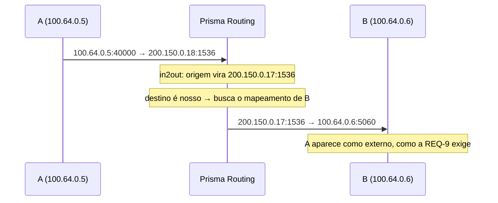

# Comportamento NAT e compatibilidade

Se as aplicações dos seus assinantes vão funcionar atrás deste CGNAT, e o que muda quando você aperta a filtragem. Para quem recebe chamado de jogo, câmera, VoIP ou peer-to-peer.

# Este equipamento é full cone

São três propriedades, e as três estão presentes:

| Propriedade | RFC 4787 | O que significa na prática |
|-------------|----------|----------------------------|
| Mapeamento independente do destino | REQ-1    | um socket interno mantém a mesma porta externa com quem quer que ele fale |
| Filtragem independente do destino | REQ-8    | qualquer host pode alcançar um mapeamento aberto |
| Hairpinning | REQ-9    | um assinante alcança outro pelo endereço público |

Isso não é promessa: cada uma é verificada **em cima do pacote**, e a terceira entregando um pacote vindo de um host com quem o assinante nunca falou.

# Um assinante, um endereço público

Uma quarta propriedade, o **pareamento de endereço** (RFC 4787 REQ-2, que a RFC 6888 torna o padrão exigido de um CGN): todo o tráfego de um assinante sai pelo **mesmo** endereço público. Um assinante que manda de um endereço e recebe em outro quebra as aplicações que conferem de onde veio a resposta, porque elas enxergam dois pares diferentes onde há um só.

| Onde | Como fica |
|------|-----------|
| pool determinístico sem `reserve` | sempre pareado: o assinante tem um bloco só, e a fórmula o põe num endereço só |
| pool dinâmico, ou determinístico com `reserve` | **preferência**, não regra. Quando o assinante enche o bloco e ganha outro (até `max-blocks`), ou recebe vários de uma vez com `initial-allocation`, a caixa procura primeiro um bloco livre no endereço público que ele já usa. Se não há, pega um em outro endereço em vez de recusar — recusar custaria tráfego ao cliente |

Por ser preferência, a caixa mostra a taxa do **seu** pool em vez de prometer uma. Em `show cgnat blocks`, todo pool em que um assinante pode ganhar mais de um bloco traz uma linha começando por `RFC 4787 REQ-2 paired:`, com quantas extensões caíram no endereço do próprio assinante contra o total. Uma taxa longe de todas é um pool apertado de endereços públicos, não um defeito: é o número a levar para a conversa sobre capacidade.

# Hairpinning: o sintoma que ninguém atribui ao CGNAT

Dois assinantes atrás do mesmo CGNAT se alcançando pelo endereço público.



Sem hairpinning o pacote sai traduzido corretamente e é roteado para um endereço que a própria caixa possui, sem nada que o mande de volta. O sintoma é específico e difícil de atribuir:

* uma câmera que responde da rua mas não do vizinho;
* um serviço hospedado em casa que funciona para todo mundo **menos** para quem é do mesmo provedor;
* um jogo que hospeda partida para todos, menos para os jogadores do mesmo ISP.

B enxerga A pelo endereço **público** de A, como a RFC exige. Mostrar o endereço privado vazaria a topologia interna e quebraria a resposta, porque B responderia para um endereço que não sabe rotear.

Um pacote endereçado a um dos nossos endereços públicos **sem sessão naquela porta** é descartado, não encaminhado — e contado à parte de um hairpin bem-sucedido, para que os dois sejam distinguíveis.

# Filtragem: quem pode responder

Dois modos, por pool:

| Modo | Quem alcança um mapeamento aberto | Custo |
|------|-----------------------------------|-------|
| `filter endpoint-independent` (padrão) | qualquer um                       | tráfego não solicitado chega ao assinante |
| `filter address-dependent` | só o remoto que o assinante contatou | algumas aplicações peer-to-peer param de funcionar |

```
configure
 nat
  cgnat
   pool residencial
    filter address-dependent
    exit
   exit
  exit
 commit
```

É ajuste **aplicado no lugar**: não derruba sessão.

Um [encaminhamento de porta](/s/wiki/doc/encaminhamento-de-porta-epIZfdmzU3) fica **fora** dessa filtragem. `address-dependent` pergunta "o assinante falou com você antes?", e num forward a resposta é não por definição; se ele entrasse no filtro, a porta aberta funcionaria só para quem o assinante respondeu por último.


:::info
A escolha é sua, não do produto. `address-dependent` reduz varredura e tráfego não solicitado chegando ao assinante; em troca, quebra parte do peer-to-peer e de jogos que dependem de conexão vinda de um terceiro. `endpoint-independent` é o padrão porque é o que mantém essas aplicações funcionando.

:::

A verificação **não** entra na chave de busca, de propósito. Colocar o endereço remoto na chave daria ao assinante uma porta externa diferente por destino — mapeamento *dependente* do destino — e quebraria exatamente as aplicações peer-to-peer que este produto existe para manter funcionando. Filtragem e mapeamento são decisões separadas, e só a primeira muda aqui.

# Fragmentos

Um fragmento que não é o primeiro **não carrega cabeçalho de camada 4**, e portanto não tem porta para casar com uma sessão. Sem tratamento ele é descartado, e DNS grande, VPN e jogos quebram **de forma intermitente** — o sintoma mais difícil de diagnosticar que existe.

O VPP faz uma remontagem virtual rasa: guarda as portas do primeiro fragmento e as anexa aos seguintes. Não há nada a configurar; está ligado no caminho.


:::info
Vale saber que esse tratamento tem um modo de falha caro: se as portas guardadas forem lidas na ordem de bytes errada, o nó não encontra a sessão e abre outra — **queimando uma porta por fragmento**. Um assinante que fragmenta muito esgota o próprio bloco sozinho. Se você vir um assinante consumindo portas sem tráfego que justifique, é a primeira hipótese a checar.

:::

# Erros ICMP, e por que alguns sites não carregam

Um erro ICMP — *fragmentation needed*, *time exceeded*, *destination unreachable* — não é um pacote sobre si mesmo. Ele carrega **dentro dele** uma cópia do pacote que causou o erro, e é essa cópia embutida que diz de qual sessão ele fala. O endereço ali dentro é o do assinante, privado, escrito antes da tradução.

Uma caixa que traduz o cabeçalho de fora e ignora o de dentro entrega ao assinante um aviso sobre uma conexão que ele não reconhece. A pilha dele descarta, e o aviso se perde. Duas coisas quebram quando isso acontece:

| O que se perde | O sintoma que chega ao suporte |
|----------------|--------------------------------|
| PMTUD (*fragmentation needed*) | "alguns sites não carregam" — a conexão abre, troca pouco, e trava no primeiro pacote grande |
| *time exceeded* | o `traceroute` do assinante para de funcionar |

Esta caixa reescreve o pacote embutido. E reescreve junto o que quase todo mundo esquece: o **checksum do ICMP cobre o pacote embutido inteiro**, inclusive o checksum do cabeçalho IP que está lá dentro. Traduzir com o checksum errado é pior do que não traduzir — a pilha do assinante descarta o pacote, o PMTUD continua quebrado, e o contador do equipamento diz que deu certo.


:::info
Para TCP comum existe uma segunda rede de proteção, o *MSS clamp* (`tcp-mss` no pool), que evita o problema antes de ele precisar de aviso. **Dentro de um túnel não existe MSS para ajustar**, e ali o erro ICMP é o único sinal que o assinante tem — é o caso detalhado em [Protocolos e ALGs](/s/wiki/doc/protocolos-e-algs-vZjaCcHaN7), com o que ele exige de você e onde ele para.

:::

# O limite honesto

A sessão lembra **um** endereço remoto, atualizado a cada pacote de saída. Uma porta de origem reusada para dois remotos só aceita resposta do mais recente.

É uma aproximação, e está dita porque quem opera merece saber onde ela para: rastrear o conjunto de remotos significaria estado por remoto num caminho de dados cujo propósito é justamente não ter nenhum.

# Como conferir

```
show cgnat subscriber <ip-interno>
show cgnat drops
show cgnat blocks
```

Se uma aplicação de entrada não funciona, `show cgnat drops` separa o motivo — pacote sem sessão na porta é contado à parte de um hairpin que deu certo. Se a queixa é de uma aplicação que estranha o endereço de origem, a linha `RFC 4787 REQ-2 paired:` de `show cgnat blocks` diz quanto do pool está pareado.

# Ver também

* [Protocolos e ALGs](/s/wiki/doc/protocolos-e-algs-vZjaCcHaN7) — quando o problema não é filtragem, é o protocolo carregar endereço no payload
* [Quando o bloco de um assinante enche](/s/wiki/doc/quando-o-bloco-de-um-assinante-enche-kb1sJTtCKx) — os blocos estendidos, de onde vem a taxa de pareamento
* [Configuração de pool](/s/wiki/doc/configuracao-de-pool-btyS572Ih6) — `filter` e os demais campos aplicados no lugar
* [Timeouts e os pisos das RFCs](/s/wiki/doc/timeouts-e-os-pisos-das-rfcs-GvPsvW3hLf) — a outra causa comum de "desconecta sozinho"
