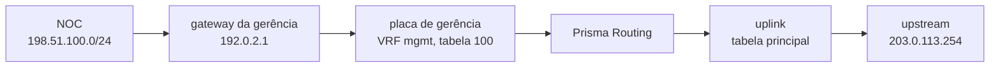
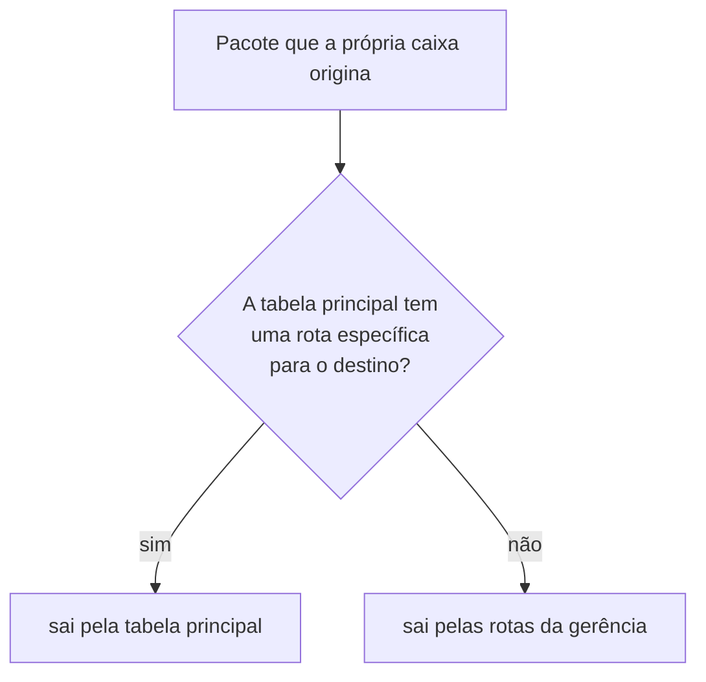

# Gerência numa VRF própria

Como pôr a placa de gerência numa VRF dela, para que a rota default da tabela principal fique livre para os assinantes e a caixa continue respondendo SSH, API e SNMP pelo gateway da gerência. Para quem vai pôr uma caixa em produção com uma rede de gerência separada do uplink — ou já pôs e descobriu que a default dos assinantes não pega.

# Por que separar

Na instalação a caixa recebe um endereço de gerência e um **gateway**. Esse gateway é a rota default dela, e fica na tabela principal — a mesma em que o dataplane encaminha os assinantes.

Quando você escreve a default dos assinantes no roteamento (`router static`, `0.0.0.0/0 next-hop` para o upstream), as duas defaults disputam a mesma tabela, e **a do instalador ganha**: ela entra no Linux com prioridade maior do que qualquer rota do roteamento. O resultado depende da placa de gerência:

* numa placa que o dataplane pareou, o tráfego dos assinantes sai pelo gateway de **gerência**;
* numa placa que só o Linux tem, a default do roteamento fica de lado e o dataplane fica **sem default nenhuma** para os assinantes: o tráfego para a internet é descartado.

A saída não é apagar a default do instalador — ela é o caminho pelo qual você alcança a caixa. É tirar a gerência da tabela principal: a placa de gerência e as rotas dela vão para uma VRF própria, e a tabela principal fica só com o que é dos assinantes.



# Antes de começar: qual é a sua placa de gerência

A configuração é a mesma para os dois tipos de placa, mas o que a caixa faz por baixo é diferente, e o que o bloco da interface aceita também:

| A placa de gerência é… | Onde ela aparece | O que o bloco `interface` dela aceita |
|------------------------|------------------|----------------------------------------|
| **pareada pelo dataplane** — a caixa tomou a placa e o endereço de gerência mora no par Linux que o dataplane mantém para ela (caixa de uma placa só, ou placa nomeada em `system` > `dataplane`) | em `show interface`, como porta do dataplane | `vrf` e o resto do bloco, como qualquer interface |
| **só do Linux** — a placa reservada para o Linux na instalação; numa máquina virtual, normalmente uma virtio ao lado das placas que o dataplane toma | em `show hardware`, embaixo de `Reserved for Linux:` | só `vrf` |

:::info
**Placa só do Linux: a partir da 0.155.19.** Até a 0.155.18 o `commit` passava no `commit check` e falhava ao aplicar (`the dataplane does not have it`). Numa caixa mais antiga, atualize antes de seguir esta página.
:::

Numa placa só do Linux, endereço, MTU e descrição continuam sendo do Linux — o endereço fica onde o instalador o pôs, em `/etc/network/interfaces.d/prisma-routing` — e o `commit check` recusa qualquer coisa além de `vrf` no bloco dela.

# 1. Escreva a configuração

Com a gerência em `192.0.2.10/24` e `2001:db8:6::10/64` na placa `enp1s0`, o gateway da gerência em `192.0.2.1` e `2001:db8:6::1`, o NOC em `198.51.100.0/24` e o upstream dos assinantes em `203.0.113.254`:

```
configure
 vrf mgmt table 100
 interface enp1s0
  vrf 100
  exit
 vrf mgmt
  ip route 0.0.0.0/0 192.0.2.1
  ip route 198.51.100.0/24 192.0.2.1
  ipv6 route ::/0 2001:db8:6::1
  exit
 router static
  0.0.0.0/0 next-hop 203.0.113.254
  exit
 system
  management
   vrf mgmt
   exit
  exit
```

| Linha | O que muda |
|-------|------------|
| `vrf mgmt table 100` | cria a VRF `mgmt` no Linux, na tabela 100 |
| `interface enp1s0` / `vrf 100` | a placa de gerência entra na tabela 100, com os endereços dela, IPv4 e IPv6 |
| `vrf mgmt` / `ip route`, `ipv6 route` | as rotas da gerência, dentro da VRF: as duas defaults e qualquer outra rede de onde você administra a caixa |
| `router static` / `0.0.0.0/0 next-hop` | a default dos assinantes, na tabela principal — que agora não tem mais com quem disputar |
| `system` > `management` > `vrf mgmt` | diz à caixa que os serviços dela moram na VRF: sem isto a placa vai para a VRF e a caixa **não** responde por ela |

O `router static` é só a tabela principal. Rota estática de uma VRF vai no bloco `vrf <nome>` dela, fechado com `exit` ou `exit-vrf`. O bloco `vrf` de uma interface e as VRFs do Linux estão em [Configuração de interface](/s/wiki/doc/configuracao-de-interface-j1q58jKWTQ). O próximo salto de cada rota da VRF precisa estar numa rede que a placa de gerência alcança; senão o `commit check` recusa com `this next hop is on no connected network:`.

Para o SSH responder **só** na gerência, liste os dois endereços dela em `ssh listen-address`, como no `snmp` e no `api`: `ssh listen-address 192.0.2.10 2001:db8:6::10`. Com a gerência na VRF o `commit` aceita esses endereços.

# 2. Confira antes de aplicar

```
commit check
```

O que ele recusa, e por quê:

| A recusa começa com | O que falta |
|---------------------|-------------|
| `management vrf mgmt: no such VRF here` | a linha `vrf mgmt table 100` |
| `management vrf mgmt: no interface is in it` | o `vrf 100` na placa de gerência: sem ninguém dentro, o tráfego da própria caixa iria para uma tabela sem saída |
| `interface enp1s0: Linux's, so 'vrf' alone applies` | a placa é só do Linux e o bloco dela tem algo além de `vrf` |
| `interface enp1s0: vrf 100 has no VRF device` | a placa é só do Linux e nenhum `vrf <nome> table 100` cria a tabela dela |
| `this next hop is on no connected network:` | uma rota da VRF aponta para um gateway que a placa de gerência não alcança |

O `commit check` também recusa um `vrf` numa interface que nem o dataplane nem o Linux têm — normalmente um nome digitado errado.

# 3. Aplique com `commit confirmed`

Você está mudando o caminho pelo qual chega à caixa. Aplique com janela de volta:

```
commit confirmed 10
```

Depois, **abra uma sessão nova** pelo endereço de gerência, por IPv4 e por IPv6, e confirme nela:

```
commit
```

A sessão em que você digitou o `commit confirmed` em geral continua viva durante a mudança, mas o que prova que deu certo é uma conexão nova chegando pela VRF.

Se nada mais alcança a caixa, ninguém confirma, e em 10 minutos ela desfaz tudo sozinha: a placa sai da VRF, as regras e os ajustes do kernel saem, e — numa placa só do Linux — a default do instalador volta para a tabela principal. A caixa volta a responder SSH, API e SNMP pela tabela principal. O desfazer está armado na caixa, não na sua sessão: perder a conexão não o cancela — o mecanismo está em [commit, rollback e save](/s/wiki/doc/commit-rollback-e-save-jqCB7kxPuA).

:::warning
**Tirar a gerência da VRF derruba as sessões SSH abertas por ela.** Vale para um `commit confirmed` que expira e para `no vrf` dentro de `management`. A caixa atende as conexões novas pela tabela principal.
:::

# 4. Salve

`commit` faz valer; só `save` faz sobreviver ao reboot. Depois de confirmar, no modo operacional:

```
save
```

Um `save` dentro da janela do `commit confirmed` grava uma mudança ainda não confirmada, e a caixa avisa. Confirme primeiro, salve depois.

# O que chega e o que sai

**O que chega.** O sshd, a API e o snmpd continuam escutando na tabela principal; com `system` > `management` > `vrf`, a caixa liga os ajustes do kernel que fazem um serviço da tabela principal atender uma conexão que chega pela VRF, escutar no endereço de gerência mesmo ele estando na VRF, e manter o IPv6 da placa quando ela troca de tabela. A resposta segue a conexão. Um serviço que já estava no ar antes do `commit` atende depois dele, sem reinício.

**O que sai.** O que a própria caixa origina passa por duas regras, por família: primeiro a tabela principal **sem a default dela**, depois a tabela da gerência. Na prática:



A default dos assinantes nunca leva o tráfego da caixa: ela é justamente a rota que a primeira regra ignora.

| Tráfego | Sai por |
|---------|---------|
| SSH, API, prisma-web, consultas SNMP (entrando, IPv4 e IPv6) | a gerência: a resposta segue a conexão |
| traps SNMP | a gerência |
| DNS, NTP, downloads do `system upgrade`, RADIUS | a gerência, a menos que a tabela principal tenha rota específica para o servidor |
| `system logging` (o registro de eventos) | a gerência, a menos que a tabela principal tenha a rota; um destino com `vrf mgmt` vai pela VRF de qualquer jeito |
| syslog e IPFIX por TCP do container de log | a gerência, a menos que a tabela principal tenha rota específica para o coletor — um coletor do lado dos assinantes é alcançado pela rota dele na principal |
| IPFIX por UDP gerado pelo dataplane | **a tabela principal**, sempre |

:::warning
**O IPFIX por UDP não segue a gerência.** O dataplane monta esses pacotes e os manda pela tabela de encaminhamento dele, sem passar pelas regras do Linux. Um coletor que só é alcançável pela rede de gerência precisa de uma rota específica para ele na tabela principal — ou do export por TCP. Sem isso os registros de tradução não chegam ao coletor.
:::

Um serviço que escuta na tabela principal também atende numa VRF de cliente cujo lado Linux alcance o endereço da caixa. Leve isso em conta se uma VRF de cliente tiver rota até a rede de gerência.

# O que sobrevive a um reboot

Com a configuração salva, cada boot põe tudo de volta, nesta ordem:

1. antes do dataplane, do snmpd, do sshd e da API subirem, a caixa liga os ajustes do kernel e as regras do tráfego dela mesma — eles nomeiam a tabela 100, não o dispositivo, então não dependem de a VRF já existir;
2. a carga da configuração cria a VRF `mgmt` e põe a placa nela;
3. o caminho de volta da gerência — a default do instalador — vai para a tabela da VRF, nunca para a principal, onde ganharia de novo da default dos assinantes.

Numa placa só do Linux o boot começa com a placa como o instalador a deixou, endereço e default na tabela principal; a carga da configuração a move para a VRF com os endereços e as defaults dela. Uma placa só do Linux com `vrf` e nada mais não é tratada como placa faltando: ela é aplicada no boot.

As mesmas regras e ajustes são postos de novo a cada `commit` que muda `system` > `management`, e a VRF da placa é lida de volta do Linux: o `show running-config` mostra o `vrf 100`, e o próximo `commit` não mexe na placa.

# Como conferir

**1. A caixa diz onde está a gerência:**

```
show system management
```

Com a gerência na VRF e tudo em vigor, a tela é:

```
configured:
  management VRF       mgmt, table 100
in effect:
  the box's own        by table 100, after main without its default
  listeners            answer on a VRF, and may bind its addresses
  IPv6 addresses       kept when a card moves between VRFs
  interfaces in it     enp1s0
```

`configured` é o que a configuração pede; `in effect` é o que o host tem agora. Se os dois diferem, a tela termina dizendo que diferem — um `commit` que mude `system` > `management`, ou o próximo boot, os põe em acordo. Sem gerência em VRF, a linha `management VRF` diz `none: the main table`.

**2. A default dos assinantes está no dataplane:**

```
show route 0.0.0.0/0
```

Com mais de uma tabela a tela separa as VRFs. Na tabela principal a default precisa apontar para o upstream (`203.0.113.254` no exemplo), não para o gateway da gerência, e não pode estar descartando. As rotas da gerência estão no roteamento, em `show ip route vrf mgmt`.

**3. A gerência responde:** de fora, um SSH novo para `192.0.2.10` e outro para `2001:db8:6::10`, e uma consulta SNMP a cada um, se você usa SNMP.

:::success
`show system management` com `in effect` igual ao `configured`, a default da tabela principal apontando para o upstream e SSH novo entrando pelos dois endereços de gerência: os assinantes têm a tabela principal só para eles, e a gerência tem o caminho dela.
:::
