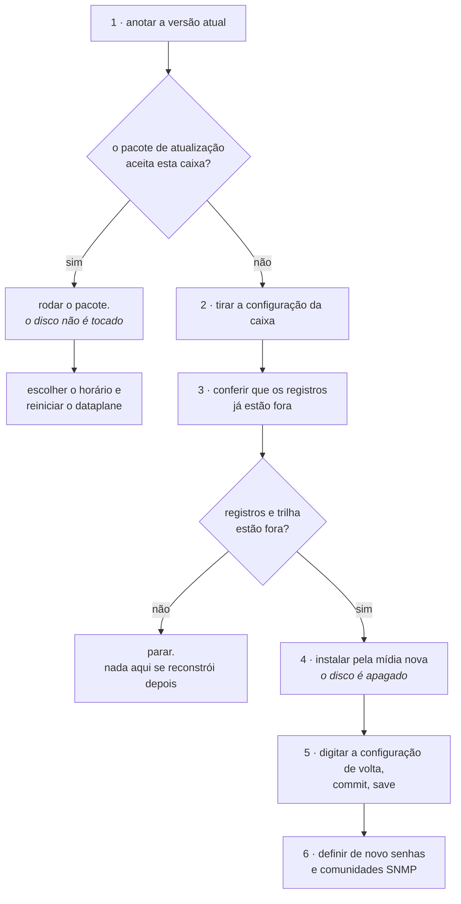

# Levar a caixa para uma versão nova

Como colocar uma versão nova do Prisma Routing numa caixa que já está em produção. Existem dois caminhos e eles custam coisas muito diferentes: o **pacote de atualização**, que troca os arquivos do produto e não encosta no disco, e a **reinstalação pela mídia**, que apaga o disco inteiro. Esta página diz qual dos dois é o seu, o que cada um custa e em que ordem fazer.

# Qual dos dois é o seu

|     | O pacote de atualização | A reinstalação pela mídia |
|-----|-------------------------|---------------------------|
| Quando | Sempre que o pacote aceitar a caixa | Quando o pacote recusa, ou quando a máquina é nova |
| O disco | Intocado                | **Apagado**               |
| Configuração, contas, comunidades SNMP | Ficam                   | Somem                     |
| Trilha de configuração e transbordo do exportador | Ficam                   | Somem                     |
| Parada | Só o reinício do dataplane, e no horário que você escolher | A janela inteira, com boot pela mídia |
| Publicado para | Toda versão, a partir da 0.79.0 | Só a última versão completa (as que mudam o primeiro ou o segundo número) |
| Tamanho do download | Cerca de 120 MB, com as imagens dos contêineres | Centenas de megabytes     |

**O pacote é o caminho normal.** A reinstalação existe para a máquina nova e para o caso em que a versão nova muda a plataforma por baixo do produto. Você não precisa adivinhar qual é: o pacote confere isso sozinho e **recusa antes de escrever qualquer coisa**, dizendo o que a caixa tem e o que a versão nova precisa.

# O pacote de atualização

**O caminho curto é pelo próprio VTY**, com a caixa alcançando a internet (e resolvendo nomes: `dns server`, se a gerência não tiver DNS):

```
prisma> system upgrade
prisma> system upgrade <versão>
```

Sem versão, ele diz qual versão a caixa roda e qual é a mais nova publicada, e não muda nada. Com a versão, ele baixa o pacote e o `sha256` do diretório público de versões (o mesmo do passo 2), recusa o pacote antes de abrir qualquer coisa se a soma não bater, e roda o mesmo `upgrade` dos passos abaixo, mostrando tudo o que ele diz. Uma versão igual ou mais antiga que a da caixa é recusada: voltar de versão é o caminho manual.

Três coisas a saber dele:

* **Só o papel de administrador pode rodá-lo**, como `system reboot`.
* **Ctrl-C não interrompe** enquanto o `upgrade` roda: uma caixa atualizada pela metade é pior que uma atualização lenta.
* **Se o `upgrade` para no meio**, a VTY diz com que status ele saiu e em que diretório o pacote ficou guardado, para quem for ler o que aconteceu.

No fim ele diz `upgraded to <versão>` e lembra do `save`. Vale o que vale para o caminho manual: `save` antes de reiniciar, e o dataplane continua o antigo até você escolher a hora do passo 4.

Os passos abaixo são o mesmo processo à mão, para uma caixa que não alcança a internet.


:::info
**Desde a 0.125.0 o pacote leva as imagens dos contêineres**, por isso tem cerca de 120 MB e não alguns megabytes. Uma caixa que foi atualizada em vez de instalada, e ainda roda o dataplane e o roteamento como serviços do systemd, **passa para os contêineres no próximo boot**, igual a uma caixa instalada pela mídia. Uma caixa que já roda nos contêineres passa a usar as imagens da versão nova, e não mais as da versão anterior.

:::

## 1. Anote a versão que está rodando

```
prisma> show version
```

Guarde a saída inteira no chamado de mudança. Ela é o que diz de onde a caixa veio, e é com ela que você compara no fim.

## 2. Baixe o pacote da versão nova

Cada versão fica em uma pasta própria em <https://prismarouting.com.br/releases/>, com o pacote e o `sha256` dele lado a lado. `latest` aponta sempre para a mais nova. A mídia de instalação só está lá para a última versão completa: uma versão que muda só o terceiro número publica apenas o pacote de atualização. Na própria caixa, trocando `<versão>` pelo número:

```
curl -fO https://prismarouting.com.br/releases/<versão>/prisma-routing-<versão>-upgrade.tar.gz
curl -fO https://prismarouting.com.br/releases/<versão>/prisma-routing-<versão>-upgrade.tar.gz.sha256
sha256sum -c prisma-routing-<versão>-upgrade.tar.gz.sha256
```

Só continue se a última linha terminar em `OK`. Qualquer outra resposta quer dizer que o arquivo que chegou não é o que foi publicado. Baixe de novo e não rode o pacote.

A pasta tem todas as versões que ainda sabem atualizar uma caixa, a partir da 0.79.0, que foi a primeira com o nome atual. Nas versões de 0.79.0 a 0.82.0 o `sha256` foi calculado quando o arquivo foi copiado para lá, porque essas versões foram publicadas sem ele.


:::warning
**Rode** `**save**` **depois de atualizar e antes de reiniciar.** Duas mudanças de forma fazem uma caixa atualizada recusar o próprio arquivo salvo no boot e subir **sem configuração nenhuma**:

* a partir da 0.125.2, o CGNAT fica nos níveis `nat` > `cgnat`, e a forma de uma linha (`nat cgnat pool ...`, `nat cgnat interface ...`) não é mais aceita. **Isso vale para toda caixa que tem CGNAT configurado**;
* a partir da 0.122.10, a forma `route <prefixo> <próximo-salto>` dentro de `router static` não é mais aceita.

A configuração continua valendo depois do pacote, porque ele não reinicia nada, e o `save` grava o que está valendo já na forma nova. É só isso: `save`, e só então reiniciar. Para conferir antes, `show running-config` já mostra o bloco `nat` > `cgnat` que o `save` vai gravar.

As revisões de rollback anteriores à atualização continuam na forma antiga, e o `save` não chega nelas. Voltar para uma delas depois de atualizar é recusado: o `commit check` aponta a linha na forma antiga e nada é aplicado. Se precisar voltar para a configuração de antes, volte primeiro a caixa para a versão anterior.

:::

## 3. Descompacte e rode

```
tar xzf prisma-routing-<versão>-upgrade.tar.gz
cd prisma-routing-<versão>-upgrade
sudo sh upgrade
```

O pacote confere a plataforma da caixa, troca os arquivos do produto e diz, arquivo por arquivo, o que escreveu. Se a plataforma não bater, ele para aí mesmo e **nada foi escrito**: a caixa continua exatamente a que era antes do comando.


:::info
**A configuração não é tocada.** `/etc/prisma-routing/prisma-routing.conf`, as revisões de rollback e o ajuste de tuning que você editou continuam onde estavam. O pacote reescreve os arquivos do produto, não os seus.

:::

## 4. Escolha quando reiniciar o dataplane

Este é o passo que custa alguma coisa, e é seu.

O pacote troca o dataplane **em disco** e não reinicia nada. Até o próximo reinício do dataplane, a caixa continua traduzindo com o dataplane antigo, que já estava carregado na memória.

Quem conta essa história é a linha `plugin` do `show version`, e **não** a linha `dataplane`. A tela tem, nesta ordem: a versão do Prisma Routing instalado, na primeira linha; `dataplane:`, a versão do próprio VPP; `plugin:`, a build com que o dataplane foi carregado; `routing:`, a do FRR; e `daemons:`, os daemons de roteamento que estão rodando.

A linha `dataplane` é a do VPP e não se mexe numa troca de versão do Prisma Routing. A que fica para trás é `plugin`: é a build com que o dataplane foi carregado no último boot. Compare-a com o número da **primeira** linha - e quando as duas discordam a caixa diz isso em voz alta, com um parágrafo embaixo da linha `plugin` explicando que só um reinício do dataplane as iguala. Quando concordam ela não diz nada, que é o estado normal.

A linha `plugin` responde de quatro jeitos, e três deles não são divergência: que a build é tal, que o dataplane não está respondendo, que o dataplane respondeu e não informa build nenhuma, ou que não há com o que comparar.

Quando for a hora, o reinício é pela própria VTY:

```
prisma> save
prisma> system dataplane restart
```

Ele diz o que custa antes de agir e então age, sem perguntar. Roda de novo o ajuste de tuning, sobe o dataplane nas imagens e no plugin da versão nova, e reaplica a configuração **salva** quando ele volta — por isso o `save` antes. Quando termina, `show interface` diz quando a caixa voltou a encaminhar. O fim do próprio `upgrade` lista as mesmas opções, com o custo de cada uma.


:::warning
**Reiniciar o dataplane derruba todas as sessões e todos os blocos de portas.** Cada assinante atrás da caixa volta a ser traduzido do zero. É rápido, mas não é de graça, e é por isso que o pacote não faz isso por conta própria.

Um reboot da caixa faz a mesma coisa. Nos dois casos a parada é ordenada: antes de sair, o dataplane fecha no log cada bloco que segurava.

:::

Enquanto a linha `plugin` estiver atrás da primeira, a caixa está rodando um produto novo com um dataplane antigo. É um estado válido e previsto, mas não é onde a caixa deve passar a semana.

# Quando o pacote recusa

A recusa vem com as duas versões da plataforma escritas, a que a caixa tem e a que a versão nova precisa. Ela acontece quando a versão nova traz também uma plataforma nova por baixo, e o pacote carrega só os arquivos do produto: ele não instala pacote de sistema nenhum e não acessa a rede.

Nesse caso o caminho é a mídia, e ele apaga o disco. **Leia a seção abaixo inteira antes de começar.**

# A reinstalação pela mídia


:::warning
**Reinstalar apaga o disco inteiro, inclusive o volume de log.**

Esse volume guarda a trilha de configuração - o que permite dizer qual definição de pool estava em vigor num instante passado, e sem ela a resposta a um ofício sobre o mês passado deixa de ser sustentável - e o spill do exportador, que são registros que o coletor ainda não recebeu. Os registros em si não ficam aqui: a caixa os exporta.

Os dois morrem na reinstalação e **nenhum comando deste produto os traz de volta**. Uma caixa reinstalada continua respondendo pelo ano de guarda que já corria.

:::

## Da HexaRouting para o Prisma Routing: o pacote recusa, e por quê

O produto mudou de nome. **Nenhuma caixa rodando HexaRouting aceita o pacote de atualização do Prisma Routing** — ele recusa antes de escrever qualquer coisa, dizendo isto:

```
This box runs HexaRouting, and this artifact installs Prisma Routing.

  The product was renamed and NOTHING MIGRATES.
```

A recusa é o ponto. Tudo o que uma caixa instalada carrega mudou de nome junto com o produto:

| Antes | Agora |
|-------|-------|
| `/etc/hexarouting/hexarouting.conf` | `/etc/prisma-routing/prisma-routing.conf` |
| `/etc/hexarouting/rollback/` | `/etc/prisma-routing/rollback/` |
| `hexarouting.service` e as demais unidades | `prisma-routing.service` e as demais |
| `hexash`, o shell de login das contas | `prismash` |
| grupos `hexa-admin` e `hexa-cgnat` | `prisma-admin` e `prisma-cgnat` |
| variáveis `HEXA_*` em `tune.env` | `PRISMA_*` |
| chaves de linha de comando `hexarouting.*` | `prisma-routing.*` |
| `/var/log/hexarouting` | `/var/log/prisma-routing` |

**Nada disso é migrado por nenhum programa.** Se os arquivos novos fossem instalados ao lado dos antigos, a caixa voltaria do próximo boot com a configuração antiga no disco, unidades novas que não a enxergam, interfaces que ninguém subiu e operadores cujo shell de login não existe mais.

**O caminho é a reinstalação pela mídia**, com os passos que já estão nesta página. Duas coisas a mais, e as duas antes de digitar `yes`:

### As contas do produto precisam ser criadas de novo

Uma conta criada pela versão antiga tem `/usr/bin/hexash` gravado como shell no `/etc/passwd`, e esse arquivo não existe na caixa nova. A reinstalação já apaga as contas — o que importa é a lista: **anote quem tem conta e em qual papel antes de apagar o disco**, porque ela não sai de lugar nenhum depois.

### O volume dos registros: como manter o ano de guarda

`/var/log/hexarouting` é um sistema de arquivos separado, com a trilha de configuração e o spill do exportador. A reinstalação **não o apaga**, desde que o disco dele fique de fora da instalação — mas a caixa nova procura em `/var/log/prisma-routing`, e não vai olhar no caminho antigo.

O procedimento é este, e é do operador: um programa que renomeasse pontos de montagem sob obrigação de guarda seria uma migração de dados feita por quem não está olhando.

**1. Antes de reinstalar, anote qual disco é o dos registros e como ele está montado:**

```
# findmnt -no SOURCE /var/log/hexarouting
/dev/sdb1
# blkid /dev/sdb1
/dev/sdb1: UUID="...." TYPE="ext4"
```

Anote o **UUID**, não o `/dev/sdb1`: nomes de disco mudam de boot para boot, e o UUID não.

**2. Instale a versão nova apontando a instalação só para o disco do sistema.** O instalador pergunta em qual disco instalar; o disco dos registros não é esse. Se a máquina tem espelho de registros, os dois discos do espelho ficam de fora.

**3. Na caixa nova, monte o volume antigo no caminho novo.** A caixa nova já criou `/var/log/prisma-routing` no disco do sistema; monte o volume antigo por cima:

```
prisma> start shell
# mkdir -p /var/log/prisma-routing
# mount UUID=<o uuid anotado> /var/log/prisma-routing
# ls /var/log/prisma-routing
```

O `ls` tem que mostrar os arquivos do volume antigo: `config-history.log`, que é a trilha de configuração, e, se o exportador ficou devendo registros a um coletor, os arquivos de transbordo dele.

**4. Deixe isso gravado, ou o próximo boot volta sem os registros:**

```
# echo "UUID=<o uuid anotado>  /var/log/prisma-routing  ext4  defaults  0 2" >> /etc/fstab
# systemctl daemon-reload
# mount -a
```

**5. Confira no autoteste do próximo boot.** A linha dos registros tem que dizer que o volume é um sistema de arquivos separado. Se ela disser que os registros estão no disco do sistema, o `mount` não pegou, e o que está sendo gravado ali vai embora junto com a próxima reinstalação.

Os arquivos de registro em si não mudam de formato: o que estava escrito continua legível, e o ano de guarda que já corria continua correndo.

## O que não sobrevive

| O que | Sobrevive à reinstalação? |
|-------|---------------------------|
| A configuração em vigor | **Não.** Você precisa levá-la para fora e digitá-la de volta |
| As senhas das contas e as comunidades SNMP | **Não**, e não dá para copiá-las da tela: a caixa as mascara ao imprimir a configuração |
| As revisões de rollback | **Não**                   |
| A trilha de configuração e o spill do exportador | **Não**                   |
| O que já foi exportado para um coletor IPFIX | **Sim** - está fora da caixa, e a reinstalação não o alcança |
| O que já foi copiado para um syslog remoto | **Sim**, pelo mesmo motivo |

As duas últimas linhas são a razão da ordem dos passos abaixo: o que sobrevive é exatamente o que já estava fora da caixa antes de alguém digitar `yes`.



## 2. Leve a configuração para fora da caixa

```
prisma> show running-config
```

É o que está em vigor neste instante. Copie a saída inteira para fora da sessão: ela é escrita para ser digitada de volta no prompt, uma linha por vez, e é o único formato de exportação que existe.


:::warning
**Senhas e comunidades SNMP saem mascaradas.** A caixa não imprime hash de senha nem comunidade SNMP na tela, de propósito: um hash que aparece numa tela compartilhada durante um incidente é um hash que saiu da empresa.

A consequência é que a cópia que você levou **não restaura acesso nenhum**. Depois da reinstalação as contas e as comunidades são definidas de novo, à mão. Decida quais vão ser **antes** da janela.

:::

## 3. Confira que os registros já estão fora da caixa

**Modo dinâmico.** Os eventos de alocação vão para o coletor IPFIX enquanto a caixa trabalha, e o que já chegou ao coletor não é afetado. O que morre é o que existe só no volume da caixa. Se a exportação estiver parada ou atrasada, o buraco entre o coletor e a caixa é o que você vai perder.

**Modo determinístico.** Não há alocação para exportar: a prova é o algoritmo mais a configuração que estava em vigor, e é a trilha que diz qual era. Confira a trilha e compare o resumo do topo com a cópia no seu syslog remoto:

```
show cgnat history verify
  7 entries checked, chain intact
  head  seq 7 sha256 4e98de83…81f4
```

Se não houver cópia remota da trilha, **pare aqui**. Ela não se reconstrói depois.

## 4. Instale a partir da mídia nova

O procedimento é o de [Instalação da appliance](/doc/instalacao-da-appliance-06NmxvBDb5) e não muda. Três pontos que são diferentes quando a máquina não é nova:

* **O disco alvo é o mesmo de antes**, com tudo que está nele, e a confirmação com a palavra `yes` apaga o disco inteiro.
* **A pergunta sobre quantos gigabytes ficam com o volume de log volta a ser feita.** Responda pelo menos o mesmo número de antes: responder menos encolhe o quanto a caixa aguenta exportando para um coletor inalcançável, sem que nada avise.
* **Se a caixa tinha espelho de registros em dois discos**, o segundo disco é perguntado de novo e apagado pelo mesmo `yes`.

## 5. Digite a configuração de volta

Entre com a senha definida durante a instalação e digite, em modo de configuração, a configuração que você levou no passo 2.

`commit` faz valer agora; `save` faz sobreviver ao próximo boot. São coisas diferentes e as duas são necessárias: uma caixa que recebeu a configuração e não salvou volta vazia no primeiro reboot.


:::warning
**Mudança remota vai com** `**commit confirmed**`**.** Uma caixa recém-instalada é uma caixa em que ninguém conferiu ainda qual interface é qual, e é exatamente onde um endereço no lugar errado corta o próprio acesso de quem está digitando.

:::

## 6. Defina de novo o que saiu mascarado

As contas e suas senhas, e as comunidades SNMP. Nada disso veio na cópia do passo 2, e uma caixa que roteia sem que a sua NMS a enxergue é uma caixa que ninguém vai perceber ficando doente.

# Como conferir

**Depois do pacote de atualização:**

* `show version` traz a versão nova na primeira linha, a do Prisma Routing instalado. A linha `plugin` só acompanha depois que o dataplane for reiniciado (`system dataplane restart` ou um reboot), e até lá ela fica na build antiga de propósito.
* Depois do reinício do dataplane a linha `plugin` passa a bater com a primeira, e o parágrafo de divergência some.
* A configuração continua lá: `show running-config` traz de volta o que já estava em vigor, sem ninguém digitar nada.
* Um assinante real navega, e `show cgnat subscriber` com o IP dele responde com o endereço público e a faixa de portas.

**Depois da reinstalação:**

* O autoteste do primeiro boot sai **sem nenhuma linha** `**[FAIL]**`.
* `show version` responde com a versão nova, e a linha `plugin` bate com ela desde o primeiro boot: a caixa inteira subiu nova, então não há build antiga carregada.
* `show running-config` traz de volta o que você digitou, comparável linha a linha com a cópia do passo 2, menos os valores mascarados.
* Um assinante real navega, e `show cgnat subscriber` com o IP dele responde com o endereço público e a faixa de portas.


:::success
Autoteste sem `**[FAIL]**`, `show version` na versão nova e um assinante traduzindo: a troca terminou.

Se o caminho foi a reinstalação, o que **não** volta é o que não saiu da caixa antes. É por isso que os passos 2 e 3 vêm antes do 4, e não depois.

:::

# Ver também

* [Instalação da appliance](/doc/instalacao-da-appliance-06NmxvBDb5) - o instalador em detalhe, o volume de registros e o espelho em dois discos
* [Logging IPFIX e trilha de auditoria](/doc/logging-ipfix-e-trilha-de-auditoria-lREEjJu1Bq) - o que a trilha guarda e como conferir que ela não foi adulterada
* [Ampliar capacidade sem derrubar assinantes](/doc/ampliar-capacidade-sem-derrubar-assinantes-rWQkaj9r1u) - a outra mudança que custa uma parada, e como medi-la antes
* [Acesso, login e papéis](/doc/acesso-login-e-papeis-VcE7gIbI1U) - as contas e os papéis que o passo 6 recria
