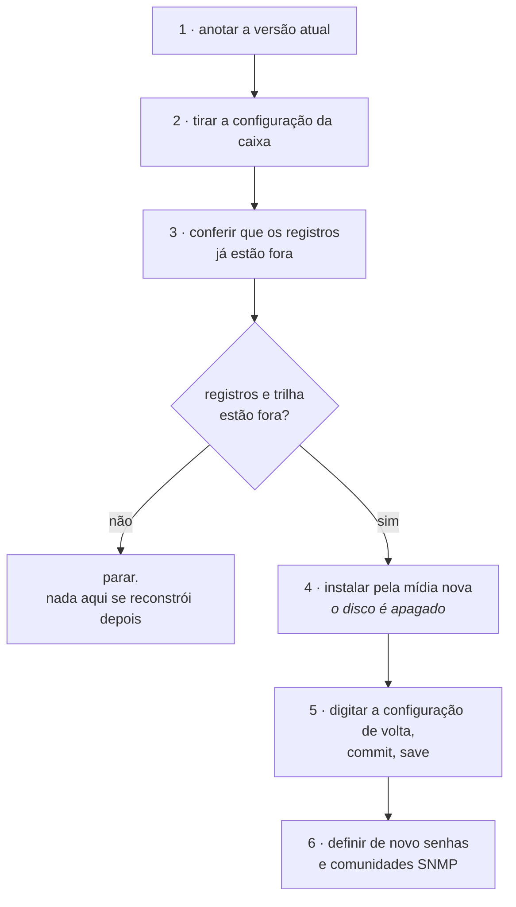

# Levar a caixa para uma versão nova

Como colocar uma versão nova do HexaRouting numa caixa que já está em produção. Hoje existe um caminho só, e ele é uma **reinstalação** a partir da mídia da versão nova: o disco inteiro é apagado no processo. Esta página diz o que isso custa, o que precisa estar fora da caixa antes de começar, e em que ordem fazer.


:::warning
**Reinstalar apaga o disco inteiro, inclusive o volume de registros de conexão.**

Em modo dinâmico esse volume guarda o registro de conexão que o Marco Civil obriga a manter por um ano. Em modo determinístico ele guarda a trilha de configuração, que é o que permite dizer qual definição de pool estava em vigor num instante passado - sem ela, a resposta a um ofício sobre o mês passado deixa de ser sustentável.

Os dois morrem na reinstalação e **nenhum comando deste produto os traz de volta**. Uma caixa reinstalada continua respondendo pelo ano de guarda que já corria.

:::

# Por que é uma reinstalação

Não existe hoje comando, pacote ou arquivo de atualização que troque a versão de uma caixa já instalada. A mídia publicada é o único artefato que carrega uma versão, e ela **instala**: ela não atualiza.

Por isso trocar de versão é uma janela de manutenção planejada, com a mesma preparação de uma instalação nova, e não uma tarefa de rotina.

# O que não sobrevive

| O que | Sobrevive à reinstalação? |
|-------|---------------------------|
| A configuração em vigor | **Não.** Você precisa levá-la para fora e digitá-la de volta |
| As senhas das contas e as comunidades SNMP | **Não**, e não dá para copiá-las da tela: a caixa as mascara ao imprimir a configuração |
| As revisões de rollback | **Não** |
| Os registros de conexão do modo dinâmico | **Não** |
| A trilha de configuração | **Não** |
| O que já foi exportado para um coletor IPFIX | **Sim** - está fora da caixa, e a reinstalação não o alcança |
| O que já foi copiado para um syslog remoto | **Sim**, pelo mesmo motivo |

As duas últimas linhas são a razão da ordem dos passos abaixo: o que sobrevive é exatamente o que já estava fora da caixa antes de alguém digitar `yes`.



# O procedimento

## 1. Anote a versão que está rodando

```
hexarouting> show version
```

Guarde a saída inteira no chamado de mudança. Depois da reinstalação ela é a única coisa que diz de onde a caixa veio.

## 2. Leve a configuração para fora da caixa

```
hexarouting> show running-config
```

É o que está em vigor neste instante. Copie a saída inteira para fora da sessão: ela é escrita para ser digitada de volta no prompt, uma linha por vez, e é o único formato de exportação que existe.


:::warning
**Senhas e comunidades SNMP saem mascaradas.** A caixa não imprime hash de senha nem comunidade SNMP na tela, de propósito: um hash que aparece numa tela compartilhada durante um incidente é um hash que saiu da empresa.

A consequência é que a cópia que você levou **não restaura acesso nenhum**. Depois da reinstalação as contas e as comunidades são definidas de novo, à mão. Decida quais vão ser **antes** da janela.

:::

## 3. Confira que os registros já estão fora da caixa

**Modo dinâmico.** Os eventos de alocação vão para o coletor IPFIX enquanto a caixa trabalha, e o que já chegou ao coletor não é afetado. O que morre é o que existe só no volume da caixa. Se a exportação estiver parada ou atrasada, o buraco entre o coletor e a caixa é o que você vai perder.

**Modo determinístico.** Não há alocação para exportar: a prova é o algoritmo mais a configuração que estava em vigor, e é a trilha que diz qual era. Confira a trilha e compare o resumo do topo com a cópia no seu syslog remoto:

```
show bpa pool history verify
  7 entries checked, chain intact
  head  seq 7 sha256 4e98de83…81f4
```

Se não houver cópia remota da trilha, **pare aqui**. Ela não se reconstrói depois.

## 4. Instale a partir da mídia nova

O procedimento é o de [Instalação da appliance](/doc/instalacao-da-appliance-06NmxvBDb5) e não muda. Três pontos que são diferentes quando a máquina não é nova:

* **O disco alvo é o mesmo de antes**, com tudo que está nele, e a confirmação com a palavra `yes` apaga o disco inteiro.
* **A pergunta sobre quantos gigabytes ficam com os registros de conexão volta a ser feita.** Responda pelo menos o mesmo número de antes: responder menos encolhe a guarda sem que nada avise.
* **Se a caixa tinha espelho de registros em dois discos**, o segundo disco é perguntado de novo e apagado pelo mesmo `yes`.

## 5. Digite a configuração de volta

Entre com a senha definida durante a instalação e digite, em modo de configuração, a configuração que você levou no passo 2.

`commit` faz valer agora; `save` faz sobreviver ao próximo boot. São coisas diferentes e as duas são necessárias: uma caixa que recebeu a configuração e não salvou volta vazia no primeiro reboot.


:::warning
**Mudança remota vai com** `**commit confirmed**`**.** Uma caixa recém-instalada é uma caixa em que ninguém conferiu ainda qual interface é qual, e é exatamente onde um endereço no lugar errado corta o próprio acesso de quem está digitando.

:::

## 6. Defina de novo o que saiu mascarado

As contas e suas senhas, e as comunidades SNMP. Nada disso veio na cópia do passo 2, e uma caixa que roteia sem que a sua NMS a enxergue é uma caixa que ninguém vai perceber ficando doente.

# Como conferir

* O autoteste do primeiro boot sai **sem nenhuma linha** `**[FAIL]**`.
* `show version` responde com a versão nova, e as duas linhas de versão - a do que está instalado e a do dataplane carregado - são **iguais**. Elas só se separam quando o dataplane em disco é trocado sem reiniciar, e não foi isso que aconteceu: a caixa inteira subiu nova.
* `show running-config` traz de volta o que você digitou, comparável linha a linha com a cópia do passo 2, menos os valores mascarados.
* Um assinante real navega, e `show cgnat subscriber` com o IP dele responde com o endereço público e a faixa de portas.


:::success
Autoteste sem `**[FAIL]**`, `show version` na versão nova e um assinante traduzindo: a troca terminou.

O que **não** volta é o que não saiu da caixa antes. É por isso que os passos 2 e 3 vêm antes do 4, e não depois.

:::

# Ver também

* [Instalação da appliance](/doc/instalacao-da-appliance-06NmxvBDb5) - o instalador em detalhe, o volume de registros e o espelho em dois discos
* [Logging IPFIX e trilha de auditoria](/doc/logging-ipfix-e-trilha-de-auditoria-lREEjJu1Bq) - o que a trilha guarda e como conferir que ela não foi adulterada
* [Ampliar capacidade sem derrubar assinantes](/doc/ampliar-capacidade-sem-derrubar-assinantes-rWQkaj9r1u) - a outra mudança que custa uma parada, e como medi-la antes
* [Acesso, login e papéis](/doc/acesso-login-e-papeis-VcE7gIbI1U) - as contas e os papéis que o passo 6 recria
