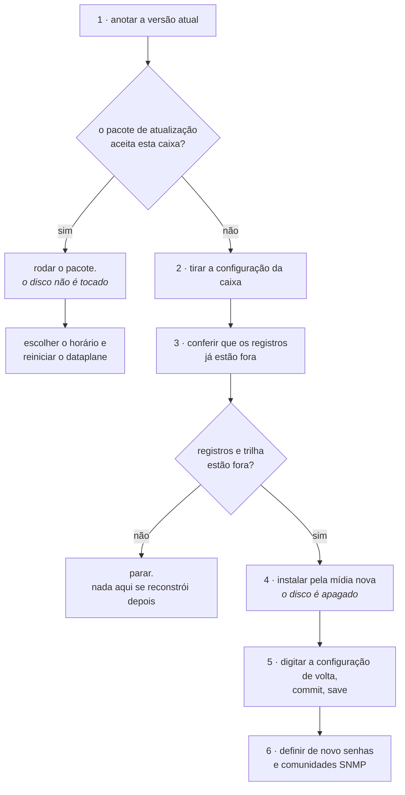

# Levar a caixa para uma versão nova

Como colocar uma versão nova do Prisma Routing numa caixa que já está em produção. Existem dois caminhos e eles custam coisas muito diferentes: o **pacote de atualização**, que troca os arquivos do produto e não encosta no disco, e a **reinstalação pela mídia**, que apaga o disco inteiro. Esta página diz qual dos dois é o seu, o que cada um custa e em que ordem fazer.

# Qual dos dois é o seu

|     | O pacote de atualização | A reinstalação pela mídia |
|-----|-------------------------|---------------------------|
| Quando | Sempre que o pacote aceitar a caixa | Quando o pacote recusa, ou quando a máquina é nova |
| O disco | Intocado                | **Apagado**               |
| Configuração, contas, comunidades SNMP | Ficam                   | Somem                     |
| Registros de conexão e trilha de configuração | Ficam                   | Somem                     |
| Parada | Só o reinício do dataplane, e no horário que você escolher | A janela inteira, com boot pela mídia |
| Tamanho do download | Alguns megabytes        | Centenas de megabytes     |

**O pacote é o caminho normal.** A reinstalação existe para a máquina nova e para o caso em que a versão nova muda a plataforma por baixo do produto. Você não precisa adivinhar qual é: o pacote confere isso sozinho e **recusa antes de escrever qualquer coisa**, dizendo o que a caixa tem e o que a versão nova precisa.

# Antes de subir para a 0.76.0: as placas mudam de dono

A partir da 0.76.0 o dataplane **reivindica as placas sozinho**. A regra é: ele fica com todas as placas PCI da caixa, exceto uma reservada para o Linux — que é a rede de gerência gravada na instalação —, e nunca a última. Numa instalação nova isso é o que faz a caixa encaminhar sem ninguém dizer nada.

Numa caixa **já em serviço**, isso muda de dono no próximo boot. Leia a sua linha antes de atualizar:

| Se a sua caixa | O que muda no próximo boot |
|----------------|----------------------------|
| tem **uma** placa | o dataplane fica com ela. Endereço, MAC e gateway passam para o par `linux_cp`, e a caixa passa a ser alcançada *através* do dataplane. Nada a fazer |
| tem **várias** e você guardou uma para o Linux só não nomeando ela | **o dataplane vai pegar essa placa.** Só é poupada a que está gravada como rede de gerência da instalação. Uma placa que você usava para VLAN de gerência, caminho de backup ou storage é reivindicada |
| já nomeia uma placa com `dataplane interface` | não muda, e agora é **exclusivo**: a caixa pega aquela e nenhuma outra. É assim que se guardam placas para o Linux |
| mistura placa de MTU 1500 com uma que aceita jumbo | toda interface começa no **menor** máximo entre as placas reivindicadas, porque o dataplane usa um valor só para todas. `mtu <n>` dentro de `interface` levanta uma porta depois |
| foi instalada nomeando uma placa que ela não tem mais | nada fica reservado, então **todas** são reivindicadas |
| foi instalada respondendo `none` à pergunta da rede de gerência | **nada pode ficar reservado**, porque a reserva É essa resposta: todas as placas são reivindicadas, inclusive a que você administra. A caixa não se perde — o endereço passa para o par do dataplane — mas o caminho muda, e o autoteste passa a avisar em todo boot |


:::warning
O caso do meio é o que morde. Uma caixa com várias placas em que você simplesmente nunca nomeou a de gerência perde essa placa para o dataplane no primeiro boot depois da atualização — e, se não for a que carrega a rota default gravada na instalação, ela não volta sozinha.

Antes de reiniciar, resolva com uma linha: nomeie a placa dos assinantes com `dataplane interface <nome>` e dê `commit`. A partir daí a caixa reivindica só aquela, e todas as outras ficam com o Linux.

:::

`show hardware` diz quais placas foram reivindicadas, qual foi poupada e por quê; o autoteste de boot diz o mesmo no console. Uma placa cujo endereço, MAC e gateway a caixa não consiga ler inteiros **não** é reivindicada — ela prefere manter a placa a entregar uma porta que não saberia devolver.

E um passo que deixou de existir: **naquela caixa de uma placa só, entregar a placa não arma mais um** `**commit confirmed**` **de trinta minutos.** Se o seu procedimento manda reiniciar, entrar de novo e digitar `commit` para manter a placa, apague esse passo — não há janela para confirmar, e o `commit` extra não faz nada.

# O pacote de atualização

## 1. Anote a versão que está rodando

```
prismarouting> show version
```

Guarde a saída inteira no chamado de mudança. Ela é o que diz de onde a caixa veio, e é com ela que você compara no fim.

## 2. Baixe o pacote da versão nova

Ele é publicado ao lado da mídia, na mesma página da versão, com o mesmo número de versão no nome. Confira o `sha256` publicado antes de continuar.

## 3. Descompacte e rode

```
tar xzf prisma-routing-<versão>-upgrade.tar.gz
cd prisma-routing-<versão>-upgrade
sudo sh upgrade
```

O pacote confere a plataforma da caixa, troca os arquivos do produto e diz, arquivo por arquivo, o que escreveu. Se a plataforma não bater, ele para aí mesmo e **nada foi escrito**: a caixa continua exatamente a que era antes do comando.


:::info
**A configuração não é tocada.** `/etc/hexarouting/hexarouting.conf`, as revisões de rollback e o ajuste de tuning que você editou continuam onde estavam. O pacote reescreve os arquivos do produto, não os seus.

:::

## 4. Escolha quando reiniciar o dataplane

Este é o passo que custa alguma coisa, e é seu.

O pacote troca o dataplane **em disco** e não reinicia nada. Até o próximo reinício do VPP, a caixa continua traduzindo com o dataplane antigo, que já estava carregado na memória.

Quem conta essa história é a linha `plugin` do `show version`, e **não** a linha `dataplane`:

```
prismarouting> show version
Prisma Routing 0.74.2
  dataplane: vpp v24.10-release built by root on box at 2026-01-01
  plugin:    0.40.0
  routing:   FRRouting 10.7.1 (hexarouting).
  daemons:   running  bgpd mgmtd ospfd staticd zebra
```

A linha `dataplane` é a versão do próprio VPP e não se mexe numa troca de versão do Prisma Routing. A que fica para trás é `plugin`: é a build com que o dataplane foi carregado no último boot. Compare-a com o número da **primeira** linha - e quando as duas discordam a caixa diz isso em voz alta, com um parágrafo embaixo da linha `plugin` explicando que só um reinício do dataplane as iguala. Quando concordam ela não diz nada, que é o estado normal.

A linha `plugin` responde de quatro jeitos, e três deles não são divergência: que a build é tal, que o dataplane não está respondendo, que o dataplane respondeu e não informa build nenhuma, ou que não há com o que comparar.


:::warning
**Reiniciar o VPP derruba todas as sessões e todos os blocos de portas.** Cada assinante atrás da caixa volta a ser traduzido do zero. É rápido, mas não é de graça, e é por isso que o pacote não faz isso por conta própria.

Um reboot da caixa faz a mesma coisa e leva junto qualquer mudança de tuning.

:::

Enquanto a linha `plugin` estiver atrás da primeira, a caixa está rodando um produto novo com um dataplane antigo. É um estado válido e previsto, mas não é onde a caixa deve passar a semana.

# Quando o pacote recusa

A recusa vem com as duas versões da plataforma escritas, a que a caixa tem e a que a versão nova precisa. Ela acontece quando a versão nova traz também uma plataforma nova por baixo, e o pacote carrega só os arquivos do produto: ele não instala pacote de sistema nenhum e não acessa a rede.

Nesse caso o caminho é a mídia, e ele apaga o disco. **Leia a seção abaixo inteira antes de começar.**

# A reinstalação pela mídia


:::warning
**Reinstalar apaga o disco inteiro, inclusive o volume de registros de conexão.**

Em modo dinâmico esse volume guarda o registro de conexão que o Marco Civil obriga a manter por um ano. Em modo determinístico ele guarda a trilha de configuração, que é o que permite dizer qual definição de pool estava em vigor num instante passado - sem ela, a resposta a um ofício sobre o mês passado deixa de ser sustentável.

Os dois morrem na reinstalação e **nenhum comando deste produto os traz de volta**. Uma caixa reinstalada continua respondendo pelo ano de guarda que já corria.

:::

## O que não sobrevive

| O que | Sobrevive à reinstalação? |
|-------|---------------------------|
| A configuração em vigor | **Não.** Você precisa levá-la para fora e digitá-la de volta |
| As senhas das contas e as comunidades SNMP | **Não**, e não dá para copiá-las da tela: a caixa as mascara ao imprimir a configuração |
| As revisões de rollback | **Não**                   |
| Os registros de conexão do modo dinâmico | **Não**                   |
| A trilha de configuração | **Não**                   |
| O que já foi exportado para um coletor IPFIX | **Sim** - está fora da caixa, e a reinstalação não o alcança |
| O que já foi copiado para um syslog remoto | **Sim**, pelo mesmo motivo |

As duas últimas linhas são a razão da ordem dos passos abaixo: o que sobrevive é exatamente o que já estava fora da caixa antes de alguém digitar `yes`.



## 2. Leve a configuração para fora da caixa

```
prismarouting> show running-config
```

É o que está em vigor neste instante. Copie a saída inteira para fora da sessão: ela é escrita para ser digitada de volta no prompt, uma linha por vez, e é o único formato de exportação que existe.


:::warning
**Senhas e comunidades SNMP saem mascaradas.** A caixa não imprime hash de senha nem comunidade SNMP na tela, de propósito: um hash que aparece numa tela compartilhada durante um incidente é um hash que saiu da empresa.

A consequência é que a cópia que você levou **não restaura acesso nenhum**. Depois da reinstalação as contas e as comunidades são definidas de novo, à mão. Decida quais vão ser **antes** da janela.

:::

## 3. Confira que os registros já estão fora da caixa

**Modo dinâmico.** Os eventos de alocação vão para o coletor IPFIX enquanto a caixa trabalha, e o que já chegou ao coletor não é afetado. O que morre é o que existe só no volume da caixa. Se a exportação estiver parada ou atrasada, o buraco entre o coletor e a caixa é o que você vai perder.

**Modo determinístico.** Não há alocação para exportar: a prova é o algoritmo mais a configuração que estava em vigor, e é a trilha que diz qual era. Confira a trilha e compare o resumo do topo com a cópia no seu syslog remoto:

```
show cgnat history verify
  7 entries checked, chain intact
  head  seq 7 sha256 4e98de83…81f4
```

Se não houver cópia remota da trilha, **pare aqui**. Ela não se reconstrói depois.

## 4. Instale a partir da mídia nova

O procedimento é o de [Instalação da appliance](/doc/instalacao-da-appliance-06NmxvBDb5) e não muda. Três pontos que são diferentes quando a máquina não é nova:

* **O disco alvo é o mesmo de antes**, com tudo que está nele, e a confirmação com a palavra `yes` apaga o disco inteiro.
* **A pergunta sobre quantos gigabytes ficam com os registros de conexão volta a ser feita.** Responda pelo menos o mesmo número de antes: responder menos encolhe a guarda sem que nada avise.
* **Se a caixa tinha espelho de registros em dois discos**, o segundo disco é perguntado de novo e apagado pelo mesmo `yes`.

## 5. Digite a configuração de volta

Entre com a senha definida durante a instalação e digite, em modo de configuração, a configuração que você levou no passo 2.

`commit` faz valer agora; `save` faz sobreviver ao próximo boot. São coisas diferentes e as duas são necessárias: uma caixa que recebeu a configuração e não salvou volta vazia no primeiro reboot.


:::warning
**Mudança remota vai com** `**commit confirmed**`**.** Uma caixa recém-instalada é uma caixa em que ninguém conferiu ainda qual interface é qual, e é exatamente onde um endereço no lugar errado corta o próprio acesso de quem está digitando.

:::

## 6. Defina de novo o que saiu mascarado

As contas e suas senhas, e as comunidades SNMP. Nada disso veio na cópia do passo 2, e uma caixa que roteia sem que a sua NMS a enxergue é uma caixa que ninguém vai perceber ficando doente.

# Como conferir

**Depois do pacote de atualização:**

* `show version` traz a versão nova na primeira linha, a do Prisma Routing instalado. A linha `plugin` só acompanha depois que o VPP for reiniciado, e até lá ela fica na build antiga de propósito.
* Depois do reinício do dataplane a linha `plugin` passa a bater com a primeira, e o parágrafo de divergência some.
* A configuração continua lá: `show running-config` traz de volta o que já estava em vigor, sem ninguém digitar nada.
* Um assinante real navega, e `show cgnat subscriber` com o IP dele responde com o endereço público e a faixa de portas.

**Depois da reinstalação:**

* O autoteste do primeiro boot sai **sem nenhuma linha** `**[FAIL]**`.
* `show version` responde com a versão nova, e a linha `plugin` bate com ela desde o primeiro boot: a caixa inteira subiu nova, então não há build antiga carregada.
* `show running-config` traz de volta o que você digitou, comparável linha a linha com a cópia do passo 2, menos os valores mascarados.
* Um assinante real navega, e `show cgnat subscriber` com o IP dele responde com o endereço público e a faixa de portas.


:::success
Autoteste sem `**[FAIL]**`, `show version` na versão nova e um assinante traduzindo: a troca terminou.

Se o caminho foi a reinstalação, o que **não** volta é o que não saiu da caixa antes. É por isso que os passos 2 e 3 vêm antes do 4, e não depois.

:::

# Ver também

* [Instalação da appliance](/doc/instalacao-da-appliance-06NmxvBDb5) - o instalador em detalhe, o volume de registros e o espelho em dois discos
* [Logging IPFIX e trilha de auditoria](/doc/logging-ipfix-e-trilha-de-auditoria-lREEjJu1Bq) - o que a trilha guarda e como conferir que ela não foi adulterada
* [Ampliar capacidade sem derrubar assinantes](/doc/ampliar-capacidade-sem-derrubar-assinantes-rWQkaj9r1u) - a outra mudança que custa uma parada, e como medi-la antes
* [Acesso, login e papéis](/doc/acesso-login-e-papeis-VcE7gIbI1U) - as contas e os papéis que o passo 6 recria
