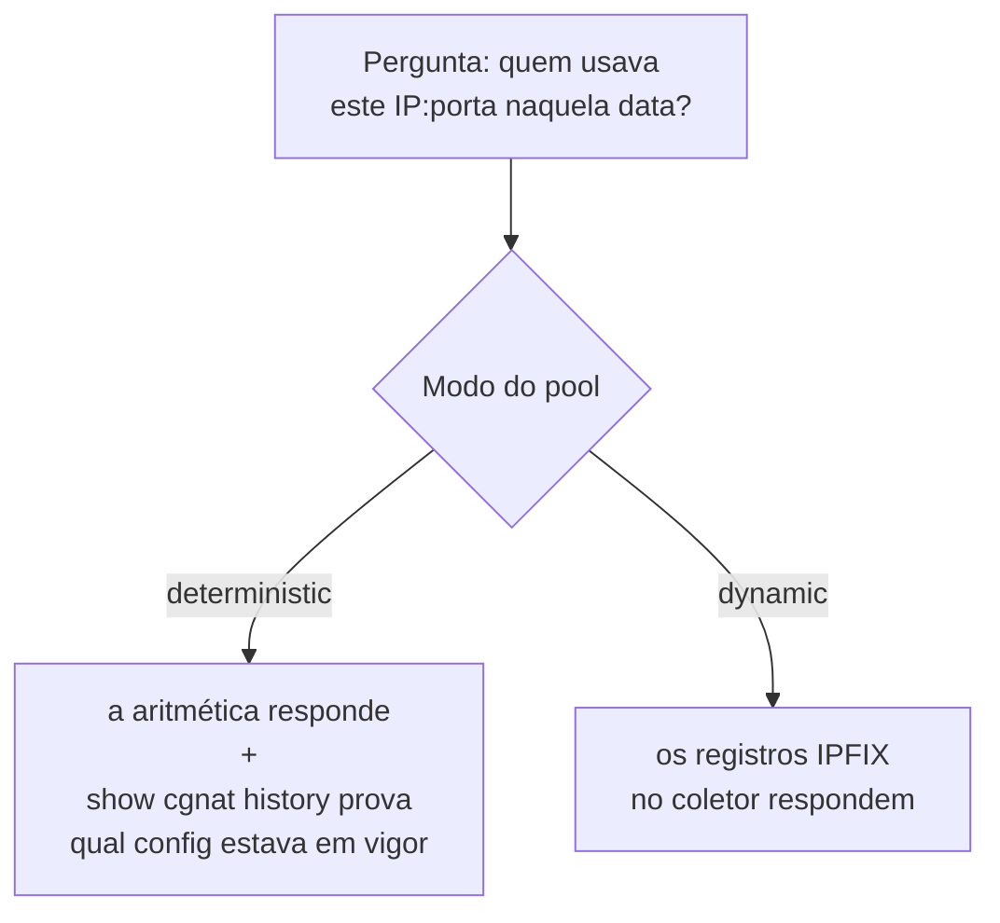
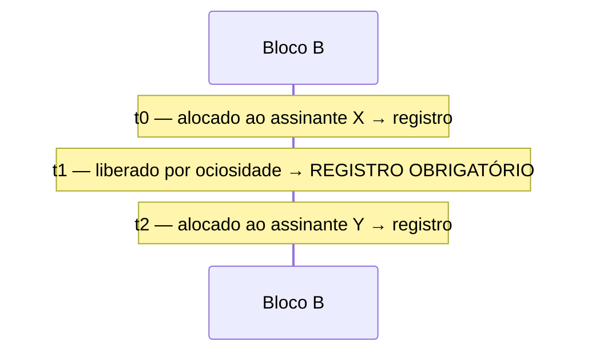

# Logging IPFIX e trilha de auditoria

Duas coisas diferentes com o mesmo objetivo — poder responder *"quem estava usando este IP público, nesta porta, neste instante?"* — e que se aplicam a modos diferentes.



# Modo determinístico: a configuração **é** o log

Não existem eventos de alocação, então não há o que exportar. A prova oferecida a uma autoridade é:

> o algoritmo, mais a configuração que estava em vigor naquele instante

Isso só se sustenta enquanto se souber **qual** configuração estava em vigor. É para isso que existe a **trilha de configuração**.

## A trilha de configuração

Propriedades que não são acidentais:

* **Append-only** — nada é reescrito.
* `**fsync**` **a cada entrada** — sobrevive a queda de energia.
* **Carrega a definição inteira, não um diff** — reconstruir o estado de uma data somando diffs desde o começo é frágil; guardar o estado completo não é.
* **Registra o operador que fez a mudança.**

Uma entrada que não puder ser atribuída a alguém **precisa dizer isso**. Omitir o campo seria indistinguível de uma entrada em que ninguém foi responsável.

```
show cgnat history
```

# Modo dinâmico: IPFIX por bloco

Um registro por **alocação de bloco** (RFC 8158) — não por fluxo. É a diferença entre alguns registros por assinante por dia e um por conexão.

## Configurando

A exportação por UDP precisa saber **para onde** ir antes de ser ligada. São dois comandos, nesta ordem:

```
configure
 nat cgnat logging udp <coletor> src <origem> [port <n>]   destino do UDP
 nat cgnat logging enable                                  liga a exportação UDP
 commit
```

`src` é o endereço de origem dos pacotes IPFIX e **não é opcional**: sem ele a caixa recusa. Use um endereço que o coletor reconheça como sendo desta caixa — normalmente o de gerência. Sem `port`, vale 4739, a porta registrada pelo RFC 7011.

Os demais comandos da hierarquia:

| Comando | O que faz |
|---------|-----------|
| `nat cgnat logging tcp <coletor> [port <n>]` | exportação por TCP |
| `nat cgnat logging tcp disable` | desliga o transporte TCP |
| `nat cgnat logging syslog <coletor> enterprise <n> [port <n>] [facility <0-23>] [severity <0-7>]` | exporta os mesmos eventos como linhas syslog (RFC 5424) |
| `nat cgnat logging syslog disable` | desliga o transporte syslog |
| `nat cgnat logging udp disable` | apaga o destino UDP |
| `nat cgnat logging disable` | desliga a exportação UDP |

O destino UDP volta em `show running-config`, sobrevive a `save`, a `rollback` e ao boot — e é reaplicado na ordem certa, o destino antes do estado.

### Se você ligar a exportação sem dizer para onde

`commit check` recusa antes de aplicar qualquer coisa:

```
error: cgnat logging enable: UDP export has no collector
    nothing would leave this box; add 'nat cgnat logging udp <collector> src
    <source>' beside it, or export over TCP with 'nat cgnat logging tcp
    <collector>'
    the dataplane refuses the statement, and it would refuse it half way
    through this commit
```

`nat cgnat logging tcp` **não** satisfaz esse requisito: os dois transportes são caminhos independentes, e `logging enable` liga o de UDP.

A recusa vale quando é **esta mudança** que cria o problema. Numa caixa que já está nesse estado — exportação ligada e o destino apagado por baixo dela — a mesma frase sai como `warning:` e o commit passa, porque senão a única configuração que a caixa não conseguiria aplicar seria justamente a que conserta isso.


:::warning
**Em versões até a 0.63.0 a exportação por UDP não funcionava em nenhuma appliance instalada.** Não havia comando na VTY que dissesse para qual coletor enviar, então o dataplane recusava `logging enable` — e, até a 0.63.0, o `commit` respondia `commit complete` por cima dessa recusa. Uma operação que acreditava estar guardando registros de retenção legal não estava guardando nada.

Se você opera modo dinâmico e ligou a exportação por UDP em versão anterior, trate isso como uma lacuna de retenção no período: os registros daquele intervalo não existem. A exportação por TCP nunca foi afetada.

:::

### Conferindo que está mesmo exportando

```
show cgnat logging       estado da exportação e para onde ela vai
```

Uma linha `exporter` com endereço é a prova de que existe destino; `exporter none` significa que nada sai por UDP, **mesmo com o estado** `**enabled**` — apagar o destino não desliga a exportação, só a deixa sem para onde ir.

O autoteste de boot também confere isso, e compara duas coisas diferentes: o que a caixa foi mandada fazer e o que o dataplane realmente tem. Se a configuração pede exportação e o dataplane está sem ela, o boot falha e diz qual das duas metades não pegou — porque uma configuração recusada é indistinguível de uma que está funcionando quando se olha só para o arquivo.

```
show cgnat logging       estado da exportação
show cgnat blocks        blocos atualmente alocados (e quantos estão presos)
```

Os blocos em uso agora; os registros já exportados estão no coletor.

## Bloco preso por encaminhamento de porta também é evento

Um [encaminhamento de porta](/doc/encaminhamento-de-porta-epIZfdmzU3) num pool dinâmico prende o bloco do assinante enquanto o forward existir. Prender gera uma **alocação** e soltar gera uma **liberação**, como qualquer outro bloco: em modo dinâmico o log é o único registro de quem segurou um bloco, e um bloco segurado sem registro é um mapeamento que ninguém consegue atribuir depois.

Um segundo forward dentro de um bloco que já está preso **não** gera outro registro — o evento é do bloco, não do forward. Duas alocações do mesmo bloco sem uma liberação entre elas é exatamente a lacuna que faz uma consulta futura responder errado.

## Por que TCP existe

Com UDP, a pergunta *"o coletor recebeu?"* não tem resposta — e a pergunta que realmente importa é **"o que acontece quando o coletor cai?"**. Com UDP, a resposta é silêncio: registros de retenção legal desaparecem sem que nada indique.

É exatamente esse o caso que o produto verifica: derrubar o coletor e conferir o que acontece com os registros.

# O formato do registro (RFC 8158)

Cada registro exportado tem estes campos:

| IE  | Nome | Bits | Obrigatório | Conteúdo |
|----:|------|-----:|-------------|----------|
| 323 | `observationTimeMilliseconds` | 64   | sim         | instante do evento, em UTC |
| 230 | `natEvent` | 8    | sim         | 16, 17 ou 12 |
| 8   | `sourceIPv4Address` | 32   | sim         | endereço do assinante |
| 225 | `postNATSourceIPv4Address` | 32   | sim         | endereço público atribuído |
| 361 | `portRangeStart` | 16   | sim         | início do bloco |
| 362 | `portRangeEnd` | 16   | não         | fim do bloco |
| 283 | `natPoolId` | 32   | não         | índice do pool |

E um **segundo template**, com dois campos, que carrega o marcador de reinício:

| IE  | Nome | Bits | Conteúdo |
|----:|------|-----:|----------|
| 323 | `observationTimeMilliseconds` | 64   | instante em que o marcador foi escrito |
| 160 | `systemInitTimeMilliseconds` | 64   | instante em que esta encarnação do dataplane começou |


:::warning
**Registros coletados por TCP em versões até a 0.34.0 têm esse campo errado.** Eles carregavam segundos desde o boot do VPP em vez da hora do dia — o coletor decodificava uma alocação como `00:00:05`. O exportador UDP, carregando os mesmos eventos, decodificava a hora certa.

Três consequências, e a terceira é a que importa para guarda legal:

* registros de boots diferentes **não são ordenáveis**, porque o relógio volta a zero a cada reinício e o log anda para trás;
* os dois transportes não podiam se corroborar, que é a única razão de rodar os dois;
* **um pedido que nomeia uma hora do dia — que é todo pedido que este log existe para responder — não podia ser resolvido.**

Corrigido na **0.35.0**. Um log já coletado por TCP pode ser reparado se a hora de boot da caixa for conhecida; **nada recupera a ordenação entre reinícios**. Se você opera modo dinâmico e coletou por TCP em versão anterior, trate isso como um problema de retenção, não de cosmética.

:::

Os três valores de `natEvent` usados:

| Valor | Evento |
|------:|--------|
| **16** | bloco alocado (inclui extensão) |
| **17** | bloco liberado |
| **12** | portas esgotadas |

# Por que a liberação é obrigatória

Este é o ponto mais fácil de perder, e ele muda a resposta jurídica.



Um juiz pergunta quem segurava (IP, porta em B) em **t1.5**. A consulta natural — *"a última alocação antes desse instante"* — responde **X**.


:::warning
Está errado: em t1.5 ninguém segurava aquele bloco. O provedor entregaria um assinante inocente.

Em t0.5 e t2.5 a mesma consulta acerta. O erro aparece **só na lacuna**, que é exatamente onde ninguém testa.

:::

Por isso o `natEvent 17` na liberação é correção, não capricho.

# Quando a caixa para, e quando ela cai

A mesma lacuna aparece no reinício, e por um motivo mais comum do que a ociosidade: **todo reboot planejado** deixava para trás um bloco segurado no instante da parada, sem liberação nenhuma. E reboot planejado inclui o que inicia uma troca de versão, porque levar a caixa para uma versão nova começa bootando pela mídia nova.

## Dar nome ao assinante no registro

Uma ordem judicial nomeia uma pessoa. O registro nomeia um endereço privado num instante. Juntar os dois exigia um segundo sistema e um passo manual, feito sob pressão por quem está de plantão — que é exatamente a condição em que se manda a resposta errada.

A caixa passa a carregar a identidade no próprio registro:

```
nat cgnat identity file /etc/prisma-routing/subscribers.map
nat cgnat identity none
```

O arquivo é um assinante por linha, escrito pelo seu sistema de provisionamento:

```
# comentários e linhas em branco são ignorados
100.64.0.5   joao.silva@isp
100.64.0.6   pppoe-4471
```

**Ou direto do arquivo de lease do seu DHCP**, se você roda IPoE e já tem a resposta:

```
nat cgnat identity dhcp-leases /var/lib/dhcp/dhcpd.leases
```

A gramática é a do ISC dhcpd. A identidade é o `client-hostname` quando o lease tem um, e o endereço `hardware ethernet` quando não tem — o primeiro é o que o suporte reconhece, o segundo é o que sempre existe. Lease sem nenhum dos dois não vira entrada, e aquele endereço fica `unknown` em vez de ganhar algo inventado.

**Só lease** `**active**` **conta.** O arquivo guarda todo lease que o servidor já escreveu, e um `free` ainda carrega o nome do último cliente — nomear um assinante a partir de um desses é dar a resposta errada a uma ordem judicial com cara de certa. Endereço renovado aparece várias vezes e **vence o último**, que é o contrário da regra do mapa estático; por isso são dois comandos e não um que adivinha pelo começo do arquivo.

**Ele é lido inteiro ou recusado inteiro.** Uma linha que não é comentário nem `<endereço> <identidade>` é recusada dizendo qual linha, e a tabela em vigor não muda — um provisionamento que escreveu uma linha torta pode ter escrito outra, e uma tabela faltando um assinante em silêncio é justamente a falha que isso existe para evitar. Endereço repetido também é recusado: duas identidades para um endereço são duas respostas para a pergunta que o juiz faz, e escolher uma seria a caixa decidindo qual assinante nomear.

**Ou da contabilidade que o seu BNG já manda**, se a autenticação é PPPoE e a resposta já existe num RADIUS:

```
nat cgnat identity radius secret <segredo compartilhado> [port <n>]
```

Esta caixa não é um servidor RADIUS: ela não autentica ninguém e não responde Access-Request. Ela é um segundo destino da contabilidade, lendo dela uma coisa só — qual assinante está em qual endereço. Um `Start` ou um `Interim` que traz endereço e nome diz quem está ali, um `Stop` tira o nome, e um `Interim` sem endereço não muda nada, porque adivinhar de qual endereço ele falava é exatamente como um assinante acaba nomeado no registro de outro.

**O segredo é obrigatório e conferido em todo pacote**, e pacote que não bate é descartado sem resposta. Sem essa conferência, qualquer um que alcance a porta nomearia qualquer assinante em qualquer endereço, e o log de compliance passaria a aceitar ditado. As duas recusas são contadas separadas — autenticador ruim é a caixa de outro (ou o segredo desta errado), pacote malformado é cliente quebrado de alguém:

```
prisma> show cgnat identity
identity table: 3 entry(s), read 2026-09-18T06:41:02Z
radius accounting: listening on port 1813
  packets    2 received, 1 applied, 1 answered
  refused    1 bad authenticator, 0 malformed
```

**O segredo não volta em nenhuma tela.** O `show configuration` imprime `secret <set, not shown>`, e o arquivo salvo guarda o valor de verdade — a caixa precisa subir o próprio listener depois de um reboot. É o mesmo tratamento que a community SNMP já tem.

**A identidade é tomada no instante da alocação**, não na hora em que o registro sai. Entre uma coisa e outra o lease pode ter mudado de dono, e um registro nomeando quem tem o endereço depois é um registro bem formado, guardado, e errado.

**Endereço que a caixa não conhece vira** `**unknown**`**, e o registro sai assim mesmo.** Registro faltando é pior que registro incompleto, e o coletor precisa distinguir "a caixa não sabe" de "a caixa não disse".

**É dado pessoal, e nada imprime uma entrada.** O `show cgnat identity` diz quantas entradas existem e quando o arquivo foi lido:

```
prisma> show cgnat identity
identity table: 3 entry(s), read 2026-09-18T06:41:02Z
```

Nenhuma outra tela desta caixa carrega identidade. A presença dela no log é a razão pela qual o log é protegido.

**Nos dois transportes:** no syslog ela vai como `subscriberId` dentro do dado estruturado; no IPFIX sobre TCP vai como elemento **371** `**userName**`. O id do template do registro de bloco passou de 256 para 258 por causa disso — o IPFIX não permite que um id signifique dois conjuntos de campos, e um coletor com o 256 em cache leria os primeiros bytes da identidade como id de pool. Se o seu coletor guarda templates, ele vai simplesmente esperar o novo, que a caixa reenvia a cada minuto.

O exportador **UDP** não mudou: ele continua com os sete campos da RFC 8158 e sem identidade.

## Quando o seu coletor só fala syslog

A maioria dos coletores de ISP lê syslog e mais nada. Os mesmos eventos saem como linhas **RFC 5424**, sem mudar o que é registrado: um registro por alocação e por liberação, nunca por fluxo.

```
nat cgnat logging syslog 10.0.0.9 enterprise 44444
```

Uma linha de alocação chega assim:

```
<134>1 2026-09-18T02:40:59.123Z cgnat-sp-01 prisma-cgnat - BLOCK-ALLOC
[cgnat@44444 natEvent="16" subscriber="100.64.0.5" public="200.150.0.16"
portStart="1024" portEnd="1027" pool="0"]
100.64.0.5 -> 200.150.0.16 ports 1024-1027 pool 0
```

**O horário é o mesmo do registro IPFIX, com a mesma precisão de milissegundo, em UTC.** É isso que permite colocar os dois lado a lado: um log cujo relógio não pode ser comparado com o outro não corrobora nada — e corroborar é a razão de existir um segundo transporte.

**O número de empresa é seu, e não tem padrão.** A RFC 5424 reserva um nome de dado estruturado sem sufixo `@empresa` para nomes registrados na IANA, e este produto não tem um. Inventar um colocaria, no log de todo operador, um nome que amanhã significa outra coisa para quem o registrar. Então a caixa **recusa** o comando sem `enterprise <n>` — no prompt, onde dá para resolver, e não em um ano de linhas que o coletor interpretou errado.

O transporte é TCP, com enquadramento por contagem de octetos (RFC 6587): o tamanho e um espaço antes de cada linha. A porta padrão é 601. Vale o mesmo que vale para o IPFIX sobre TCP — se o coletor cair, os bytes vão para um arquivo de transbordo na própria caixa e voltam na reconexão, na ordem. Cada transporte tem o arquivo dele.

Os dois podem ficar ligados ao mesmo tempo: o coletor do provedor lendo syslog e a ferramenta deste produto lendo IPFIX.

| Você digitou | A caixa diz |
|--------------|-------------|
| `nat cgnat logging syslog 10.0.0.9` | `an enterprise number is required`, com o porquê |
| `... enterprise 9 sideways 2` | `not an option of this statement`, listando as que são |
| `... enterprise 9 port 70000` | `port is 0-65535` |
| `... enterprise 9 facility 24` | `facility is 0-23` |

## Parada planejada

Uma parada ordenada - `systemctl stop`, `systemctl restart`, um reboot, inclusive o reboot que começa uma troca de versão - **libera todos os blocos antes de sair**. Sai um `natEvent 17` por bloco ainda segurado, nos dois transportes, carimbado com o **instante da parada**.

O instante é o da parada e não um anterior de propósito: a caixa não observou o momento em que o bloco deixou de ser usado, e um registro que chutasse esse momento seria um registro inventado.

## Quando o coletor está atrasado na hora da parada

As liberações são escritas no instante da parada, mas o coletor pode não estar pronto para recebê-las todas de uma vez. Dois casos, e o segundo é o comum:

* um coletor lento, ou que parou de ler sem fechar a conexão;
* uma caixa com **muitos blocos segurados**. A parada escreve uma liberação por bloco, de uma só vez, e isso é mais do que cabe no socket em uma passada.

Nos dois casos os bytes que sobraram **não são perdidos**: vão para um arquivo no disco da própria caixa, `/var/log/prisma-routing/ipfix-spill.bin`, e voltam na próxima conexão com o coletor, na ordem em que foram escritos. É o mesmo arquivo que cobre um coletor fora do ar.

O que isso muda para quem opera:

* depois de um reboot, parte das liberações pode chegar ao coletor **alguns segundos depois de a caixa voltar**, e não no instante da parada. O carimbo de cada registro continua sendo o instante da parada, que é o que responde a uma ordem judicial;
* enquanto a exportação por TCP não voltar a conectar, o arquivo fica no disco. Uma caixa desligada em definitivo deixa esses registros lá - copie o arquivo antes de descomissionar;
* o estado da exportação mostra quantos bytes foram para o arquivo, quantos já voltaram e quantos foram descartados. Descarte só acontece quando não há onde escrever, e é contado - nunca silencioso.

```
show cgnat logging
```


:::info
Medido com o coletor lendo normalmente e 4001 blocos segurados: 70 kB de liberações ainda estavam no buffer de saída no instante em que o processo terminou, cerca de 1500 registros. Todos chegaram ao coletor no reinício seguinte.

:::

## Queda de energia

Uma caixa que perde energia, que é morta pelo kernel por falta de memória ou que entra em pânico **não emite nada** - e não há o que fazer a respeito: não existe instante em que ela poderia ter escrito o registro. As alocações dela ficam abertas.

É por isso que a parada ordenada sozinha **não** resolve o problema. Ela fecha os casos que a caixa viu chegando, e deixaria quem lê o log convencido de que toda alocação aberta é uma alocação em vigor - errando justamente nas caixas que caíram.

## O marcador de reinício

Para separar os dois casos, a caixa anuncia periodicamente **quando esta encarnação do dataplane começou**, em um segundo template, no campo `systemInitTimeMilliseconds` (IE 160) - que o IANA registra exatamente como *"o instante absoluto da última (re)inicialização do dispositivo IPFIX"*.

Com isso, uma alocação sem liberação passa a ter três leituras, e não duas:

| O que o coletor tem | Leitura |
|---------------------|---------|
| alocação e liberação | o assinante segurou aquelas portas entre os dois instantes - resposta exata |
| alocação sem liberação, e o valor do marcador **não** mudou depois | **ainda em vigor**: o assinante segura aquelas portas agora |
| alocação sem liberação, e o marcador anunciou um valor **novo** depois | **terminou naquele reinício**: a caixa caiu segurando o bloco e não observou o fim. A resposta honesta é a janela entre o último registro da encarnação anterior e o novo instante de início - não um instante |


:::info
O valor do marcador é **latched** no início do processo e não é recalculado. O que importa é que ele **mude** quando o processo é substituído; um valor recalculado a cada envio pularia a cada ajuste de relógio e seria lido como um reinício que não houve.

Em compensação, uma caixa cujo relógio ainda estava errado quando o dataplane subiu carrega um valor absoluto errado até ser reiniciada. Ele continua diferente do da encarnação anterior, que é para o que o coletor o lê.

:::


:::warning
**Um coletor que não conhece o IE 160 continua vendo alocações abertas e não consegue distingui-las.** Isso não é defeito da caixa: os registros saem, o segundo template é anunciado junto com o primeiro, e quem decodifica é o coletor. Ao escolher ou configurar um coletor para guarda legal, confirme que ele guarda o `systemInitTimeMilliseconds` por exportador e reprocessa as alocações abertas quando esse valor muda.

:::

## Conferindo

A linha do marcador aparece no estado da exportação, com o template que o carrega, quantos já saíram e o instante de início desta encarnação:

```
show cgnat logging
```

Se o número de marcadores enviados não sai do zero com a exportação ligada, o coletor não tem como separar os dois casos acima - trate como a exportação estar quebrada, não como cosmética.

# Verificando que a trilha não foi adulterada

Cada entrada da trilha carrega um número de sequência e um resumo SHA-256 sobre **o resumo anterior e o próprio texto**. Mudar um byte muda o resumo daquela entrada e de todas as seguintes — uma alteração não pode ser feita "fechar" só corrigindo a linha em que está.

```
show cgnat history verify
  7 entries checked, chain intact
  head  seq 7 sha256 4e98de83…81f4
```

Três formas de uma trilha estar errada, e elas são reportadas **separadamente**:

| O que foi feito | O que é reportado |
|-----------------|-------------------|
| o texto de uma entrada foi alterado | `BROKEN at entry 2` — a entrada inteira, e que ela não bate com o próprio resumo |
| uma entrada foi removida do meio | `BROKEN before entry 4` — a sequência pula de 2 para 4 |
| entradas foram removidas do fim | `TRUNCATED: the file ends at entry 5 and this dataplane wrote up to 7` |

A **sequência é conferida antes do resumo**, e essa ordem é o diagnóstico: remover uma entrada também quebra o resumo da seguinte, então um verificador que olhasse o hash primeiro reportaria toda remoção como alteração — da linha inocente depois da lacuna, mandando quem investiga para uma linha que ninguém tocou.

Entradas escritas antes da corrente existir continuam legíveis e são reportadas como **não cobertas**, nunca contadas como limpas. Um arquivo sem nenhuma entrada encadeada é reportado como `no chained entries: nothing here is covered` — nunca como íntegro, porque perder a corrente inteira é a primeira coisa que alguém tentaria.


:::info
**O que isso prova, e o que não prova.** Detecta uma trilha que foi **editada**, e diz onde. O que ele não faz é impedir alguém com acesso de escrita ao arquivo **e** a este algoritmo de reescrever a trilha inteira recalculando todos os resumos. Uma corrente que verifica prova que o arquivo não foi editado — não que é o mesmo arquivo. Compare o resumo do topo com a cópia no seu syslog remoto.

:::

# O que é recusado

**Log por fluxo não existe e não vai existir.** É precisamente o que o BPA foi feito para evitar. Um CGNAT registrando cada fluxo gera volume que nenhum provedor consegue guardar por um ano de forma útil.

# Ver também

* [Comandos show](/doc/comandos-show-YlNji1X5W4) — como ler `show cgnat translation` e o que ele prova
* [Receitas do dia a dia](/doc/receitas-do-dia-a-dia-IcocgdbXW2) — o roteiro para atender uma ordem judicial
