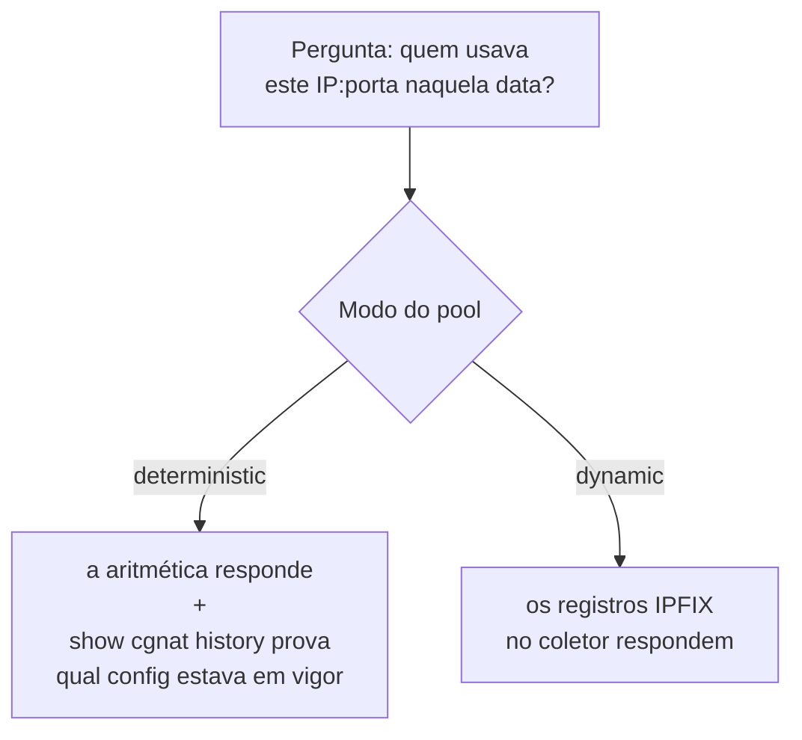
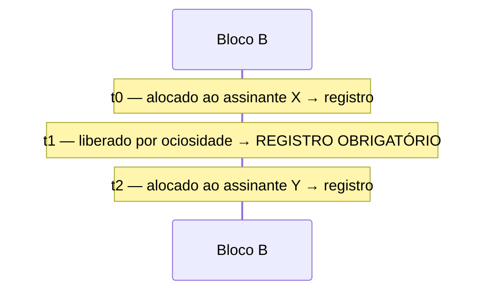

# Logging IPFIX e trilha de auditoria

Duas coisas diferentes com o mesmo objetivo — poder responder *"quem estava usando este IP público, nesta porta, neste instante?"* — e que se aplicam a modos diferentes.



# Modo determinístico: a configuração **é** o log

Não existem eventos de alocação, então não há o que exportar. A prova oferecida a uma autoridade é:

> o algoritmo, mais a configuração que estava em vigor naquele instante

Isso só se sustenta enquanto se souber **qual** configuração estava em vigor. É para isso que existe a **trilha de configuração**.

## A trilha de configuração

Propriedades que não são acidentais:

* **Append-only** — nada é reescrito.
* `**fsync**` **a cada entrada** — sobrevive a queda de energia.
* **Carrega a definição inteira, não um diff** — reconstruir o estado de uma data somando diffs desde o começo é frágil; guardar o estado completo não é.
* **Registra o operador que fez a mudança.**

Uma entrada que não puder ser atribuída a alguém **precisa dizer isso**. Omitir o campo seria indistinguível de uma entrada em que ninguém foi responsável.

```
show cgnat history
```

# Modo dinâmico: IPFIX por bloco

Um registro por **alocação de bloco** (RFC 8158) — não por fluxo. É a diferença entre alguns registros por assinante por dia e um por conexão.

## Configurando

```
configure
 nat cgnat logging enable                        exportação por UDP
 nat cgnat logging tcp <coletor> [port <n>]      exportação por TCP
 nat cgnat logging disable                       desliga
 commit
```

```
show cgnat logging       estado da exportação
show cgnat blocks        blocos atualmente alocados (e quantos estão presos)
```

## Bloco preso por encaminhamento de porta também é evento

Um [encaminhamento de porta](/doc/encaminhamento-de-porta-epIZfdmzU3) num pool dinâmico prende o bloco do assinante enquanto o forward existir. Prender gera uma **alocação** e soltar gera uma **liberação**, como qualquer outro bloco: em modo dinâmico o log é o único registro de quem segurou um bloco, e um bloco segurado sem registro é um mapeamento que ninguém consegue atribuir depois.

Um segundo forward dentro de um bloco que já está preso **não** gera outro registro — o evento é do bloco, não do forward. Duas alocações do mesmo bloco sem uma liberação entre elas é exatamente a lacuna que faz uma consulta futura responder errado.

## Por que TCP existe

Com UDP, a pergunta *"o coletor recebeu?"* não tem resposta — e a pergunta que realmente importa é **"o que acontece quando o coletor cai?"**. Com UDP, a resposta é silêncio: registros de retenção legal desaparecem sem que nada indique.

É exatamente esse o caso que o produto verifica: derrubar o coletor e conferir o que acontece com os registros.

# O formato do registro (RFC 8158)

Cada registro exportado tem estes campos:

| IE  | Nome | Bits | Obrigatório | Conteúdo |
|----:|------|-----:|-------------|----------|
| 323 | `observationTimeMilliseconds` | 64   | sim         | instante do evento, em UTC |
| 230 | `natEvent` | 8    | sim         | 16, 17 ou 12 |
| 8   | `sourceIPv4Address` | 32   | sim         | endereço do assinante |
| 225 | `postNATSourceIPv4Address` | 32   | sim         | endereço público atribuído |
| 361 | `portRangeStart` | 16   | sim         | início do bloco |
| 362 | `portRangeEnd` | 16   | não         | fim do bloco |
| 283 | `natPoolId` | 32   | não         | índice do pool |


:::warning
**Registros coletados por TCP em versões até a 0.34.0 têm esse campo errado.** Eles carregavam segundos desde o boot do VPP em vez da hora do dia — o coletor decodificava uma alocação como `00:00:05`. O exportador UDP, carregando os mesmos eventos, decodificava a hora certa.

Três consequências, e a terceira é a que importa para guarda legal:

* registros de boots diferentes **não são ordenáveis**, porque o relógio volta a zero a cada reinício e o log anda para trás;
* os dois transportes não podiam se corroborar, que é a única razão de rodar os dois;
* **um pedido que nomeia uma hora do dia — que é todo pedido que este log existe para responder — não podia ser resolvido.**

Corrigido na **0.35.0**. Um log já coletado por TCP pode ser reparado se a hora de boot da caixa for conhecida; **nada recupera a ordenação entre reinícios**. Se você opera modo dinâmico e coletou por TCP em versão anterior, trate isso como um problema de retenção, não de cosmética.

:::

Os três valores de `natEvent` usados:

| Valor | Evento |
|------:|--------|
| **16** | bloco alocado (inclui extensão) |
| **17** | bloco liberado |
| **12** | portas esgotadas |

# Por que a liberação é obrigatória

Este é o ponto mais fácil de perder, e ele muda a resposta jurídica.



Um juiz pergunta quem segurava (IP, porta em B) em **t1.5**. A consulta natural — *"a última alocação antes desse instante"* — responde **X**.


:::warning
Está errado: em t1.5 ninguém segurava aquele bloco. O provedor entregaria um assinante inocente.

Em t0.5 e t2.5 a mesma consulta acerta. O erro aparece **só na lacuna**, que é exatamente onde ninguém testa.

:::

Por isso o `natEvent 17` na liberação é correção, não capricho.

# Verificando que a trilha não foi adulterada

Cada entrada da trilha carrega um número de sequência e um resumo SHA-256 sobre **o resumo anterior e o próprio texto**. Mudar um byte muda o resumo daquela entrada e de todas as seguintes — uma alteração não pode ser feita "fechar" só corrigindo a linha em que está.

```
show bpa pool history verify
  7 entries checked, chain intact
  head  seq 7 sha256 4e98de83…81f4
```

Três formas de uma trilha estar errada, e elas são reportadas **separadamente**:

| O que foi feito | O que é reportado |
|-----------------|-------------------|
| o texto de uma entrada foi alterado | `BROKEN at entry 2` — a entrada inteira, e que ela não bate com o próprio resumo |
| uma entrada foi removida do meio | `BROKEN before entry 4` — a sequência pula de 2 para 4 |
| entradas foram removidas do fim | `TRUNCATED: the file ends at entry 5 and this dataplane wrote up to 7` |

A **sequência é conferida antes do resumo**, e essa ordem é o diagnóstico: remover uma entrada também quebra o resumo da seguinte, então um verificador que olhasse o hash primeiro reportaria toda remoção como alteração — da linha inocente depois da lacuna, mandando quem investiga para uma linha que ninguém tocou.

Entradas escritas antes da corrente existir continuam legíveis e são reportadas como **não cobertas**, nunca contadas como limpas. Um arquivo sem nenhuma entrada encadeada é reportado como `no chained entries: nothing here is covered` — nunca como íntegro, porque perder a corrente inteira é a primeira coisa que alguém tentaria.


:::info
**O que isso prova, e o que não prova.** Detecta uma trilha que foi **editada**, e diz onde. O que ele não faz é impedir alguém com acesso de escrita ao arquivo **e** a este algoritmo de reescrever a trilha inteira recalculando todos os resumos. Uma corrente que verifica prova que o arquivo não foi editado — não que é o mesmo arquivo. Compare o resumo do topo com a cópia no seu syslog remoto.

:::

# O que é recusado

**Log por fluxo não existe e não vai existir.** É precisamente o que o BPA foi feito para evitar. Um CGNAT registrando cada fluxo gera volume que nenhum provedor consegue guardar por um ano de forma útil.

# Ver também

* [Comandos show](/doc/comandos-show-YlNji1X5W4) — como ler `show cgnat translation` e o que ele prova
* [Receitas do dia a dia](/doc/receitas-do-dia-a-dia-IcocgdbXW2) — o roteiro para atender uma ordem judicial
