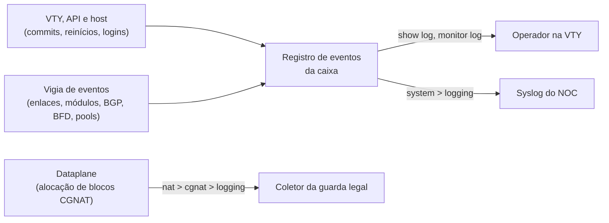

# Mandar o log de eventos da caixa para o syslog do NOC

Para quem quer ver no syslog do NOC o que acontece na caixa — commits, reinícios e a causa deles, enlaces, módulos, sessões BGP e BFD, pools sem bloco, logins — sem precisar entrar nela. Esta página diz o que é esse registro, como lê-lo na própria caixa, como mandá-lo para um ou mais coletores syslog e como conferir que ele está chegando.

:::warning
**Isto não é a exportação dos registros do CGNAT.** Quem usou qual IP público e porta, para responder a um ofício, sai por `nat` > `cgnat` > `logging` (IPFIX ou syslog) e está em [Logging IPFIX e trilha de auditoria](/s/wiki/doc/logging-ipfix-e-trilha-de-auditoria-lREEjJu1Bq) e [Onde vão os registros: coletor, transporte e guarda](/s/wiki/doc/onde-vao-os-registros-coletor-transporte-e-guarda-0IG3JJOswC). O log de eventos desta página **não leva** nenhum registro de conexão: configurar só `system` > `logging` deixa a caixa sem a guarda que a lei pede.

:::

# Dois registros, duas configurações

A caixa tem dois fluxos de log que não se misturam: uma configuração nunca mexe na outra, e nenhum carrega as linhas do outro. Eles devem ir para coletores diferentes — o do NOC e o da guarda legal.



| | Log de eventos (esta página) | Registros do CGNAT |
|---|---|---|
| O que diz | o que aconteceu com a caixa | quem segurava qual IP público e porta |
| Para que serve | operação, NOC, auditoria interna | resposta a ofício, guarda de um ano |
| Onde se configura | `system` > `logging` | `nat` > `cgnat` > `logging` |
| Na própria caixa | `show log`, `monitor log`, `show system logging` | `show cgnat logging`, `monitor cgnat logging` |
| No syslog | APP-NAME `prisma-routing`, facility `daemon` (3) | APP-NAME `prisma-cgnat`, facility `local0` (16) se nada for dito |

O APP-NAME e a facility diferentes deixam um coletor que recebe os dois separá-los num filtro.

# O que entra no registro

O registro é escrito por quem age — a VTY, a API, os scripts do host — e por um vigia no host que lê o estado da caixa a cada poucos segundos e registra o que mudou desde a leitura anterior. Nada é copiado do journal nem dos logs do FRR, então a rotina que enche o journal não aparece aqui. Fica no volume de registros da caixa, sobrevive a reboot e a atualização, e tem tamanho limitado: dois arquivos de 256 KiB, cerca de 3000 eventos; o mais antigo sai.

Cada evento tem a hora, um **nível**, uma **origem**, um **tipo** e uma frase, com quem fez e de onde quando isso é conhecido.

| Nível | Quando |
|---|---|
| `error` | um alarme de módulo, a caixa desistindo do dataplane |
| `warning` | algo que pede atenção: enlace caído, sessão BGP saindo de Established, partida que ninguém pediu, login com senha errada |
| `notice` | uma mudança normal: commit, enlace de volta, sessão de pé, login |
| `info` | rotina: logout, a cabeça da trilha de sessões PPPoE |

| Origem (`source`) | Quem viu |
|---|---|
| `vty` | uma sessão da VTY |
| `api` | a API de gerência |
| `host` | o host: o boot, logins, as placas que o Linux tem, a caixa desistindo do dataplane, o plano de controle PPPoE |
| `dataplane` | as portas do dataplane, os módulos delas, os pools, a exportação de log do CGNAT |
| `routing` | o FRR: sessões BGP e BFD |

| Tipo (`kind`) | O que é |
|---|---|
| `commit`, `rollback`, `confirm`, `confirm-expired` | a configuração mudou, voltou, foi confirmada, ou um `commit confirmed` venceu e foi desfeito |
| `asked` | um reinício, atualização, reboot ou desligamento pedido, por quem |
| `start`, `boot`, `upgraded` | o dataplane, o roteamento ou o plano de controle PPPoE partiu, **com a causa**; a caixa subiu; uma atualização terminou |
| `settings` | as configurações de SNMP, da API ou de `system` > `logging` aplicadas ou recusadas por um commit |
| `link` | enlace de uma porta caiu ou voltou, administrativo ou não; caiu e voltou entre duas leituras, com quantas vezes |
| `transceiver` | módulo inserido, removido, trocado; RX ou temperatura além de um aviso ou alarme, e de volta |
| `bgp`, `bfd` | sessão de pé, ou caída com o motivo do FRR ou o diagnóstico do bfdd |
| `pool` | pool CGNAT sem bloco livre, e com bloco livre de novo |
| `collector` | a exportação dos registros do CGNAT perdeu ou alcançou o coletor dela |
| `login` | login, logout, login com senha errada |
| `gave-up` | a caixa desistiu do dataplane, ou um `system dataplane restart` não terminou |
| `exit`, `radius`, `trail` | com PPPoE: o plano de controle parou, um servidor RADIUS caiu ou voltou, a cabeça da trilha de sessões |

Duas regras evitam que o registro vire ruído. Uma coisa que fica caindo e voltando sai quatro vezes em 5 minutos e, dali em diante, uma linha por janela de 5 minutos com a contagem. E o que **já** estava errado quando o vigia começou — uma porta ligada sem enlace, um módulo além do aviso, uma sessão configurada que não subiu — é dito uma vez por boot, no presente, começando por `standing at start:`.

# 1. Leia o registro na própria caixa

Qualquer conta pode ler. Sem filtro, os últimos 50 eventos, o mais novo por último:

```
prisma> show log
prisma> show log last 20
prisma> show log since 2h
prisma> show log severity warning
prisma> show log source routing
prisma> show log kind bgp since 1d
prisma> show log since 1d source vty | match rollback
```

`since` aceita `45s`, `30m`, `1h`, `2d`, `1w` ou uma data ISO (`2026-10-05`, `2026-10-05T14:00`); a hora sai no fuso da caixa. `severity` mostra aquele nível e os mais graves. Os filtros se combinam. Uma linha mais larga que o console dobra, com a continuação recuada; a primeira linha leva a hora, o nível, a origem e o começo da frase.

Para acompanhar ao vivo, `monitor log`, com os mesmos filtros, até Ctrl-C:

```
prisma> monitor log
prisma> monitor log severity warning
prisma> monitor log kind link last 5
prisma> monitor log source routing seconds 300
```

`severity`, `source` e `kind` escolhem o que é acompanhado; `last` e `since`, o que é mostrado antes. Sem nenhum dos dois, começa agora. `seconds <n>` para sozinho.

`show logging`, sem o `log`, é outra coisa: a configuração de log de cada daemon do FRR.

# 2. Configure os destinos syslog

Precisa de uma conta com `role administrator`. Em modo de configuração:

```
configure
 system
  logging
   host 192.0.2.10
   host 192.0.2.11 protocol tcp severity warning
   exit
  exit
 commit
```

`host <endereço> [port <n>] [protocol udp|tcp] [severity <nível>] [source-address <endereço>] [vrf <nome>]`:

| Opção | Se nada for dito | O que faz por você |
|---|---|---|
| `<endereço>` | — | o coletor, IPv4 ou IPv6. **Endereço, nunca nome**: a caixa cujo DNS caiu é justamente a que mais precisa mandar os eventos |
| `protocol udp\|tcp` | `udp` | UDP: um datagrama por evento. TCP: um fluxo com enquadramento por contagem de octetos (RFC 6587), e nada se perde enquanto o coletor está fora (abaixo) |
| `port <n>` | 514 em UDP, 601 em TCP | a porta do coletor |
| `severity error\|warning\|notice\|info` | `info` (tudo) | o nível mínimo mandado: aquele e os mais graves |
| `source-address <endereço>` | o que a rota escolher | o endereço de origem que o coletor vê; da mesma família do coletor |
| `vrf <nome>` | as rotas do Linux da caixa | a VRF por onde o evento sai; tem de ser um `vrf <nome> table <n>` da configuração, senão o `commit check` recusa |

São até quatro destinos, um por endereço: um segundo `host` para o mesmo endereço substitui o primeiro, e `no host <endereço>` para de mandar para ele. `show this`, dentro de `logging`, mostra o que está configurado.

**Vale no** `**commit**`**, sem reiniciar nada.** O commit diz quantos destinos ficaram (`logging: 2 remote syslog destination(s)`), o registro ganha um evento `settings`, e o vigia passa a mandar em até um segundo. Lembre do `save` para a configuração sobreviver ao boot.

:::info
**Um destino novo começa do agora.** O que já estava no registro antes do commit não é mandado; para o passado, use `show log`. Daí em diante, cada destino guarda até onde já recebeu.

:::

# 3. Escolha UDP ou TCP

Quem manda é o próprio vigia de eventos, e a fila dele é o próprio registro: cada destino guarda a sua posição, que só avança depois de um envio que deu certo, e essa posição sobrevive a um reinício do vigia e a um reboot.

* **Em TCP, nada se perde e nada se repete** enquanto o coletor está fora: a caixa tenta de novo a cada 30 s e, quando ele volta, manda o que esperou, na ordem. O limite é o tamanho do registro — um coletor fora por mais tempo do que os cerca de 3000 eventos cobrem perde o que já saiu do registro. Uma conexão que cai no meio de um envio pode fazer o coletor ver um evento repetido, nunca um buraco.
* **Em UDP, a caixa só sabe que o envio falhou se o sistema disser** (uma porta inalcançável respondida, uma rota que não existe). Um coletor que simplesmente some não é percebido, e o que foi mandado nesse tempo se perde.

Para o NOC que precisa da linha do tempo inteira, TCP.

:::info
**Com PPPoE, a cabeça da trilha de sessões sai por aqui, em nível** `**info**`**.** É a cópia fora da caixa com que `show pppoe history verify` compara a trilha. Um destino com `severity notice` ou mais grave não a recebe: deixe pelo menos um coletor em `info`.

:::

# 4. Gerência numa VRF: por onde o evento sai

O destino sem `vrf` sai pelas rotas do Linux da caixa. Com a gerência numa VRF própria (`system` > `management` > `vrf <nome>`), o que a própria caixa origina — e isso inclui estes eventos — sai pelas rotas da gerência, **a não ser** que a tabela principal tenha uma rota específica para o coletor. Um destino com `vrf <nome>` sai sempre por aquela VRF, tenha a tabela principal a rota que tiver:

```
configure
 system
  logging
   host 2001:db8:100::10 protocol tcp source-address 2001:db8:100::2 vrf mgmt
   exit
  exit
 commit
```

Use `vrf` quando quiser que o caminho não dependa do que a tabela principal aprender, e `source-address` quando o coletor ou o firewall dele filtram pela origem. A gerência em VRF está em [Roteamento, SSH, usuários e SNMP](/s/wiki/doc/roteamento-ssh-usuarios-e-snmp-LoibxwFM5m).

# 5. O que chega ao coletor

RFC 5424, uma mensagem por evento: facility `daemon`, o nível do evento como severidade syslog (`error` 3, `warning` 4, `notice` 5, `info` 6), o nome da caixa como HOSTNAME, APP-NAME `prisma-routing`, o tipo do evento em maiúsculas como MSGID, e os campos do evento como dados estruturados sob o número de empresa do produto, `event@67033`. A hora vai em UTC. Um commit feito pela VTY e um login com senha errada, numa caixa chamada `edge-1`, chegam assim (uma mensagem por linha):

```
<29>1 2026-10-07T14:02:11.250Z edge-1 prisma-routing - COMMIT [event@67033 source="vty" kind="commit" account="ana" origin="ssh 192.0.2.50"] configuration committed: NOC syslog (by ana, from ssh 192.0.2.50)
<28>1 2026-10-07T14:02:51.250Z edge-1 prisma-routing - LOGIN [event@67033 source="host" kind="login" subject="noc" reason="authentication failed" origin="ssh 203.0.113.9"] failed login as noc (from ssh 203.0.113.9)
```

Os parâmetros possíveis são `source`, `kind`, `subject` (a interface, o vizinho, o pool, a conta), `reason`, `account`, `origin`, `cause` e `component`; um parâmetro vazio não vai. Filtrar no coletor por MSGID (`LINK`, `BGP`, `LOGIN`, `COMMIT`...) ou pelo parâmetro `kind` dá o mesmo que `show log kind` na caixa.

Os mesmos eventos também saem pela API de gerência (`ListEvents` e o fluxo `WatchEvents`). Os que têm um objeto na MIB — enlace, sessão BGP e BFD, pool sem bloco, módulo — também viram notificações SNMP; os logins, commits e reinícios, não: esses só saem por aqui. Veja [Monitoramento e SNMP](/s/wiki/doc/monitoramento-e-snmp-YGn85RpUAb).

# Como conferir

**1. A caixa diz se está entregando.** Qualquer conta pode rodar:

```
prisma> show system logging
```

Uma linha por destino, com o endereço, a porta, o protocolo e o nível mínimo, e embaixo o que o vigia disse dele:

```
192.0.2.10:514 udp  info and above
  sending
  sent 12 event(s) since the watcher started, the last at 2026-10-07 14:02:11
[2001:db8:100::10]:601 tcp  warning and above  from 2001:db8:100::2  vrf mgmt
  ready
  sent 0 event(s) since the watcher started
```

| O que aparece | O que quer dizer |
|---|---|
| `ready` | o destino foi lido e ainda não houve evento do nível dele para mandar |
| `sending` | o último envio deu certo |
| `not reached: <reason>; tried again every 30 s` | o coletor não foi alcançado, com o motivo que o sistema deu (`connection refused`, por exemplo); nada que esperava se perdeu em TCP |
| `not forwarding yet: the watcher (prisma-routing-events-watch) has not said` | o vigia ainda não passou desde o commit, ou está parado há mais de um minuto |
| `no remote syslog destination: the record stays on the box ('show log')` | nada configurado em `system` > `logging` |

**2. Provoque um evento e veja os dois lados.** Abra uma sessão SSH nova na caixa: em até 10 s o registro ganha um `login` em nível `notice`. Para um destino com `severity warning`, uma tentativa com a senha errada gera um `login` em nível `warning`. Na caixa:

```
prisma> show log kind login last 5
```

No coletor, a mesma linha, com APP-NAME `prisma-routing` e MSGID `LOGIN`. Na caixa, `show system logging` passa a `sending` e o contador sobe.

:::success
`sending` no `show system logging`, o mesmo evento no `show log` e no coletor: o registro de eventos da caixa está saindo para o NOC.

:::
