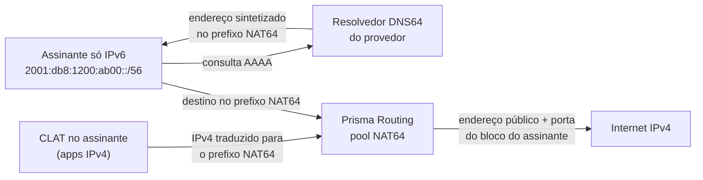

# NAT64 — assinantes só IPv6 no mesmo espaço público

Como pôr no ar um pool NAT64 para assinantes que recebem só IPv6 — FTTH ou acesso móvel com prefixo delegado — e fazê-los chegar à internet IPv4 pelo mesmo espaço público, dividido em blocos de porta, que o CGNAT já usa. Para quem opera a caixa e responde pelos registros.

# Quando usar

Um pool NAT64 é o CGNAT com o lado de dentro em IPv6. O lado de fora é o mesmo endereço IPv4 escasso, repartido por porta em blocos, e a pergunta que ele precisa responder é a mesma: quem estava com aquele endereço público e aquela porta naquele instante. Por isso ele usa a mesma tabela de sessões, os mesmos blocos, o mesmo logging e a mesma trilha de configuração.

| Situação | O que usar |
|----------|------------|
| Assinante com IPv4 privado (100.64.0.0/10), com ou sem IPv6 | pool em `nat` > `cgnat` |
| Assinante **só IPv6**, com prefixo delegado, que precisa alcançar destinos IPv4 | pool em `nat` > `nat64`, esta página |
| Aplicação IPv4 dentro de um assinante só IPv6 (jogo, VPN, endereço literal) | o mesmo pool NAT64, com um CLAT do lado do assinante (464XLAT) |

DS-Lite, MAP-E/MAP-T e NPTv6 não fazem parte do produto.

**O assinante é o prefixo, nunca o /128.** O endereço de um host dentro de um /64 muda com as extensões de privacidade, então um mapeamento determinístico preso a ele não existiria. O prefixo delegado é estável, e é ele que o RADIUS atribui a uma pessoa (Delegated-IPv6-Prefix). O pool corta os seus prefixos internos no comprimento `subscriber-length`, e cada pedaço é um assinante com o seu bloco.



# Antes de começar

Você precisa de três coisas definidas:

| O quê | Exemplo nesta página | Por quê |
|-------|----------------------|---------|
| Os prefixos IPv6 dos assinantes e o tamanho que cada um recebe | `2001:db8:1200::/48`, cada assinante um /56 | são o lado de dentro do pool |
| O prefixo público IPv4 | `203.0.113.0/29` | é o lado de fora, como num pool IPv4 |
| O prefixo NAT64 (RFC 6052) | `64:ff9b:1::/48` | é para onde o assinante manda o tráfego destinado a IPv4 |

O prefixo NAT64 tem comprimento 32, 40, 48, 56, 64 ou 96. Sem `nat64-prefix`, o pool usa o prefixo bem conhecido `64:ff9b::/96` — e, sob ele, endereços IPv4 que não são globais (privados, compartilhados, loopback, documentação e afins) nunca são alcançados, como manda a RFC 6052.

# Passo a passo

1. **Marque a interface dos assinantes como lado de dentro.** É a mesma marcação de um pool IPv4: a tradução NAT64 roda nas interfaces `cgnat inside`, e só enquanto existe um pool NAT64.

   ```
   configure
    interface enp2s0
     ipv6 address 2001:db8:ffff::1/64
     cgnat inside
     exit
   ```

   A interface pública continua com `cgnat outside`, como em qualquer pool.

2. **Crie o pool em** `nat` **>** `nat64`. É um prefixo IPv6 em `prefix-inside` que faz dele um pool NAT64.

   ```
    nat
     nat64
      pool v6
       prefix-inside 2001:db8:1200::/48
       subscriber-length 56
       nat64-prefix 64:ff9b:1::/48
       prefix-outside 203.0.113.0/29
       block-size 1024
       exit
      exit
     exit
   ```

   A conta de capacidade é a de um pool IPv4: um /48 em /56 são 256 assinantes; 8 endereços públicos, cada um com 63 blocos de 1024 portas (portas 1024 a 65535), dão 504 lugares. Um pool aceita até 2^28 assinantes, e com IPv6 isso é uma recusa que se encontra de verdade: `2001:db8::/32` em /56 cabe; em /64, não.

3. **Dê à rede as duas rotas que o pool precisa.** O prefixo NAT64 precisa chegar a esta caixa pelo lado IPv6, e os prefixos dos assinantes precisam de rota de volta — como os assinantes IPv4 atrás de um BNG.

   ```
    router static
     64:ff9b:1::/48 next-hop blackhole
     2001:db8:1200::/48 next-hop 2001:db8:ffff::2
     exit
   ```

   A rota `blackhole` não prende tráfego nenhum de assinante: a tradução acontece antes da consulta de rota. Ela só dá ao BGP algo para anunciar. Se a caixa tem BGP, anuncie o prefixo NAT64 na família IPv6 (`network 64:ff9b:1::/48` sob `address-family ipv6 unicast`); quando nada o anuncia, o `commit check` avisa, e o aviso já traz as duas linhas que resolvem. O prefixo público IPv4 é anunciado como o de qualquer pool.

4. **Confira e aplique.**

   ```
    commit check
    commit
    exit
   save
   ```

   O `commit check` recusa pelo nome o que um pool NAT64 não aceita (veja **Limites**) e o pool escrito no lugar antigo, dentro de `cgnat`.

5. **Anuncie o prefixo NAT64 aos CLATs (PREF64).** Para o 464XLAT, o CLAT do assinante precisa saber o prefixo NAT64, e numa caixa com mais de um pool, ou com um prefixo que não é o bem conhecido, ele não tem como adivinhar. A caixa coloca o prefixo nos anúncios de roteador (opção PREF64, RFC 8781), na interface dos assinantes:

   ```
   configure
    interface enp2s0
     no ipv6 nd suppress-ra
     ipv6 nd nat64 64:ff9b:1::/48
     exit
    commit
   ```

   `ipv6 nd nat64` sem prefixo anuncia `64:ff9b::/96`, e a linha pode se repetir, um prefixo por linha. O `commit check` recusa a linha numa interface que não anuncia e recusa um prefixo que nenhum pool NAT64 da caixa traduz — um CLAT que aprendesse esse prefixo mandaria o IPv4 dele para um lugar onde a caixa descarta.

6. **Configure o DNS64 no seu resolvedor, com o mesmo prefixo.** A caixa não é o resolvedor do assinante, então não sintetiza AAAA nem responde `ipv4only.arpa` (RFC 7050). O resolvedor DNS64 que você opera precisa sintetizar com o mesmo prefixo que o pool traduz e que a caixa anuncia; se os dois divergem, os dois métodos de descoberta discordam, e alguns CLATs preferem a resposta do DNS.

:::warning
**Antes de atualizar uma caixa que tem pool NAT64 dentro de** `cgnat`**.** A forma antiga — um pool NAT64 escrito dentro de `nat` > `cgnat` — é recusada no `commit check` e quando o arquivo salvo é carregado, nomeando a forma nova, e nada a move sozinho. Reescreva o pool em `nat` > `nat64` antes da atualização, ou a caixa sobe sem aceitar esse arquivo.
:::

# Os campos do pool

`nat64` guarda pools e nada mais. As interfaces, o logging, os timeouts e a memória continuam em `cgnat`, compartilhados pelos dois tipos de pool. Um nome de pool é um pool só nos dois níveis: não existe `v6` em `cgnat` e outro `v6` em `nat64`.

| Campo | O que faz por você |
|-------|--------------------|
| `prefix-inside <prefixo IPv6>` | os prefixos dos assinantes; pode repetir. IPv6 é o que torna o pool NAT64, e um lado de dentro é de uma família só |
| `subscriber-length <32-128>` | o comprimento do prefixo de um assinante; obrigatório num pool NAT64, e nenhum `prefix-inside` pode ser mais longo que ele |
| `nat64-prefix <prefixo IPv6>` | onde ficam os destinos IPv4 (RFC 6052); `no nat64-prefix` volta para `64:ff9b::/96` |
| `prefix-outside <prefixo IPv4>` | o espaço público, como num pool IPv4; nunca IPv6 |
| `block-size`, `ports`, `policy` | o bloco de cada assinante, pela mesma fórmula de um pool IPv4 |
| `mode deterministic` ou `mode bpa` | bloco por fórmula ou sob demanda; em `mode bpa` valem `max-blocks`, `initial-allocation` e `block-stride`, como num pool IPv4 |
| `reserve` | blocos extras para quem enche o seu, num pool determinístico; registrados pelo prefixo |
| `forward <proto> <porta> to <host IPv6> <porta>` | uma porta pública do bloco do assinante presa a um host do prefixo dele — veja [Encaminhamento de porta](/s/wiki/doc/encaminhamento-de-porta-epIZfdmzU3) |
| `tcp-mss` | ajuste do MSS nos dois sentidos; `auto` fica 20 abaixo do IPv4, o tamanho a mais do cabeçalho IPv6 |
| `vrf`, `outside-vrf` | a tabela IPv6 dos assinantes e a tabela IPv4 por onde o tráfego traduzido sai; dois clientes podem ter o mesmo prefixo interno e o mesmo prefixo NAT64 em VRFs diferentes |
| `max-sessions`, `max-session-rate`, `utilisation-alarm` | os mesmos limites e o mesmo alarme de um pool IPv4 |
| `alg ftp on` | FTP64 (RFC 6384): traduz EPSV/EPRT do cliente IPv6 para PASV/PORT do servidor IPv4. **Desligado a menos que você peça**, ao contrário dos ALGs IPv4 |

Mudar o que define o mapeamento — prefixos, `subscriber-length`, `nat64-prefix`, `block-size`, `ports`, `policy`, `mode`, `reserve` ou VRF — reconstrói o pool, como num pool IPv4: veja [Configuração de pool](/s/wiki/doc/configuracao-de-pool-btyS572Ih6).

# Como os registros ficam

O logging é o mesmo do CGNAT, configurado em `cgnat`, e segue as mesmas regras — [Logging IPFIX e trilha de auditoria](/s/wiki/doc/logging-ipfix-e-trilha-de-auditoria-lREEjJu1Bq) tem o resto. O que muda é como o assinante é nomeado: **sempre pelo prefixo delegado**, nunca pelo índice interno que a aritmética do pool usa — esse índice, lido como endereço IPv4, apontaria um cliente que não tem nada a ver.

| Onde | Como o assinante NAT64 aparece |
|------|--------------------------------|
| IPFIX | um template próprio: `sourceIPv6Address` (o endereço de rede do prefixo) e `sourceIPv6PrefixLength` (o `subscriber-length`) no lugar do endereço IPv4 de origem, com o endereço público, o início e o fim do bloco e o pool |
| Syslog | `subscriber="2001:db8:1200:ab00::/56"` |
| RADIUS | o Delegated-IPv6-Prefix é o que liga o prefixo a uma pessoa |
| Trilha de configuração (`show cgnat history`) | o pool registrado pelo prefixo interno IPv6, pelo `subscriber-length` e pelo `nat64-prefix` — o que permite recalcular o mapeamento de qualquer instante |

Os eventos são os mesmos do IPv4: alocação, liberação e bloco esgotado (registrado uma vez por intervalo, por mais pacotes que sejam recusados).

:::info
**Pool determinístico não gera evento de bloco**, como no IPv4: o mapeamento é a fórmula mais a configuração datada na trilha. Para responder a uma ordem judicial sobre um pool determinístico, a trilha é a prova; num pool `mode bpa`, é o registro exportado.
:::

# Consultar e limpar

Os comandos `show nat64` respondem só por NAT64. Quando você pergunta por um assinante IPv4, ou por um endereço público de um pool CGNAT, eles recusam e dizem qual `show cgnat` responde. O `show cgnat` continua sendo a caixa inteira: NAT44 e NAT64 dividem a tabela de sessões, os blocos e o espaço público.

| Comando | O que responde |
|---------|----------------|
| `show nat64 pool` | os pools NAT64 como o dataplane os tem — os que trazem uma linha `inside6`; sem nenhum, a resposta é `no NAT64 pools configured` |
| `show nat64 subscriber <endereço IPv6>` | tudo sobre um assinante, por **qualquer** endereço dentro do prefixo dele: o endereço público e o bloco |
| `show nat64 translation <endereço público> <porta>` | quem estava atrás daquele endereço e porta: o prefixo do assinante, o pool e o bloco. Num pool determinístico a resposta vale para qualquer instante (é a fórmula); num pool `mode bpa`, só para agora — para o passado, a resposta é o registro |
| `clear nat64 subscriber <endereço IPv6>` | encerra todas as sessões de um assinante, por qualquer endereço do prefixo; num pool `mode bpa`, o bloco volta a ficar livre depois do hold-down |
| `show cgnat top`, `blocks`, `forward`, `alg`, `drops`, `memory` | os dois tipos de pool juntos; o `top` nomeia o assinante NAT64 pelo prefixo |

# Num par ativo/standby

O modelo de alta disponibilidade é o do IPv4: nada é sincronizado entre as caixas, e um pool determinístico põe o mesmo prefixo no mesmo endereço público e no mesmo bloco nas duas, porque o bloco é função da configuração. `subscriber-length` e `nat64-prefix` entram na comparação de mapeamento do par, então `show cgnat ha` e a recusa de commit num par divergente enxergam os dois.

O que um pool NAT64 precisa a mais é um gateway IPv6 que acompanhe o mestre. Um endereço IPv6 sob um `vrrp <vrid>` na interface dos assinantes cria o roteador virtual IPv6 daquele id, com a prioridade, o rastreio e o preempt do IPv4:

```
interface enp2s0
 ipv6 address 2001:db8:ffff::2/64
 ipv4 address 100.64.3.252/22
 vrrp 1 address 100.64.3.254
 vrrp 1 address fe80::1
 vrrp 1 address 2001:db8:ffff::1
 vrrp 1 priority 200
 vrrp 1 track enp1s0 decrement 150
 exit
```

* **O link-local primeiro** (RFC 5798): é para ele que os assinantes — ou o BNG na frente deles — apontam a rota. O `commit check` recusa um roteador IPv6 sem link-local.
* **Os anúncios de roteador da caixa não são do roteador virtual.** Um assinante que tira a rota padrão de um anúncio aponta para o link-local da própria caixa, que não muda de lugar. Aponte para o link-local virtual.
* **O rastreio é por família.** Um roteador IPv4 rastreando um lado de assinante só IPv6 nunca o vê de pé, e o `commit check` avisa: dê um endereço IPv4 a esse lado ou rastreie outra coisa.
* Num par em que todos os roteadores virtuais são IPv4, o `commit check` avisa sobre cada pool NAT64: o gateway dos assinantes IPv6 não acompanharia o mestre.

Medido em laboratório com um assinante só IPv6: o tráfego traduzido voltou entre 2,8 e 4,0 segundos depois de um cabo de uplink puxado, de um dataplane parado e de um dataplane morto, sempre no mesmo endereço público e numa porta do mesmo bloco. As conexões abertas caem, como no IPv4: um fluxo UDP volta numa porta nova do mesmo bloco, uma conexão TCP é reiniciada.

:::info
**Um pool NAT64** `mode bpa` **num par não tem essa medida.** Como num pool BPA IPv4, o mestre novo aloca do zero, então o bloco do assinante — e talvez o endereço — muda numa troca. O passo a passo do par está em [Montar um par ativo/standby](/s/wiki/doc/montar-um-par-ativostandby-CkNb7AvtnG).
:::

# Limites

| O que | Por quê |
|-------|---------|
| `bypass` é recusado, para sempre | um pacote IPv6 para o prefixo NAT64 só chega ao IPv4 traduzido; não existe caminho sem tradução para um bypass nomear |
| Todo ALG exceto FTP é recusado, para sempre | RTSP e SIP carregam endereços no corpo, que nenhuma RFC traduz entre IPv6 e IPv4; PPTP usa GRE e IPsec usa ESP, que o NAT64 stateful não carrega. IPsec atravessa como NAT-T em UDP 4500, sem ALG |
| `prefix-list-inside` e `prefix-list-outside` são recusados | são conjuntos IPv4; os lados de um pool NAT64 são os prefixos dele |
| Um lado de dentro com IPv4 e IPv6 juntos é recusado | um pool NAT44 e um pool NAT64 são dois pools |
| `prefix-outside` IPv6 é recusado | o lado de fora é sempre IPv4 |
| Um endereço público pertence a um pool só | NAT44 ou NAT64, nunca os dois |
| Uma sessão NAT64 custa cerca de um terço a mais de memória que uma IPv4 | a chave interna carrega o endereço IPv6 inteiro |
| Pacote não solicitado na porta pública é descartado e contado como `no session`, sem resposta | como num pool IPv4 |
| Datagrama IPv4 fragmentável que passaria de 1280 bytes em IPv6 é cortado em 1280 | o caminho até o assinante não é conhecido como maior que isso |

A tradução segue a RFC 7915: TCP e UDP (um UDP IPv4 com checksum zero ganha checksum, porque IPv6 não aceita zero), ICMP echo nos dois sentidos, erros ICMP com o pacote citado também traduzido, e fragmentos nos dois sentidos.

# Como conferir

```
show nat64 pool
```

O pool aparece com a linha `inside6`. Se a resposta é `no NAT64 pools configured`, o pool não chegou ao dataplane: volte ao `commit check`.

```
show nat64 subscriber 2001:db8:1200:ab00::10
```

Qualquer endereço dentro do /56 de um assinante devolve o endereço público e o bloco dele. Gere tráfego desse assinante para um destino IPv4 e confira o caminho de volta:

```
show nat64 translation 203.0.113.3 44100
```

Com um endereço público e uma porta que estejam no bloco do assinante, a resposta é o prefixo dele. O `show cgnat top` mostra o assinante pelo prefixo, com as portas em uso. No coletor, o registro de um pool `mode bpa` traz o prefixo (`sourceIPv6Address` e `sourceIPv6PrefixLength` no IPFIX, `subscriber="…/56"` no syslog).

Do lado do assinante: um CLAT que ouve os anúncios da interface deve aprender o prefixo NAT64 pela opção PREF64, e uma consulta AAAA de um nome só IPv4 ao seu resolvedor deve voltar dentro do mesmo prefixo.

:::success
Pool listado em `show nat64 pool`, o assinante com o bloco certo em `show nat64 subscriber`, a tradução respondendo pelo prefixo dele e o coletor recebendo o registro com o prefixo: seus assinantes só IPv6 estão saindo pelo mesmo espaço público do CGNAT, e cada porta continua respondível.
:::
