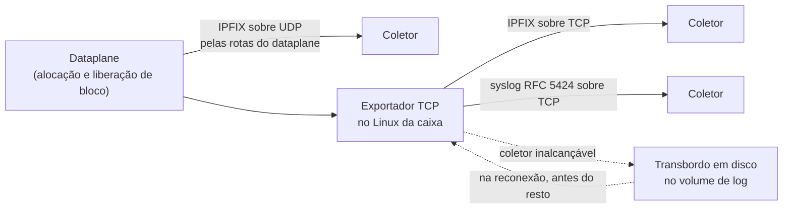
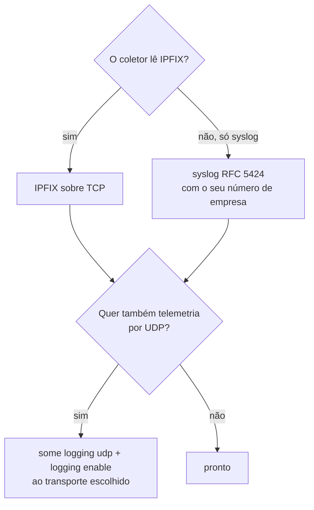
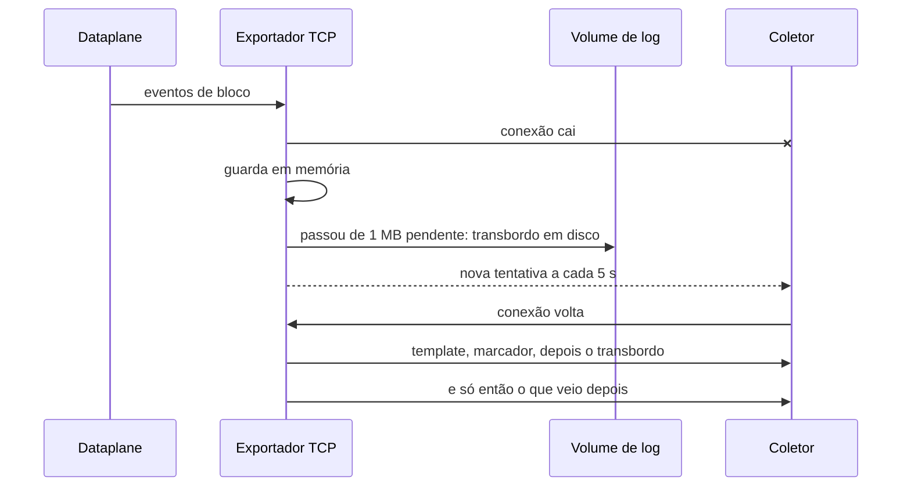

# Onde vão os registros: coletor, transporte e guarda

Para quem opera CGNAT e precisa responder a um ofício: onde ficam os registros de quem usava cada IP público e porta, como eles saem da caixa e o que acontece quando o coletor sai do ar. Os comandos em detalhe estão em [Logging IPFIX e trilha de auditoria](/s/wiki/doc/logging-ipfix-e-trilha-de-auditoria-lREEjJu1Bq); aqui está o porquê de cada escolha.

# O problema

O Marco Civil da Internet exige que o provedor guarde por um ano os registros de conexão. Com CGNAT, identificar um assinante a partir de *(IP público, porta, instante)* exige o mapeamento que valia naquele instante.

Em modo determinístico esse mapeamento é uma fórmula: a configuração em vigor responde, e o que precisa ser guardado é a trilha de configuração. Em modo dinâmico, e nos blocos que um pool determinístico entrega a partir da `reserve`, o bloco é escolhido na hora em que o assinante pede, e **o registro exportado é a única prova** de quem segurava uma porta pública.

Esse registro precisa existir em algum lugar por um ano, precisa sobreviver a uma queda do coletor e precisa ser legível sem ajuda de quem o escreveu.

# A ideia: a caixa exporta, o coletor guarda


:::info
**A caixa não guarda registros de conexão.** Ela os exporta à medida que acontecem, e quem guarda o ano que a lei pede é o seu coletor. No volume de log da caixa ficam só a trilha de configuração e o transbordo do exportador, os registros que um coletor fora do ar ainda não recebeu.

:::



O registro é por **bloco**, não por fluxo (RFC 8158): um na alocação, um na liberação, um quando as portas se esgotam. A ordem de grandeza, em modo dinâmico, é de uns 80 MB por dia para 200 mil assinantes, contra cerca de 1,6 GB por dia de um NAT que registrasse cada fluxo. Um ano de guarda fica na casa das dezenas de gigabytes, e é **no disco do coletor**, não da caixa.

## Três transportes, e o que cada um pede

Os três podem ficar ligados ao mesmo tempo, e todos são configurados em `nat` > `cgnat`:

| Transporte | Comando | Por onde sai | O que precisa estar certo | Serve para |
|------------|---------|--------------|---------------------------|------------|
| IPFIX sobre UDP | `logging udp <coletor> src <origem> [port <n>]` e `logging enable` | pelo próprio dataplane | o coletor alcançável pelas rotas do dataplane; `src` obrigatório, um endereço que o coletor reconheça como desta caixa; porta 4739 se nada for dito | telemetria: sob congestionamento perde registro sem aviso, e não leva a identidade do assinante |
| IPFIX sobre TCP | `logging tcp <coletor> [port <n>]` | pelo Linux da caixa | o coletor alcançável pelas rotas do Linux; porta 4739 se nada for dito | **guarda legal**: transbordo em disco, reenvio na ordem, identidade do assinante no registro |
| syslog RFC 5424 sobre TCP | `logging syslog <coletor> enterprise <n> [port <n>] [facility <0-23>] [severity <0-7>]` | pelo Linux da caixa, pelo mesmo exportador do TCP | o coletor alcançável pelas rotas do Linux; porta 601 se nada for dito; um número de empresa (PEN) da IANA, obrigatório | o coletor que só lê syslog, que é a maioria; mesma garantia do IPFIX sobre TCP |

Os dois transportes TCP abrem a conexão **a partir da caixa**: o que precisa estar aberto é a porta do coletor, no firewall dele e em qualquer um no caminho. Uma tentativa que falha é repetida a cada 5 segundos.

`logging tcp` não conta como destino para `logging enable`: os dois são caminhos separados, e `enable` liga o de UDP.




:::warning
**Guarda legal apenas por UDP é uma guarda com buracos.** Um datagrama perdido é um registro perdido, sem nada na caixa ou no coletor que o denuncie, e perder um `natEvent 17` (a liberação) faz a consulta natural apontar para o assinante errado. Use TCP ou syslog para a guarda; o UDP, se quiser, ao lado.

:::

# O que o coletor precisa guardar

Guardar as linhas não basta. Para que um registro responda a um ofício daqui a onze meses, o coletor precisa guardar também o que dá sentido a elas:

| O que | Por que |
|-------|---------|
| **O template IPFIX** de cada exportador | sem ele os registros são bytes. A caixa manda o template no começo de cada conexão TCP e o repete a cada minuto; o registro de bloco sobre TCP usa o template **258**. Um coletor com o 256 de uma versão antiga em cache simplesmente espera o novo |
| **O marcador de reinício**, `systemInitTimeMilliseconds` (IE 160) | o último valor por exportador e domínio de observação. Enquanto não muda, uma alocação sem liberação ainda está valendo; quando muda, toda alocação aberta de antes terminou naquele reinício. É o que distingue uma caixa que caiu de uma que segue segurando o bloco. No syslog ele chega como a linha `BOOT-MARKER`. A caixa o reenvia a cada 30 segundos |
| **O número de empresa** de cada exportador syslog | cada linha leva o dado estruturado como `cgnat@<número>`, e é por ele que o coletor reconhece de quem é o formato. O número é seu, não tem padrão, e a caixa recusa `logging syslog` sem ele |
| **A identidade do assinante** | `subscriberId` no syslog, elemento 371 `userName` no IPFIX sobre TCP. Vem sempre, com o nome da tabela de identidade ou `unknown`. É dado pessoal, e é o motivo de o log precisar de proteção. O UDP não a carrega |
| **O instante de cada registro, em UTC** | é o instante do evento com precisão de milissegundo, igual nos dois formatos, o que permite pôr IPFIX e syslog lado a lado |

A liberação repete a identidade que a alocação disse, então qualquer um dos dois registros de um bloco responde sozinho. Mesmo assim, guarde os dois: a liberação é o que fecha o intervalo, e sem ela a pergunta *"quem segurava esta porta às 14h?"* tem duas respostas.

# O que acontece quando o coletor some

Nos transportes TCP, um coletor fora do ar não custa registro enquanto houver onde escrever:



* **Fila.** O dataplane põe cada evento numa fila por núcleo de trabalho, com teto de 8192 eventos. Se o exportador fica para trás além disso, o excedente é descartado e contado, nunca acumulado sem limite.
* **Transbordo.** O que o socket não aceitou fica em memória até passar de 1 MB; daí em diante vai para um arquivo no volume de log, um por transporte: `/var/log/prisma-routing/ipfix-spill.bin` e `/var/log/prisma-routing/syslog-spill.bin`.
* **Reenvio.** Na reconexão o arquivo volta **antes** de qualquer registro novo, porque uma alocação tem de chegar ao coletor antes da sua liberação. Cada registro mantém o carimbo do instante em que o evento aconteceu, não o da entrega.
* **Descarte.** Só acontece quando não há onde escrever (o volume cheio, ou o arquivo impossível de abrir), e é contado. Na parada da caixa, quando o contador morre junto com o processo, a perda é escrita no registro do sistema.

O limite honesto do TCP: bytes que o socket aceitou contam como enviados, e os poucos registros escritos no instante em que a conexão cai podem se perder. O IPFIX sobre TCP não tem confirmação de recebimento. É muito melhor que o UDP, mas não é absoluto, e por isso os contadores ficam à vista.

## Dimensionando o volume de log

O instalador pergunta quantos gigabytes dar ao volume da trilha e do transbordo; o padrão é 30 GB. Numa instalação sem perguntas, a resposta vai em `prisma-routing.log-gb=<n>` ou `log-gb` no arquivo de respostas. O que esse tamanho compra é **quanto tempo a caixa aguenta exportando para um coletor inalcançável**, não quanto histórico ela tem.

A conta, a partir da estimativa de cerca de 80 MB por dia para 200 mil assinantes em modo dinâmico:

| Assinantes em modo dinâmico | Transbordo por dia, aproximado | O que 30 GB aguentam |
|-----------------------------|-------------------------------:|----------------------|
| 50 mil                      | 20 MB                          | anos                 |
| 200 mil                     | 80 MB                          | mais de um ano       |
| 1 milhão                    | 400 MB                         | cerca de dois meses e meio |

É uma estimativa de ordem de grandeza, com um bloco renegociado umas cinco vezes por dia por assinante ativo; a sua rotatividade de blocos muda o número. Uma linha syslog é texto e ocupa várias vezes o que ocupa um registro IPFIX: se exporta por syslog, dimensione com folga maior. Em modo determinístico sem `reserve` quase nada é exportado, e o volume serve praticamente só à trilha.


:::warning
**Um volume cheio com o coletor fora do ar é perda de registro.** O transbordo passa a ser descartado (contado, mas descartado), e esses registros não chegam nunca ao coletor. Monitore o coletor, não só a caixa: o volume foi dimensionado para cobrir uma queda, não para substituir o coletor.

:::

Se a caixa tem um segundo disco, o instalador oferece espelhar esse volume nele. O que está ali são registros que o coletor ainda não recebeu, e um disco que os leva abre um buraco no ano de guarda que nada na caixa recompõe.

# A consequência prática: conferir

```
show cgnat logging
```

A tela tem três partes. O que ler em cada uma:

| Linha | O que responde |
|-------|----------------|
| `state` | se a exportação por UDP está ligada |
| `exporter` | para onde vai o UDP. `none: nothing is sent over UDP` quer dizer que nada sai por UDP, **mesmo com** `**state enabled**` |
| `boot marker` | o template do marcador, quantos foram enviados e o instante de início desta encarnação do dataplane |
| `TCP transport` e `syslog transport` | cada uma com o coletor e o estado da conexão: `connected`, `connecting` ou `disconnected`; um transporte desligado aparece como `disabled` |
| `enterprise` | no syslog: o número de empresa, a facility e a severity em uso |
| `spill` | por transporte: bytes que foram para o disco, quantos já voltaram ao coletor e quantos foram descartados |

O que procurar:

* `**disconnected**` **por mais que alguns segundos**: o coletor está fora do ar ou inalcançável pelas rotas do Linux. Os bytes em disco na linha `spill` sobem enquanto isso durar.
* **Descartados na linha** `**spill**` **acima de zero**: houve registro perdido. Confira o espaço do volume de log e o coletor.
* **Bytes em disco e reenviados iguais, com a conexão** `**connected**`: o coletor voltou e recebeu tudo o que ficou para trás.

Para a exportação por UDP, o autoteste de boot compara o que a configuração pede com o que o dataplane tem e falha quando os dois não batem. E `commit check` avisa, nomeando o pool, quando um pool dinâmico (ou determinístico com `reserve`) fica numa caixa em que nada exporta.

Antes de dar a guarda por montada, faça o teste que importa: com tráfego de assinante passando, derrube o coletor por alguns minutos, traga-o de volta, e confira no **coletor** que as alocações e liberações do intervalo chegaram.

# Ver também

* [Logging IPFIX e trilha de auditoria](/s/wiki/doc/logging-ipfix-e-trilha-de-auditoria-lREEjJu1Bq) — os comandos, o formato do registro, a identidade do assinante e a trilha de configuração
* [Determinístico e BPA — conceitos e mapeamento](/s/wiki/doc/deterministico-e-bpa-conceitos-e-mapeamento-uh9nF6sRaa) — por que um modo precisa de exportação e o outro quase não
* [Instalação da appliance](/s/wiki/doc/instalacao-da-appliance-06NmxvBDb5) — o tamanho do volume de log e o espelho em dois discos
* [Dimensionamento e requisitos](/s/wiki/doc/dimensionamento-e-requisitos-f42dC4k45s) — o disco da caixa e o volume do log
* [Monitoramento e SNMP](/s/wiki/doc/monitoramento-e-snmp-YGn85RpUAb) — acompanhar a caixa pela NMS
