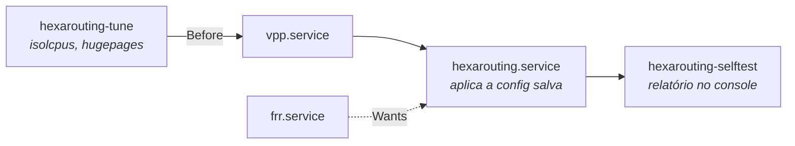
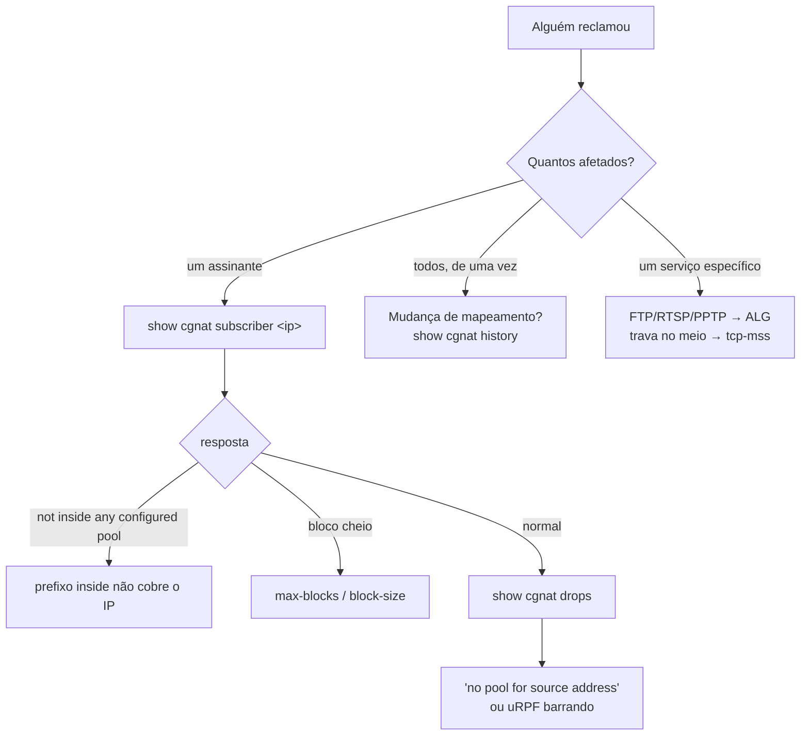

# Operação e diagnóstico

As regras que evitam incidente, a ordem em que a máquina sobe, e por onde começar quando alguém reclama. Para quem está com a caixa em produção.

# Regras que evitam incidente

## A interface de gerência não vai para o VPP

O DPDK tira a NIC do Linux. Entregue ao VPP a porta pela qual você administra a máquina e ela fica **inalcançável** — e inalcançável é inconsertável remotamente. Identifique-a antes de configurar qualquer coisa, e confirme que ela não aparece em `cgnat interface`.

## Mudança remota vai com rede de segurança

```
commit confirmed 5
```

Aplica agora e desfaz sozinho em 5 minutos se você não confirmar. Se a mudança cortar seu próprio acesso, a máquina se recupera.

## `commit` não é `save`

`commit` faz valer agora. `save` grava em disco. Uma configuração commitada e não salva **desaparece no próximo boot**.

## Antes de mexer em prefixo de pool

```
show configuration compare    o que muda
commit check                  quem seria re-mapeado
```

Se aparecer re-mapeamento, você vai derrubar todos os assinantes daquele pool ao aplicar. Isso é o esperado — mas precisa ser uma decisão, com janela.

## Recuperar uma caixa que ficou inalcançável

Se o dataplane tomou a placa de gerência, a caixa saiu da rede no instante em que o VPP subiu. Pelo console:

```
HEXA_DATAPLANE_IF=<placa dos assinantes>   em /etc/hexarouting/tune.env
```

ou acrescente `no-pci` ao bloco `dpdk {}` de `/etc/vpp/startup.conf`. **Depois reinicie.**


:::warning
Reiniciar não é zelo: o DPDK amarrou a placa a um driver de espaço de usuário, e parar o VPP **não a devolve ao kernel de forma confiável**.

:::

Uma caixa sem interface de dataplane parece uma caixa funcionando — ela responde, loga e aceita configuração, só não encaminha. Por isso o self-test diz que ela não tem interface de dataplane e nomeia o arquivo a editar.

# Serviços e ordem de boot



| Serviço | Função |
|---------|--------|
| `hexarouting-tune` | tuning de boot (isolcpus, hugepages); roda em **todo** boot, sem sentinela |
| `vpp.service` | o dataplane |
| `frr.service` | o roteamento |
| `hexarouting.service` | aplica a configuração salva (`hexash --load`) |
| `hexarouting-selftest` | verifica e reporta no console |

Duas decisões que valem entender:

* **FRR é** `**Wants**`**, não** `**Requires**`**.** Sem roteamento a máquina ainda encaminha pelas rotas estáticas existentes; derrubar o CGNAT junto só ampliaria o estrago.
* **Não existe** `**ExecStop**`**.** A configuração vive no VPP. Parar o serviço **não** apaga pools de produção — remover um pool é ação do operador, pela VTY.

`hexarouting.service` espera o VPP **aceitar comandos** antes de aplicar configuração: o systemd considera o `vpp.service` iniciado assim que o processo sobe, mas o socket da CLI e os plugins demoram mais um pouco, e aplicar antes disso falha de forma intermitente.

Essa espera **se explica no console**, que é onde a pessoa está:

```
waiting for the dataplane to accept commands
(VPP is up; its CLI socket and plugins take a moment longer)
still waiting: 5s of at most 60s
the dataplane answered after 5s
```

Três desfechos, ditos de formas diferentes: uma espera curta o bastante para ninguém notar **não diz nada**; uma que termina normalmente **não deixa aviso**; e um estouro de tempo diz o que custou — *a configuração de CGNAT NÃO foi aplicada*.


:::info
O limite de 60 segundos é generoso de propósito: o VPP responde em 5 a 21 segundos numa VM sem hugepages e com um worker, e uma caixa com 32 GB de hugepages e dezesseis workers demora mais.

:::

O tuning roda em todo boot justamente para que uma mudança em `tune.env` ou uma troca de NIC seja honrada.

# Diagnóstico



## Por onde começar

| Pergunta | Comando |
|----------|---------|
| "esse assinante não navega" | `show cgnat subscriber <ip-interno>` |
| "está caindo pacote" | `show cgnat drops` |
| "de quem era esse IP:porta?" | `show cgnat translation <ip> <porta>` |
| "o pool vai encher?" | `show cgnat top` |
| "quantas sessões, por thread?" | `show cgnat session` |
| "o coletor está recebendo?" | `show cgnat logging` |
| "quem mudou o quê, e quando?" | `show cgnat history` |
| "o que estou prestes a aplicar?" | `show configuration compare` |
| "que versão é essa máquina?" | `show version` |

## Sintomas conhecidos

| Sintoma | Causa provável |
|---------|----------------|
| Adjacência OSPF travada em Exchange | MTU herdada do TAP (9000). Ajuste com `mtu` dentro de `interface` |
| FTP/RTSP/PPTP conectam mas a transferência não começa | ALG correspondente desligado no pool |
| Conexões travam sem erro, em certos caminhos | MSS não rebaixado — configure `tcp-mss auto` |
| Assinante sem tradução e o pool não enche | prefixo dele coberto por um `bypass source` |
| Serviço não sobe no primeiro boot | ver `hexarouting.service`; o self-test imprime a última mensagem dela |
| Tudo caiu ao mesmo tempo, sem alarme | mudança de mapeamento aplicada com `commit remap` |

## Duas armadilhas de diagnóstico

`**vppctl**` **sai com código 0 mesmo quando falha.** Não trate o código de retorno dele como prova. A VTY usa a API binária justamente por isso.

**Um contador não é evidência.** Um ALG incrementa o contador dele tendo a reescrita saído certa ou não. Confira o pacote, não o contador.

# Ausências conhecidas

Não reporte como falha — são decisões registradas:

* **Alta disponibilidade / failover** — analisado, não implementado.
* **Números de throughput** — nada foi medido em hardware. Qualquer figura de desempenho é não verificada.
* **Log por fluxo** — recusado por projeto.
* **Migração graciosa de pool** — daria dois mapeamentos para um assinante, e a aritmética reversa não saberia distingui-los, abrindo mão exatamente da propriedade que o modo determinístico existe para fornecer.
* **MIB empresarial SNMP** — inativa até alguém registrar um Private Enterprise Number na IANA e configurá-lo.

# Ver também

* [Comandos show](/doc/comandos-show-YlNji1X5W4) — a referência de cada comando de diagnóstico
* [Receitas do dia a dia](/doc/receitas-do-dia-a-dia-IcocgdbXW2) — a correção, depois do diagnóstico
