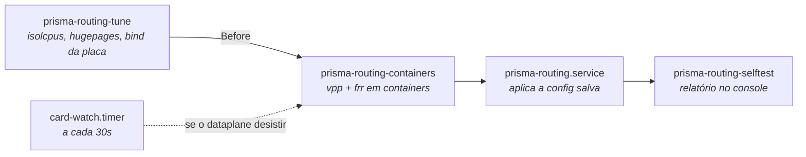
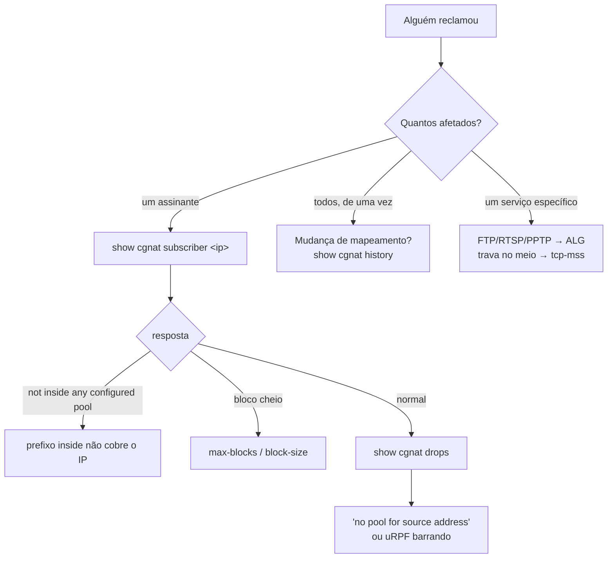

# Operação e diagnóstico

As regras que evitam incidente, a ordem em que a máquina sobe, e por onde começar quando alguém reclama. Para quem está com a caixa em produção.

# Regras que evitam incidente

## Qual placa o dataplane toma, e qual fica com o Linux

O DPDK tira a NIC do Linux: a placa que o dataplane toma deixa de existir para o sistema, e o que chegava à caixa por ela passa a chegar pelo par que o dataplane mantém do lado do Linux.

Sem ninguém configurar nada, a caixa toma **todas** as placas de rede que tem, menos **uma reservada ao Linux** — a da rede de gerência que foi informada na instalação; quem respondeu `none` ali, que é o padrão do instalador, não reservou nenhuma. A reserva nunca fica com a última placa: numa caixa de uma placa só, essa placa vai para o dataplane, e o endereço de gerência vai junto com ela para o par do lado do Linux, com o mesmo MAC e o mesmo gateway. `show hardware` diz quais placas a caixa tomou, qual carrega a rota padrão, e por quê.

O caminho de volta — endereço, MAC e gateway — é lido **da própria placa, no boot que a toma**, antes de ela sair do Linux. Uma placa cujo caminho de volta não pode ser lido **não é tomada**. E se o dataplane não consegue subir, a caixa devolve as placas ao driver do kernel sozinha.

Para escolher a placa à mão — numa máquina com várias placas, em que só uma carrega assinantes —, diga qual em `system` > `dataplane`:

```
configure
system
dataplane
interface enp2s0
commit
```

A placa nomeada é tomada **qualquer que seja a rota que ela carrega**, e passa a ser a única. Não há mais recusa no prompt por ser a placa por onde você está conectado: a caixa nova é configurada no console, e é ali que essa decisão é tomada. `no interface`, no mesmo lugar, devolve a escolha à caixa — a regra automática acima.


:::warning
**O** `**commit**` **guarda a escolha e não reinicia o dataplane.** A placa troca de dono no próximo boot, ou com `system dataplane restart` — os dois derrubam o encaminhamento por alguns segundos e jogam fora o bloco de portas de todos os assinantes. O próprio `commit` diz se a placa escolhida é a que carrega a sua sessão. Escolha a janela.

:::

## Mudança remota vai com rede de segurança

```
commit confirmed 5
```

Aplica agora e desfaz sozinho em 5 minutos se você não confirmar. Se a mudança cortar seu próprio acesso, a máquina se recupera.

O prazo é do **equipamento**, não da sessão: sair da VTY, perder o SSH, fechar o console ou reiniciar a máquina não cancela o desfazer. Só `commit` cancela. E três mudanças viram `commit confirmed 10` mesmo sem você pedir — qualquer coisa em `ssh`, qualquer coisa em `user`, e um `commit cutoff` —, porque são as que podem cortar a sessão em que você está digitando.

Entregar ao dataplane a placa por onde a caixa é alcançada **não** está entre elas: a caixa lê o caminho de volta da placa no boot que a toma, e não há janela nenhuma para confirmar essa entrega. **Procedimento que mande reiniciar, entrar de novo e digitar** `**commit**` **para manter a placa não vale mais**, e o `commit` extra não faz nada.

## `commit` não é `save`

`commit` faz valer agora. `save` grava em disco. Uma configuração commitada e não salva **desaparece no próximo boot**.

## Antes de mexer em prefixo de pool

```
show configuration compare    o que muda
commit check                  valida sem tocar no equipamento
commit                        aplica, ou recusa se houver re-mapeamento
```

O `commit check` informa o re-mapeamento: a conta exata e dois assinantes de exemplo, sem tocar no equipamento. Se aparecer, você vai derrubar todos os assinantes daquele pool ao aplicar. Isso é o esperado — mas precisa ser uma decisão, com janela. O `commit` comum recusa a mudança até ser pedida pelo nome, com `commit remap`.

## Recuperar uma caixa que ficou inalcançável

Se o dataplane tomou a placa por onde a caixa era administrada e o caminho de volta não funcionou, a caixa saiu da rede no instante em que o dataplane subiu. Pelo console, aponte o dataplane para a placa dos assinantes, e só para ela:

```
prisma> configure
prisma# [edit] system
prisma# [edit system] dataplane
prisma# [edit system / dataplane] interface enp2s0
prisma# [edit] commit
prisma# [edit] exit
prisma> save
```

Com uma placa nomeada, todas as outras ficam com o Linux. **Depois reinicie** — ou use `system dataplane restart`, que devolve todas as placas ao kernel, refaz a escolha e sobe o dataplane de novo.


:::warning
Reiniciar não é zelo: o `commit` só guarda a escolha, porque trocar a placa de dono derruba o encaminhamento e o bloco de portas de todos os assinantes. Quem escolhe a janela é você — e até lá a placa continua com quem estava.

:::

Uma caixa sem interface de dataplane parece uma caixa funcionando — ela responde, loga e aceita configuração, só não encaminha. Por isso o self-test diz que ela não tem interface de dataplane e diz o que digitar para dar uma a ela.

## O autoteste diz que a placa foi entregue e nada carrega o endereço

Quando o dataplane toma a placa por onde a caixa é alcançada - numa caixa de uma placa só, é o que acontece sem ninguém pedir -, a caixa lê dessa placa, no mesmo boot e antes de tirá-la do Linux, o caminho de gerência que vai precisar de volta: o endereço com a máscara, o MAC e o gateway. Esse endereço volta para o par `linux_cp` da interface, e a rota padrão para o Linux atrás dele. É por esse par que a caixa passa a ser alcançada.

Se o par não existir, não há para onde o endereço voltar. A caixa sobe encaminhando e **sem ninguém conseguir chegar nela** - só pelo console, no lugar onde ela está. O autoteste diz isso no console, em todo boot, e diz como falha e não como aviso:

```
  [FAIL] this box handed its only card over and NO pair carries the address
        The card this box is reached on was given to the dataplane, and the
        linux_cp pair is where the address the box answers on goes back.
        Without one it comes up forwarding and unreachable from anywhere but
        its console.
        the way back it computed on this boot: ens18 192.0.2.10/24
        52:54:00:00:00:01
        without a pair: ens18
        give each one an 'interface' block in prismash, and commit:
        the block pairs it under its own name.
```

A linha do caminho de gerência é a que interessa primeiro: ela é o endereço que a caixa tinha, e quem está no console não tem outro lugar de onde tirá-lo. O conserto é dar à porta um bloco `interface`: a placa leva no dataplane o nome que tinha no Linux, e qualquer bloco para ela cria o par com esse mesmo nome. `linux-name` só é preciso para escolher outro:

```
configure
interface ens18
 no shutdown
 exit
commit
```

Depois `exit` e `save`. O `save` não é opcional aqui: sem ele o par some no próximo boot e a caixa volta ao mesmo lugar.


:::info
Uma caixa que **não** entregou placa nenhuma e **não** roda protocolo de roteamento continua recebendo só um aviso por não ter par - `[warn] no linux_cp pair on:`. Ela não está quebrada: encaminhar CGNAT sem protocolo de roteamento é uma configuração legítima deste produto, e uma verificação que ficasse vermelha nela seria uma verificação que todo mundo aprende a ignorar.

:::

## Um disco morreu debaixo do espelho dos registros

Numa caixa instalada com os registros em dois discos, a morte de um deles **não derruba nada**: o volume continua montado, a gravação continua, a caixa continua encaminhando. Só o autoteste avisa, e ele avisa em todo boot:

```
  [FAIL] the records mirror is DEGRADED: 1 of 2 disks (vda3)
```

Isso é visita ao site, mesmo com a caixa funcionando: o que sobrou é uma cópia só, e a próxima falha perde o ano inteiro. Quem quiser conferir sem esperar o próximo boot:

```
cat /proc/mdstat
```

`[2/2] [UU]` são os dois discos; `[2/1] [U_]` é um só.

Depois de trocar o disco, particione-o e devolva a partição ao arranjo:

```
printf 'label: gpt\n,,R\n' | sfdisk --wipe=always /dev/<disco novo>
mdadm --add /dev/md0 /dev/<disco novo>1
```

A cópia recomeça sozinha e o autoteste passa a dizer `REBUILDING` com o percentual - isso é o conserto acontecendo, não um defeito. Quando termina, volta a `[ ok ] records mirrored on 2 disks`.


:::info
**Morreu o disco do sistema, e não o do espelho?** A caixa não sobe sozinha - é reinstalação. Os registros do disco sobrevivente continuam legíveis em outra máquina: monte a partição dele em qualquer Linux com `mdadm --assemble --run /dev/md0 /dev/<partição>` e depois `mount /dev/md0 /mnt`. Não se perde nada por não ter o outro disco.

:::

## O autoteste diz que as chaves SSH não foram geradas nesta caixa

A cada boot o autoteste compara as chaves de host do SSH com o sistema de arquivos em que elas estão guardadas. Um arquivo não pode ter conteúdo mais antigo que ele próprio: se as chaves forem mais antigas que o sistema de arquivos, elas não nasceram nesta caixa — vieram prontas, dentro da imagem do sistema. Nesse caso o autoteste avisa, e avisa como falha:

```
  [FAIL] the ssh host keys were not generated on this box
```

Isso importa porque uma chave de host que veio pronta de fora é a mesma em toda caixa instalada daquela mídia, e a metade privada dela está onde a mídia estiver. Quem tiver essa metade consegue se passar por esta caixa numa sessão SSH, **e o cliente de quem administra não reclama**: a impressão digital que ele guardou é exatamente a que ele recebeu.

O conserto é a caixa gerar as suas. No console:

```
rm /etc/ssh/ssh_host_*_key /etc/ssh/ssh_host_*_key.pub
ssh-keygen -A
systemctl restart ssh
```


:::warning
**Depois disso, toda máquina que já tinha esta caixa no** `**known_hosts**` **vai recusar a próxima conexão** e dizer que a chave do host mudou. Isso é o conserto acontecendo, não um ataque — e é o preço dele. Em cada máquina que administra a caixa, apague a entrada antiga com `ssh-keygen -R <endereço da caixa>` e confira a impressão digital nova na primeira conexão, lendo-a no console da caixa: é o único lugar onde ela não pode ter sido trocada no caminho.

:::

Quando as chaves são da própria caixa, a linha é outra e não pede nada:

```
  [ ok ] the ssh host keys were generated on this box, not handed to it
```

### A mesma coisa aparece ao entrar na caixa

O relatório do autoteste é escrito no console, no boot. Uma caixa em rack é alcançada por SSH, e ninguém está olhando para aquele console - então a caixa repete o aviso no banner, toda vez que alguém entra na VTY, exatamente nas caixas em que ele é verdade:

```
This box's ssh host keys were not generated on it:
    ssh_host_ecdsa_key ssh_host_ed25519_key ssh_host_rsa_key
    they came in with the system image, so every box installed from that
    medium answers with this same key and the private half of it is in the
    published download. This ssh session can be impersonated and your client
    will not object, because the fingerprint it pinned is the fingerprint it
    was handed.
regenerate them, in a shell on this box ('start shell'):
    rm /etc/ssh/ssh_host_*_key /etc/ssh/ssh_host_*_key.pub
    ssh-keygen -A
    systemctl restart ssh

    every client that pinned the old fingerprint will then refuse to connect
    and report that the host key changed. That is this being fixed, not an
    attack, and it is the cost of fixing it.
```

Numa caixa que gerou as próprias chaves o banner não diz nada sobre isso. E a resposta é medida a cada login, não lembrada do último boot: depois de regenerar, o aviso some no login seguinte, sem precisar reiniciar a caixa.

Há mais duas linhas vizinhas, que não querem dizer a mesma coisa:

* `[FAIL] no ssh host keys in /etc/ssh: sshd cannot start` — não existe chave nenhuma. O SSH não sobe e a caixa só é alcançável pelo console; `ssh-keygen -A` seguido de `systemctl restart ssh` resolve.
* `[warn] cannot tell where these ssh host keys were made` — o sistema de arquivos não registra quando cada arquivo foi criado, então não há com o que comparar. Não é um defeito e também não é um aval.

## O autoteste diz que arquivos desta caixa não são da versão que ela informa

A primeira linha do autoteste, e a resposta de `show version`, é a versão da caixa. Essa linha é uma frase única sobre cerca de trinta arquivos: o interpretador de comandos, o plugin do plano de dados, os utilitários, as unidades de serviço e os documentos instalados. Quando a instalação termina, ela deixa ao lado da versão a lista do que colocou na caixa, com uma soma de verificação para cada arquivo. A cada boot o autoteste refaz essas somas e compara.

Com tudo em ordem, é uma linha só:

```
  [ ok ] all 31 files of that build are the ones it shipped
```

Quando algum arquivo não confere, o autoteste diz quais:

```
  [FAIL] 1 file(s) on this box are not from 0.72.0 (beefcaf):
          usr/bin/prisma-routing-tune
```

Isso acontece de três maneiras, e todas são comuns: alguém copiou um arquivo de outra versão para a caixa (em geral para provar uma correção, e depois ele ficou), uma instalação parou no meio, ou uma atualização passou por parte da caixa e não pelo resto. Em qualquer dos três casos a caixa continua funcionando e continua encaminhando, e é por isso que a linha importa: sem ela, a versão informada segue sendo lida como verdade, e todo diagnóstico a partir dali é feito contra as notas de outra versão.

O conserto é instalar de novo, inteira, a versão que a caixa informa. A página **Levar a caixa para uma versão nova** descreve o procedimento e o que ele custa. Se foi você quem colocou o arquivo ali de propósito, essa linha é a caixa lembrando que ele continua lá.


:::info
**Os três arquivos de configuração nunca aparecem nessa lista.** `tune.env`, `vpp-base.conf` e `prisma-routing.conf` são escritos uma única vez, na primeira instalação, e a partir daí são seus: nem a atualização os substitui, nem o autoteste opina sobre o conteúdo deles. Editar o `tune.env` é o arquivo cumprindo a função dele, não um defeito, e uma verificação que reclamasse disso seria uma verificação que ninguém deixaria ligada.

:::

Há mais duas linhas vizinhas, e nenhuma das duas acusa a caixa de nada:

* `[warn] no /usr/share/prisma-routing/MANIFEST, so nothing checked that line`: a lista não está lá. Toda instalação deixa uma, então ou ela foi apagada, ou a instalação não chegou ao fim. Nada foi medido, que é diferente de nada estar errado.
* `[warn] /usr/share/prisma-routing/MANIFEST names no files, so it checked nothing`: a lista está lá e está vazia. Mesma leitura: nada foi comparado.

# Serviços e ordem de boot

**Desde a 0.117.0 o dataplane e o roteamento rodam em containers.** A caixa instalada habilita `prisma-routing-containers.service` e desabilita `vpp.service` e `frr.service` — os três não podem rodar juntos, porque disputam os mesmos sockets, as mesmas hugepages e a mesma placa.



| Serviço | Função |
|---------|--------|
| `prisma-routing-tune` | tuning de boot (isolcpus, hugepages); roda em **todo** boot, sem sentinela |
| `prisma-routing-containers` | sobe o dataplane, o roteamento e o plano de gerência (a VTY) como containers |
| `prisma-routing-doors` | executa no host o que a VTY pede (contas, sshd, SNMP, reboot); só para root, cada pedido vira uma linha no journal |
| `prisma-routing-card-watch.timer` | percebe um dataplane que o Docker desistiu de reiniciar, anota o motivo e devolve a placa ao kernel |
| `prisma-routing-backplane` | a rede interna própria dos containers, numa VRF separada, que não vaza para a tabela principal |
| `prisma-routing.service` | aplica a configuração salva (`prismash --load`) |
| `prisma-routing-selftest` | verifica e reporta no console |

**A VTY roda no container de gerência** (`prisma-routing_mgmt_1`). O login cai nela com o próprio usuário e os próprios grupos, então o papel de cada conta é o mesmo de antes. O container só tem uma rede interna própria, que alcança o host e nada além dele, e lê do host, só leitura, o que a VTY precisa saber da caixa: as placas, as rotas, os núcleos, se a caixa está na mídia de instalação. O que age no host passa pelo host: `ping`, `traceroute` e `mtr` saem pela rede do host; `install`, `system upgrade` e `system dataplane restart` rodam na VTY do host, no mesmo terminal; `start shell` abre um shell no host, e só para `root` e para contas com o papel `administrator` - qualquer outra conta recebe a recusa, e um comando que ela passe pelo `ssh` é executado pela VTY, com o papel dela, e não por um shell. Se o container não estiver no ar, a VTY roda no host, e ninguém fica trancado para fora. Para voltar a VTY para o host numa caixa: `touch /etc/prisma-routing/vty-on-host`.

```
docker ps --format "{{.Names}} {{.Status}}"
```

Numa caixa saudável, a lista traz os três containers — `prisma-routing_vpp_1` (o dataplane), `prisma-routing_frr_1` (o roteamento) e `prisma-routing_mgmt_1` (a VTY) — todos `Up`.

Antes de o compose ver o arquivo, a unit faz três coisas, e cada uma existe porque uma caixa que pulou aquela etapa subiu errada:


1. **carrega as imagens** que a mídia trouxe (`/usr/lib/prisma-routing/images.tar.gz`) e escreve a tag encontrada onde o compose a lê — sem isso a caixa pediria uma imagem a um registry, e um appliance não tem rota para nenhum;
2. **escreve o nó de device da placa** que este boot vinculou, porque qual nó é depende do driver que a caixa conseguiu usar;
3. depois de subir, **entrega o segmento da API binária ao grupo** `vpp`, que é o que permite uma conta de operador configurar a caixa.

### Quando o dataplane desistiu

O dataplane em container tenta subir cinco vezes. Depois disso o Docker desiste, e a cada 30 segundos o vigia confere: achando o dataplane parado, ele **anota por quê** — o estado do container, o código de saída e as últimas oitenta linhas que o dataplane escreveu — em `/var/log/prisma-routing/why-the-dataplane-stopped`, e só então devolve a placa ao kernel, uma vez por boot.

Esse arquivo é a primeira coisa a ler numa caixa que subiu sem encaminhar. Reiniciar a caixa apaga o log do container, e o arquivo fica justamente porque reiniciar é a primeira coisa que qualquer um faz. Quando ele existe, a VTY e o autoteste apontam para ele em vez de mandar consultar o log do container, que naquela caixa está vazio.

Duas decisões que valem entender:

* **Nenhuma unit “puxa” um dataplane.** `Requires=` e `Wants=` *iniciam* o que nomeiam: numa caixa em containers isso subiria um segundo dataplane ao lado do que está rodando. O que existe é `After=`, que só ordena.
* **Não existe** `**ExecStop**` **que apague configuração.** A configuração vive no VPP. Parar o serviço **não** apaga pools de produção — remover um pool é ação do operador, pela VTY.

### Voltar para as units

Dois comandos, e a caixa continua respondendo pela placa depois deles:

```sh
systemctl disable --now prisma-routing-containers.service
systemctl enable --now vpp.service frr.service
```

Esses dois comandos são percorridos a cada release, numa caixa instalada de verdade, que depois é conferida: ela volta a responder pela placa e volta a aplicar a configuração salva no boot. Um caminho de volta que ninguém percorreu não é um caminho de volta.

`prisma-routing.service` espera o dataplane **aceitar comandos** antes de aplicar configuração: o container é criado antes de o VPP dentro dele estar servindo — e, nas units, o systemd considera o `vpp.service` iniciado assim que o processo sobe. Nos dois casos o socket da CLI e os plugins demoram mais um pouco, e aplicar antes disso falha de forma intermitente.

Essa espera **se explica no console**, que é onde a pessoa está:

```
waiting for the dataplane to accept commands
(VPP is up; its CLI socket and plugins take a moment longer)
still waiting: 5s of at most 60s
the dataplane answered after 5s
```

Três desfechos, ditos de formas diferentes: uma espera curta o bastante para ninguém notar **não diz nada**; uma que termina normalmente **não deixa aviso**; e um estouro de tempo diz o que custou — *a configuração de CGNAT NÃO foi aplicada*.


:::info
O limite de 60 segundos é generoso de propósito: o VPP responde em 5 a 21 segundos numa VM sem hugepages e com um worker, e uma caixa com 32 GB de hugepages e dezesseis workers demora mais.

:::

O tuning roda em todo boot justamente para que uma mudança em `tune.env` ou uma troca de NIC seja honrada.

### `rx queues`: o que a placa abriu, e não só o que foi pedido

O autoteste lê, do dataplane em execução, quantas filas de recepção cada placa realmente abriu, e compara com o que o ajuste de boot pediu para aquela placa:

```
  [ ok ] rx queues: 1 of 1 on ens9, as requested (1)
```

`1 of 1` é o que a placa abriu e o máximo que ela tem; o nome é o que o dataplane dá à placa, que é o nome que ela tinha no Linux. Quando o que foi aberto difere do pedido, a linha vira aviso e diz por que isso importa:

```
  [warn] rx queues: 1 of 1 on ens9, 4 requested
         the tuner asked for one queue per worker, capped at
         what the card reported, and the dataplane opened 1:
         at most 1 worker(s) receive from this card, and the
         other workers receive nothing from it.
```

O ajuste de boot dimensiona os workers pelo processador e pede uma fila por worker, limitado ao que a placa informou. Cada fila é entregue a um worker: uma placa com menos filas do que o pedido entrega o que tem, só esse número de workers recebe dela, e os outros não recebem nada dessa placa. A caixa encaminha, mas com uma fração do que o processador poderia fazer.

Há um caso pior: o driver recusa a placa e não abre fila nenhuma, embora o dataplane ainda liste a contagem com que ela foi configurada. O autoteste lê o estado do driver junto com a contagem e trata isso como falha, não como fila aberta:

```
  [FAIL] rx queues: none opened on ens9
        'show hardware-interfaces' marks the card pmd-init-fail, so the
        1 of 1 it lists were configured and never opened:
        the driver refused the port and the card carries no
        traffic. 'journalctl -u vpp' has the driver's reason.
```

Essa mesma placa aparece como interface em estado `error`, algumas linhas abaixo.

A palavra `requested` fica só para a caixa em que nada pôde ser lido. O número é o que foi **pedido**, e a linha de baixo diz que é só isso:

```
  [ ok ] rx queues requested: num-rx-queues 4
         what the dataplane opened could not be read: it is not
         answering, so the count in effect is unknown on this box.
```

Numa caixa que não entregou placa nenhuma ao dataplane, e por isso não pediu nada, a linha diz isso por extenso em vez de sair vazia:

```
  [ ok ] rx queues requested: default (1 per interface, one worker takes all)
         the dataplane holds no card that reports its queues, so
         there is no count in effect to read back.
```

Nesse mesmo boot, o que a caixa **pediu** e o que ela **recebeu** são conferidos um contra o outro — e o que é lido de volta é o que o **kernel** está fazendo, não o que o arquivo gerado pediu. Um parâmetro pode se perder em três lugares: o `update-grub` não rodou, a caixa não reiniciou desde então, ou o kernel viu e recusou. Uma appliance que se diz ajustada quando o kernel não aceitou o parâmetro é pior que uma que não diz nada.

São **quatro** respostas por regra, e nenhuma delas se confunde com outra:

| Linha no autoteste | O que significa |
|--------------------|-----------------|
| `[ ok ] every tuning rule this box can read back is in effect (2)` | tudo que dava para conferir está valendo, e diz quantas regras foram |
| `[warn] requested and NOT in effect: isolcpus` | foi pedido e o kernel não está fazendo. A linha de baixo diz o que ele está fazendo em vez disso |
| `[info] cannot be read on this box: nohz_full` | esta caixa não expõe jeito de ler se pegou. Não é "pegou" nem "não pegou" |
| `[info] not requested on this box: 99-prisma-routing.conf` | ninguém pediu esse ajuste aqui. Uma caixa deliberada não pode ter a cara de uma caixa quebrada |

Medido numa caixa cujo kernel recusou o isolamento:

```
  [warn] requested and NOT in effect: isolcpus
         cpu(s) 1-3 were asked for and the kernel is not isolating them
```

A linha verde **não sai** ao lado de uma regra recusada: uma caixa com metade do ajuste no chão não é uma caixa ajustada. E duas regras caem em `cannot be read` em hardware real — o `rcu_nocbs`, que não tem leitura fora de um debugfs só de root, e a lista de CPUs do `irqbalance`, que fica no ambiente do daemon.

Três outras linhas valem a pena reconhecer no console:

| O que aparece | O que significa |
|---------------|-----------------|
| `deep C-states left enabled on purpose` | você pôs `PRISMA_LOW_LATENCY=0` e a caixa está fazendo o que foi mandada. Não é aviso |
| `booted a command line older than that file` | `tune.env` foi editado e a caixa ainda não reiniciou desde então. Reinicie para valer |
| `the kernel exposes no idle-state driver` | numa máquina virtual não há estado de energia para desligar, então esse ajuste não muda nada ali |

Um valor que a caixa não aceita em `tune.env` também aparece aí, com os valores que ela aceita no lugar. O que cada variável aceita está em *Dimensionamento e requisitos*.

### Quando a linha inteira de boot se perdeu, é **uma** linha

Se o arquivo gerado pede onze parâmetros e o boot não trouxe nenhum, isso é um fato só sobre a caixa — o `update-grub` não rodou, ou ela não reiniciou desde então — e não onze fatos. O autoteste diz uma vez:

```
  [warn] requested and NOT in effect: the kernel command line
         the generated file asks this boot for 11 parameter(s) and it carries
         none of them: update-grub has not run since that file was written, or
         the box has not rebooted since. Run update-grub and reboot
```

Onze cópias da mesma frase num console de oitenta colunas são vinte e duas linhas empurrando todo o resto para fora da tela, e uma tela que não cabe é uma tela que ninguém lê.

### E quando o próprio conferidor não está lá

Duas linhas separam *"o ajuste não pegou"* de *"ninguém conseguiu conferir"*:

| Linha no autoteste | O que significa |
|--------------------|-----------------|
| `[warn] prisma-routing-tune is not on this box, so what the kernel did with the tuning cannot be read here at all` | não há conferidor nesta caixa. Nada foi medido |
| `[warn] prisma-routing-tune could not say what tuning is in effect, so this box is unmeasured rather than confirmed` | o conferidor está lá e não respondeu. Também não foi medido |

Nenhuma das duas diz que o ajuste está valendo, e nenhuma diz que não está. Uma caixa **não medida** e uma caixa **conferida e boa** não podem ter a mesma cara na tela, que é o que uma ausência de linha faria com as duas.

Existe ainda uma quinta resposta que uma caixa entregue não deve ver:

```
  [warn] no way to read back a parameter this box sets: <parâmetro>
```

Ela quer dizer que a caixa escreve um parâmetro para o qual não existe leitura de volta — ou seja, algo que ela pede e nunca vai conseguir conferir. Se ela aparecer, o que está acontecendo é que a caixa ganhou um ajuste novo sem ganhar o conferidor dele.

# Diagnóstico



## Por onde começar

| Pergunta | Comando |
|----------|---------|
| "esse assinante não navega" | `show cgnat subscriber <ip-interno>` |
| "está caindo pacote" | `show cgnat drops` |
| "de quem era esse IP:porta?" | `show cgnat translation <ip> <porta>` |
| "o pool vai encher?" | `show cgnat top` |
| "quantas sessões, por thread?" | `show cgnat session` |
| "o coletor está recebendo?" | `show cgnat logging` |
| "o que aconteceu na caixa?" | `show log` |
| "quem fez commit, e de onde?" | `show log source vty` (ou `source api`) |
| "por que o dataplane reiniciou?" | `show log source dataplane`, e a linha `started by:` de `show system uptime` |
| "essa porta caiu? quando, e quantas vezes?" | `show log kind link` |
| "por que a sessão BGP caiu?" | `show log kind bgp` (o motivo do FRR) e `show log kind bfd` |
| "quem entrou na caixa, e quem errou a senha?" | `show log kind login` |
| "o pool esgotou?" | `show log kind pool` |
| "quem mudou o pool, e quando?" | `show cgnat history` |
| "o que estou prestes a aplicar?" | `show configuration compare` |
| "que versão é essa máquina?" | `show version` |
| "quais daemons de roteamento estão de pé?" | `show version` |
| "a porta caiu ou alguém deu shutdown?" | `show interface terse` |
| "para que serve essa porta?" | `show interface description` |
| "o enlace está cheio?" | `show interface utilization <nome>` |
| "quanta luz chega nessa porta? o módulo está bem?" | `show interface <nome> transceiver` |
| "cabe mais sessão na memória do CGNAT?" | `show cgnat memory` |
| "quais ALGs estão valendo?" | `show cgnat alg` |
| "a trilha de configuração foi adulterada?" | `show cgnat history verify` |
| "quais placas a caixa tem, e qual ela tomou?" | `show hardware` |
| "quais núcleos fazem o quê?" | `show system cpu` |
| "como a memória está dividida?" | `show system memory` |
| "o agregado LACP está inteiro?" | `show lacp` |
| "a caixa alcança esse destino?" | `ping`, `traceroute` ou `mtr` |

## Sintomas conhecidos

| Sintoma | Causa provável |
|---------|----------------|
| Adjacência OSPF travada em Exchange | MTU herdada do TAP (o padrão da caixa, 1500; 9000 numa caixa instalada antes da 0.152.1). Ajuste com `mtu` dentro de `interface` |
| Um lado reclama de queda e a configuração está de pé | `show interface terse`: `Admin up` com `Link down` é cabo, transceiver ou o outro lado |
| `show interface` anota erros de CRC numa porta | fibra suja ou danificada, conector, ou um dos módulos: compare a potência de RX de `show interface <nome> transceiver` com a de TX do outro lado (abaixo) |
| `show interface` anota `rx power ... below its low warning` | pouca luz chegando: fibra, conector, um vão longo demais, ou o laser do outro lado |
| FTP/RTSP/PPTP conectam mas a transferência não começa | ALG correspondente desligado no pool |
| Conexões travam sem erro, em certos caminhos | MSS não rebaixado — configure `tcp-mss auto` |
| Assinante sem tradução e o pool não enche | prefixo dele coberto por um `bypass source` |
| Serviço não sobe no primeiro boot | ver `prisma-routing.service`; o self-test imprime a última mensagem dela |
| Autoteste diz `the records mirror is DEGRADED` | um dos dois discos de registros morreu; a caixa funciona, a guarda está por um fio |
| Tudo caiu ao mesmo tempo, sem alarme | mudança de mapeamento aplicada com `commit remap` |
| `show bgp` (ou `ospf`, ou `isis`) não responde | `show version` nomeia os daemons parados; um parado recebe configuração e não chega a lugar nenhum |
| A caixa subiu, roteia e não encaminha; `show interface` sem as placas | o dataplane desistiu de subir: leia `/var/log/prisma-routing/why-the-dataplane-stopped` |
| Sessão BGP caiu e voltou sem ninguém ver | `show log kind bgp`: cada queda com o motivo do FRR, e `went down and came back between two readings` quando caiu e voltou entre duas leituras |
| A caixa ficou sem placas depois de um reinício | `show log kind gave-up`: o dataplane abandonado, ou o `system dataplane restart` que não terminou, e por quê |
| `show system uptime` diz `restarted after the boot` | `show log source dataplane` diz a causa: um `system dataplane restart` (de quem), uma atualização, ou `unexpected` — ninguém pediu, e `why-the-dataplane-stopped` costuma ter o motivo |
| Sessões novas recusadas com a caixa de pé | `show cgnat memory`: a memória do CGNAT encheu, e a caixa recusa em vez de cair. `memory` em `nat` > `cgnat` dá mais, a partir do próximo boot |
| Assinante não alcança a própria caixa (gateway, DNS, SSH) | versões anteriores à 0.136.1 traduziam o tráfego para os endereços da caixa; atualize |

## Erros de CRC numa porta óptica

Erro de CRC é quadro que chegou corrompido. Numa porta óptica, quase sempre é a camada física: fibra suja, dobrada ou danificada, conector mal encaixado, ou um módulo no fim da vida — deste lado ou do outro. Foi assim que este diagnóstico nasceu: uma porta do X520 contando 0,58% dos quadros com erro de CRC, e ninguém conseguia ler a potência óptica do lado da caixa para comparar com a do switch.


1. `show interface` mostra a nota quando a taxa passa de 0,01% desde que os contadores começaram.
2. `show interface <nome> transceiver` dá a potência de RX **deste** lado, e a de TX. No switch do outro lado, `display transceiver interface <porta> verbose` (Huawei) ou `show interfaces diagnostics optics <porta>` (Junos) dá as dele.
3. Compare: a RX de um lado deve ser a TX do outro menos a perda do enlace (fibra e conectores, alguns dB num enlace curto). RX muito abaixo da TX do outro lado é perda no caminho — limpe e reencaixe os conectores, troque o cordão. RX normal dos dois lados com CRC continuando aponta para um dos módulos.
4. O estado de cada linha diz se o próprio módulo considera o valor fora: `low warn` antes de `low alarm`.

A leitura não para o encaminhamento: não é preciso devolver a placa ao Linux para usar o `ethtool -m`, que era o único caminho antes da 0.151.15 e derrubava o dataplane. O mesmo valor vai pelo SNMP (`prTransceiver`, com itens e gatilhos no template do Zabbix) e pela API (`ListTransceivers`).

## Duas armadilhas de diagnóstico

**A CLI de texto do dataplane sai com código 0 mesmo quando falha.** É por isso que a VTY não fala com o dataplane por texto: ela usa a API binária, que responde se deu certo. Nada nesta wiki pede para você descer até lá, e o código de retorno que você veria ali não é prova de nada.

**Um contador não é evidência.** Um ALG incrementa o contador dele tendo a reescrita saído certa ou não. Confira o pacote, não o contador.

# Ausências conhecidas

Não reporte como falha — são decisões registradas:

* **Sincronismo de sessão no failover** — recusado por custo. O par ativo/standby existe e preserva endereço público e bloco de portas; conexões em curso caem, como em qualquer NAT.
* **Números de throughput** — bits por segundo não foram medidos em placa que o DPDK controle nativamente. O que **foi** medido é quanto um pacote custa aos nós de tradução, em ciclos de CPU. Qualquer figura em bit/s é não verificada.
* **Log por fluxo** — recusado por projeto.
* **Migração graciosa de pool** — daria dois mapeamentos para um assinante, e a aritmética reversa não saberia distingui-los, abrindo mão exatamente da propriedade que o modo determinístico existe para fornecer.
* **MIB empresarial SNMP** — inativa até alguém registrar um Private Enterprise Number na IANA e configurá-lo.

# Ver também

* [Comandos show](/doc/comandos-show-YlNji1X5W4) — a referência de cada comando de diagnóstico
* [Monitoramento e SNMP](/doc/monitoramento-e-snmp-YGn85RpUAb) — os mesmos números na NMS
* [Receitas do dia a dia](/doc/receitas-do-dia-a-dia-IcocgdbXW2) — a correção, depois do diagnóstico
