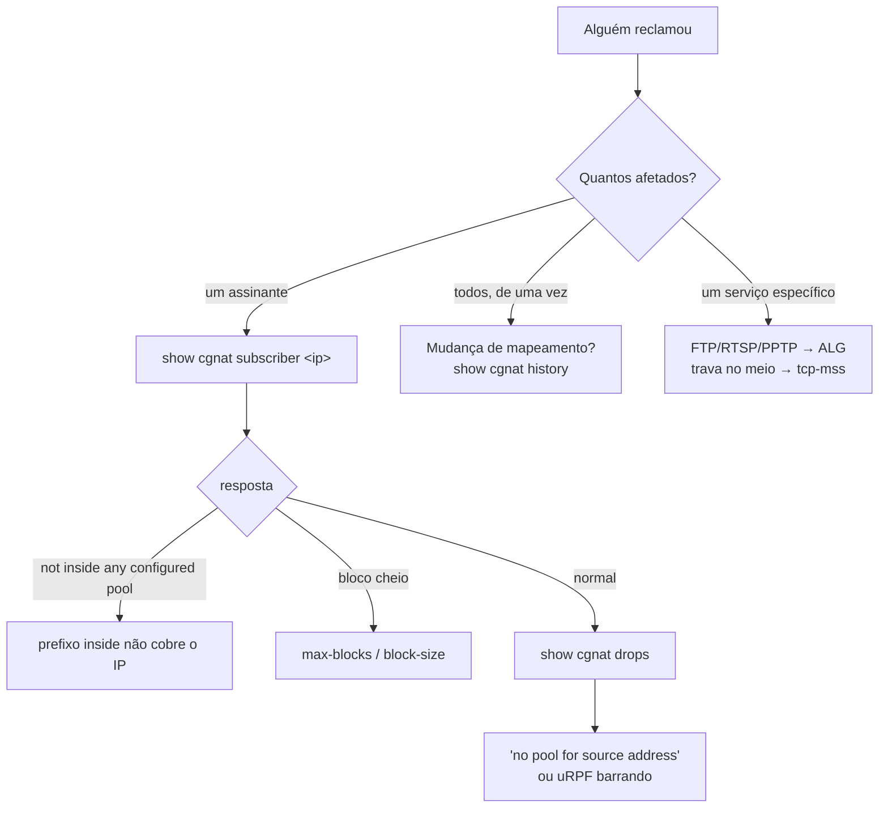

# Operação e diagnóstico

As regras que evitam incidente, a ordem em que a máquina sobe, e por onde começar quando alguém reclama. Para quem está com a caixa em produção.

# Regras que evitam incidente

## A interface de gerência não vai para o VPP

O DPDK tira a NIC do Linux. Entregue ao VPP a porta pela qual você administra a máquina e ela fica **inalcançável** — e inalcançável é inconsertável remotamente. Identifique-a antes de configurar qualquer coisa, e confirme que ela não aparece em `nat cgnat interface`.

## Mudança remota vai com rede de segurança

```
commit confirmed 5
```

Aplica agora e desfaz sozinho em 5 minutos se você não confirmar. Se a mudança cortar seu próprio acesso, a máquina se recupera.

O prazo é do **equipamento**, não da sessão: sair da VTY, perder o SSH, fechar o console ou reiniciar a máquina não cancela o desfazer. Só `commit` cancela. E três mudanças viram `commit confirmed 10` mesmo sem você pedir — qualquer coisa em `ssh`, qualquer coisa em `user`, e um `commit cutoff` —, porque são as que podem cortar a sessão em que você está digitando.

## `commit` não é `save`

`commit` faz valer agora. `save` grava em disco. Uma configuração commitada e não salva **desaparece no próximo boot**.

## Antes de mexer em prefixo de pool

```
show configuration compare    o que muda
commit check                  valida sem tocar no equipamento
commit                        aplica, ou recusa se houver re-mapeamento
```

O `commit check` informa o re-mapeamento: a conta exata e dois assinantes de exemplo, sem tocar no equipamento. Se aparecer, você vai derrubar todos os assinantes daquele pool ao aplicar. Isso é o esperado — mas precisa ser uma decisão, com janela. O `commit` comum recusa a mudança até ser pedida pelo nome, com `commit remap`.

## Recuperar uma caixa que ficou inalcançável

Se o dataplane tomou a placa de gerência, a caixa saiu da rede no instante em que o VPP subiu. Pelo console, aponte-a para a placa dos assinantes — ou para nenhuma, até decidir:

```
hexarouting> configure
hexarouting# [edit] dataplane interface enp2s0
hexarouting# [edit] commit
hexarouting# [edit] exit
hexarouting> save
```

`no dataplane interface` é a versão sem escolher: a caixa passa a não pegar placa nenhuma, que é o estado seguro e alcançável por rede. **Depois reinicie.**


:::warning
Reiniciar não é zelo: o DPDK amarrou a placa a um driver de espaço de usuário, e parar o VPP **não a devolve ao kernel de forma confiável**. É também por isso que o `commit` não reinicia o dataplane sozinho — quem escolhe a janela é você.

:::

Uma caixa sem interface de dataplane parece uma caixa funcionando — ela responde, loga e aceita configuração, só não encaminha. Por isso o self-test diz que ela não tem interface de dataplane e diz o que digitar para dar uma a ela.

## O autoteste diz que a placa foi entregue e nada carrega o endereço

Numa caixa de uma placa só, entregar essa placa ao dataplane é permitido - e no momento em que você confirma a entrega a caixa anota, ao lado do nome da placa, o caminho de gerência que ela vai precisar de volta: o endereço, a máscara e o MAC. No boot seguinte o dataplane toma a porta e esse endereço volta para o par `linux_cp` da interface. É por esse par que a caixa passa a ser alcançada.

Se o par não existir, não há para onde o endereço voltar. A caixa sobe encaminhando e **sem ninguém conseguir chegar nela** - só pelo console, no lugar onde ela está. O autoteste diz isso no console, em todo boot, e diz como falha e não como aviso:

```
  [FAIL] this box handed its only card over and NO pair carries the address
        The card named in /etc/hexarouting/tune.env was given to the
        dataplane, and the linux_cp pair is where the address the box answers
        on goes back. Without one it comes up forwarding and unreachable from
        anywhere but its console.
        the management path it recorded: ens18 10.95.200.198/24
        52:54:00:00:00:01
        without a pair: GigabitEthernet0/9/0
        give each one a 'linux-name <name>' under 'interface' in
        hexash, and commit.
```

A linha do caminho de gerência é a que interessa primeiro: ela é o endereço que a caixa tinha, e quem está no console não tem outro lugar de onde tirá-lo. O conserto é dar um nome de Linux à porta que o dataplane está segurando, que é o que cria o par:

```
configure
interface GigabitEthernet0/9/0
 linux-name wan0
 exit
commit
```

Depois `exit` e `save`. O `save` não é opcional aqui: sem ele o par some no próximo boot e a caixa volta ao mesmo lugar.

:::info
Uma caixa que **não** entregou placa nenhuma e **não** roda protocolo de roteamento continua recebendo só um aviso por não ter par - `[warn] no linux_cp pair on:`. Ela não está quebrada: encaminhar CGNAT sem protocolo de roteamento é uma configuração legítima deste produto, e uma verificação que ficasse vermelha nela seria uma verificação que todo mundo aprende a ignorar.

:::

## Um disco morreu debaixo do espelho dos registros

Numa caixa instalada com os registros em dois discos, a morte de um deles **não derruba nada**: o volume continua montado, a gravação continua, a caixa continua encaminhando. Só o autoteste avisa, e ele avisa em todo boot:

```
  [FAIL] the records mirror is DEGRADED: 1 of 2 disks (vda3)
```

Isso é visita ao site, mesmo com a caixa funcionando: o que sobrou é uma cópia só, e a próxima falha perde o ano inteiro. Quem quiser conferir sem esperar o próximo boot:

```
cat /proc/mdstat
```

`[2/2] [UU]` são os dois discos; `[2/1] [U_]` é um só.

Depois de trocar o disco, particione-o e devolva a partição ao arranjo:

```
printf 'label: gpt\n,,R\n' | sfdisk --wipe=always /dev/<disco novo>
mdadm --add /dev/md0 /dev/<disco novo>1
```

A cópia recomeça sozinha e o autoteste passa a dizer `REBUILDING` com o percentual - isso é o conserto acontecendo, não um defeito. Quando termina, volta a `[ ok ] records mirrored on 2 disks`.


:::info
**Morreu o disco do sistema, e não o do espelho?** A caixa não sobe sozinha - é reinstalação. Os registros do disco sobrevivente continuam legíveis em outra máquina: monte a partição dele em qualquer Linux com `mdadm --assemble --run /dev/md0 /dev/<partição>` e depois `mount /dev/md0 /mnt`. Não se perde nada por não ter o outro disco.

:::

## O autoteste diz que as chaves SSH não foram geradas nesta caixa

A cada boot o autoteste compara as chaves de host do SSH com o sistema de arquivos em que elas estão guardadas. Um arquivo não pode ter conteúdo mais antigo que ele próprio: se as chaves forem mais antigas que o sistema de arquivos, elas não nasceram nesta caixa — vieram prontas, dentro da imagem do sistema. Nesse caso o autoteste avisa, e avisa como falha:

```
  [FAIL] the ssh host keys were not generated on this box
```

Isso importa porque uma chave de host que veio pronta de fora é a mesma em toda caixa instalada daquela mídia, e a metade privada dela está onde a mídia estiver. Quem tiver essa metade consegue se passar por esta caixa numa sessão SSH, **e o cliente de quem administra não reclama**: a impressão digital que ele guardou é exatamente a que ele recebeu.

O conserto é a caixa gerar as suas. No console:

```
rm /etc/ssh/ssh_host_*_key /etc/ssh/ssh_host_*_key.pub
ssh-keygen -A
systemctl restart ssh
```

:::warning
**Depois disso, toda máquina que já tinha esta caixa no `known_hosts` vai recusar a próxima conexão** e dizer que a chave do host mudou. Isso é o conserto acontecendo, não um ataque — e é o preço dele. Em cada máquina que administra a caixa, apague a entrada antiga com `ssh-keygen -R <endereço da caixa>` e confira a impressão digital nova na primeira conexão, lendo-a no console da caixa: é o único lugar onde ela não pode ter sido trocada no caminho.

:::

Quando as chaves são da própria caixa, a linha é outra e não pede nada:

```
  [ ok ] the ssh host keys were generated on this box, not handed to it
```

### A mesma coisa aparece ao entrar na caixa

O relatório do autoteste é escrito no console, no boot. Uma caixa em rack é alcançada por SSH, e ninguém está olhando para aquele console - então a caixa repete o aviso no banner, toda vez que alguém entra na VTY, exatamente nas caixas em que ele é verdade:

```
This box's ssh host keys were not generated on it:
    ssh_host_ecdsa_key ssh_host_ed25519_key ssh_host_rsa_key
    they came in with the system image, so every box installed from that
    medium answers with this same key and the private half of it is in the
    published download. This ssh session can be impersonated and your client
    will not object, because the fingerprint it pinned is the fingerprint it
    was handed.
regenerate them, in a shell on this box ('start shell'):
    rm /etc/ssh/ssh_host_*_key /etc/ssh/ssh_host_*_key.pub
    ssh-keygen -A
    systemctl restart ssh

    every client that pinned the old fingerprint will then refuse to connect
    and report that the host key changed. That is this being fixed, not an
    attack, and it is the cost of fixing it.
```

Numa caixa que gerou as próprias chaves o banner não diz nada sobre isso. E a resposta é medida a cada login, não lembrada do último boot: depois de regenerar, o aviso some no login seguinte, sem precisar reiniciar a caixa.

Há mais duas linhas vizinhas, que não querem dizer a mesma coisa:

* `[FAIL] no ssh host keys in /etc/ssh: sshd cannot start` — não existe chave nenhuma. O SSH não sobe e a caixa só é alcançável pelo console; `ssh-keygen -A` seguido de `systemctl restart ssh` resolve.
* `[warn] cannot tell where these ssh host keys were made` — o sistema de arquivos não registra quando cada arquivo foi criado, então não há com o que comparar. Não é um defeito e também não é um aval.

## O autoteste diz que arquivos desta caixa não são da versão que ela informa

A primeira linha do autoteste, e a resposta de `show version`, é a versão da caixa. Essa linha é uma frase única sobre cerca de trinta arquivos: o interpretador de comandos, o plugin do plano de dados, os utilitários, as unidades de serviço e os documentos instalados. Quando a instalação termina, ela deixa ao lado da versão a lista do que colocou na caixa, com uma soma de verificação para cada arquivo. A cada boot o autoteste refaz essas somas e compara.

Com tudo em ordem, é uma linha só:

```
  [ ok ] all 31 files of that build are the ones it shipped
```

Quando algum arquivo não confere, o autoteste diz quais:

```
  [FAIL] 1 file(s) on this box are not from 0.72.0 (beefcaf):
          usr/bin/hexarouting-tune
```

Isso acontece de três maneiras, e todas são comuns: alguém copiou um arquivo de outra versão para a caixa (em geral para provar uma correção, e depois ele ficou), uma instalação parou no meio, ou uma atualização passou por parte da caixa e não pelo resto. Em qualquer dos três casos a caixa continua funcionando e continua encaminhando, e é por isso que a linha importa: sem ela, a versão informada segue sendo lida como verdade, e todo diagnóstico a partir dali é feito contra as notas de outra versão.

O conserto é instalar de novo, inteira, a versão que a caixa informa. A página **Levar a caixa para uma versão nova** descreve o procedimento e o que ele custa. Se foi você quem colocou o arquivo ali de propósito, essa linha é a caixa lembrando que ele continua lá.

:::info

**Os três arquivos de configuração nunca aparecem nessa lista.** `tune.env`, `vpp-base.conf` e `hexarouting.conf` são escritos uma única vez, na primeira instalação, e a partir daí são seus: nem a atualização os substitui, nem o autoteste opina sobre o conteúdo deles. Editar o `tune.env` é o arquivo cumprindo a função dele, não um defeito, e uma verificação que reclamasse disso seria uma verificação que ninguém deixaria ligada.

:::

Há mais duas linhas vizinhas, e nenhuma das duas acusa a caixa de nada:

* `[warn] no /usr/share/hexarouting/MANIFEST, so nothing checked that line`: a lista não está lá. Toda instalação deixa uma, então ou ela foi apagada, ou a instalação não chegou ao fim. Nada foi medido, que é diferente de nada estar errado.
* `[warn] /usr/share/hexarouting/MANIFEST names no files, so it checked nothing`: a lista está lá e está vazia. Mesma leitura: nada foi comparado.

# Serviços e ordem de boot


| Serviço | Função |
|---------|--------|
| `hexarouting-tune` | tuning de boot (isolcpus, hugepages); roda em **todo** boot, sem sentinela |
| `vpp.service` | o dataplane |
| `frr.service` | o roteamento |
| `hexarouting.service` | aplica a configuração salva (`hexash --load`) |
| `hexarouting-selftest` | verifica e reporta no console |

Duas decisões que valem entender:

* **FRR é** `**Wants**`**, não** `**Requires**`**.** Sem roteamento a máquina ainda encaminha pelas rotas estáticas existentes; derrubar o CGNAT junto só ampliaria o estrago.
* **Não existe** `**ExecStop**`**.** A configuração vive no VPP. Parar o serviço **não** apaga pools de produção — remover um pool é ação do operador, pela VTY.

`hexarouting.service` espera o VPP **aceitar comandos** antes de aplicar configuração: o systemd considera o `vpp.service` iniciado assim que o processo sobe, mas o socket da CLI e os plugins demoram mais um pouco, e aplicar antes disso falha de forma intermitente.

Essa espera **se explica no console**, que é onde a pessoa está:

```
waiting for the dataplane to accept commands
(VPP is up; its CLI socket and plugins take a moment longer)
still waiting: 5s of at most 60s
the dataplane answered after 5s
```

Três desfechos, ditos de formas diferentes: uma espera curta o bastante para ninguém notar **não diz nada**; uma que termina normalmente **não deixa aviso**; e um estouro de tempo diz o que custou — *a configuração de CGNAT NÃO foi aplicada*.


:::info
O limite de 60 segundos é generoso de propósito: o VPP responde em 5 a 21 segundos numa VM sem hugepages e com um worker, e uma caixa com 32 GB de hugepages e dezesseis workers demora mais.

:::

O tuning roda em todo boot justamente para que uma mudança em `tune.env` ou uma troca de NIC seja honrada.

Nesse mesmo boot, o que a caixa **pediu** e o que ela **recebeu** são conferidos um contra o outro. Três linhas que valem a pena reconhecer no console:

| O que aparece | O que significa |
|---|---|
| `deep C-states left enabled on purpose` | você pôs `HEXA_LOW_LATENCY=0` e a caixa está fazendo o que foi mandada. Não é aviso |
| `booted a command line older than that file` | `tune.env` foi editado e a caixa ainda não reiniciou desde então. Reinicie para valer |
| `the kernel exposes no idle-state driver` | numa máquina virtual não há estado de energia para desligar, então esse ajuste não muda nada ali |

Um valor que a caixa não aceita em `tune.env` também aparece aí, com os valores que ela aceita no lugar. O que cada variável aceita está em *Dimensionamento e requisitos*.

# Diagnóstico



## Por onde começar

| Pergunta | Comando |
|----------|---------|
| "esse assinante não navega" | `show cgnat subscriber <ip-interno>` |
| "está caindo pacote" | `show cgnat drops` |
| "de quem era esse IP:porta?" | `show cgnat translation <ip> <porta>` |
| "o pool vai encher?" | `show cgnat top` |
| "quantas sessões, por thread?" | `show cgnat session` |
| "o coletor está recebendo?" | `show cgnat logging` |
| "quem mudou o quê, e quando?" | `show cgnat history` |
| "o que estou prestes a aplicar?" | `show configuration compare` |
| "que versão é essa máquina?" | `show version` |
| "quais daemons de roteamento estão de pé?" | `show version` |
| "a porta caiu ou alguém deu shutdown?" | `show interface terse` |
| "para que serve essa porta?" | `show interface description` |
| "o enlace está cheio?" | `show interface utilization <nome>` |

## Sintomas conhecidos

| Sintoma | Causa provável |
|---------|----------------|
| Adjacência OSPF travada em Exchange | MTU herdada do TAP (9000). Ajuste com `mtu` dentro de `interface` |
| Um lado reclama de queda e a configuração está de pé | `show interface terse`: `Admin up` com `Link down` é cabo, transceiver ou o outro lado |
| FTP/RTSP/PPTP conectam mas a transferência não começa | ALG correspondente desligado no pool |
| Conexões travam sem erro, em certos caminhos | MSS não rebaixado — configure `tcp-mss auto` |
| Assinante sem tradução e o pool não enche | prefixo dele coberto por um `bypass source` |
| Serviço não sobe no primeiro boot | ver `hexarouting.service`; o self-test imprime a última mensagem dela |
| Autoteste diz `the records mirror is DEGRADED` | um dos dois discos de registros morreu; a caixa funciona, a guarda está por um fio |
| Tudo caiu ao mesmo tempo, sem alarme | mudança de mapeamento aplicada com `commit remap` |
| `show bgp` (ou `ospf`, ou `isis`) não responde | `show version` nomeia os daemons parados; um parado recebe configuração e não chega a lugar nenhum |

## Duas armadilhas de diagnóstico

`**vppctl**` **sai com código 0 mesmo quando falha.** Não trate o código de retorno dele como prova. A VTY usa a API binária justamente por isso.

**Um contador não é evidência.** Um ALG incrementa o contador dele tendo a reescrita saído certa ou não. Confira o pacote, não o contador.

# Ausências conhecidas

Não reporte como falha — são decisões registradas:

* **Alta disponibilidade / failover** — analisado, não implementado.
* **Números de throughput** — nada foi medido em hardware. Qualquer figura de desempenho é não verificada.
* **Log por fluxo** — recusado por projeto.
* **Migração graciosa de pool** — daria dois mapeamentos para um assinante, e a aritmética reversa não saberia distingui-los, abrindo mão exatamente da propriedade que o modo determinístico existe para fornecer.
* **MIB empresarial SNMP** — inativa até alguém registrar um Private Enterprise Number na IANA e configurá-lo.

# Ver também

* [Comandos show](/doc/comandos-show-YlNji1X5W4) — a referência de cada comando de diagnóstico
* [Receitas do dia a dia](/doc/receitas-do-dia-a-dia-IcocgdbXW2) — a correção, depois do diagnóstico
