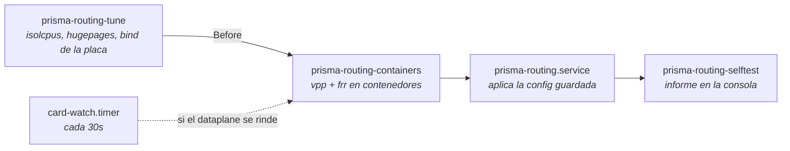
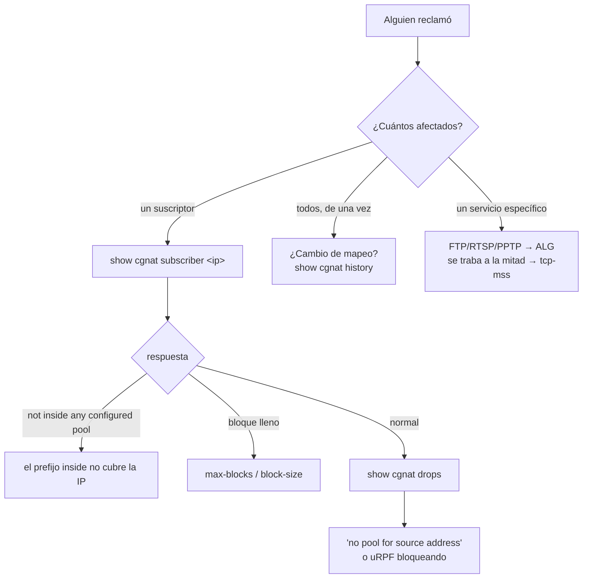

# Operación y diagnóstico

Las reglas que evitan incidentes, el orden en que la máquina arranca, y por dónde empezar cuando alguien reclama. Para quien tiene el equipo en producción.

# Reglas que evitan incidentes

## Qué placa toma el dataplane, y cuál queda con Linux

DPDK le quita la NIC a Linux: la placa que toma el dataplane deja de existir para el sistema, y lo que llegaba al equipo por ella pasa a llegar por el par que el dataplane mantiene del lado de Linux.

Sin que nadie configure nada, el equipo toma **todas** las placas de red que tiene, menos **una reservada a Linux** — la de la red de gestión que se indicó en la instalación; quien respondió `none` allí, que es el valor por defecto del instalador, no reservó ninguna. La reserva nunca se queda con la última placa: en un equipo de una sola placa, esa placa va al dataplane, y la dirección de gestión va junto con ella al par del lado de Linux, con la misma MAC y el mismo gateway. `show hardware` indica qué placas tomó el equipo, cuál lleva la ruta por defecto, y por qué.

El camino de vuelta — dirección, MAC y gateway — se lee **de la propia placa, en el arranque que la toma**, antes de que salga de Linux. Una placa cuyo camino de vuelta no puede leerse **no se toma**. Y si el dataplane no logra arrancar, el equipo devuelve las placas al driver del kernel por sí solo.

Para elegir la placa a mano — en una máquina con varias placas, en la que solo una lleva suscriptores —, indique cuál en `system` > `dataplane`:

```
configure
system
dataplane
interface enp2s0
commit
```

La placa nombrada se toma **sin importar la ruta que lleve**, y pasa a ser la única. Ya no hay rechazo en el prompt por ser la placa por la que usted está conectado: el equipo nuevo se configura en la consola, y es allí donde se toma esa decisión. `no interface`, en el mismo lugar, devuelve la elección al equipo — la regla automática de arriba.


:::warning
**El** `**commit**` **guarda la elección y no reinicia el dataplane.** La placa cambia de dueño en el próximo arranque, o con `system dataplane restart` — ambos cortan el reenvío por algunos segundos y descartan el bloque de puertos de todos los suscriptores. El propio `commit` indica si la placa elegida es la que lleva su sesión. Elija la ventana.

:::

## Un cambio remoto va con red de seguridad

```
commit confirmed 5
```

Aplica ahora y se deshace solo en 5 minutos si usted no confirma. Si el cambio corta su propio acceso, la máquina se recupera.

El plazo es del **equipo**, no de la sesión: salir de la VTY, perder el SSH, cerrar la consola o reiniciar la máquina no cancela la reversión. Solo `commit` la cancela. Y tres cambios se convierten en `commit confirmed 10` aunque usted no lo pida — cualquier cosa en `ssh`, cualquier cosa en `user`, y un `commit cutoff` —, porque son los que pueden cortar la sesión en la que usted está escribiendo.

Entregar al dataplane la placa por la que se alcanza el equipo **no** está entre ellos: el equipo lee el camino de vuelta de la placa en el arranque que la toma, y no hay ventana alguna para confirmar esa entrega. **Un procedimiento que indique reiniciar, volver a entrar y escribir** `**commit**` **para conservar la placa ya no vale**, y el `commit` adicional no hace nada.

## `commit` no es `save`

`commit` hace que valga ahora. `save` graba en disco. Una configuración con commit y sin guardar **desaparece en el próximo arranque**.

## Antes de tocar el prefijo de un pool

```
show configuration compare    qué cambia
commit check                  valida sin tocar el equipo
commit                        aplica, o rechaza si hay re-mapeo
```

El `commit check` informa el re-mapeo: la cuenta exacta y dos suscriptores de ejemplo, sin tocar el equipo. Si aparece, usted va a tirar las sesiones de todos los suscriptores de ese pool al aplicar. Eso es lo esperado — pero tiene que ser una decisión, con ventana. El `commit` común rechaza el cambio hasta que se pida por su nombre, con `commit remap`.

## Recuperar un equipo que quedó inalcanzable

Si el dataplane tomó la placa por la que se administraba el equipo y el camino de vuelta no funcionó, el equipo salió de la red en el instante en que arrancó el dataplane. Desde la consola, apunte el dataplane a la placa de los suscriptores, y solo a ella:

```
prisma> configure
prisma# [edit] system
prisma# [edit system] dataplane
prisma# [edit system / dataplane] interface enp2s0
prisma# [edit] commit
prisma# [edit] exit
prisma> save
```

Con una placa nombrada, todas las demás quedan con Linux. **Después reinicie** — o use `system dataplane restart`, que devuelve todas las placas al kernel, rehace la elección y vuelve a arrancar el dataplane.


:::warning
Reiniciar no es exceso de celo: el `commit` solo guarda la elección, porque cambiar la placa de dueño corta el reenvío y el bloque de puertos de todos los suscriptores. Quien elige la ventana es usted — y hasta entonces la placa sigue con quien estaba.

:::

Un equipo sin interfaz de dataplane parece un equipo funcionando — responde, registra logs y acepta configuración, solo que no reenvía. Por eso el self-test dice que no tiene interfaz de dataplane y dice qué escribir para darle una.

## El autotest de arranque dice que la placa fue entregada y nada lleva la dirección

Cuando el dataplane toma la placa por la que se alcanza el equipo - en un equipo de una sola placa, es lo que ocurre sin que nadie lo pida -, el equipo lee de esa placa, en el mismo arranque y antes de sacarla de Linux, el camino de gestión que va a necesitar de vuelta: la dirección con la máscara, la MAC y el gateway. Esa dirección vuelve al par `linux_cp` de la interfaz, y la ruta por defecto a Linux detrás de él. Es por ese par que el equipo pasa a ser alcanzable.

Si el par no existe, no hay adónde volver la dirección. El equipo arranca reenviando y **sin que nadie pueda llegar a él** - solo por la consola, en el lugar donde está. El autotest de arranque lo dice en la consola, en cada arranque, y lo dice como falla y no como advertencia:

```
  [FAIL] this box handed its only card over and NO pair carries the address
        The card this box is reached on was given to the dataplane, and the
        linux_cp pair is where the address the box answers on goes back.
        Without one it comes up forwarding and unreachable from anywhere but
        its console.
        the way back it computed on this boot: ens18 192.0.2.10/24
        52:54:00:00:00:01
        without a pair: ens18
        give each one an 'interface' block in prismash, and commit:
        the block pairs it under its own name.
```

La línea del camino de gestión es la que interesa primero: es la dirección que tenía el equipo, y quien está en la consola no tiene otro lugar de donde sacarla. La corrección es darle al puerto un bloque `interface`: la placa lleva en el dataplane el nombre que tenía en Linux, y cualquier bloque para ella crea el par con ese mismo nombre. `linux-name` solo hace falta para elegir otro:

```
configure
interface ens18
 no shutdown
 exit
commit
```

Después `exit` y `save`. El `save` no es opcional aquí: sin él el par desaparece en el próximo arranque y el equipo vuelve al mismo lugar.


:::info
Un equipo que **no** entregó ninguna placa y **no** corre protocolo de enrutamiento sigue recibiendo solo una advertencia por no tener par - `[warn] no linux_cp pair on:`. No está roto: reenviar CGNAT sin protocolo de enrutamiento es una configuración legítima de este producto, y una verificación que quedara en rojo en él sería una verificación que todo el mundo aprende a ignorar.

:::

## Murió un disco debajo del espejo de los registros

En un equipo instalado con los registros en dos discos, la muerte de uno de ellos **no tira nada**: el volumen sigue montado, la grabación continúa, el equipo sigue reenviando. Solo avisa el autotest de arranque, y avisa en cada arranque:

```
  [FAIL] the records mirror is DEGRADED: 1 of 2 disks (vda3)
```

Esto es visita al sitio, aunque el equipo esté funcionando: lo que queda es una sola copia, y la próxima falla pierde el año entero. Quien quiera verificar sin esperar al próximo arranque:

```
cat /proc/mdstat
```

`[2/2] [UU]` son los dos discos; `[2/1] [U_]` es uno solo.

Después de cambiar el disco, particiónelo y devuelva la partición al arreglo:

```
printf 'label: gpt\n,,R\n' | sfdisk --wipe=always /dev/<disco nuevo>
mdadm --add /dev/md0 /dev/<disco nuevo>1
```

La copia se reanuda sola y el autotest de arranque pasa a decir `REBUILDING` con el porcentaje - eso es la corrección ocurriendo, no un defecto. Cuando termina, vuelve a `[ ok ] records mirrored on 2 disks`.


:::info
**¿Murió el disco del sistema, y no el del espejo?** El equipo no arranca solo - es reinstalación. Los registros del disco sobreviviente siguen siendo legibles en otra máquina: monte su partición en cualquier Linux con `mdadm --assemble --run /dev/md0 /dev/<partición>` y luego `mount /dev/md0 /mnt`. No se pierde nada por no tener el otro disco.

:::

## El autotest de arranque dice que las claves SSH no se generaron en este equipo

En cada arranque el autotest compara las claves de host del SSH con el sistema de archivos en el que están guardadas. Un archivo no puede tener contenido más antiguo que él mismo: si las claves son más antiguas que el sistema de archivos, no nacieron en este equipo — vinieron listas, dentro de la imagen del sistema. En ese caso el autotest avisa, y avisa como falla:

```
  [FAIL] the ssh host keys were not generated on this box
```

Esto importa porque una clave de host que vino lista de afuera es la misma en todo equipo instalado desde ese medio, y su mitad privada está dondequiera que esté el medio. Quien tenga esa mitad puede hacerse pasar por este equipo en una sesión SSH, **y el cliente de quien administra no se queja**: la huella digital que guardó es exactamente la que recibió.

La corrección es que el equipo genere las suyas. En la consola:

```
rm /etc/ssh/ssh_host_*_key /etc/ssh/ssh_host_*_key.pub
ssh-keygen -A
systemctl restart ssh
```


:::warning
**Después de esto, toda máquina que ya tenía este equipo en el** `**known_hosts**` **va a rechazar la próxima conexión** y decir que la clave del host cambió. Eso es la corrección ocurriendo, no un ataque — y es su precio. En cada máquina que administra el equipo, borre la entrada antigua con `ssh-keygen -R <dirección del equipo>` y verifique la huella digital nueva en la primera conexión, leyéndola en la consola del equipo: es el único lugar donde no puede haber sido cambiada en el camino.

:::

Cuando las claves son del propio equipo, la línea es otra y no pide nada:

```
  [ ok ] the ssh host keys were generated on this box, not handed to it
```

### Lo mismo aparece al entrar al equipo

El informe del autotest de arranque se escribe en la consola, en el arranque. Un equipo en rack se alcanza por SSH, y nadie está mirando esa consola - entonces el equipo repite la advertencia en el banner, cada vez que alguien entra a la VTY, exactamente en los equipos en los que es cierta:

```
This box's ssh host keys were not generated on it:
    ssh_host_ecdsa_key ssh_host_ed25519_key ssh_host_rsa_key
    they came in with the system image, so every box installed from that
    medium answers with this same key and the private half of it is in the
    published download. This ssh session can be impersonated and your client
    will not object, because the fingerprint it pinned is the fingerprint it
    was handed.
regenerate them, in a shell on this box ('start shell'):
    rm /etc/ssh/ssh_host_*_key /etc/ssh/ssh_host_*_key.pub
    ssh-keygen -A
    systemctl restart ssh

    every client that pinned the old fingerprint will then refuse to connect
    and report that the host key changed. That is this being fixed, not an
    attack, and it is the cost of fixing it.
```

En un equipo que generó sus propias claves el banner no dice nada al respecto. Y la respuesta se mide en cada login, no se recuerda del último arranque: después de regenerar, la advertencia desaparece en el login siguiente, sin necesidad de reiniciar el equipo.

Hay dos líneas vecinas más, que no quieren decir lo mismo:

* `[FAIL] no ssh host keys in /etc/ssh: sshd cannot start` — no existe ninguna clave. El SSH no arranca y el equipo solo es alcanzable por la consola; `ssh-keygen -A` seguido de `systemctl restart ssh` lo resuelve.
* `[warn] cannot tell where these ssh host keys were made` — el sistema de archivos no registra cuándo se creó cada archivo, así que no hay con qué comparar. No es un defecto y tampoco es un aval.

## El autotest de arranque dice que archivos de este equipo no son de la versión que informa

La primera línea del autotest de arranque, y la respuesta de `show version`, es la versión del equipo. Esa línea es una única frase sobre unos treinta archivos: el intérprete de comandos, el plugin del plano de datos, las utilidades, las unidades de servicio y los documentos instalados. Cuando la instalación termina, deja junto a la versión la lista de lo que puso en el equipo, con una suma de verificación para cada archivo. En cada arranque el autotest rehace esas sumas y compara.

Con todo en orden, es una sola línea:

```
  [ ok ] all 31 files of that build are the ones it shipped
```

Cuando algún archivo no coincide, el autotest dice cuáles:

```
  [FAIL] 1 file(s) on this box are not from 0.72.0 (beefcaf):
          usr/bin/prisma-routing-tune
```

Esto ocurre de tres maneras, y todas son comunes: alguien copió un archivo de otra versión al equipo (en general para probar una corrección, y después quedó), una instalación se detuvo a la mitad, o una actualización pasó por parte del equipo y no por el resto. En cualquiera de los tres casos el equipo sigue funcionando y sigue reenviando, y por eso la línea importa: sin ella, la versión informada se sigue leyendo como verdad, y todo diagnóstico a partir de ahí se hace contra las notas de otra versión.

La corrección es instalar de nuevo, completa, la versión que informa el equipo. La página **Llevar el equipo a una versión nueva** describe el procedimiento y lo que cuesta. Si fue usted quien puso el archivo allí a propósito, esa línea es el equipo recordándole que sigue allí.


:::info
**Los tres archivos de configuración nunca aparecen en esa lista.** `tune.env`, `vpp-base.conf` y `prisma-routing.conf` se escriben una única vez, en la primera instalación, y a partir de ahí son suyos: ni la actualización los reemplaza, ni el autotest opina sobre su contenido. Editar el `tune.env` es el archivo cumpliendo su función, no un defecto, y una verificación que se quejara de eso sería una verificación que nadie dejaría activada.

:::

Hay dos líneas vecinas más, y ninguna de las dos acusa al equipo de nada:

* `[warn] no /usr/share/prisma-routing/MANIFEST, so nothing checked that line`: la lista no está. Toda instalación deja una, así que o fue borrada, o la instalación no llegó al final. No se midió nada, que es distinto de que nada esté mal.
* `[warn] /usr/share/prisma-routing/MANIFEST names no files, so it checked nothing`: la lista está y está vacía. Misma lectura: no se comparó nada.

# Servicios y orden de arranque

**Desde la 0.117.0 el dataplane y el enrutamiento corren en contenedores.** El equipo instalado habilita `prisma-routing-containers.service` y deshabilita `vpp.service` y `frr.service` — los tres no pueden correr juntos, porque se disputan los mismos sockets, las mismas hugepages y la misma placa.



| Servicio | Función |
|----------|---------|
| `prisma-routing-tune` | tuning de arranque (isolcpus, hugepages); corre en **cada** arranque, sin centinela |
| `prisma-routing-containers` | levanta el dataplane, el enrutamiento y el plano de gestión (la VTY) como contenedores |
| `prisma-routing-doors` | ejecuta en el host lo que pide la VTY (cuentas, sshd, SNMP, reboot); solo para root, cada pedido se convierte en una línea en el journal |
| `prisma-routing-card-watch.timer` | detecta un dataplane que Docker dejó de intentar reiniciar, anota el motivo y devuelve la placa al kernel |
| `prisma-routing-backplane` | la red interna propia de los contenedores, en una VRF separada, que no se filtra a la tabla principal |
| `prisma-routing.service` | aplica la configuración guardada (`prismash --load`) |
| `prisma-routing-selftest` | verifica e informa en la consola |

**La VTY corre en el contenedor de gestión** (`prisma-routing_mgmt_1`). El login cae en ella con el propio usuario y los propios grupos, así que el rol de cada cuenta es el mismo de antes. El contenedor solo tiene una red interna propia, que alcanza el host y nada más allá de él, y lee del host, en solo lectura, lo que la VTY necesita saber del equipo: las placas, las rutas, los núcleos, si el equipo está en el medio de instalación. Lo que actúa en el host pasa por el host: `ping`, `traceroute` y `mtr` salen por la red del host; `install`, `system upgrade` y `system dataplane restart` corren en la VTY del host, en la misma terminal; `start shell` abre un shell en el host, y solo para `root` y para cuentas con el rol `administrator` - cualquier otra cuenta recibe el rechazo, y un comando que pase por `ssh` lo ejecuta la VTY, con su rol, y no un shell. Si el contenedor no está en línea, la VTY corre en el host, y nadie queda bloqueado afuera. Para volver la VTY al host en un equipo: `touch /etc/prisma-routing/vty-on-host`.

```
docker ps --format "{{.Names}} {{.Status}}"
```

En un equipo sano, la lista trae los tres contenedores — `prisma-routing_vpp_1` (el dataplane), `prisma-routing_frr_1` (el enrutamiento) y `prisma-routing_mgmt_1` (la VTY) — todos `Up`.

Antes de que compose vea el archivo, la unit hace tres cosas, y cada una existe porque un equipo que se saltó esa etapa arrancó mal:


1. **carga las imágenes** que trajo el medio (`/usr/lib/prisma-routing/images.tar.gz`) y escribe la tag encontrada donde compose la lee — sin eso el equipo le pediría una imagen a un registry, y un appliance no tiene ruta hacia ninguno;
2. **escribe el nodo de device de la placa** que vinculó este arranque, porque cuál nodo es depende del driver que el equipo logró usar;
3. después de arrancar, **entrega el segmento de la API binaria al grupo** `vpp`, que es lo que permite que una cuenta de operador configure el equipo.

### Cuando el dataplane se rindió

El dataplane en contenedor intenta arrancar cinco veces. Después de eso Docker se rinde, y cada 30 segundos el vigilante verifica: si encuentra el dataplane detenido, **anota por qué** — el estado del contenedor, el código de salida y las últimas ochenta líneas que escribió el dataplane — en `/var/log/prisma-routing/why-the-dataplane-stopped`, y solo entonces devuelve la placa al kernel, una vez por arranque.

Ese archivo es lo primero que hay que leer en un equipo que arrancó sin reenviar. Reiniciar el equipo borra el log del contenedor, y el archivo queda justamente porque reiniciar es lo primero que hace cualquiera. Cuando existe, la VTY y el autotest de arranque apuntan a él en lugar de mandar a consultar el log del contenedor, que en ese equipo está vacío.

Dos decisiones que vale la pena entender:

* **Ninguna unit “arrastra” un dataplane.** `Requires=` y `Wants=` *inician* lo que nombran: en un equipo con contenedores eso levantaría un segundo dataplane al lado del que está corriendo. Lo que existe es `After=`, que solo ordena.
* **No existe** `**ExecStop**` **que borre configuración.** La configuración vive en VPP. Detener el servicio **no** borra pools de producción — eliminar un pool es una acción del operador, desde la VTY.

### Volver a las units

Dos comandos, y el equipo sigue respondiendo por la placa después de ellos:

```sh
systemctl disable --now prisma-routing-containers.service
systemctl enable --now vpp.service frr.service
```

Estos dos comandos se recorren en cada release, en un equipo instalado de verdad, que después se verifica: vuelve a responder por la placa y vuelve a aplicar la configuración guardada en el arranque. Un camino de vuelta que nadie recorrió no es un camino de vuelta.

`prisma-routing.service` espera a que el dataplane **acepte comandos** antes de aplicar configuración: el contenedor se crea antes de que el VPP dentro de él esté sirviendo — y, en las units, systemd considera iniciado el `vpp.service` apenas arranca el proceso. En ambos casos el socket de la CLI y los plugins tardan un poco más, y aplicar antes de eso falla de forma intermitente.

Esa espera **se explica en la consola**, que es donde está la persona:

```
waiting for the dataplane to accept commands
(VPP is up; its CLI socket and plugins take a moment longer)
still waiting: 5s of at most 60s
the dataplane answered after 5s
```

Tres desenlaces, dichos de formas distintas: una espera lo bastante corta para que nadie la note **no dice nada**; una que termina normalmente **no deja advertencia**; y un agotamiento del tiempo dice lo que costó — *la configuración de CGNAT NO fue aplicada*.


:::info
El límite de 60 segundos es generoso a propósito: el VPP responde en 5 a 21 segundos en una VM sin hugepages y con un worker, y un equipo con 32 GB de hugepages y dieciséis workers tarda más.

:::

El tuning corre en cada arranque justamente para que un cambio en `tune.env` o un cambio de NIC se respete.

### `rx queues`: lo que la placa abrió, y no solo lo que se pidió

El autotest de arranque lee, del dataplane en ejecución, cuántas colas de recepción abrió realmente cada placa, y lo compara con lo que el ajuste de arranque pidió para esa placa:

```
  [ ok ] rx queues: 1 of 1 on ens9, as requested (1)
```

`1 of 1` es lo que la placa abrió y el máximo que tiene; el nombre es el que el dataplane le da a la placa, que es el nombre que tenía en Linux. Cuando lo abierto difiere de lo pedido, la línea se convierte en advertencia y dice por qué importa:

```
  [warn] rx queues: 1 of 1 on ens9, 4 requested
         the tuner asked for one queue per worker, capped at
         what the card reported, and the dataplane opened 1:
         at most 1 worker(s) receive from this card, and the
         other workers receive nothing from it.
```

El ajuste de arranque dimensiona los workers según el procesador y pide una cola por worker, limitado a lo que informó la placa. Cada cola se entrega a un worker: una placa con menos colas que las pedidas entrega las que tiene, solo ese número de workers recibe de ella, y los demás no reciben nada de esa placa. El equipo reenvía, pero con una fracción de lo que podría hacer el procesador.

Hay un caso peor: el driver rechaza la placa y no abre ninguna cola, aunque el dataplane todavía liste la cantidad con la que fue configurada. El autotest lee el estado del driver junto con la cantidad y lo trata como falla, no como cola abierta:

```
  [FAIL] rx queues: none opened on ens9
        'show hardware-interfaces' marks the card pmd-init-fail, so the
        1 of 1 it lists were configured and never opened:
        the driver refused the port and the card carries no
        traffic. 'journalctl -u vpp' has the driver's reason.
```

Esa misma placa aparece como interfaz en estado `error`, algunas líneas más abajo.

La palabra `requested` queda solo para el equipo en el que no se pudo leer nada. El número es lo que se **pidió**, y la línea de abajo dice que es solo eso:

```
  [ ok ] rx queues requested: num-rx-queues 4
         what the dataplane opened could not be read: it is not
         answering, so the count in effect is unknown on this box.
```

En un equipo que no entregó ninguna placa al dataplane, y por eso no pidió nada, la línea lo dice por extenso en lugar de salir vacía:

```
  [ ok ] rx queues requested: default (1 per interface, one worker takes all)
         the dataplane holds no card that reports its queues, so
         there is no count in effect to read back.
```

En ese mismo arranque, lo que el equipo **pidió** y lo que **recibió** se verifican uno contra otro — y lo que se lee de vuelta es lo que el **kernel** está haciendo, no lo que pidió el archivo generado. Un parámetro puede perderse en tres lugares: el `update-grub` no corrió, el equipo no se reinició desde entonces, o el kernel lo vio y lo rechazó. Un appliance que se dice ajustado cuando el kernel no aceptó el parámetro es peor que uno que no dice nada.

Son **cuatro** respuestas por regla, y ninguna se confunde con otra:

| Línea en el autotest | Qué significa |
|----------------------|---------------|
| `[ ok ] every tuning rule this box can read back is in effect (2)` | todo lo que se podía verificar está vigente, y dice cuántas reglas fueron |
| `[warn] requested and NOT in effect: isolcpus` | se pidió y el kernel no lo está haciendo. La línea de abajo dice qué está haciendo en su lugar |
| `[info] cannot be read on this box: nohz_full` | este equipo no expone forma de leer si se aplicó. No es "se aplicó" ni "no se aplicó" |
| `[info] not requested on this box: 99-prisma-routing.conf` | nadie pidió ese ajuste aquí. Un equipo deliberado no puede tener la cara de un equipo roto |

Medido en un equipo cuyo kernel rechazó el aislamiento:

```
  [warn] requested and NOT in effect: isolcpus
         cpu(s) 1-3 were asked for and the kernel is not isolating them
```

La línea verde **no sale** al lado de una regla rechazada: un equipo con la mitad del ajuste en el suelo no es un equipo ajustado. Y dos reglas caen en `cannot be read` en hardware real — el `rcu_nocbs`, que no tiene lectura fuera de un debugfs solo de root, y la lista de CPUs del `irqbalance`, que queda en el entorno del daemon.

Otras tres líneas vale la pena reconocer en la consola:

| Lo que aparece | Qué significa |
|----------------|---------------|
| `deep C-states left enabled on purpose` | usted puso `PRISMA_LOW_LATENCY=0` y el equipo está haciendo lo que se le indicó. No es advertencia |
| `booted a command line older than that file` | `tune.env` se editó y el equipo todavía no se reinició desde entonces. Reinicie para que tenga efecto |
| `the kernel exposes no idle-state driver` | en una máquina virtual no hay estado de energía que desactivar, así que ese ajuste no cambia nada allí |

Un valor que el equipo no acepta en `tune.env` también aparece ahí, con los valores que sí acepta en su lugar. Lo que acepta cada variable está en *Dimensionamiento y requisitos*.

### Cuando se perdió toda la línea de arranque, es **una** línea

Si el archivo generado pide once parámetros y el arranque no trajo ninguno, eso es un solo hecho sobre el equipo — el `update-grub` no corrió, o no se reinició desde entonces — y no once hechos. El autotest lo dice una vez:

```
  [warn] requested and NOT in effect: the kernel command line
         the generated file asks this boot for 11 parameter(s) and it carries
         none of them: update-grub has not run since that file was written, or
         the box has not rebooted since. Run update-grub and reboot
```

Once copias de la misma frase en una consola de ochenta columnas son veintidós líneas empujando todo lo demás fuera de la pantalla, y una pantalla que no cabe es una pantalla que nadie lee.

### Y cuando el propio verificador no está

Dos líneas separan *"el ajuste no se aplicó"* de *"nadie pudo verificar"*:

| Línea en el autotest | Qué significa |
|----------------------|---------------|
| `[warn] prisma-routing-tune is not on this box, so what the kernel did with the tuning cannot be read here at all` | no hay verificador en este equipo. No se midió nada |
| `[warn] prisma-routing-tune could not say what tuning is in effect, so this box is unmeasured rather than confirmed` | el verificador está y no respondió. Tampoco se midió |

Ninguna de las dos dice que el ajuste está vigente, y ninguna dice que no lo está. Un equipo **no medido** y un equipo **verificado y bueno** no pueden tener la misma cara en la pantalla, que es lo que una ausencia de línea haría con los dos.

Existe además una quinta respuesta que un equipo entregado no debería ver:

```
  [warn] no way to read back a parameter this box sets: <parámetro>
```

Quiere decir que el equipo escribe un parámetro para el que no existe lectura de vuelta — o sea, algo que pide y nunca va a poder verificar. Si aparece, lo que está pasando es que el equipo ganó un ajuste nuevo sin ganar su verificador.

# Diagnóstico



## Por dónde empezar

| Pregunta | Comando |
|----------|---------|
| "este suscriptor no navega" | `show cgnat subscriber <ip-interna>` |
| "se están perdiendo paquetes" | `show cgnat drops` |
| "¿de quién era esta IP:puerto?" | `show cgnat translation <ip> <puerto>` |
| "¿se va a llenar el pool?" | `show cgnat top` |
| "¿cuántas sesiones, por hilo?" | `show cgnat session` |
| "¿el colector está recibiendo?" | `show cgnat logging` |
| "¿qué pasó en el equipo?" | `show log` |
| "¿quién hizo commit, y desde dónde?" | `show log source vty` (o `source api`) |
| "¿por qué se reinició el dataplane?" | `show log source dataplane`, y la línea `started by:` de `show system uptime` |
| "¿se cayó este puerto? ¿cuándo, y cuántas veces?" | `show log kind link` |
| "¿por qué se cayó la sesión BGP?" | `show log kind bgp` (el motivo de FRR) y `show log kind bfd` |
| "¿quién entró al equipo, y quién se equivocó de contraseña?" | `show log kind login` |
| "¿se agotó el pool?" | `show log kind pool` |
| "¿qué ya estaba mal cuando arrancó el equipo?" | `show log` — las líneas `standing at start:` de la primera lectura del arranque |
| "quiero ver los eventos llegando" | `monitor log` (los mismos filtros; Ctrl-C para detener) |
| "¿los eventos están llegando a mi syslog?" | `show system logging` |
| "¿quién cambió el pool, y cuándo?" | `show cgnat history` |
| "¿qué estoy a punto de aplicar?" | `show configuration compare` |
| "¿qué versión es esta máquina?" | `show version` |
| "¿qué daemons de enrutamiento están en pie?" | `show version` |
| "¿se cayó el puerto o alguien hizo shutdown?" | `show interface terse` |
| "¿para qué sirve este puerto?" | `show interface description` |
| "¿el enlace está lleno?" | `show interface utilization <nombre>` |
| "¿cuánta luz llega a este puerto? ¿el módulo está bien?" | `show interface <nombre> transceiver` |
| "¿caben más sesiones en la memoria del CGNAT?" | `show cgnat memory` |
| "¿qué ALGs están vigentes?" | `show cgnat alg` |
| "¿el trail de configuración fue adulterado?" | `show cgnat history verify` |
| "¿qué placas tiene el equipo, y cuál tomó?" | `show hardware` |
| "¿qué núcleos hacen qué?" | `show system cpu` |
| "¿qué tan ocupado está cada núcleo? ¿hay steal?" | `show system cpu cores` |
| "¿cómo está dividida la memoria?" | `show system memory` |
| "¿el agregado LACP está completo?" | `show lacp` |
| "¿el equipo alcanza este destino?" | `ping`, `traceroute` o `mtr` |

## Síntomas conocidos

| Síntoma | Causa probable |
|---------|----------------|
| Adyacencia OSPF trabada en Exchange | MTU heredada del TAP (el valor por defecto del equipo, 1500; 9000 en un equipo instalado antes de la 0.152.1). Ajuste con `mtu` dentro de `interface` |
| Un lado se queja de caída y la configuración está en pie | `show interface terse`: `Admin up` con `Link down` es cable, transceiver o el otro lado |
| `show interface` anota errores de CRC en un puerto | fibra sucia o dañada, conector, o uno de los módulos: compare la potencia de RX de `show interface <nombre> transceiver` con la de TX del otro lado (abajo) |
| `show interface` anota `rx power ... below its low warning` | llega poca luz: fibra, conector, un tramo demasiado largo, o el láser del otro lado |
| FTP/RTSP/PPTP conectan pero la transferencia no empieza | ALG correspondiente desactivado en el pool |
| Las conexiones se traban sin error, en ciertos caminos | MSS no reducido — configure `tcp-mss auto` |
| Suscriptor sin traducción y el pool no se llena | su prefijo está cubierto por un `bypass source` |
| El servicio no arranca en el primer arranque | ver `prisma-routing.service`; el self-test imprime su último mensaje |
| El autotest de arranque dice `the records mirror is DEGRADED` | murió uno de los dos discos de registros; el equipo funciona, la retención está pendiendo de un hilo |
| Todo se cayó al mismo tiempo, sin alarma | cambio de mapeo aplicado con `commit remap` |
| `show bgp` (u `ospf`, o `isis`) no responde | `show version` nombra los daemons detenidos; uno detenido recibe configuración y no llega a ningún lado |
| El equipo arrancó, enruta y no reenvía; `show interface` sin las placas | el dataplane se rindió al intentar arrancar: lea `/var/log/prisma-routing/why-the-dataplane-stopped` |
| La sesión BGP se cayó y volvió sin que nadie lo viera | `show log kind bgp`: cada caída con el motivo de FRR, y `went down and came back between two readings` cuando cayó y volvió entre dos lecturas |
| Puerto que se cayó y volvió demasiado rápido para que alguien lo viera | `show log kind link`: `went down and came back between two readings (N time(s))` — el dataplane cuenta cada caída de link del puerto, y Linux, las de las placas que quedaron con él; la caída se registra aunque las dos lecturas hayan visto el link en pie |
| El módulo de la placa de gestión (la que quedó con Linux) | `show log kind transceiver`: módulo insertado, retirado, luz por debajo de la advertencia, con la placa nombrada `(held by Linux)` y origen `host`; una placa virtio, que no tiene módulo, no genera ningún evento |
| El equipo quedó sin placas después de un reinicio | `show log kind gave-up`: el dataplane abandonado, o el `system dataplane restart` que no terminó, y por qué |
| Todos los suscriptores PPPoE se cayeron juntos | `show log kind exit`: el plano de control PPPoE se detuvo, y por qué (el código, la señal, un commit); `show log kind start` dice quién lo volvió a levantar |
| `show system uptime` dice `restarted after the boot` | `show log source dataplane` dice la causa: un `system dataplane restart` (de quién), una actualización, o `unexpected` — nadie lo pidió, y `why-the-dataplane-stopped` suele tener el motivo |
| Sesiones nuevas rechazadas con el equipo en pie | `show cgnat memory`: la memoria del CGNAT se llenó, y el equipo rechaza en lugar de caerse. `memory` en `nat` > `cgnat` da más, a partir del próximo arranque |
| El suscriptor no alcanza el propio equipo (gateway, DNS, SSH) | las versiones anteriores a la 0.136.1 traducían el tráfico hacia las direcciones del equipo; actualice |

## Errores de CRC en un puerto óptico

Un error de CRC es una trama que llegó corrupta. En un puerto óptico, casi siempre es la capa física: fibra sucia, doblada o dañada, conector mal encajado, o un módulo al final de su vida útil — de este lado o del otro. Así nació este diagnóstico: un puerto del X520 contando el 0,58% de las tramas con error de CRC, y nadie podía leer la potencia óptica del lado del equipo para compararla con la del switch.


1. `show interface` muestra la nota cuando la tasa supera el 0,01% desde que empezaron los contadores.
2. `show interface <nombre> transceiver` da la potencia de RX de **este** lado, y la de TX. En el switch del otro lado, `display transceiver interface <puerto> verbose` (Huawei) o `show interfaces diagnostics optics <puerto>` (Junos) da las suyas.
3. Compare: la RX de un lado debe ser la TX del otro menos la pérdida del enlace (fibra y conectores, algunos dB en un enlace corto). Una RX muy por debajo de la TX del otro lado es pérdida en el camino — limpie y vuelva a encajar los conectores, cambie el patch cord. RX normal en ambos lados con CRC que continúa apunta a uno de los módulos.
4. El estado de cada línea dice si el propio módulo considera el valor fuera de rango: `low warn` antes de `low alarm`.

La lectura no detiene el reenvío: no hace falta devolver la placa a Linux para usar `ethtool -m`, que era el único camino antes de la 0.151.15 y tiraba el dataplane. El mismo valor va por SNMP (`prTransceiver`, con ítems y triggers en la plantilla de Zabbix) y por la API (`ListTransceivers`).

## Dos trampas de diagnóstico

**La CLI de texto del dataplane sale con código 0 incluso cuando falla.** Por eso la VTY no habla con el dataplane por texto: usa la API binaria, que responde si salió bien. Nada en esta wiki le pide que baje hasta allí, y el código de retorno que vería allí no prueba nada.

**Un contador no es evidencia.** Un ALG incrementa su contador haya salido bien la reescritura o no. Verifique el paquete, no el contador.

# Ausencias conocidas

No las reporte como falla — son decisiones registradas:

* **Sincronización de sesiones en el failover** — rechazada por costo. El par activo/standby existe y preserva la dirección pública y el bloque de puertos; las conexiones en curso se caen, como en cualquier NAT.
* **Cifras de throughput** — los bits por segundo no se midieron en una placa que DPDK controle de forma nativa. Lo que **sí** se midió es cuánto le cuesta un paquete a los nodos de traducción, en ciclos de CPU. Cualquier cifra en bit/s no está verificada.
* **Log por flujo** — rechazado por diseño.
* **Migración gradual de pool** — daría dos mapeos para un suscriptor, y la aritmética inversa no sabría distinguirlos, renunciando exactamente a la propiedad que el modo determinístico existe para proveer.

# Ver también

* [Comandos show](/s/wiki-es/doc/comandos-show-yfCeHVInDX) — la referencia de cada comando de diagnóstico
* [Monitoreo y SNMP](/s/wiki-es/doc/monitoreo-y-snmp-zQ9bTfrh8z) — los mismos números en la NMS
* [Recetas del día a día](/s/wiki-es/doc/recetas-del-dia-a-dia-maiZboGbqY) — la corrección, después del diagnóstico
