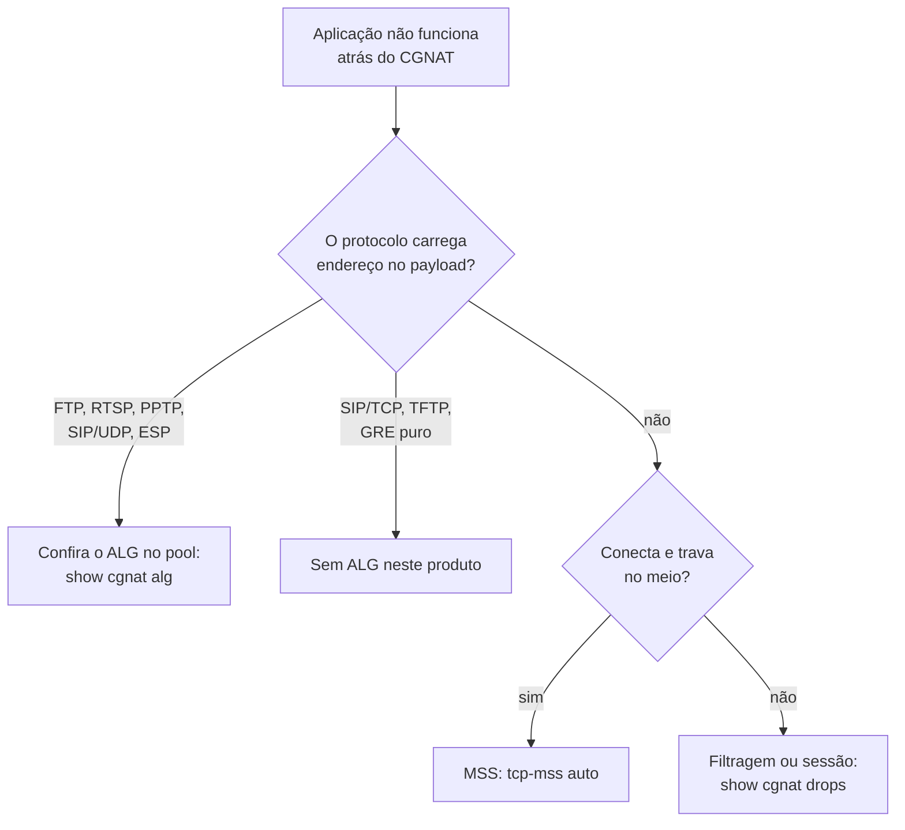

# Protocolos e ALGs

Quais protocolos atravessam este CGNAT sozinhos, quais precisam de ALG, e quais **não são suportados**. Para quem está diagnosticando "funciona na LAN mas não pela internet".

# Por que alguns protocolos precisam de ajuda

Protocolo que carrega endereço ou porta **dentro do payload** quebra atrás de qualquer NAT, a menos que o NAT reescreva o payload também. O canal de controle sobe, anuncia um endereço privado para o outro lado, e a conexão de dados nunca se estabelece.

O ALG (*Application-Level Gateway*) é quem reescreve esse anúncio.

# O que está construído

Cinco, ligáveis e desligáveis por pool com `alg <nome> <on|off>`. Todos vêm **ligados**: um pool que não diz nada sobre ALG tem os cinco funcionando.

| ALG | O que reescreve | Sintoma sem ele |
|-----|-----------------|-----------------|
| `ftp` | `PORT`/`EPRT` e as respostas 227/229 | FTP funciona em modo passivo e falha em ativo — ainda comum em equipamento industrial e legado |
| `rtsp` | o `client_port` do cabeçalho Transport | câmera IP e alguns streamers: funciona na LAN, quadro preto de fora |
| `pptp` | o canal de controle e o canal de dados GRE | VPN para concentrador corporativo antigo não conecta de jeito nenhum |
| `esp` | nada do payload: só amarra o túnel ao gateway remoto | vários assinantes atrás de um endereço público não conseguem IPsec sem NAT-T |
| `sip` | `Via`, `Contact` e o SDP (`c=` e `m=`) do SIP **sobre UDP**, e abre o par RTP/RTCP | VoIP registra mas ninguém consegue ligar para o assinante, ou a chamada completa sem áudio |

O comando é para o caso contrário — desligar um que atrapalha, ou religar o que alguém desligou:

```
configure
 nat
  cgnat
   pool residencial
    alg sip off
    exit
   exit
  exit
 commit
```

`no alg sip`, no mesmo lugar, apaga a escolha e devolve aquele ALG ao padrão, que é ligado. Ajuste **aplicado no lugar**: não derruba sessão.

Para ver o que o **dataplane** está de fato aplicando — e não o que o arquivo diz —, pool a pool, com os cinco e o estado de cada um:

```
show cgnat alg
```

## Num pool NAT64: só o FTP, e desligado até você pedir

Num pool NAT64 o assinante só tem IPv6 e o servidor só tem IPv4, e o problema do FTP é outro: o cliente IPv6 fala `EPSV` e `EPRT` — não tem outra coisa para falar — e muito servidor IPv4 antigo só entende `PASV` e `PORT`. O login funciona e toda listagem trava. O `alg ftp` de um pool NAT64 é o ALG da RFC 6384, que traduz entre as duas metades:

| O cliente manda | O servidor recebe | O cliente recebe de volta |
|-----------------|-------------------|---------------------------|
| `EPSV`          | `PASV`            | a resposta `227` do servidor reescrita como `229`, só com a porta |
| `EPRT` com o próprio endereço IPv6 | `PORT` com o endereço público e uma porta do bloco do assinante | a resposta do servidor    |
| `EPSV ALL`, ou `EPSV` com outro protocolo | um `NOOP`, no lugar | `504` ou `522`, respondidos pela caixa |
| `ALGS STATUS64`, `ENABLE64`, `DISABLE64` | um `NOOP`, no lugar | `216`, com o estado da tradução |

Depois de um `AUTH` que o servidor aceita, a caixa não traduz mais nada naquela conexão: o canal de controle passou a ser TLS.

**Vem desligado**, ao contrário dos ALGs de um pool IPv4: a própria RFC 6384 recomenda ligar só onde precisa, porque com ele o `EPSV` de um servidor que entenderia o `EPSV` vira `PASV` à toa. Ligue no pool NAT64 que atende assinantes com esse problema — um pool NAT64 fica em `nat` > `nat64`, ao lado de `cgnat`, e não dentro dele:

```
configure
 nat
  nat64
   pool v6
    alg ftp on
    exit
   exit
  exit
 commit
```

**Os outros quatro são recusados num pool NAT64**, para sempre e cada um pelo nome no `commit check`: o RTSP e o SIP carregam endereços no SDP e nenhuma RFC traduz isso entre IPv6 e IPv4 — para o SIP a RFC 6157 usa ICE e relay, não um tradutor reescrevendo o corpo —, e o GRE do PPTP e o ESP não são protocolos que o NAT64 com estado carrega. O IPsec atravessa NAT64 como NAT-T, em UDP 4500, sem ALG nenhum.


:::info
O PPTP tem um problema próprio: GRE não tem portas, então o **Call ID** precisa fazer o papel que a porta faria. A reescrita não muda tamanho algum, nenhum número de sequência se move, e cada mensagem é guardada por um *magic cookie* de 32 bits e pelo próprio campo de comprimento antes de um único byte ser tocado.

:::

Dois limites do PPTP que vale conhecer: **chamada de entrada não é tratada** — o assinante discando para dentro, como concentrador, não tem mapeamento até a chamada chegar, e ela nunca chega —, e **GRE fragmentado é descartado**, porque o fragmento não traz os campos que identificam a chamada.

## O túnel que conecta e trava no primeiro arquivo

Vale conhecer o sintoma porque ele não se parece com um problema de CGNAT, e porque o assinante vai descrevê-lo de um jeito que manda o diagnóstico para o lado errado:

> "A VPN conecta normal, eu navego na intranet, mas quando eu abro um arquivo grande trava."

O que está acontecendo é **PMTUD quebrado**. Quando um roteador no caminho não consegue carregar um pacote grande, ele devolve um ICMP *fragmentation needed* dizendo o tamanho que caberia. Para TCP comum existe uma segunda rede de proteção — o *MSS clamp*, que você liga com `tcp-mss` no pool. Dentro de um túnel **não existe MSS para ajustar**: o ICMP é o único aviso que o assinante tem. Se ele se perder, pacotes pequenos passam, pacotes grandes somem, e nada em lugar nenhum reclama.

A caixa entrega esse ICMP de volta ao assinante, tanto para PPTP quanto para IPsec, e reescreve o pacote citado dentro dele — que é a metade que importa, porque é por esse pacote citado que a máquina do assinante reconhece de qual conexão o aviso fala.

**O que isso exige de você:** que o túnel esteja estabelecido *através desta caixa*. O aviso é amarrado à chamada PPTP no momento em que o servidor a aceita, e some quando a chamada é desconectada. Um túnel que subiu antes da caixa entrar no caminho não tem essa amarração até reconectar.

**Um limite honesto, e só do IPsec:** dois assinantes atrás do **mesmo endereço público** com túneis IPsec para o **mesmo gateway** não podem ser distinguidos — nenhum campo na rede os separa. O primeiro fica com a amarração; o segundo não. Para PPTP isso não acontece, porque o Call ID que o servidor entrega separa as duas chamadas. Quem cai nesse caso do IPsec é atendido por NAT-T, que é o que o CPE moderno faz sozinho.

# O SIP, em detalhe

Vale o detalhe porque é o ALG que mais gera dúvida, e porque a indústria caminhou no sentido contrário: provedores de VoIP rotineiramente pedem que o cliente **desligue** o SIP ALG do CPE, já que um ALG que interpreta o SDP errado produz áudio unidirecional e registro que cai — falhas mais difíceis de diagnosticar do que as que ele evitaria.

Ele trata o SIP **sobre UDP, na porta 5060**, e é construído em cima de uma regra só: **ele só reescreve um endereço IPv4 literal igual ao endereço privado do próprio assinante.** Tudo o mais sai como entrou. Daí saem, de graça, as três coisas que costumam dar errado:

* **Telefone que já sabe o endereço público dele** (fez STUN, ou aprendeu pelo `rport`) coloca o endereço público no `Via`, no `Contact` e no SDP. Nada disso bate com o endereço privado, então nada é reescrito — as duas travessias de NAT não brigam. É exatamente o caso que costuma virar "o ALG quebrou meu telefone".
* **Resposta que o assinante envia** carrega o `Via` de quem ligou, não o dele. O endereço não bate, então não é tocado.
* **Mensagem que ele não consegue interpretar inteira** passa **intocada** e é contada. Nunca é reescrita pela metade.

O que ele reescreve, saindo:

| Campo | Vira |
|-------|------|
| `Via` (o primeiro) | endereço público\*\*:\*\*porta pública |
| `Contact` | endereço público\*\*:\*\*porta pública |
| `c=IN IP4` do SDP | endereço público |
| `m=` do SDP | uma **porta par reservada**, com a de cima guardada para o RTCP |
| `Content-Length` | recalculado quando o corpo mudou de tamanho |

Cada par RTP/RTCP reservado espera o primeiro pacote pelo tempo do timeout `alg-expect` do pool — 60 segundos por padrão — e é liberado se nada chegar. Um corpo SDP abre no máximo quatro fluxos de mídia: uma oferta com mais é recusada inteira, em vez de mapeada pela metade. Os pares são reservados só no sentido de saída, então nada que chegue de fora consegue gastar as portas de um assinante.

Voltando, ele devolve o `Via` da **resposta** exatamente como o telefone tinha escrito — sem isso o próprio telefone descarta a resposta da chamada que ele mesmo fez.

O que ele **não** toca, de propósito: `From`, `To`, `Call-ID` (identidades, não lugares — e é por elas que o registro autentica), `Route`/`Record-Route` (são do proxy), o `o=` do SDP (identifica a sessão, não é destino) e os parâmetros `received=`/`rport=`, que são o outro lado dizendo a verdade sobre o que viu.


:::warning
**SIP sobre TCP não é tratado**, e isso é decisão, não esquecimento. Mensagem SIP em TCP é um fluxo: um analisador que enxerga um segmento não enxerga o fim da mensagem, e um INVITE com SDP passa de um segmento com frequência. Conexão TCP na porta 5060 atravessa o equipamento como qualquer outra, sem ALG nenhum. SIP sobre TLS (porta 5061) ninguém consegue tocar.

:::

# O que NÃO está construído

| Protocolo | Sintoma | Situação |
|-----------|---------|----------|
| **SIP sobre TCP/TLS** | pouco comum em CPE residencial; TLS é intocável por qualquer NAT | ausente, por decisão |
| **TFTP**  | provisionamento de alguns CPE | ausente, por decisão: não será construído |
| **GRE puro** (sem PPTP) | túnel GRE simples, sem canal de controle | não é traduzido: não tem identificador por fluxo, e vários assinantes atrás de um endereço não seriam separáveis. É descartado com contador próprio |

Deliberadamente **não** serão construídos: H.323, MGCP, SCCP, MSRPC, NetBIOS, IRC/DCC, TFTP e DNS.

# A regra que protege o tráfego

Um payload malformado ou inesperado **deixa o pacote intocado** e incrementa um contador. Nunca é reescrito na dúvida.

O motivo é direto: um ALG que reescreve um payload que interpretou errado é pior do que ALG nenhum, porque corrompe tráfego que apenas deixaria de conectar.

Por isso a verificação de um ALG olha o **pacote capturado**, e não o contador — um ALG incrementa o contador dele tendo a reescrita saído certa ou não.

Os contadores de cada ALG aparecem em `show cgnat drops`, na parte que lista tudo o mais que o CGNAT contou, só os que não estão em zero: `SIP messages rewritten` ao lado de `SIP message not understood, left untouched`, e o mesmo par para FTP, RTSP e PPTP. Um contador de "reescrito" subindo diz que o ALG está vendo o protocolo; um de "não entendido" subindo diz que existe um equipamento cujo formato ele recusa tocar.

# Diagnóstico



# Ver também

* [Comportamento NAT e compatibilidade](/s/wiki/doc/comportamento-nat-e-compatibilidade-8eYzcDTnmJ) — quando o problema é filtragem, não payload
* [Configuração de pool](/s/wiki/doc/configuracao-de-pool-btyS572Ih6) — os campos `alg` e `tcp-mss`
* [Receitas do dia a dia](/s/wiki/doc/receitas-do-dia-a-dia-IcocgdbXW2) — como ligar um ALG passo a passo
