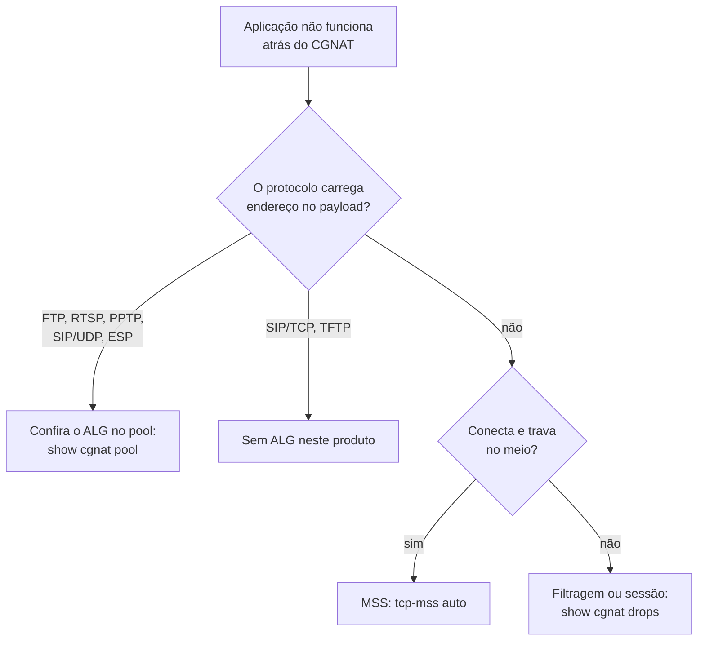

# Protocolos e ALGs

Quais protocolos atravessam este CGNAT sozinhos, quais precisam de ALG, e quais **não são suportados**. Para quem está diagnosticando "funciona na LAN mas não pela internet".

# Por que alguns protocolos precisam de ajuda

Protocolo que carrega endereço ou porta **dentro do payload** quebra atrás de qualquer NAT, a menos que o NAT reescreva o payload também. O canal de controle sobe, anuncia um endereço privado para o outro lado, e a conexão de dados nunca se estabelece.

O ALG (*Application-Level Gateway*) é quem reescreve esse anúncio.

# O que está construído

Cinco, ligáveis por pool com `alg <nome> <on|off>`. Todos vêm **ligados**:

| ALG | O que reescreve | Sintoma sem ele |
|-----|-----------------|-----------------|
| `ftp` | `PORT`/`EPRT` e as respostas 227/229 | FTP funciona em modo passivo e falha em ativo — ainda comum em equipamento industrial e legado |
| `rtsp` | o `client_port` do cabeçalho Transport | câmera IP e alguns streamers: funciona na LAN, quadro preto de fora |
| `pptp` | o canal de controle e o canal de dados GRE | VPN para concentrador corporativo antigo não conecta de jeito nenhum |
| `esp` | nada do payload: só amarra o túnel ao gateway remoto | vários assinantes atrás de um endereço público não conseguem IPsec sem NAT-T |
| `sip` | `Via`, `Contact` e o SDP (`c=` e `m=`) do SIP **sobre UDP**, e abre o par RTP/RTCP | VoIP registra mas ninguém consegue ligar para o assinante, ou a chamada completa sem áudio |

```
configure
 nat cgnat pool residencial
  alg ftp on
  alg rtsp on
  alg pptp on
  alg sip on
  exit
 commit
```

```
show cgnat pool
```

Ajuste **aplicado no lugar**: não derruba sessão.


:::info
O PPTP tem um problema próprio: GRE não tem portas, então o **Call ID** precisa fazer o papel que a porta faria. A reescrita não muda tamanho algum, nenhum número de sequência se move, e cada mensagem é guardada por um *magic cookie* de 32 bits e pelo próprio campo de comprimento antes de um único byte ser tocado.

:::

# O SIP, em detalhe

Vale o detalhe porque é o ALG que mais gera dúvida, e porque a indústria caminhou no sentido contrário: provedores de VoIP rotineiramente pedem que o cliente **desligue** o SIP ALG do CPE, já que um ALG que interpreta o SDP errado produz áudio unidirecional e registro que cai — falhas mais difíceis de diagnosticar do que as que ele evitaria.

Este aqui é construído em cima de uma regra só: **ele só reescreve um endereço IPv4 literal igual ao endereço privado do próprio assinante.** Tudo o mais sai como entrou. Daí saem, de graça, as três coisas que costumam dar errado:

* **Telefone que já sabe o endereço público dele** (fez STUN, ou aprendeu pelo `rport`) coloca o endereço público no `Via`, no `Contact` e no SDP. Nada disso bate com o endereço privado, então nada é reescrito — as duas travessias de NAT não brigam. É exatamente o caso que costuma virar "o ALG quebrou meu telefone".
* **Resposta que o assinante envia** carrega o `Via` de quem ligou, não o dele. O endereço não bate, então não é tocado.
* **Mensagem que ele não consegue interpretar inteira** passa **intocada** e é contada. Nunca é reescrita pela metade.

O que ele reescreve, saindo:

| Campo | Vira |
|-------|------|
| `Via` (o primeiro) | endereço público**:**porta pública |
| `Contact` | endereço público**:**porta pública |
| `c=IN IP4` do SDP | endereço público |
| `m=` do SDP | uma **porta par reservada**, com a de cima guardada para o RTCP |
| `Content-Length` | recalculado quando o corpo mudou de tamanho |

Voltando, ele devolve o `Via` da **resposta** exatamente como o telefone tinha escrito — sem isso o próprio telefone descarta a resposta da chamada que ele mesmo fez.

O que ele **não** toca, de propósito: `From`, `To`, `Call-ID` (identidades, não lugares — e é por elas que o registro autentica), `Route`/`Record-Route` (são do proxy), o `o=` do SDP (identifica a sessão, não é destino) e os parâmetros `received=`/`rport=`, que são o outro lado dizendo a verdade sobre o que viu.


:::warning
**SIP sobre TCP não é tratado**, e isso é decisão, não esquecimento. Mensagem SIP em TCP é um fluxo: um analisador que enxerga um segmento não enxerga o fim da mensagem, e um INVITE com SDP passa de um segmento com frequência. Conexão TCP na porta 5060 atravessa o equipamento como qualquer outra, sem ALG nenhum. SIP sobre TLS (porta 5061) ninguém consegue tocar.

:::

# O que NÃO está construído

| Protocolo | Sintoma | Situação |
|-----------|---------|----------|
| **SIP sobre TCP/TLS** | pouco comum em CPE residencial; TLS é intocável por qualquer NAT | ausente, por decisão |
| **TFTP**  | provisionamento de alguns CPE | ausente, prioridade baixa |

Deliberadamente **não** serão construídos: H.323, MGCP, SCCP, MSRPC, NetBIOS, IRC/DCC e DNS.

# A regra que protege o tráfego

Um payload malformado ou inesperado **deixa o pacote intocado** e incrementa um contador. Nunca é reescrito na dúvida.

O motivo é direto: um ALG que reescreve um payload que interpretou errado é pior do que ALG nenhum, porque corrompe tráfego que apenas deixaria de conectar.

Por isso a verificação de um ALG olha o **pacote capturado**, e não o contador — um ALG incrementa o contador dele tendo a reescrita saído certa ou não.

# Diagnóstico



# Ver também

* [Comportamento NAT e compatibilidade](/doc/comportamento-nat-e-compatibilidade-8eYzcDTnmJ) — quando o problema é filtragem, não payload
* [Configuração de pool](/doc/configuracao-de-pool-btyS572Ih6) — os campos `alg` e `tcp-mss`
* [Receitas do dia a dia](/doc/receitas-do-dia-a-dia-IcocgdbXW2) — como ligar um ALG passo a passo
