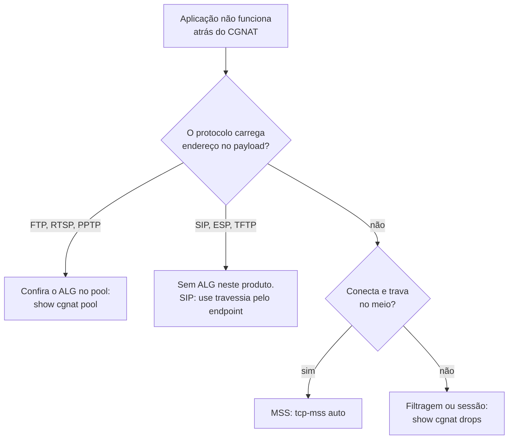

# Protocolos e ALGs

Quais protocolos atravessam este CGNAT sozinhos, quais precisam de ALG, e quais **não são suportados**. Para quem está diagnosticando "funciona na LAN mas não pela internet".

# Por que alguns protocolos precisam de ajuda

Protocolo que carrega endereço ou porta **dentro do payload** quebra atrás de qualquer NAT, a menos que o NAT reescreva o payload também. O canal de controle sobe, anuncia um endereço privado para o outro lado, e a conexão de dados nunca se estabelece.

O ALG (*Application-Level Gateway*) é quem reescreve esse anúncio.

# O que está construído

Três ALGs, ligáveis por pool com `alg <nome> <on|off>`:

| ALG | O que reescreve | Sintoma sem ele |
|-----|-----------------|-----------------|
| `ftp` | `PORT`/`EPRT` e as respostas 227/229 | FTP funciona em modo passivo e falha em ativo — ainda comum em equipamento industrial e legado |
| `rtsp` | o `client_port` do cabeçalho Transport | câmera IP e alguns streamers: funciona na LAN, quadro preto de fora |
| `pptp` | o canal de controle e o canal de dados GRE | VPN para concentrador corporativo antigo não conecta de jeito nenhum |

```
configure
 cgnat pool residencial
  alg ftp on
  alg rtsp on
  alg pptp on
  exit
 commit
```

```
show cgnat pool
```

Ajuste **aplicado no lugar**: não derruba sessão.


:::info
O PPTP tem um problema próprio: GRE não tem portas, então o **Call ID** precisa fazer o papel que a porta faria. A reescrita não muda tamanho algum, nenhum número de sequência se move, e cada mensagem é guardada por um *magic cookie* de 32 bits e pelo próprio campo de comprimento antes de um único byte ser tocado.

:::

# O que NÃO está construído


:::warning
**SIP não tem ALG neste equipamento.** O sintoma é VoIP que registra mas fica sem áudio, ou com áudio em uma direção só — reconhecidamente a chamada de suporte mais cara que um provedor recebe. Se você opera voz, planeje isso antes de migrar assinantes.

:::

| Protocolo | Sintoma | Situação |
|-----------|---------|----------|
| **SIP**   | VoIP registra mas sem áudio, ou áudio de uma direção só | ausente, prioridade alta |
| **IPsec passthrough (ESP)** | vários assinantes atrás de um endereço público não conseguem IPsec sem NAT-T; ESP não tem portas para demultiplexar | ausente, prioridade média |
| **TFTP**  | provisionamento de alguns CPE | ausente, prioridade baixa |

Deliberadamente **não** serão construídos: H.323, MGCP, SCCP, MSRPC, NetBIOS, IRC/DCC e DNS.


:::info
Vale saber que a indústria caminhou no sentido contrário do SIP ALG: provedores de VoIP rotineiramente pedem que o cliente **desligue** o SIP ALG do CPE, porque um ALG que interpreta o SDP errado produz áudio unidirecional e registro que cai — falhas mais difíceis de diagnosticar do que as que ele evitaria. O SIP moderno resolve a travessia de NAT a partir do endpoint.

:::

# A regra que protege o tráfego

Um payload malformado ou inesperado **deixa o pacote intocado** e incrementa um contador. Nunca é reescrito na dúvida.

O motivo é direto: um ALG que reescreve um payload que interpretou errado é pior do que ALG nenhum, porque corrompe tráfego que apenas deixaria de conectar.

Por isso os laboratórios de ALG conferem o **pacote capturado**, e não o contador — um ALG incrementa o contador dele tendo a reescrita saído certa ou não.

# Diagnóstico



# Ver também

* [Comportamento NAT e compatibilidade](/doc/comportamento-nat-e-compatibilidade-8eYzcDTnmJ) — quando o problema é filtragem, não payload
* [Configuração de pool](/doc/configuracao-de-pool-btyS572Ih6) — os campos `alg` e `tcp-mss`
* [Receitas do dia a dia](/doc/receitas-do-dia-a-dia-IcocgdbXW2) — como ligar um ALG passo a passo
