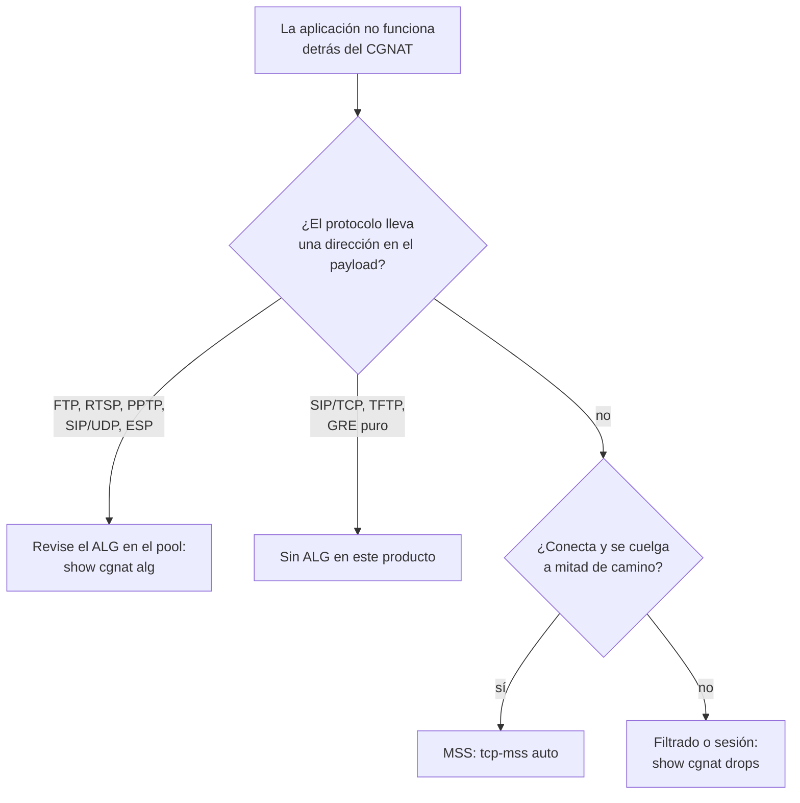

# Protocolos y ALG

Qué protocolos atraviesan este CGNAT por sí solos, cuáles necesitan un ALG y cuáles **no son compatibles**. Para quienes están diagnosticando "funciona en la LAN pero no por internet".

# Por qué algunos protocolos necesitan ayuda

Un protocolo que lleva una dirección o un puerto **dentro del payload** se rompe detrás de cualquier NAT, a menos que el NAT también reescriba el payload. El canal de control se establece, anuncia una dirección privada al otro lado y la conexión de datos nunca se establece.

El ALG (*Application-Level Gateway*) es el que reescribe ese anuncio.

# Lo que está construido

Cinco, que se pueden activar y desactivar por pool con `alg <nombre> <on|off>`. Todos vienen **activados**: un pool que no dice nada sobre ALG tiene los cinco funcionando.

| ALG | Qué reescribe | Síntoma sin él |
|-----|---------------|----------------|
| `ftp` | `PORT`/`EPRT` y las respuestas 227/229 | FTP funciona en modo pasivo y falla en activo, algo todavía común en equipos industriales y heredados |
| `rtsp` | el `client_port` del encabezado Transport | cámara IP y algunos streamers: funciona en la LAN, pantalla negra desde afuera |
| `pptp` | el canal de control y el canal de datos GRE | la VPN hacia un concentrador corporativo antiguo no conecta de ninguna manera |
| `esp` | nada del payload: solo ata el túnel al gateway remoto | varios suscriptores detrás de una dirección pública no logran IPsec sin NAT-T |
| `sip` | `Via`, `Contact` y el SDP (`c=` y `m=`) del SIP **sobre UDP**, y abre el par RTP/RTCP | el VoIP se registra pero nadie logra llamar al suscriptor, o la llamada se completa sin audio |

El comando es para el caso contrario: desactivar uno que estorba, o reactivar el que alguien desactivó:

```
configure
 nat
  cgnat
   pool residencial
    alg sip off
    exit
   exit
  exit
 commit
```

`no alg sip`, en el mismo lugar, borra la elección y devuelve ese ALG al valor predeterminado, que es activado. Es un ajuste **aplicado sin reconstruir**: no tira sesiones.

Para ver lo que el **dataplane** está aplicando realmente —y no lo que dice el archivo—, pool por pool, con los cinco y el estado de cada uno:

```
show cgnat alg
```

## En un pool NAT64: solo el FTP, y desactivado hasta que usted lo pida

En un pool NAT64 el suscriptor solo tiene IPv6 y el servidor solo tiene IPv4, y el problema del FTP es otro: el cliente IPv6 habla `EPSV` y `EPRT` —no tiene otra cosa que hablar— y muchos servidores IPv4 antiguos solo entienden `PASV` y `PORT`. El login funciona y todo listado se cuelga. El `alg ftp` de un pool NAT64 es el ALG de la RFC 6384, que traduce entre las dos mitades:

| El cliente envía | El servidor recibe | El cliente recibe de vuelta |
|------------------|--------------------|-----------------------------|
| `EPSV`           | `PASV`             | la respuesta `227` del servidor reescrita como `229`, solo con el puerto |
| `EPRT` con su propia dirección IPv6 | `PORT` con la dirección pública y un puerto del bloque del suscriptor | la respuesta del servidor   |
| `EPSV ALL`, o `EPSV` con otro protocolo | un `NOOP`, en su lugar | `504` o `522`, respondidos por el equipo |
| `ALGS STATUS64`, `ENABLE64`, `DISABLE64` | un `NOOP`, en su lugar | `216`, con el estado de la traducción |

Después de un `AUTH` que el servidor acepta, el equipo ya no traduce nada en esa conexión: el canal de control pasó a ser TLS.

**Viene desactivado**, al contrario de los ALG de un pool IPv4: la propia RFC 6384 recomienda activarlo solo donde se necesita, porque con él el `EPSV` de un servidor que entendería `EPSV` se convierte en `PASV` sin necesidad. Actívelo en el pool NAT64 que atiende a suscriptores con ese problema:

```
configure
 nat
  cgnat
   pool v6
    alg ftp on
    exit
   exit
  exit
 commit
```

**Los otros cuatro se rechazan en un pool NAT64**, para siempre y cada uno por su nombre en el `commit check`: el RTSP y el SIP llevan direcciones en el SDP y ninguna RFC traduce eso entre IPv6 e IPv4 —para el SIP, la RFC 6157 usa ICE y relay, no un traductor que reescriba el cuerpo—, y el GRE del PPTP y el ESP no son protocolos que el NAT64 con estado transporte. El IPsec atraviesa NAT64 como NAT-T, en UDP 4500, sin ningún ALG.


:::info
El PPTP tiene un problema propio: GRE no tiene puertos, así que el **Call ID** debe cumplir el papel que cumpliría el puerto. La reescritura no cambia ningún tamaño, ningún número de secuencia se mueve, y cada mensaje se valida con una *magic cookie* de 32 bits y con el propio campo de longitud antes de tocar un solo byte.

:::

Dos límites del PPTP que conviene conocer: **la llamada entrante no se trata** —el suscriptor que recibe llamadas hacia adentro, como concentrador, no tiene mapeo hasta que llega la llamada, y la llamada nunca llega—, y **el GRE fragmentado se descarta**, porque el fragmento no trae los campos que identifican la llamada.

## El túnel que conecta y se cuelga en el primer archivo

Conviene conocer el síntoma porque no parece un problema de CGNAT, y porque el suscriptor lo va a describir de una forma que lleva el diagnóstico hacia el lado equivocado:

> "La VPN conecta normal, navego en la intranet, pero cuando abro un archivo grande se cuelga."

Lo que está pasando es **PMTUD roto**. Cuando un router en el camino no puede transportar un paquete grande, devuelve un ICMP *fragmentation needed* indicando el tamaño que cabría. Para el TCP común existe una segunda red de protección: el *MSS clamp*, que usted activa con `tcp-mss` en el pool. Dentro de un túnel **no existe MSS que ajustar**: el ICMP es el único aviso que tiene el suscriptor. Si se pierde, los paquetes pequeños pasan, los grandes desaparecen y nada en ningún lugar se queja.

El equipo entrega ese ICMP de vuelta al suscriptor, tanto para PPTP como para IPsec, y reescribe el paquete citado dentro de él, que es la mitad que importa, porque es por ese paquete citado que la máquina del suscriptor reconoce de qué conexión habla el aviso.

**Lo que esto le exige a usted:** que el túnel esté establecido *a través de este equipo*. El aviso se ata a la llamada PPTP en el momento en que el servidor la acepta, y desaparece cuando la llamada se desconecta. Un túnel que se estableció antes de que el equipo entrara en el camino no tiene esa atadura hasta que se reconecte.

**Un límite honesto, y solo del IPsec:** dos suscriptores detrás de la **misma dirección pública** con túneles IPsec hacia el **mismo gateway** no se pueden distinguir: ningún campo en la red los separa. El primero se queda con la atadura; el segundo no. Con PPTP esto no ocurre, porque el Call ID que entrega el servidor separa las dos llamadas. Quien cae en este caso del IPsec queda atendido por NAT-T, que es lo que el CPE moderno hace por sí solo.

# El SIP, en detalle

Vale la pena el detalle porque es el ALG que más dudas genera, y porque la industria fue en el sentido contrario: los proveedores de VoIP piden rutinariamente que el cliente **desactive** el SIP ALG del CPE, ya que un ALG que interpreta mal el SDP produce audio unidireccional y registros que se caen, fallas más difíciles de diagnosticar que las que evitaría.

Trata el SIP **sobre UDP, en el puerto 5060**, y está construido sobre una sola regla: **solo reescribe una dirección IPv4 literal igual a la dirección privada del propio suscriptor.** Todo lo demás sale como entró. De ahí se obtienen, sin costo, las tres cosas que suelen salir mal:

* **Un teléfono que ya conoce su dirección pública** (hizo STUN, o la aprendió por `rport`) coloca la dirección pública en el `Via`, en el `Contact` y en el SDP. Nada de eso coincide con la dirección privada, así que nada se reescribe: los dos recorridos de NAT no chocan. Es exactamente el caso que suele terminar en "el ALG rompió mi teléfono".
* **Una respuesta que envía el suscriptor** lleva el `Via` de quien llamó, no el suyo. La dirección no coincide, así que no se toca.
* **Un mensaje que no logra interpretar completo** pasa **intacto** y se cuenta. Nunca se reescribe a medias.

Lo que reescribe, en la salida:

| Campo | Se convierte en |
|-------|-----------------|
| `Via` (el primero) | dirección pública\*\*:\*\*puerto público |
| `Contact` | dirección pública\*\*:\*\*puerto público |
| `c=IN IP4` del SDP | dirección pública |
| `m=` del SDP | un **puerto par reservado**, con el siguiente guardado para el RTCP |
| `Content-Length` | recalculado cuando el cuerpo cambió de tamaño |

Cada par RTP/RTCP reservado espera el primer paquete durante el timeout `alg-expect` del pool —60 segundos por defecto— y se libera si no llega nada. Un cuerpo SDP abre como máximo cuatro flujos de medios: una oferta con más se rechaza entera, en vez de mapearse a medias. Los pares se reservan solo en el sentido de salida, así que nada que llegue desde afuera puede gastar los puertos de un suscriptor.

De vuelta, devuelve el `Via` de la **respuesta** exactamente como lo había escrito el teléfono; sin eso, el propio teléfono descarta la respuesta de la llamada que él mismo hizo.

Lo que **no** toca, a propósito: `From`, `To`, `Call-ID` (identidades, no lugares, y es con ellas que se autentica el registro), `Route`/`Record-Route` (son del proxy), el `o=` del SDP (identifica la sesión, no es un destino) y los parámetros `received=`/`rport=`, que son el otro lado diciendo la verdad sobre lo que vio.


:::warning
**El SIP sobre TCP no se trata**, y es una decisión, no un olvido. Un mensaje SIP en TCP es un flujo: un analizador que ve un segmento no ve el final del mensaje, y un INVITE con SDP supera un segmento con frecuencia. Una conexión TCP en el puerto 5060 atraviesa el equipo como cualquier otra, sin ningún ALG. El SIP sobre TLS (puerto 5061) nadie lo puede tocar.

:::

# Lo que NO está construido

| Protocolo | Síntoma | Situación |
|-----------|---------|-----------|
| **SIP sobre TCP/TLS** | poco común en CPE residencial; TLS es intocable para cualquier NAT | ausente, por decisión |
| **TFTP**  | aprovisionamiento de algunos CPE | ausente, por decisión: no se construirá |
| **GRE puro** (sin PPTP) | túnel GRE simple, sin canal de control | no se traduce: no tiene identificador por flujo, y varios suscriptores detrás de una dirección no serían separables. Se descarta con un contador propio |

Deliberadamente **no** se construirán: H.323, MGCP, SCCP, MSRPC, NetBIOS, IRC/DCC, TFTP y DNS.

# La regla que protege el tráfico

Un payload malformado o inesperado **deja el paquete intacto** e incrementa un contador. Nunca se reescribe ante la duda.

El motivo es directo: un ALG que reescribe un payload que interpretó mal es peor que no tener ALG, porque corrompe tráfico que simplemente dejaría de conectar.

Por eso la verificación de un ALG mira el **paquete capturado**, y no el contador: un ALG incrementa su contador tanto si la reescritura salió bien como si no.

Los contadores de cada ALG aparecen en `show cgnat drops`, en la parte que lista todo lo demás que contó el CGNAT, solo los que no están en cero: `SIP messages rewritten` junto a `SIP message not understood, left untouched`, y el mismo par para FTP, RTSP y PPTP. Un contador de "reescrito" que sube indica que el ALG está viendo el protocolo; uno de "no entendido" que sube indica que existe un equipo cuyo formato se niega a tocar.

# Diagnóstico



# Vea también

* [Comportamiento NAT y compatibilidad](/s/wiki-es/doc/comportamiento-nat-y-compatibilidad-QvEXCgxsQE) — cuando el problema es el filtrado, no el payload
* [Configuración de pool](/s/wiki-es/doc/configuracion-de-pool-Y3cACG9QHA) — los campos `alg` y `tcp-mss`
* [Recetas del día a día](/s/wiki-es/doc/recetas-del-dia-a-dia-maiZboGbqY) — cómo activar un ALG paso a paso
