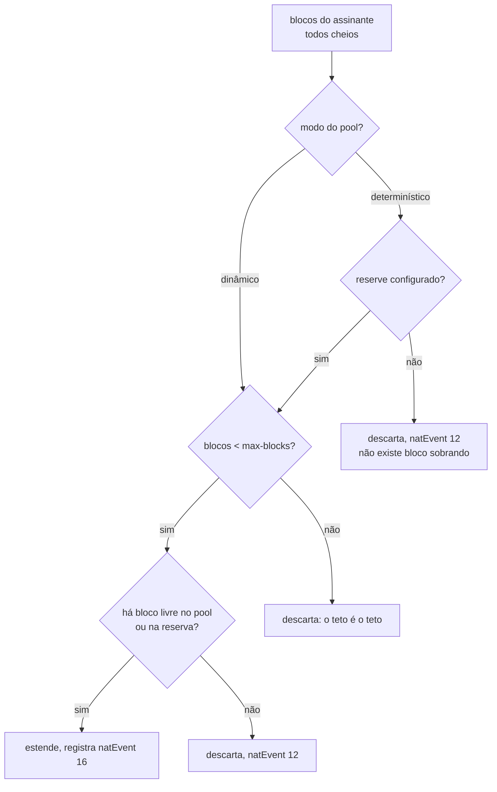

# Quando o bloco de um assinante enche

Um assinante que enche o próprio bloco para de navegar enquanto a caixa está saudável e os vizinhos não sentem nada. Esta página mostra como descobrir se é isso, o que fazer, e como impedir que um host infectado consuma o pool inteiro.

# O sintoma

Por padrão, um assinante que enche o bloco **é descartado**, e o log registra `natEvent 12`. Está correto e é terrível: o cliente fica sem internet, o equipamento não reporta nada de anormal, e o operador não tem para onde apontar quando ele liga.

O que torna isso comum é que o culpado geralmente não é o cliente: um host infectado abre milhares de sessões e esgota o **próprio** bloco. Os vizinhos que dividem o mesmo endereço público não são afetados — é exatamente para isso que se aloca um bloco por assinante — e é também por isso que o CGNAT leva a culpa por uma infecção do outro lado da rede de acesso.

# Descobrindo se é isso

```
show cgnat subscriber 100.64.3.19
```

A resposta traz uma linha de recusas:

```
sessions 4   refusals: ports 0, session cap 6, rate cap 0
```

Acima dessa linha vêm os blocos que ele segura, cada um com o endereço público, a faixa de portas e quantas estão em uso — um bloco de extensão vem marcado como tal. E cada contador de recusa que não está em zero ganha, embaixo, uma linha dizendo o que ele quer dizer.

São **três contadores separados, e cada um leva a uma ação diferente**:

| Contador | O que significa | O que fazer |
|----------|-----------------|-------------|
| `ports`  | o bloco do assinante está cheio | venda mais portas, ou eleve `max-blocks` (num pool determinístico, isso exige `reserve`) |
| `session cap` | ele está no limite configurado | o limite está funcionando, ou está baixo demais para esse cliente |
| `rate cap` | ele abre sessões mais rápido do que o permitido | normalmente é infecção, não é cliente |


:::info
Um contador só para os três não responderia nenhum deles. É a diferença entre saber que "algo foi recusado" e saber se você vende mais portas, ajusta um limite ou liga para o cliente avisar de uma infecção.

:::

Para achar quem está mais perto do limite antes de alguém ligar:

```
show cgnat top
```

Ele lista os assinantes mais carregados com as portas que cada um segura, por exemplo `3/512`.

# Quantos estão perto do limite, e o alarme que avisa sozinho

`show cgnat top` responde **quem**. Ele não responde **quantos**, e essa é a pergunta que decide se você tem um cliente infectado ou um pool mal dimensionado.

```
show cgnat pool
```

Junto da capacidade do pool, ele imprime a distribuição de quanto cada assinante está usando do próprio bloco:

```
utilisation  2 subscriber(s) holding a block
   75-89%  1
      100%  1
alarm at     75% of a subscriber's block
```

A forma importa mais do que a média. Com 200 mil assinantes, um pool lê como metade vazio enquanto mil clientes estão colados no limite — e a média não conta nem uma coisa nem outra. O que resolve é a **forma**: quantos estão perto do fim do bloco, e se esse número está andando.


:::info
Esse histograma é calculado no momento em que você roda o comando, percorrendo os mapas de portas que o alocador já mantém de qualquer jeito. Nada é contado por pacote e a tabela de sessões não é tocada — rodar isso num equipamento carregado não custa tráfego.

:::

## O alarme, uma vez por travessia

O histograma responde quando você pergunta. O alarme avisa sem ser perguntado, e vem desligado:

```
configure
 nat
  cgnat
   pool residencial
    utilisation-alarm 75
    exit
   exit
  exit
 commit
```

Quando um assinante cruza o limiar, sai **uma** linha no log, nomeando quem é, quanto está usando e do que ela está na frente:

```
subscriber 5 of pool residencial is 75% through its 512 ports on 200.150.10.7:
past the 75% alarm. RFC 8158 natEvent 12 would only report this once the
customer had already started losing traffic.
```

Essa última frase é o motivo de o alarme existir. O `natEvent 12` que abre esta página é correto e chega tarde: ele reporta a exaustão, que é dizer que reporta o instante em que o cliente **começou a perder tráfego** — quando a ligação para o suporte já está na fila. O alarme reporta o caminho até lá.

O limiar vai de 1 a 100, por pool, e `no utilisation-alarm` desliga o alarme de novo. A linha sai no log do dataplane, com nível de aviso. É ajuste **aplicado no lugar**: ligar, mudar ou desligar não derruba ninguém.

E ele fala **uma vez por travessia**, não uma vez por alocação. Depois da linha, o assinante pode continuar enchendo que nada mais é dito.


:::info
Isso é desenho, não economia. Uma linha por alocação acima do limiar é um log que ninguém consegue guardar — e o assinante que dispara o alarme é, por definição, o que está alocando mais rápido, ou seja, o que produziria mais linhas. Dez pontos de histerese limpam a marca, para que um assinante parado exatamente em cima do limiar não gere uma linha cada vez que uma porta é liberada e tomada de novo.

:::

O alarme é avaliado **onde uma porta é tomada**, e em nenhum outro lugar — utilização só sobe ali. A consequência prática: um assinante que esvaziou o bloco e nunca mais alocou nada mantém a marca levantada. Não é resposta errada, é estado parado: o alarme fala sobre assinante **enchendo**, e quem parou de pedir portas não está enchendo.

# Blocos estendidos

Com `max-blocks` acima de 1 (o máximo é 255), um assinante cujos blocos estão todos cheios ganha **outro**. De onde sai esse bloco depende do modo do pool:

* num pool **dinâmico** (BPA), de uma lista de blocos livres — entregar o segundo é a mesma operação que entregar o primeiro;
* num pool **determinístico**, só de uma **reserva** separada para isso com `reserve`. Sem reserva, não existe bloco sobrando, e o assinante que enche é descartado como antes.

```
configure
 nat
  cgnat
   pool residencial
    max-blocks 2
    exit
   exit
  exit
 commit
```



O teto importa tanto quanto a extensão: sem ele, um host infectado consome o pool de que todos os outros assinantes precisam, e o operador troca uma reclamação de cliente por uma parada.

Toda extensão é registrada como `natEvent 16` e sua liberação como `natEvent 17`. Uma extensão não é derivável de nada — nem da fórmula, nem do primeiro bloco — então um bloco que o log não registra não pode ser atribuído a ninguém.

## A reserva de um pool determinístico

Num pool determinístico a fórmula atribui **todos** os blocos a alguém. Um bloco entregue como extensão sem reserva seria um bloco que a fórmula dá a outra pessoa — e entregá-lo quebraria o mapeamento dela sem erro em lugar nenhum. `reserve <n>` resolve isso tirando `n` blocos de **cada** endereço público da fórmula e guardando-os para extensões:

```
configure
 nat
  cgnat
   pool residencial
    reserve 1
    max-blocks 2
    exit
   exit
  exit
 commit remap
```

`show cgnat pool` mostra a conta: quantos blocos por endereço a fórmula ainda usa e quantos ficaram guardados.


:::warning
**Ligar ou mudar a reserva é mudança de capacidade.** A fórmula passa a ter menos blocos por endereço, o pool é reconstruído, e todas as sessões dele caem. Por isso o `commit` comum recusa, e é preciso pedir pelo nome com `commit remap`. Quantos assinantes perdem o bloco ou mudam de lugar depende da política do pool: rode `commit check` antes, que ele diz a conta exata. Faça numa janela.

:::


:::info
**O bloco da reserva não sai da fórmula, então precisa ir para o log.** Num pool determinístico com reserva, cada bloco de extensão é exportado como `natEvent 16` e liberado como `natEvent 17`, exatamente como num pool dinâmico — é a única coisa que um pool determinístico registra por assinante. Um pool com reserva e sem exportação configurada recebe um aviso no `commit check` e no `commit`: sem o registro, ninguém consegue dizer de quem era uma porta daquela reserva.

:::

Uma reserva menor que o número de workers do dataplane é aceita, com aviso: os workers que ficaram sem bloco reservado não conseguem estender os assinantes deles. E a reserva esgotada é contada à parte em `show cgnat blocks`, separada do assinante que bateu no `max-blocks` — uma pede reserva maior, a outra teto maior.

# Começar pequeno e crescer só quem precisa

`block-size` e `max-blocks` juntos já são uma **faixa de portas por assinante**, e é assim que um pool dinâmico atende um medidor inteligente e uma casa pesada ao mesmo tempo:

```
configure
 nat
  cgnat
   pool residencial
    block-size 64
    max-blocks 8
    exit
   exit
  exit
 commit
```

O medidor fica com **64 portas** e nunca pede o segundo bloco. A casa pesada chega às 512 sozinha, um bloco de cada vez, à medida que enche cada um - sem ninguém configurar nada para ela. Com um bloco único de 512 portas, o medidor custaria ao pool as mesmas 512.

`show cgnat pool` mostra a faixa em portas:

```
  per sub      64-512 ports (1-8 blocks, grown one at a time as each fills)
```

Se todo assinante novo precisa de mais do que um bloco logo de início, `initial-allocation <portas>` entrega de uma vez uma primeira alocação maior, e o crescimento segue um bloco de cada vez a partir dela. "Primeiro 512, depois de 256 em 256" é `block-size 256`, `max-blocks 10` e `initial-allocation 512`. O valor precisa ser um número inteiro de blocos e não pode passar de `max-blocks`; vale só em pool dinâmico, é aplicado no lugar e muda o que o **próximo** assinante novo recebe, sem mexer em quem já tem bloco. Cada bloco dessa primeira alocação é um `natEvent 16` próprio. `show cgnat pool` passa a mostrar a faixa a partir dela.

O preço do bloco pequeno é **volume de registro**: cada bloco entregue vira um registro próprio no log. A casa que chega a oito blocos gera oito registros onde um bloco grande geraria um. Escolha o menor bloco que ainda deixe a maioria dos assinantes dentro de **um**, e use `max-blocks` para a minoria.


:::warning
`block-size` **reconstrói o pool** e derruba todas as sessões dele. `max-blocks` não. Mudar os dois de uma vez é uma mudança de mapeamento, e o `commit` recusa até que ela seja pedida pelo nome.

:::

# Onde os blocos extras caem

O bloco extra cai, sempre que der, **no mesmo endereço público** do assinante. Esse é o pareamento de endereço que a RFC 4787 REQ-2 descreve e que a RFC 6888 REQ-2 exige como padrão de um CGNAT: um cliente que sai por dois endereços ao mesmo tempo aparece como dois computadores para quem está do outro lado, e é o que faz a chamada SIP conectar e ficar sem áudio - a mídia é anunciada num endereço e o sinal veio de outro.

É **preferência, não regra**. Se não houver bloco livre naquele endereço, a caixa entrega outro qualquer em vez de deixar o cliente sem tráfego. Quanto disso valeu no seu pool está em `show cgnat blocks`:

```
  RFC 4787 REQ-2 paired: 412 of 419 extension(s) on the holder's own address
```

`block-stride` é outra pergunta, e decide a distância entre os blocos de um mesmo assinante **dentro** desse endereço:

```
configure
 nat
  cgnat
   pool residencial
    block-stride 1
    exit
   exit
  exit
 commit
```

| Valor | O que acontece |
|-------|----------------|
| `0` (padrão) | o bloco livre mais próximo no endereço do assinante |
| `1`   | colados: o segundo bloco começa onde o primeiro termina |
| `n`   | `n × block-size` portas de distância, no mesmo endereço público |

**Colado** deixa o assinante com uma faixa contínua de portas, e é a opção de quem atende ofício e investigação: um intervalo em vez de vários. **Afastado** espalha o assinante pela faixa do próprio endereço público, e é a opção de quem não quer que observar um intervalo de fora diga muito sobre um cliente.

`block-stride` vale só em pool **dinâmico**, e é recusado num determinístico: a extensão ali sai da reserva, que tem a própria regra de posição, e a distância nunca seria lida.

Trocar a distância é aplicado **no lugar**: ninguém cai, e nenhum bloco já entregue se move - vale do próximo bloco em diante.

O ajuste nunca custa tráfego a um cliente: se o bloco apontado já estiver com outro assinante, a caixa entrega outro qualquer. `show cgnat blocks` conta os dois casos, e é onde se confere se a distância está valendo:

```
  stride 1: 412 extensions placed where it says, 7 fell back to the free list
```

Só zeros na primeira coluna quer dizer que a distância escolhida não cabe nesta caixa - a caixa avisa no momento em que o pool é criado e diz qual serve.

# Limites por assinante

Dois limites, por pool. **Zero significa ilimitado**, para que uma configuração escrita antes de esses limites existirem não passe a recusar nada que funcionava ontem quando a caixa roda uma versão nova.

```
configure
 nat
  cgnat
   pool residencial
    max-sessions 512
    max-session-rate 50
    exit
   exit
  exit
 commit
```

| Limite | O que impede |
|--------|--------------|
| `max-sessions` | um assinante segurando mais mapeamentos do que foi vendido a ele |
| `max-session-rate` | uma varredura — que fica abaixo de qualquer teto de simultâneas enquanto consome o bloco na velocidade em que os temporizadores liberam |

`max-sessions` conta sessões simultâneas de um assinante; `max-session-rate` conta sessões novas por segundo. Os dois são aplicados **no lugar**, sem derrubar ninguém, e `no max-sessions` ou `no max-session-rate` volta a ilimitado. O teste acontece antes de uma porta ser tirada do bloco, então um pacote recusado por limite não consome porta nenhuma.

A taxa é um **balde de fichas**, não uma janela de um segundo. Uma janela deixa um scanner gastar o orçamento de duas janelas em cima da virada, que é exatamente a rajada que o limite existe para impedir. O balde guarda o valor de um segundo, então a rajada permitida é um número que você acordou, não um artefato de quando o relógio virou.

## O que os limites não recusam

Um mapeamento aberto por um **ALG** em nome de uma conexão de controle — dado de FTP, porta de mídia anunciada, chamada PPTP — nunca é recusado por nenhum dos dois limites. Uma porta anunciada que não funciona é justamente a falha que o ALG existe para evitar.

Eles ainda **contam** para o total simultâneo, porque ocupam porta como qualquer coisa: isentos de serem recusados, não de serem contados.

Um limite também **nunca fecha uma sessão que já existe**. Ele limita o que pode ser criado; derrubar mapeamentos anteriores a ele faria de configurar um limite uma parada por conta própria.

# Como conferir

```
show cgnat subscriber <ip do assinante>
show cgnat top
```


:::success
As três recusas em zero e o assinante longe do total do bloco: o problema não está aqui. Se `rate cap` sobe sozinho, você achou uma infecção antes do cliente ligar.

:::

# Ver também

* [Configuração de pool](/doc/configuracao-de-pool-btyS572Ih6) - `max-blocks`, `reserve`, `initial-allocation`, `block-stride`, `max-sessions` e `max-session-rate`
* [Monitoramento e SNMP](/doc/monitoramento-e-snmp-YGn85RpUAb) — os assinantes perto do limite e as recusas, vistos pela NMS
* [Dimensionamento e requisitos](/doc/dimensionamento-e-requisitos-f42dC4k45s) — escolher `block-size` para que isso seja raro
* [Ampliar capacidade sem derrubar assinantes](/doc/ampliar-capacidade-sem-derrubar-assinantes-rWQkaj9r1u) — quando o pool inteiro, e não um assinante, está no limite
