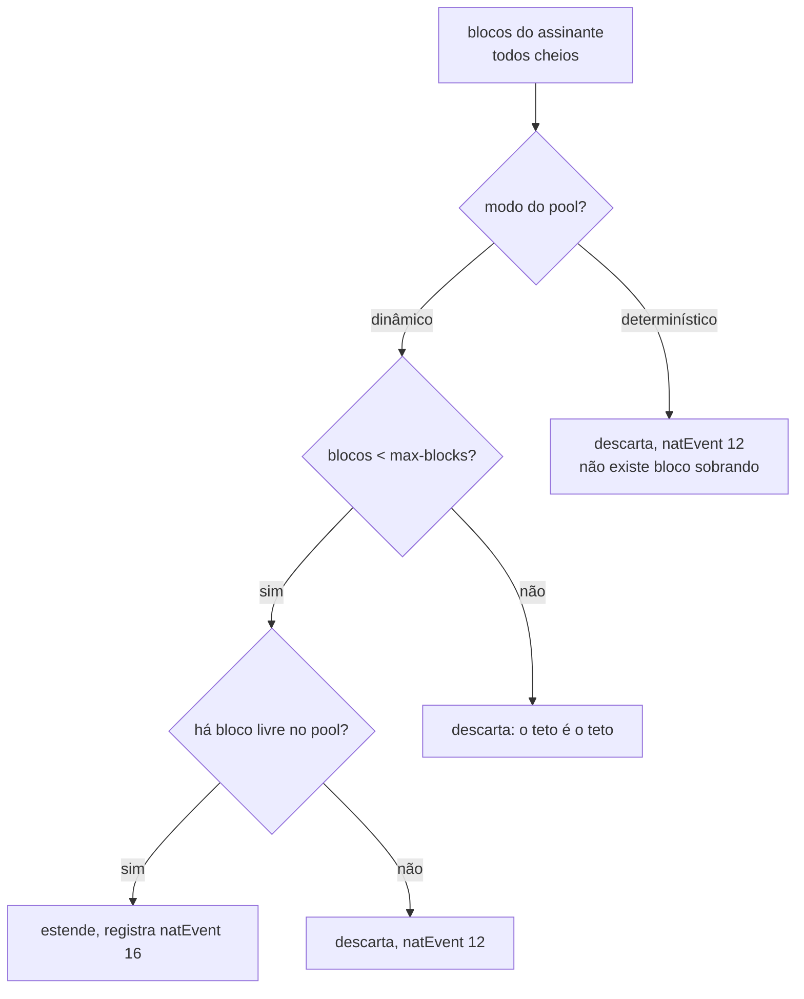

# Quando o bloco de um assinante enche

Um assinante que enche o próprio bloco para de navegar enquanto a caixa está saudável e os vizinhos não sentem nada. Esta página mostra como descobrir se é isso, o que fazer, e como impedir que um host infectado consuma o pool inteiro.

# O sintoma

Por padrão, um assinante que enche o bloco **é descartado**, e o log registra `natEvent 12`. Está correto e é terrível: o cliente fica sem internet, o equipamento não reporta nada de anormal, e o operador não tem para onde apontar quando ele liga.

O que torna isso comum é que o culpado geralmente não é o cliente: um host infectado abre milhares de sessões e esgota o **próprio** bloco. Os vizinhos que dividem o mesmo endereço público não são afetados — é exatamente para isso que se aloca um bloco por assinante — e é também por isso que o CGNAT leva a culpa por uma infecção do outro lado da rede de acesso.

# Descobrindo se é isso

```
show cgnat subscriber 100.64.3.19
```

A resposta traz uma linha de recusas:

```
sessions 4   refusals: ports 0, session cap 6, rate cap 0
```

São **três contadores separados, e cada um leva a uma ação diferente**:

| Contador | O que significa | O que fazer |
|----------|-----------------|-------------|
| `ports`  | o bloco do assinante está cheio | venda mais portas, ou eleve `max-blocks` |
| `session cap` | ele está no limite configurado | o limite está funcionando, ou está baixo demais para esse cliente |
| `rate cap` | ele abre sessões mais rápido do que o permitido | normalmente é infecção, não é cliente |


:::info
Um contador só para os três não responderia nenhum deles. É a diferença entre saber que "algo foi recusado" e saber se você vende mais portas, ajusta um limite ou liga para o cliente avisar de uma infecção.

:::

Para achar quem está mais perto do limite antes de alguém ligar:

```
show cgnat top
```

Ele lista os assinantes mais carregados com as portas que cada um segura, por exemplo `3/512`.

# Blocos estendidos

Com `max-blocks` acima de 1, um assinante cujos blocos estão todos cheios ganha **outro**.

```
configure
 nat cgnat pool residencial
  max-blocks 2
  exit
 commit
```




:::warning
**Blocos estendidos só existem em modo dinâmico.** Num pool determinístico a capacidade é `endereços × blocos por endereço` e a fórmula atribui **todos** os blocos a alguém. Um bloco entregue como extensão é um bloco que a fórmula dá a outra pessoa — e entregá-lo quebraria o mapeamento dela sem erro em lugar nenhum, que é exatamente a falha que o modo determinístico existe para evitar.

:::

O teto importa tanto quanto a extensão: sem ele, um host infectado consome o pool de que todos os outros assinantes precisam, e o operador troca uma reclamação de cliente por uma parada.

Toda extensão é registrada como `natEvent 16` e sua liberação como `natEvent 17`. Uma extensão não é derivável de nada — nem da fórmula, nem do primeiro bloco — então um bloco que o log não registra não pode ser atribuído a ninguém.

# Começar pequeno e crescer só quem precisa

`block-size` e `max-blocks` juntos já são uma **faixa de portas por assinante**, e é assim que um pool atende um medidor inteligente e uma casa pesada ao mesmo tempo:

```
configure
 nat cgnat pool residencial
  block-size 64
  max-blocks 8
  exit
 commit
```

O medidor fica com **64 portas** e nunca pede o segundo bloco. A casa pesada chega às 512 sozinha, um bloco de cada vez, à medida que enche cada um - sem ninguém configurar nada para ela. Com um bloco único de 512 portas, o medidor custaria ao pool as mesmas 512.

`show cgnat pool` mostra a faixa em portas:

```
  per sub      64-512 ports (1-8 blocks, grown one at a time as each fills)
```

O preço do bloco pequeno é **volume de registro**: cada bloco entregue vira um registro próprio no log. A casa que chega a oito blocos gera oito registros onde um bloco grande geraria um. Escolha o menor bloco que ainda deixe a maioria dos assinantes dentro de **um**, e use `max-blocks` para a minoria.


:::warning
`block-size` **reconstrói o pool** e derruba todas as sessões dele. `max-blocks` não. Mudar os dois de uma vez é uma mudança de mapeamento, e o `commit` recusa até que ela seja pedida pelo nome.

:::

# Onde os blocos extras caem

O bloco extra cai, sempre que der, **no mesmo endereço público** do assinante. Esse é o pareamento de endereço que a RFC 4787 REQ-2 descreve e que a RFC 6888 REQ-2 exige como padrão de um CGNAT: um cliente que sai por dois endereços ao mesmo tempo aparece como dois computadores para quem está do outro lado, e é o que faz a chamada SIP conectar e ficar sem áudio - a mídia é anunciada num endereço e o sinal veio de outro.

É **preferência, não regra**. Se não houver bloco livre naquele endereço, a caixa entrega outro qualquer em vez de deixar o cliente sem tráfego. Quanto disso valeu no seu pool está em `show cgnat blocks`:

```
  RFC 4787 REQ-2 paired: 412 of 419 extension(s) on the holder's own address
```

`block-stride` é outra pergunta, e decide a distância entre os blocos de um mesmo assinante **dentro** desse endereço:

```
configure
 nat cgnat pool residencial
  block-stride 1
  exit
 commit
```

| Valor | O que acontece |
|-------|----------------|
| `0` (padrão) | o bloco livre mais próximo no endereço do assinante |
| `1`   | colados: o segundo bloco começa onde o primeiro termina |
| `n`   | `n × block-size` portas de distância, no mesmo endereço público |

**Colado** deixa o assinante com uma faixa contínua de portas, e é a opção de quem atende ofício e investigação: um intervalo em vez de vários. **Afastado** espalha o assinante pela faixa do próprio endereço público, e é a opção de quem não quer que observar um intervalo de fora diga muito sobre um cliente.

Trocar a distância é aplicado **no lugar**: ninguém cai, e nenhum bloco já entregue se move - vale do próximo bloco em diante.

O ajuste nunca custa tráfego a um cliente: se o bloco apontado já estiver com outro assinante, a caixa entrega outro qualquer. `show cgnat blocks` conta os dois casos, e é onde se confere se a distância está valendo:

```
  stride 1: 412 extensions placed where it says, 7 fell back to the free list
```

Só zeros na primeira coluna quer dizer que a distância escolhida não cabe nesta caixa - a caixa avisa no momento em que o pool é criado e diz qual serve.

# Limites por assinante

Dois limites, por pool. **Zero significa ilimitado**, para que uma configuração escrita antes de esses limites existirem não passe a recusar nada que funcionava ontem quando a caixa roda uma versão nova.

```
configure
 nat cgnat pool residencial
  max-sessions 512
  max-session-rate 50
  exit
 commit
```

| Limite | O que impede |
|--------|--------------|
| `max-sessions` | um assinante segurando mais mapeamentos do que foi vendido a ele |
| `max-session-rate` | uma varredura — que fica abaixo de qualquer teto de simultâneas enquanto consome o bloco na velocidade em que os temporizadores liberam |

A taxa é um **balde de fichas**, não uma janela de um segundo. Uma janela deixa um scanner gastar o orçamento de duas janelas em cima da virada, que é exatamente a rajada que o limite existe para impedir. O balde guarda o valor de um segundo, então a rajada permitida é um número que você acordou, não um artefato de quando o relógio virou.

## O que os limites não recusam

Um mapeamento aberto por um **ALG** em nome de uma conexão de controle — dado de FTP, porta de mídia anunciada, chamada PPTP — nunca é recusado por nenhum dos dois limites. Uma porta anunciada que não funciona é justamente a falha que o ALG existe para evitar.

Eles ainda **contam** para o total simultâneo, porque ocupam porta como qualquer coisa: isentos de serem recusados, não de serem contados.

Um limite também **nunca fecha uma sessão que já existe**. Ele limita o que pode ser criado; derrubar mapeamentos anteriores a ele faria de configurar um limite uma parada por conta própria.

# Como conferir

```
show cgnat subscriber <ip do assinante>
show cgnat top
```


:::success
As três recusas em zero e o assinante longe do total do bloco: o problema não está aqui. Se `rate cap` sobe sozinho, você achou uma infecção antes do cliente ligar.

:::

# Ver também

* [Configuração de pool](/doc/configuracao-de-pool-btyS572Ih6) - `max-blocks`, `block-stride`, `max-sessions` e `max-session-rate`
* [Dimensionamento e requisitos](/doc/dimensionamento-e-requisitos-f42dC4k45s) — escolher `block-size` para que isso seja raro
* [Ampliar capacidade sem derrubar assinantes](/doc/ampliar-capacidade-sem-derrubar-assinantes-rWQkaj9r1u) — quando o pool inteiro, e não um assinante, está no limite
