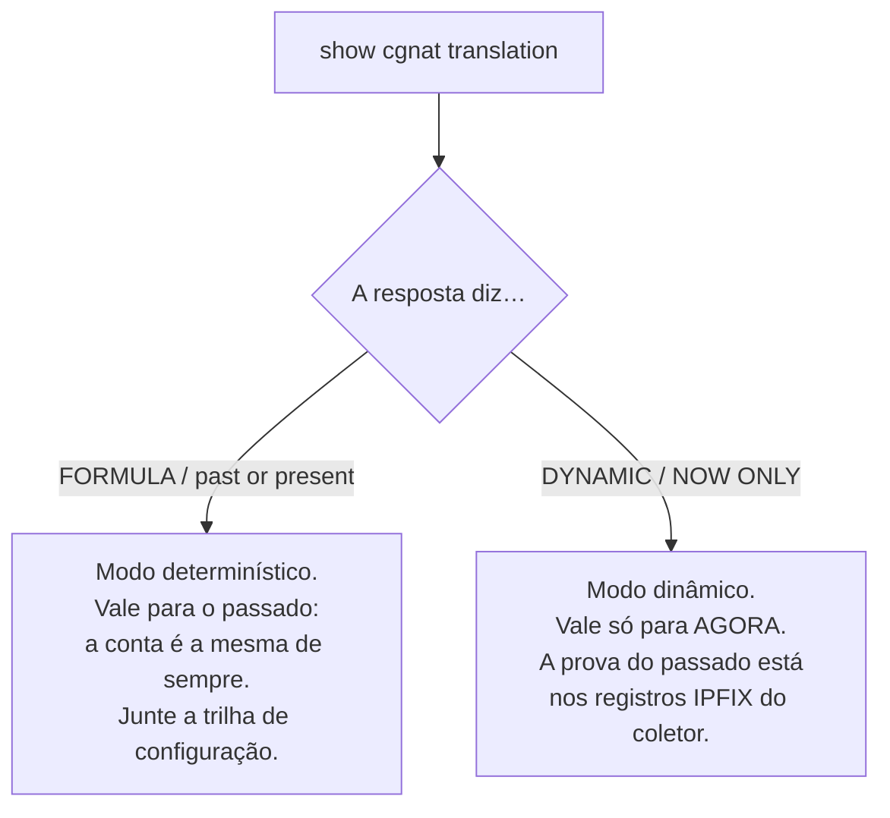
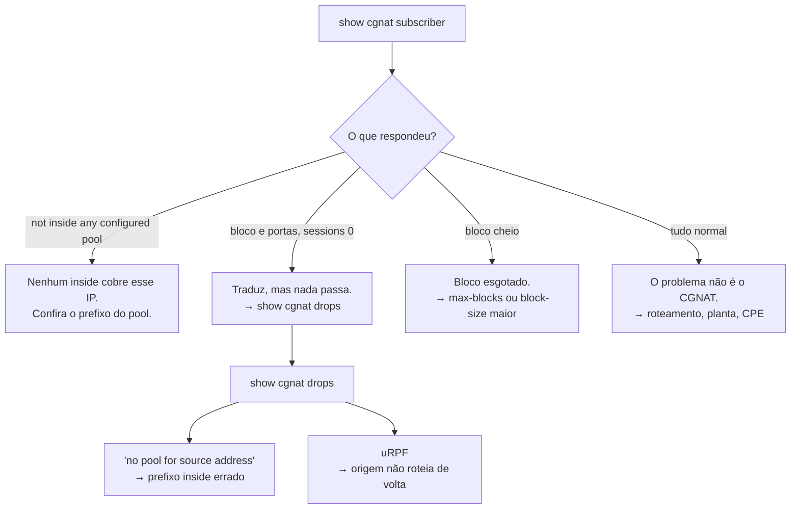

# Receitas do dia a dia

Tarefas concretas, com os comandos na ordem e o que conferir depois. Toda receita pressupõe que você já está na VTY.

# Atender uma ordem judicial

A pergunta é sempre a mesma: *quem estava usando o IP público X, porta Y, na data Z?*

```
show cgnat translation 203.0.113.7 4200
```

**Leia a resposta com atenção — ela diz quanto vale como prova:**



* `**FORMULA**` **+** `**past or present**` — a resposta veio da aritmética, que é estável. Ela responde por um instante passado **desde que você comprove qual configuração estava em vigor**. Junte a saída de `show cgnat history` referente à data.
* `**DYNAMIC**` **+** `**NOW ONLY**` — o bloco foi alocado sob demanda. Essa resposta descreve o presente e **não** é evidência sobre o passado. O que responde pelo passado são os registros IPFIX que foram para o coletor.

O comando é explícito nessa diferença de propósito: as duas fontes não valem a mesma coisa, e confundir uma com a outra é o tipo de erro que só aparece no tribunal.

```
show cgnat history      qual configuração estava em vigor, e quem a colocou lá
```

# Um assinante está sem internet

```
show cgnat subscriber 100.64.3.19
```



Cheque também se o prefixo dele não caiu numa lista de `bypass source` — nesse caso ele sai sem tradução e não aparece consumindo bloco.

# Abrir uma porta de entrada para um cliente

Câmera, servidor de jogo, VPN. A porta pública fica fixada no socket do cliente.

```
configure
 nat cgnat pool residencial
  forward tcp 8080 to 100.64.3.19 80
  exit
 commit
 exit
save
```

Confirme:

```
show cgnat pool
```


:::info
**O endereço público é o do próprio assinante**, não um IP avulso do pool. O cliente chega pelo IP que já é dele no mapeamento.

:::

Isso é um ajuste **aplicado no lugar**: não derruba sessão de ninguém.

# Limitar uma máquina infectada

Um host varrendo a internet consome o bloco inteiro e depois pede mais.

```
configure
 nat cgnat pool residencial
  max-sessions 2000
  max-session-rate 200
  exit
 commit
```

Também aplicado no lugar. Para achar o culpado antes:

```
show cgnat top
```

Ele lista os assinantes mais próximos de encher o bloco, com as portas que cada um segura (por exemplo `3/512`).

# Ampliar o pool sem derrubar todo mundo

**Existe um caminho que não derruba ninguém**, e ele não é crescer o pool atual.

Acrescentar um prefixo em `outside` muda a conta do mapeamento e move **todos** os assinantes ao mesmo tempo. Já um **segundo pool**, servindo uma fatia diferente do espaço de assinantes, tem o próprio mapeamento e não encosta no existente:

```
configure
 nat cgnat pool residencial-2
  inside 100.64.4.0/22
  outside 45.170.16.0/26
  block-size 512
  policy interleaved
  mode deterministic
  exit
 commit
 exit
save
```

Assinantes novos são provisionados na faixa interna do pool novo. Os dois pools convivem indefinidamente, e cada um tem o próprio registro de auditoria.

Se ampliar o pool existente for inevitável, aí sim é janela:

```
show configuration compare
commit check                 quantos assinantes se movem, e para onde
commit remap                 aplica de fato
```

O `commit check` não estima: ele responde a contagem exata e mostra para onde dois assinantes vão. Registre esse número no chamado — é quantos clientes vão ligar.

O procedimento completo dos dois caminhos, com o que muda e o que não muda, está em [Ampliar capacidade sem derrubar assinantes](/doc/ampliar-capacidade-sem-derrubar-assinantes-rWQkaj9r1u).

# Trocar timeouts

```
configure
 nat cgnat pool residencial
  timeout udp 300
  timeout tcp-established 7440
  timeout port-holddown 120
  exit
 commit
```

Aplicado no lugar. `port-holddown` merece atenção: é quanto tempo uma porta liberada espera antes de ser reusada. Curto demais faz o registro de quem usava a porta se sobrepor ao do próximo dono.

# Ligar um ALG

FTP, RTSP e PPTP carregam endereço dentro do payload. Sem o ALG, a conexão de controle sobe e a de dados nunca completa.

```
configure
 nat cgnat pool residencial
  alg ftp on
  alg pptp on
  exit
 commit
```

```
show cgnat pool
```

# Deixar um destino sem tradução

Servidor que precisa enxergar o IP real do assinante — um portal interno, um sistema de gestão.

```
configure
 nat cgnat pool residencial
  bypass destination 198.51.100.0/24
  exit
 commit
```

Tráfego em bypass sai **sem tradução e sem alocar bloco**.

# Conexões que travam sem erro

Sintoma clássico: a conexão abre, a transferência começa e para. Quase sempre é MSS.

```
configure
 nat cgnat pool residencial
  tcp-mss auto
  exit
 commit
```

`auto` deriva o valor das MTUs das interfaces de CGNAT.

# Achar uma linha numa configuração grande

Numa caixa com vinte pools e política de BGP, `show running-config` é várias telas. Qualquer `show` aceita filtro depois de uma barra vertical:

```
show running-config | section interface         o bloco de cada interface
show running-config | include mode dynamic      só as linhas com esse texto
show running-config | include timeout | count   quantas linhas casam
show logging | last 40                          o fim do log
```

`section` mantém a linha que casa e tudo que está indentado embaixo dela — é como se pede um bloco inteiro sem ler a caixa toda. O texto procurado vai **sem aspas** e pode ter espaços.

O filtro roda sobre o que o comando já imprimiu, **depois** das ocultações: `show running-config | include password` mostra `<set, not shown>`, a mesma linha que apareceria sem filtro. Nenhum filtro alcança o valor por trás dela.

# Desfazer uma mudança

```
show rollback           revisões disponíveis (as 20 mais recentes)
rollback 0              carrega a última commitada na candidata
show configuration compare
commit
```

O `rollback` **não aplica sozinho**: ele carrega a revisão na candidata, que você revisa e aplica como qualquer edição.

# Mexer numa máquina remota sem se trancar do lado de fora

```
configure
 ... a mudança ...
 commit confirmed 10
```

Se você continuar com acesso, confirme. Se perder, espere 10 minutos e a máquina volta sozinha ao estado anterior.

# Adicionar um operador que só mexe em CGNAT

```
configure
 user joao
  ssh-key ssh-ed25519 AAAAC3Nza... joao@noc
  exit
 commit
```

O que a conta pode fazer vem dos **grupos do sistema**, não daqui:

| Grupo | Pode |
|-------|------|
| `hexa-admin` | tudo: roteamento, sistema e CGNAT |
| `hexa-cgnat` | somente CGNAT |
| nenhum | somente leitura |

Senha, se for usar, é **hash crypt** — nunca texto claro:

```sh
openssl passwd -6
```

# Apontar o log para um coletor

```
configure
 nat cgnat logging tcp 198.51.100.10 port 4739
 commit
 exit
save
```

```
show cgnat logging
```

Prefira TCP: com UDP, a queda do coletor é silenciosa, e registros de guarda legal somem sem ninguém notar.

# Ver também

* [Comandos show](/doc/comandos-show-YlNji1X5W4) — como ler cada resposta
* [Configuração de pool](/doc/configuracao-de-pool-btyS572Ih6) — a referência dos campos usados aqui
* [commit, rollback e save](/doc/commit-rollback-e-save-jqCB7kxPuA) — por que `commit` e `save` são dois passos
