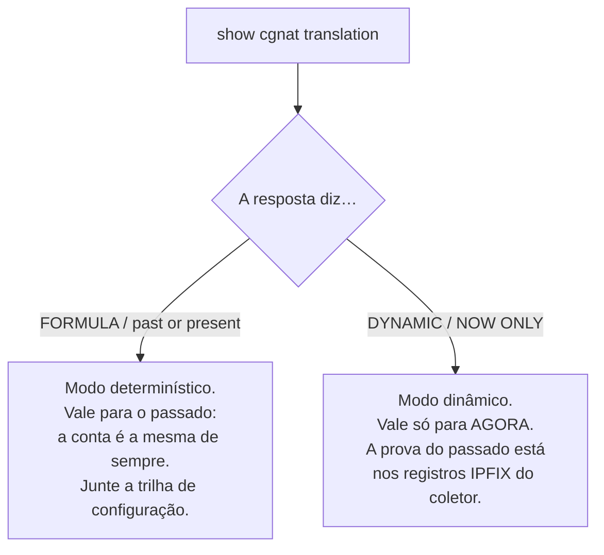
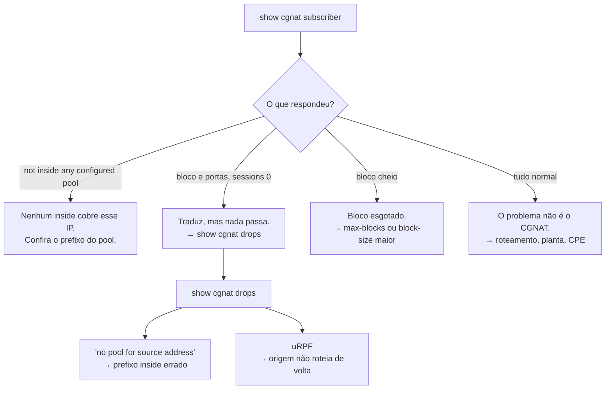

# Receitas do dia a dia

Tarefas concretas, com os comandos na ordem e o que conferir depois. Toda receita pressupõe que você já está na VTY.

# Atender uma ordem judicial

A pergunta é sempre a mesma: *quem estava usando o IP público X, porta Y, na data Z?*

```
show cgnat translation 203.0.113.7 4200
```

**Leia a resposta com atenção — ela diz quanto vale como prova:**



* `**FORMULA**` **+** `**past or present**` — a resposta veio da aritmética, que é estável. Ela responde por um instante passado **desde que você comprove qual configuração estava em vigor**. Junte a saída de `show cgnat history` referente à data.
* `**DYNAMIC**` **+** `**NOW ONLY**` — o bloco foi alocado sob demanda. Essa resposta descreve o presente e **não** é evidência sobre o passado. O que responde pelo passado são os registros IPFIX que foram para o coletor.

O comando é explícito nessa diferença de propósito: as duas fontes não valem a mesma coisa, e confundir uma com a outra é o tipo de erro que só aparece no tribunal.

```
show cgnat history          qual configuração estava em vigor, e quem a colocou lá
show cgnat history verify   confere a cadeia de hash da trilha e aponta a primeira entrada que não bate
```


:::info
**Pool determinístico com** `**reserve**`**: a porta pode não ser da fórmula.** Os blocos da reserva são entregues sob demanda, a assinantes que encheram o próprio bloco, e a fórmula não responde por eles — `show cgnat translation` não os atribui a ninguém. Quem responde por uma porta da reserva são os registros `natEvent 16` e `natEvent 17` que foram para o coletor, como num pool dinâmico.

:::

# Um assinante está sem internet

```
show cgnat subscriber 100.64.3.19
```



Cheque também se o prefixo dele não caiu numa lista de `bypass source` — nesse caso ele sai sem tradução e não aparece consumindo bloco.

# Testar se a caixa alcança um destino

Sem sair da VTY, e com qualquer conta — inclusive a somente leitura, porque não muda nada:

```
ping 198.51.100.1
ping 198.51.100.1 count 20 source 203.0.113.1
traceroute 198.51.100.1
mtr 198.51.100.1 count 10
```

`count` é quantos pacotes o `ping` manda (5 por padrão, até 100), quantos saltos o `traceroute` percorre no máximo, e quantos ciclos o `mtr` faz. `source` é o endereço de origem — sempre um endereço, nunca um nome. Os endereços saem sem resolução reversa, para não depender de um DNS que pode ser justamente o que está quebrado, e o `mtr` sai como relatório, legível num console serial.

Todos param sozinhos: pelo `count`, ou em 300 segundos no pior caso. Ctrl-C devolve o prompt antes disso. O teste sai pela pilha de rede do Linux da caixa, isto é, pelas rotas do roteamento — é a pergunta *"a caixa chega lá?"*, e não *"o assinante chega lá?"*.

# Abrir uma porta de entrada para um cliente

Câmera, servidor de jogo, VPN. A porta pública fica fixada no socket do cliente.

```
configure
 nat
  cgnat
   pool residencial
    forward tcp 8080 to 100.64.3.19 80
    exit
   exit
  exit
 commit
 exit
save
```

Confirme:

```
show cgnat forward
```


:::info
**O endereço público é o do próprio assinante**, não um IP avulso do pool. O cliente chega pelo IP que já é dele no mapeamento.

:::

Isso é um ajuste **aplicado no lugar**: não derruba sessão de ninguém.

# Limitar uma máquina infectada

Um host varrendo a internet consome o bloco inteiro e depois pede mais.

```
configure
 nat
  cgnat
   pool residencial
    max-sessions 2000
    max-session-rate 200
    exit
   exit
  exit
 commit
```

Também aplicado no lugar. Para achar o culpado antes:

```
show cgnat top
```

Ele lista os assinantes mais próximos de encher o bloco, com as portas que cada um segura (por exemplo `3/512`).

# Ampliar o pool sem derrubar todo mundo

**Existe um caminho que não derruba ninguém**, e ele não é crescer o pool atual.

Acrescentar um prefixo em `outside` muda a conta do mapeamento e move **todos** os assinantes ao mesmo tempo. Já um **segundo pool**, servindo uma fatia diferente do espaço de assinantes, tem o próprio mapeamento e não encosta no existente:

```
configure
 nat
  cgnat
   pool residencial-2
    inside 100.64.4.0/22
    outside 45.170.16.0/26
    block-size 512
    policy interleaved
    mode deterministic
    exit
   exit
  exit
 commit
 exit
save
```

Assinantes novos são provisionados na faixa interna do pool novo. Os dois pools convivem indefinidamente, e cada um tem o próprio registro de auditoria.

Se ampliar o pool existente for inevitável, aí sim é janela:

```
show configuration compare
commit check                 valida sem tocar no equipamento
commit                       recusa, e imprime quantos se movem e para onde
commit remap                 aplica de fato
```

Os números saem do `commit check`, antes de aplicar, e o `commit` comum imprime os mesmos ao recusar. Não são estimativa: o dataplane roda a mesma aritmética que rodaria depois, então a contagem é exata e vem com dois assinantes de exemplo. Registre esse número no chamado — é quantos clientes vão ligar.

O procedimento completo dos dois caminhos, com o que muda e o que não muda, está em [Ampliar capacidade sem derrubar assinantes](/doc/ampliar-capacidade-sem-derrubar-assinantes-rWQkaj9r1u).

# Trocar timeouts

```
configure
 nat
  cgnat
   pool residencial
    timeout udp 300
    timeout tcp-established 7440
    timeout port-holddown 120
    exit
   exit
  exit
 commit
```

Aplicado no lugar. `port-holddown` merece atenção: é quanto tempo uma porta liberada espera antes de ser reusada. Curto demais faz o registro de quem usava a porta se sobrepor ao do próximo dono.

# Desligar ou religar um ALG

FTP, RTSP, PPTP, SIP sobre UDP e a passagem de IPsec (ESP) vêm **ligados** em todo pool. O que se faz no dia a dia é o contrário: desligar um que atrapalha um cliente específico — em geral o SIP, quando o provedor de VoIP pede — ou religar um que alguém desligou.

```
configure
 nat
  cgnat
   pool residencial
    alg sip off
    exit
   exit
  exit
 commit
```

`alg sip on` religa; `no alg sip` apaga a escolha e volta ao padrão, que é ligado. Aplicado no lugar, sem derrubar sessão. Confira o que o dataplane está aplicando, pool a pool:

```
show cgnat alg
```

# Deixar um destino sem tradução

Servidor que precisa enxergar o IP real do assinante — um portal interno, um sistema de gestão.

```
configure
 nat
  cgnat
   pool residencial
    bypass destination 198.51.100.0/24
    exit
   exit
  exit
 commit
```

Tráfego em bypass sai **sem tradução e sem alocar bloco**.

# Conexões que travam sem erro

Sintoma clássico: a conexão abre, a transferência começa e para. Quase sempre é MSS.

```
configure
 nat
  cgnat
   pool residencial
    tcp-mss auto
    exit
   exit
  exit
 commit
```

`auto` deriva o valor das MTUs das interfaces de CGNAT.

# Achar uma linha numa configuração grande

Numa caixa com vinte pools e política de BGP, `show running-config` é várias telas. Qualquer `show` aceita filtro depois de uma barra vertical:

```
show running-config | section interface         o bloco de cada interface
show running-config | include mode dynamic      só as linhas com esse texto
show running-config | exclude description       tudo, menos as linhas com esse texto
show running-config | include timeout | count   quantas linhas casam
show cgnat top | first 10                       as dez primeiras linhas
show logging | last 40                          o fim do log
```

| Filtro | O que faz |
|--------|-----------|
| `include <texto>` (ou `match`) | mantém as linhas que contêm o texto |
| `exclude <texto>` | tira as linhas que contêm o texto |
| `section <texto>` | mantém a linha que casa e tudo que está indentado embaixo dela |
| `count` | o número de linhas, em vez das linhas |
| `first <n>`, `last <n>` | as primeiras ou as últimas `n` linhas |
| `no-more` | tudo de uma vez, sem parar em `--More--` |

Os filtros se encadeiam, da esquerda para a direita. O texto procurado pode ter espaços, e um par de aspas em volta dele inteiro é retirado antes da busca (`section "interface Gi"` procura `interface Gi`). Um filtro que não existe é recusado com a lista dos que existem — nunca ignorado.

O filtro roda sobre o que o comando já imprimiu, **depois** das ocultações: `show running-config | include password` mostra `<set, not shown>`, a mesma linha que apareceria sem filtro. Nenhum filtro alcança o valor por trás dela.

**Numa sessão interativa, todo** `**show**` **maior que a tela para em** `**--More--**`**.** Espaço mostra a próxima tela, Enter a próxima linha, e `q` ou Ctrl-C encerra a saída — não a sessão. `| no-more` desliga isso para um comando. `prismash -c`, um comando passado pelo `ssh` e uma saída que não vai para um terminal nunca param. O paginador é o da própria VTY, e não `more` nem `less`, que deixariam abrir um shell a partir dele.

# Desfazer uma mudança

```
show rollback           revisões disponíveis (as 20 mais recentes)
rollback 0              carrega a última commitada na candidata
show configuration compare
commit
```

O `rollback` **não aplica sozinho**: ele carrega a revisão na candidata, que você revisa e aplica como qualquer edição.

# Mexer numa máquina remota sem se trancar do lado de fora

```
configure
 ... a mudança ...
 commit confirmed 10
```

Se você continuar com acesso, confirme com `commit`. Se perder, espere 10 minutos e a máquina volta sozinha ao estado anterior — **inclusive se você não tiver mais nenhuma sessão aberta**, e inclusive se a máquina for reiniciada no meio da janela. O prazo fica gravado no equipamento, não na sessão que fez a mudança.

Quem entrar na VTY enquanto a janela estiver aberta é avisado logo no banner, com a hora em que a máquina vai desfazer.


:::warning
Não use `save` antes de confirmar. O desfazer devolve o que está valendo e não reescreve o arquivo de boot, então salvar uma mudança não confirmada a traz de volta no próximo reboot. Confirme primeiro, salve depois — o `save` avisa se você inverter a ordem.

:::

# Fazer manutenção numa caixa que faz par

A caixa que você quer mexer está com o endereço de serviço. Passe o serviço para a parceira antes, em vez de derrubar a caixa e descobrir depois se o par funcionava:

```
configure
 interface ens18
  vrrp 1 priority 50
  exit
 commit
```

A caixa avisa o que isso custa antes de aplicar:

```
  changing vrrp 1 on ens18 restarts it: this box stops advertising while it is
  rebuilt, the peer takes the address, and preempt hands it back - two
  elections, a few seconds apart
```

Confira em qual caixa o serviço ficou — `show cgnat ha` nas duas — e só então faça a manutenção. No fim, devolva a prioridade:

```
configure
 interface ens18
  vrrp 1 priority 200
  exit
 commit
```

Com `preempt` ligado, que é o padrão desta caixa, ela **retoma** o endereço assim que volta a anunciar a prioridade maior. É por isso que a configuração é a afirmação de quem deve ficar com o serviço: o par termina onde a configuração diz, e não onde a última falha deixou.


:::warning
**As conexões em curso caem nas duas trocas.** O assinante mantém o mesmo endereço público e o mesmo bloco de portas — é isso que o modo determinístico preserva —, mas as sessões em andamento não sobrevivem. Trate como janela, e não como operação transparente.

**A mudança precisa ir para as duas caixas.** Se você alterar pool numa caixa que faz par, o `commit` recusa enquanto a parceira discordar, e `commit diverge` é a palavra de quem sabe o que está fazendo: aplique a mesma mudança nos dois lados, e copie o `peer.conf` de novo depois.

:::

# Adicionar um operador que só mexe em CGNAT

```
configure
 user joao
  role cgnat-operator
  ssh-key ssh-ed25519 AAAAC3Nza... joao@noc
  exit
 commit
 exit
save
```

**Sem a linha** `**role**` **a conta entra somente leitura.** É o `role` que decide o que ela pode mudar, e o `commit` é quem o materializa nos grupos do sistema — acrescentando os que o papel exige e retirando os que ele não exige mais:

| `role` | Pode mudar |
|------|------------|
| `administrator` | tudo: roteamento, sistema, contas e CGNAT |
| `cgnat-operator` | somente CGNAT |
| ausente | somente leitura |

Confira com `show running-config`: o papel aparece dentro do bloco da conta. Uma promoção feita direto no grupo, por fora da VTY, é desfeita no commit seguinte.

Senha, se for usar, é **hash crypt** — nunca texto claro:

```sh
openssl passwd -6
```

# Apontar o log para um coletor

```
configure
 nat
  cgnat
   logging tcp 198.51.100.10 port 4739
   exit
  exit
 commit
 exit
save
```

```
show cgnat logging
```

Prefira TCP: com UDP, a queda do coletor é silenciosa, e registros de guarda legal somem sem ninguém notar.

Por UDP são dois comandos, e o destino vem primeiro — sem ele `commit check` recusa:

```
configure
 nat
  cgnat
   logging udp 198.51.100.10 src 198.51.100.1
   logging enable
   exit
  exit
 commit
 exit
save
```

# Ver também

* [Comandos show](/doc/comandos-show-YlNji1X5W4) — como ler cada resposta
* [Configuração de pool](/doc/configuracao-de-pool-btyS572Ih6) — a referência dos campos usados aqui
* [commit, rollback e save](/doc/commit-rollback-e-save-jqCB7kxPuA) — por que `commit` e `save` são dois passos
