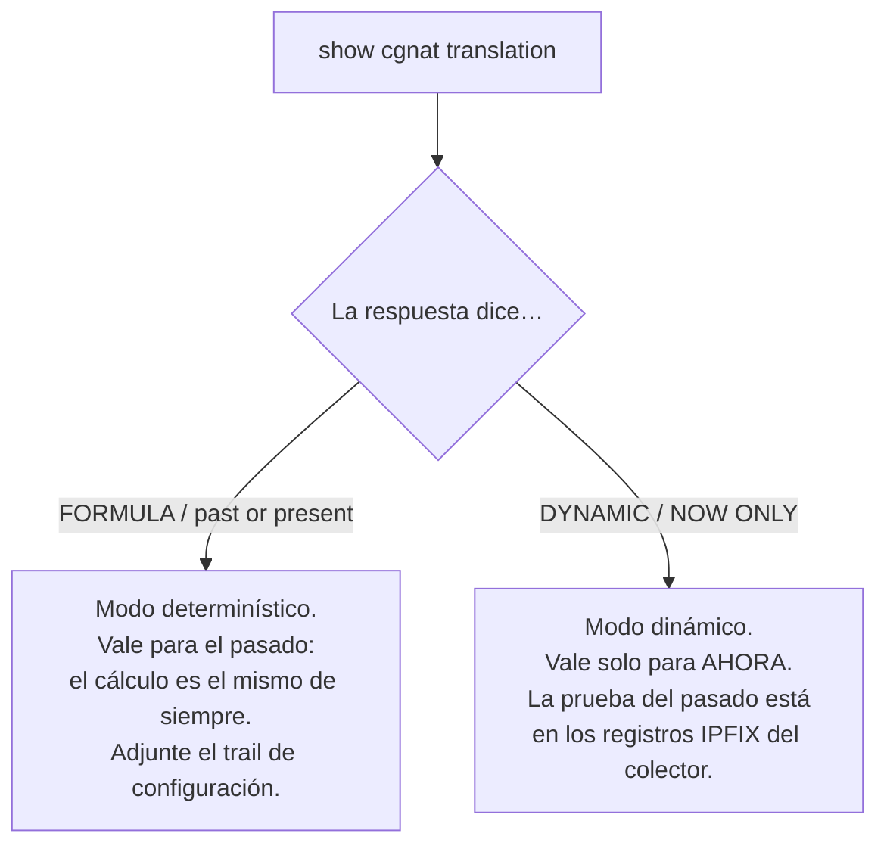
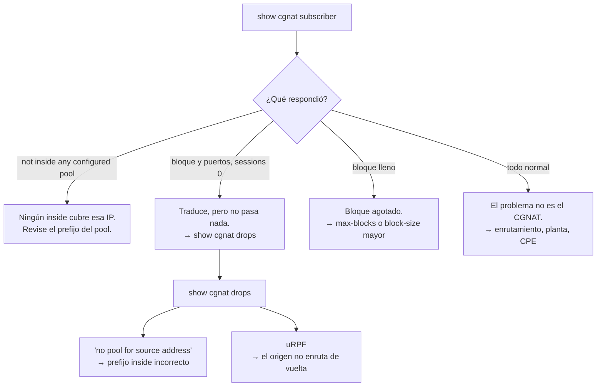

# Recetas del día a día

Tareas concretas, con los comandos en orden y qué verificar después. Toda receta supone que usted ya está en la VTY.

# Atender una orden judicial

La pregunta es siempre la misma: *¿quién estaba usando la IP pública X, puerto Y, en la fecha Z?*

```
show cgnat translation 203.0.113.7 4200
```

**Lea la respuesta con atención — dice cuánto vale como prueba:**



* `**FORMULA**` **+** `**past or present**` — la respuesta vino de la aritmética, que es estable. Responde por un instante pasado **siempre que usted compruebe qué configuración estaba vigente**. Adjunte la salida de `show cgnat history` correspondiente a la fecha.
* `**DYNAMIC**` **+** `**NOW ONLY**` — el bloque se asignó bajo demanda. Esa respuesta describe el presente y **no** es evidencia sobre el pasado. Lo que responde por el pasado son los registros IPFIX que fueron al colector.
* `**DETERMINISTIC RESERVE**` **+** `**NOW ONLY**` — el puerto es de un bloque de la reserva de un pool determinístico, que la fórmula no atribuye a nadie. El equipo dice quién tiene ese bloque ahora, si alguien lo tiene; por el pasado responden los registros que fueron al colector, como en el dinámico.

El comando es explícito en esa diferencia de propósito: las dos fuentes no valen lo mismo, y confundir una con la otra es el tipo de error que solo aparece en el tribunal.

```
show cgnat history          qué configuración estaba vigente, y quién la puso ahí
show cgnat history verify   verifica la cadena de hash del trail y señala la primera entrada que no coincide
```


:::info
**Pool determinístico con** `**reserve**`**: el puerto puede no ser de la fórmula.** Los bloques de la reserva se entregan bajo demanda, a suscriptores que llenaron su propio bloque, y la fórmula no responde por ellos. `show cgnat translation` marca esos puertos como `DETERMINISTIC RESERVE` y dice quién tiene el bloque ahora; quienes responden por un instante pasado son los registros `natEvent 16` y `natEvent 17` que fueron al colector, como en un pool dinámico.

:::

# Un suscriptor está sin internet

```
show cgnat subscriber 100.64.3.19
```



Verifique también que su prefijo no haya caído en una lista de `bypass source` — en ese caso sale sin traducción y no aparece consumiendo bloque.

# Probar si el equipo alcanza un destino

Sin salir de la VTY, y con cualquier cuenta — incluso la de solo lectura, porque no cambia nada:

```
ping 198.51.100.1
ping 198.51.100.1 count 20 source 203.0.113.1
traceroute 198.51.100.1
mtr 198.51.100.1 count 10
```

`count` es cuántos paquetes envía el `ping` (5 por defecto, hasta 100), cuántos saltos recorre como máximo el `traceroute`, y cuántos ciclos hace el `mtr`. `source` es la dirección de origen — siempre una dirección, nunca un nombre. Las direcciones salen sin resolución inversa, para no depender de un DNS que puede ser justamente lo que está roto, y el `mtr` sale como informe, legible en una consola serial.

Todos se detienen solos: por el `count`, o en 300 segundos en el peor caso. Ctrl-C devuelve el prompt antes. La prueba sale por la pila de red del Linux del equipo, es decir, por las rutas del enrutamiento — es la pregunta *"¿el equipo llega ahí?"*, y no *"¿el suscriptor llega ahí?"*.

# Abrir un puerto de entrada para un cliente

Cámara, servidor de juegos, VPN. El puerto público queda fijado en el socket del cliente.

```
configure
 nat
  cgnat
   pool residencial
    forward tcp 8080 to 100.64.3.19 80
    exit
   exit
  exit
 commit
 exit
save
```

Confirme:

```
show cgnat forward
```


:::info
**La dirección pública es la del propio suscriptor**, no una IP suelta del pool. El cliente llega por la IP que ya es suya en el mapeo.

:::

Este es un ajuste **aplicado sin reconstruir**: no tira la sesión de nadie.

# Limitar una máquina infectada

Un host que barre internet consume el bloque entero y después pide más.

```
configure
 nat
  cgnat
   pool residencial
    max-sessions 2000
    max-session-rate 200
    exit
   exit
  exit
 commit
```

También aplicado sin reconstruir. Para encontrar al culpable antes:

```
show cgnat top
```

Lista los suscriptores más cerca de llenar el bloque, con los puertos que tiene cada uno (por ejemplo `3/512`).

# Ampliar el pool sin tirar a todos

**Existe un camino que no tira a nadie**, y no es hacer crecer el pool actual.

Agregar un prefijo en `outside` cambia el cálculo del mapeo y mueve a **todos** los suscriptores al mismo tiempo. En cambio, un **segundo pool**, que sirve una porción diferente del espacio de suscriptores, tiene su propio mapeo y no toca el existente:

```
configure
 nat
  cgnat
   pool residencial-2
    prefix-inside 100.64.4.0/22
    prefix-outside 45.170.16.0/26
    block-size 512
    policy interleaved
    mode deterministic
    exit
   exit
  exit
 commit
 exit
save
```

Los suscriptores nuevos se aprovisionan en el rango interno del pool nuevo. Los dos pools conviven indefinidamente, y cada uno tiene su propio registro de auditoría.

Si ampliar el pool existente es inevitable, entonces sí es ventana:

```
show configuration compare
commit check                 valida sin tocar el equipo
commit                       rechaza, e imprime cuántos se mueven y adónde
commit remap                 aplica de verdad
```

Los números salen de `commit check`, antes de aplicar, y el `commit` común imprime los mismos al rechazar. No son una estimación: el dataplane ejecuta la misma aritmética que ejecutaría después, así que el conteo es exacto y viene con dos suscriptores de ejemplo. Registre ese número en el ticket — es cuántos clientes van a llamar.

El procedimiento completo de los dos caminos, con lo que cambia y lo que no cambia, está en [Ampliar la capacidad sin tirar suscriptores](/s/wiki-es/doc/ampliar-la-capacidad-sin-tirar-suscriptores-eHEJEg47aX).

# Cambiar timeouts

```
configure
 nat
  cgnat
   pool residencial
    timeout udp 300
    timeout tcp-established 7440
    timeout port-holddown 120
    exit
   exit
  exit
 commit
```

Aplicado sin reconstruir. `port-holddown` merece atención: es cuánto tiempo espera un puerto liberado antes de reutilizarse. Demasiado corto hace que el registro de quién usaba el puerto se superponga con el del próximo dueño.

# Desactivar o reactivar un ALG

FTP, RTSP, PPTP, SIP sobre UDP y el paso de IPsec (ESP) vienen **activados** en todo pool. Lo que se hace en el día a día es lo contrario: desactivar uno que molesta a un cliente específico — en general el SIP, cuando el proveedor de VoIP lo pide — o reactivar uno que alguien desactivó.

```
configure
 nat
  cgnat
   pool residencial
    alg sip off
    exit
   exit
  exit
 commit
```

`alg sip on` lo reactiva; `no alg sip` borra la elección y vuelve al valor por defecto, que es activado. Aplicado sin reconstruir, sin tirar sesiones. Verifique lo que el dataplane está aplicando, pool por pool:

```
show cgnat alg
```

# Dejar un destino sin traducción

Un servidor que necesita ver la IP real del suscriptor — un portal interno, un sistema de gestión.

```
configure
 nat
  cgnat
   pool residencial
    bypass destination 198.51.100.0/24
    exit
   exit
  exit
 commit
```

El tráfico en bypass sale **sin traducción y sin asignar bloque**.

# Conexiones que se cuelgan sin error

Síntoma clásico: la conexión abre, la transferencia empieza y se detiene. Casi siempre es MSS.

```
configure
 nat
  cgnat
   pool residencial
    tcp-mss auto
    exit
   exit
  exit
 commit
```

`auto` deriva el valor de las MTU de las interfaces de CGNAT.

# Encontrar una línea en una configuración grande

En un equipo con veinte pools y política de BGP, `show running-config` ocupa varias pantallas. Cualquier `show` acepta un filtro después de una barra vertical:

```
show running-config | section interface         el bloque de cada interfaz
show running-config | include mode bpa      solo las líneas con ese texto
show running-config | exclude description       todo, menos las líneas con ese texto
show running-config | include timeout | count   cuántas líneas coinciden
show cgnat top | first 10                       las diez primeras líneas
show log | last 40                              los 40 eventos más recientes
```

| Filtro | Qué hace |
|--------|----------|
| `include <texto>` (o `match`) | mantiene las líneas que contienen el texto |
| `exclude <texto>` | quita las líneas que contienen el texto |
| `section <texto>` | mantiene la línea que coincide y todo lo que está indentado debajo de ella |
| `count` | el número de líneas, en lugar de las líneas |
| `first <n>`, `last <n>` | las primeras o las últimas `n` líneas |
| `no-more` | todo de una vez, sin detenerse en `--More--` |

Los filtros se encadenan, de izquierda a derecha. El texto buscado puede tener espacios, y un par de comillas alrededor de todo el texto se quita antes de la búsqueda (`section "interface Gi"` busca `interface Gi`). Un filtro que no existe se rechaza con la lista de los que existen — nunca se ignora.

El filtro se ejecuta sobre lo que el comando ya imprimió, **después** de los ocultamientos: `show running-config | include password` muestra `<set, not shown>`, la misma línea que aparecería sin filtro. Ningún filtro alcanza el valor que hay detrás.

**En una sesión interactiva, todo** `**show**` **mayor que la pantalla se detiene en** `**--More--**`**.** Espacio muestra la siguiente pantalla, Enter la siguiente línea, y `q` o Ctrl-C termina la salida — no la sesión. `| no-more` desactiva esto para un comando. `prismash -c`, un comando pasado por `ssh` y una salida que no va a un terminal nunca se detienen. El paginador es el de la propia VTY, y no `more` ni `less`, que permitirían abrir un shell desde él.

# Deshacer un cambio

```
show rollback           revisiones disponibles (las 20 más recientes)
rollback 0              carga la última commiteada en la candidata
show configuration compare
commit
```

El `rollback` **no aplica solo**: carga la revisión en la candidata, que usted revisa y aplica como cualquier edición.

# Modificar una máquina remota sin quedarse afuera

```
configure
 ... el cambio ...
 commit confirmed 10
```

Si sigue teniendo acceso, confirme con `commit`. Si lo pierde, espere 10 minutos y la máquina vuelve sola al estado anterior — **incluso si ya no tiene ninguna sesión abierta**, e incluso si la máquina se reinicia en medio de la ventana. El plazo queda grabado en el equipo, no en la sesión que hizo el cambio.

Quien entre en la VTY mientras la ventana esté abierta recibe una advertencia en el banner, con la hora en que la máquina va a deshacer.


:::warning
No use `save` antes de confirmar. El deshacer devuelve lo que está vigente y no reescribe el archivo de arranque, así que guardar un cambio no confirmado lo trae de vuelta en el próximo reinicio. Confirme primero, guarde después — `save` advierte si usted invierte el orden.

:::

# Hacer mantenimiento en un equipo que forma par

El equipo que usted quiere tocar tiene la dirección de servicio. Pase el servicio al peer antes, en lugar de tirar el equipo y descubrir después si el par funcionaba:

```
configure
 interface ens18
  vrrp 1 priority 50
  exit
 commit
```

El equipo advierte lo que esto cuesta antes de aplicar:

```
  changing vrrp 1 on ens18 restarts it: this box stops advertising while it is
  rebuilt, the peer takes the address, and preempt hands it back - two
  elections, a few seconds apart
```

Verifique en qué equipo quedó el servicio — `show cgnat ha` en los dos — y solo entonces haga el mantenimiento. Al final, devuelva la prioridad:

```
configure
 interface ens18
  vrrp 1 priority 200
  exit
 commit
```

Con `preempt` activado, que es el valor por defecto de este equipo, **retoma** la dirección en cuanto vuelve a anunciar la prioridad mayor. Por eso la configuración es la afirmación de quién debe quedarse con el servicio: el par termina donde dice la configuración, y no donde lo dejó la última falla.


:::warning
**Las conexiones en curso se caen en los dos cambios.** El suscriptor mantiene la misma dirección pública y el mismo bloque de puertos — eso es lo que preserva el modo determinístico —, pero las sesiones en curso no sobreviven. Trátelo como ventana, y no como operación transparente.

**El cambio tiene que ir a los dos equipos.** Si usted modifica un pool en un equipo que forma par, el `commit` rechaza mientras el peer no coincida, y `commit diverge` es la palabra de quien sabe lo que está haciendo: aplique el mismo cambio en los dos lados, y copie el `peer.conf` de nuevo después.

:::

# Agregar un operador que solo toca CGNAT

```
configure
 user joao
  role cgnat-operator
  ssh-key ssh-ed25519 AAAAC3Nza... joao@noc
  exit
 commit
 exit
save
```

**Sin la línea** `**role**` **la cuenta entra en solo lectura.** Es el `role` el que decide qué puede cambiar, y el `commit` es quien lo materializa en los grupos del sistema — agregando los que el rol exige y quitando los que ya no exige:

| `role` | Puede cambiar |
|------|---------------|
| `administrator` | todo: enrutamiento, sistema, cuentas y CGNAT |
| `cgnat-operator` | solo CGNAT    |
| ausente | solo lectura  |

Verifique con `show running-config`: el rol aparece dentro del bloque de la cuenta. Una promoción hecha directamente en el grupo, por fuera de la VTY, se deshace en el siguiente commit.

La contraseña, si la va a usar, es **hash crypt** — nunca texto plano:

```sh
openssl passwd -6
```

# Apuntar el log a un colector

```
configure
 nat
  cgnat
   logging tcp 198.51.100.10 port 4739
   exit
  exit
 commit
 exit
save
```

```
show cgnat logging
```

Prefiera TCP: con UDP, la caída del colector es silenciosa, y los registros de retención legal desaparecen sin que nadie lo note.

Por UDP son dos comandos, y el destino va primero — sin él `commit check` rechaza:

```
configure
 nat
  cgnat
   logging udp 198.51.100.10 src 198.51.100.1
   logging enable
   exit
  exit
 commit
 exit
save
```

# Ver también

* [Comandos show](/s/wiki-es/doc/comandos-show-yfCeHVInDX) — cómo leer cada respuesta
* [Configuración de pool](/s/wiki-es/doc/configuracion-de-pool-Y3cACG9QHA) — la referencia de los campos usados aquí
* [commit, rollback y save](/s/wiki-es/doc/commit-rollback-y-save-6sAWJkXNO3) — por qué `commit` y `save` son dos pasos
