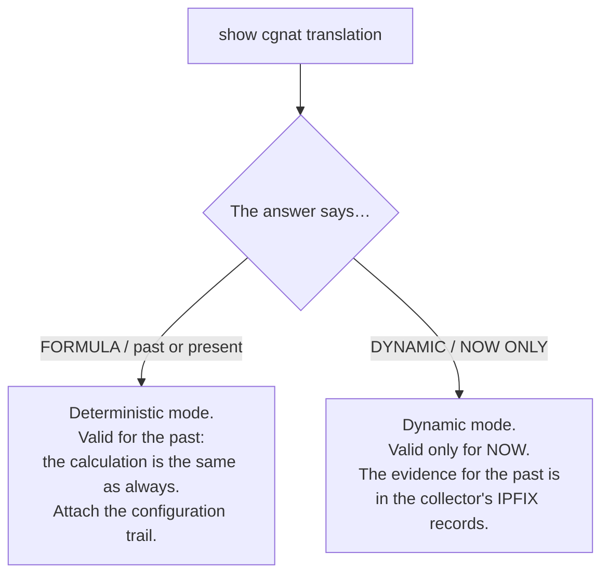
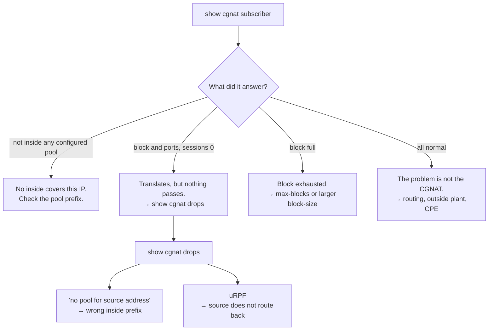

# Day-to-day recipes

Concrete tasks, with the commands in order and what to check afterwards. Every recipe assumes you are already in the VTY.

# Answering a court order

The question is always the same: *who was using public IP X, port Y, on date Z?*

```
show cgnat translation 203.0.113.7 4200
```

**Read the answer carefully — it tells you how much it is worth as evidence:**



* `**FORMULA**` **+** `**past or present**` — the answer came from arithmetic, which is stable. It answers for a past instant **as long as you prove which configuration was in effect**. Attach the output of `show cgnat history` for that date.
* `**DYNAMIC**` **+** `**NOW ONLY**` — the block was allocated on demand. This answer describes the present and is **not** evidence about the past. What answers for the past are the IPFIX records that went to the collector.
* `**DETERMINISTIC RESERVE**` **+** `**NOW ONLY**` — the port belongs to a reserve block of a deterministic pool, which the formula does not assign to anyone. The box says who holds that block now, if anyone does; for the past, the records that went to the collector answer, as in dynamic mode.

The command is explicit about this difference on purpose: the two sources are not worth the same, and confusing one with the other is the kind of mistake that only shows up in court.

```
show cgnat history          which configuration was in effect, and who put it there
show cgnat history verify   checks the trail's hash chain and points to the first entry that does not match
```


:::info
**Deterministic pool with** `**reserve**`**: the port may not be from the formula.** Reserve blocks are handed out on demand, to subscribers who filled their own block, and the formula does not answer for them. `show cgnat translation` marks these ports as `DETERMINISTIC RESERVE` and says who holds the block now; what answers for a past instant are the `natEvent 16` and `natEvent 17` records that went to the collector, as in a dynamic pool.

:::

# A subscriber has no internet

```
show cgnat subscriber 100.64.3.19
```



Also check that their prefix has not ended up in a `bypass source` list — in that case it goes out untranslated and does not show up consuming a block.

# Testing whether the box reaches a destination

Without leaving the VTY, and with any account — including the read-only one, because it changes nothing:

```
ping 198.51.100.1
ping 198.51.100.1 count 20 source 203.0.113.1
traceroute 198.51.100.1
mtr 198.51.100.1 count 10
```

`count` is how many packets `ping` sends (5 by default, up to 100), the maximum number of hops `traceroute` goes through, and how many cycles `mtr` runs. `source` is the source address — always an address, never a name. Addresses are shown without reverse resolution, so as not to depend on a DNS that may be exactly what is broken, and `mtr` comes out as a report, readable on a serial console.

They all stop on their own: by `count`, or at 300 seconds in the worst case. Ctrl-C returns the prompt before that. The test goes out through the box's Linux network stack, that is, through the routing routes — it is the question *"does the box get there?"*, and not *"does the subscriber get there?"*.

# Opening an inbound port for a customer

Camera, game server, VPN. The public port is pinned to the customer's socket.

```
configure
 nat
  cgnat
   pool residencial
    forward tcp 8080 to 100.64.3.19 80
    exit
   exit
  exit
 commit
 exit
save
```

Confirm:

```
show cgnat forward
```


:::info
**The public address is the subscriber's own**, not a separate IP from the pool. The customer is reached through the IP that is already theirs in the mapping.

:::

This is a change **applied in place**: it does not drop anyone's sessions.

# Limiting an infected machine

A host scanning the internet consumes its whole block and then asks for more.

```
configure
 nat
  cgnat
   pool residencial
    max-sessions 2000
    max-session-rate 200
    exit
   exit
  exit
 commit
```

Also applied in place. To find the culprit first:

```
show cgnat top
```

It lists the subscribers closest to filling their block, with the ports each one holds (for example `3/512`).

The limits apply to what is created afterwards: the sessions the host already has carry on. To end them at once, without touching the configuration — with an `administrator` or `cgnat-operator` account:

```
clear cgnat subscriber 100.64.3.19
```

Every session of that subscriber ends, on every worker, and the box says how many it ended. On a BPA pool the block does not come back at once: it is held for the `block-holddown` and released with its release record in the log, as an ordinary expiry would.

# Growing the pool without dropping everyone

**There is a path that drops no one**, and it is not growing the current pool.

Adding a prefix to `prefix-outside` changes the mapping calculation and moves **all** subscribers at the same time. A **second pool**, on the other hand, serving a different slice of the subscriber space, has its own mapping and does not touch the existing one:

```
configure
 nat
  cgnat
   pool residencial-2
    prefix-inside 100.64.4.0/22
    prefix-outside 45.170.16.0/26
    block-size 512
    policy interleaved
    mode deterministic
    exit
   exit
  exit
 commit
 exit
save
```

New subscribers are provisioned in the new pool's inside range. The two pools coexist indefinitely, and each has its own audit record.

If growing the existing pool is unavoidable, then it is a window:

```
show configuration compare
commit check                 validates without touching the equipment
commit                       refuses, and prints how many move and where to
commit remap                 actually applies it
```

The numbers come from `commit check`, before applying, and a plain `commit` prints the same ones when it refuses. They are not an estimate: the dataplane runs the same arithmetic it would run afterwards, so the count is exact and comes with two example subscribers. Record that number in the ticket — it is how many customers are going to call.

The full procedure for both paths, with what changes and what does not, is in [Expanding capacity without dropping subscribers](/s/wiki-en/doc/expanding-capacity-without-dropping-subscribers-R1zYvsfLCT).

# Changing timeouts

```
configure
 nat
  cgnat
   pool residencial
    timeout udp 300
    timeout tcp-established 7440
    timeout port-holddown 120
    exit
   exit
  exit
 commit
```

Applied in place. `port-holddown` deserves attention: it is how long a released port waits before being reused. Too short makes the record of who was using the port overlap with that of the next owner.

# Turning an ALG off or back on

FTP, RTSP, PPTP, SIP over UDP and IPsec (ESP) passthrough come **on** in every pool. What you do day to day is the opposite: turn off one that gets in a specific customer's way — usually SIP, when the VoIP provider asks — or turn back on one someone turned off.

```
configure
 nat
  cgnat
   pool residencial
    alg sip off
    exit
   exit
  exit
 commit
```

`alg sip on` turns it back on; `no alg sip` clears the choice and returns to the default, which is on. Applied in place, without dropping sessions. Check what the dataplane is applying, pool by pool:

```
show cgnat alg
```

# Leaving a destination untranslated

A server that needs to see the subscriber's real IP — an internal portal, a management system.

```
configure
 nat
  cgnat
   pool residencial
    bypass destination 198.51.100.0/24
    exit
   exit
  exit
 commit
```

Bypass traffic goes out **untranslated and without allocating a block**.

# Connections that hang without an error

Classic symptom: the connection opens, the transfer starts and stops. It is almost always MSS.

```
configure
 nat
  cgnat
   pool residencial
    tcp-mss auto
    exit
   exit
  exit
 commit
```

`auto` derives the value from the MTUs of the CGNAT interfaces.

# Finding a line in a large configuration

On a box with twenty pools and BGP policy, `show running-config` is several screens. Any `show` accepts a filter after a vertical bar:

```
show running-config | section interface         the block of each interface
show running-config | include mode bpa      only the lines with this text
show running-config | exclude description       everything except the lines with this text
show running-config | include timeout | count   how many lines match
show cgnat top | first 10                       the first ten lines
show log | last 40                              the 40 newest events
```

| Filter | What it does |
|--------|--------------|
| `include <text>` (or `match`) | keeps the lines that contain the text |
| `exclude <text>` | removes the lines that contain the text |
| `section <text>` | keeps the matching line and everything indented under it |
| `count` | the number of lines, instead of the lines |
| `first <n>`, `last <n>` | the first or last `n` lines |
| `no-more` | everything at once, without stopping at `--More--` |

Filters chain, from left to right. The search text may contain spaces, and a pair of quotes around the whole of it is removed before the search (`section "interface Gi"` searches for `interface Gi`). A filter that does not exist is refused with the list of those that do — never ignored.

The filter runs over what the command has already printed, **after** the redactions: `show running-config | include password` shows `<set, not shown>`, the same line that would appear without a filter. No filter reaches the value behind it.

**In an interactive session, every** `**show**` **larger than the screen stops at** `**--More--**`**.** Space shows the next screen, Enter the next line, and `q` or Ctrl-C ends the output — not the session. `| no-more` turns this off for one command. `prismash -c`, a command passed via `ssh` and output that does not go to a terminal never stop. The pager is the VTY's own, and not `more` or `less`, which would allow opening a shell from it.

# Undoing a change

```
show rollback           available revisions (the 20 most recent)
rollback 0              loads the last committed one into the candidate
show configuration compare
commit
```

`rollback` **does not apply on its own**: it loads the revision into the candidate, which you review and apply like any edit.

# Working on a remote machine without locking yourself out

```
configure
 ... the change ...
 commit confirmed 10
```

If you still have access, confirm with `commit`. If you lose it, wait 10 minutes and the machine reverts to the previous state on its own — **even if you no longer have any session open**, and even if the machine is restarted in the middle of the window. The deadline is stored on the equipment, not in the session that made the change.

Anyone who enters the VTY while the window is open is warned right in the banner, with the time at which the machine will revert.


:::warning
Do not use `save` before confirming. The revert restores what is running and does not rewrite the boot file, so saving an unconfirmed change brings it back at the next reboot. Confirm first, save afterwards — `save` warns you if you reverse the order.

:::

# Doing maintenance on a box that is part of a pair

The box you want to work on holds the service address. Move the service to the peer first, instead of taking the box down and finding out afterwards whether the pair worked:

```
configure
 interface ens18
  vrrp 1 priority 50
  exit
 commit
```

The box warns what this costs before applying:

```
  changing vrrp 1 on ens18 restarts it: this box stops advertising while it is
  rebuilt, the peer takes the address, and preempt hands it back - two
  elections, a few seconds apart
```

Check which box ended up with the service — `show cgnat ha` on both — and only then do the maintenance. At the end, restore the priority:

```
configure
 interface ens18
  vrrp 1 priority 200
  exit
 commit
```

With `preempt` on, which is this box's default, it **takes back** the address as soon as it advertises the higher priority again. That is why the configuration is the statement of who should hold the service: the pair ends up where the configuration says, and not where the last failure left it.


:::warning
**Connections in progress drop on both switchovers.** The subscriber keeps the same public address and the same port block — that is what deterministic mode preserves —, but the sessions in progress do not survive. Treat it as a window, not as a transparent operation.

**The change needs to go to both boxes.** If you change a pool on a box that is part of a pair, `commit` refuses while the peer disagrees, and `commit diverge` is the word of someone who knows what they are doing: apply the same change on both sides, and copy `peer.conf` again afterwards.

:::

# Adding an operator who only touches CGNAT

```
configure
 user joao
  role cgnat-operator
  ssh-key ssh-ed25519 AAAAC3Nza... joao@noc
  exit
 commit
 exit
save
```

**Without the** `**role**` **line the account logs in read-only.** It is `role` that decides what it can change, and `commit` is what materializes it in the system groups — adding the ones the role requires and removing the ones it no longer requires:

| `role` | Can change |
|------|------------|
| `administrator` | everything: routing, system, accounts and CGNAT |
| `cgnat-operator` | CGNAT only |
| absent | read-only  |

Check with `show running-config`: the role appears inside the account block. A promotion made directly in the group, outside the VTY, is undone at the next commit.

A password, if you use one, is a **crypt hash** — never clear text:

```sh
openssl passwd -6
```

# Pointing the log to a collector

```
configure
 nat
  cgnat
   logging tcp 198.51.100.10 port 4739
   exit
  exit
 commit
 exit
save
```

```
show cgnat logging
```

Prefer TCP: with UDP, a collector outage is silent, and legal retention records disappear without anyone noticing.

Over UDP it is two commands, and the destination comes first — without it `commit check` refuses:

```
configure
 nat
  cgnat
   logging udp 198.51.100.10 src 198.51.100.1
   logging enable
   exit
  exit
 commit
 exit
save
```

# See also

* [show commands](/s/wiki-en/doc/show-commands-3WvebaLZkm) — how to read each answer
* [Pool configuration](/s/wiki-en/doc/pool-configuration-wkJ1DcmG2Y) — the reference for the fields used here
* [commit, rollback and save](/s/wiki-en/doc/commit-rollback-and-save-HVsz5GElE1) — why `commit` and `save` are two steps
