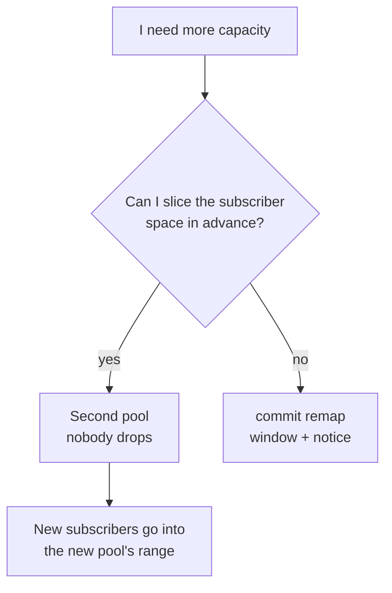

# Expanding capacity without dropping subscribers

How to add capacity to a CGNAT in production. There is a path that drops every subscriber and one that drops nobody — this page shows both and says when each one applies.

# Why expanding is dangerous here

The mapping is `subscriber index → (public address, port block)`, **computed** from the pool's address sets, the block size, the port range and the policy. Anything that changes the **divisor** changes the answer for almost everyone.

| Change | What moves |
|--------|------------|
| adding or removing a public prefix | the divisor changes: **every** subscriber |
| changing `block-size` | blocks per address change: almost everyone — only those whose block starts on the same port stay put |
| changing `ports` | same as block size |
| changing `policy` | `interleaved` and `blocked` divide the index in different ways: **everyone** |
| changing `mode` | `deterministic` and `bpa` are not the same mapping — and this is the only mapping change that `commit` does **not** refuse: the count is only made when the pool in effect and the new one are both deterministic, so changing the mode is applied without the warning below |
| adding or removing an **inside** prefix | changes the index of every address after it |
| changing the pool's `prefix-list-inside` or `prefix-list-outside`, or an entry of the list it uses | the same as typing the prefixes: what counts is the set of addresses the list resolves to. If it changes, the pool is rebuilt, and on a deterministic pool `commit` makes the count and asks for `commit remap` as above. `show configuration compare` shows the new sets under each pool affected |
| changing `reserve` | the capacity the formula can use changes. With `interleaved` **nobody moves**: only subscribers above the new capacity lose their block. With `blocked` the divisor is the block count, and almost everyone moves. In both cases it is a capacity change and calls for `commit remap` |
| changing `vrf` or `outside-vrf` | **no subscriber moves**, and even so every session in the pool ends: the arithmetic does not change, so `commit` does not ask for `commit remap`, but the pool is rebuilt |
| timeouts, ALGs, `filter`, `max-blocks`, `initial-allocation`, `block-stride`, `tcp-mss`, per-subscriber limits, `utilisation-alarm`, forwards, bypass | **nothing** — these are settings applied in place, on a pool carrying traffic |


:::info
**On a dynamic pool the refusal on this page does not exist.** Counting who moves only makes sense where the block is a formula. On a `mode bpa` pool, changing prefix, block size, port range, policy, VRF or mode rebuilds the pool all the same — every session in it ends at the instant of the `commit` —, but `commit` goes through without asking for `commit remap` and without printing any count. The blocks the pool held are released with one `natEvent 17` each, stamped at the instant of the change, so the log stays closed. Treat the change as the outage it is: window, notice, and then `show cgnat blocks` to see blocks being allocated again.

:::

# What does not change, even in the worst case

* **Past answers remain resolvable.** The trail records the complete definition, dated in UTC, at every change. A request about last month is answered with last month's definition.
* **Nothing is corrupted.** Sessions end; they do not become wrong.
* **The log stays complete.** In dynamic mode the allocation and release events are not affected, and replacing the pool closes every block it held with a release; in deterministic mode there are none to affect, except the blocks handed out from a `reserve`, which are also closed.

# Measure first

```
configure
 nat
  cgnat
   pool residencial
    prefix-outside 45.170.16.0/26
    exit
   exit
  exit
 commit check
```

`commit check` measures, without touching the equipment: it warns that the change re-maps subscribers, prints the count and up to two example subscribers, and reminds you that `commit` will refuse. The plain `commit` prints the same count when it **refuses** the change, and only applies when it is asked for by name. Both also work from inside the pool block, without having to leave it.

And the count **is not an estimate**: the dataplane holds both definitions and runs the same arithmetic it would run afterwards. It answers how many subscribers move, how many hold live state at that instant, and where two of them go. A subscriber the new definition no longer serves counts as moved — and the example says it is now served by no block at all, which is the same outage for the customer and worse for you, because nothing will record it.

At the plain `commit`, the refusal is this:

```
error: this change re-maps subscribers that already have mappings
    1024 of 1024 subscribers change public address or port block; 61 hold live
    state right now
    100.64.0.0 moves from 200.150.0.16:1024-1535 to 45.170.16.0:1024-1535
    100.64.0.1 moves from 200.150.0.17:1024-1535 to 45.170.16.1:1024-1535
    every session on this pool ends when it is applied. Past answers stay
    resolvable - the configuration trail records which definition was in force
    - but the subscribers do not.
    if that is what you mean, type: commit remap
```


:::info
The difference between an operator who hears *"this changes the mapping"* and one who reads the line above is knowing what they are about to do.

Record that first number in the change ticket: **it is the number of customers who are going to call.**

:::

# Before expanding a dynamic pool: the count is per worker

On a dynamic pool the blocks are split among the dataplane workers, and each subscriber takes blocks only from its own worker's slice — which slice is theirs is arithmetic on the inside address, not a counter. That is why a subscriber can be refused with free blocks in the slice next door, and why the capacity the pool can promise is smaller than the total number of blocks.

`show cgnat pool` gives that number when it is smaller than the total: a line with how many subscribers the pool serves **whatever their address**, and the reason — the blocks split among the workers. Size by it, not by the total. The loss is zero when your DHCP hands out inside addresses in sequence from the start of the range, and it weighs on a small pool with many workers.

The dataplane knows how to lend a block from one slice to another, but that ships **turned off** and has no command in the VTY. The demand the lending reads is the number of **distinct** subscribers the slice refused in the last five seconds that still hold no block — not a count of refused packets. Measured on a bench with an uneven load across three workers, turned on it took the crowded slice from 13-15% of its sessions unserved to 0.4%; in exchange, 7-9% of the sessions of the slices that lend were refused at first (served after 6-9 seconds, median) and about 1% went unserved. On an even load it has not been measured yet, which is why it stays off by default. If your dynamic pool refuses with free blocks, the answer today is capacity — more public addresses or a second pool, through the paths below.

# The procedure that costs an outage

Accept it when the pool is small, the window is agreed, or the alternative below cannot be arranged.


1. `commit check` (or `commit`) and read the count. Record it in the ticket.
2. Choose a window. Every session in the pool ends — not gracefully, not after a timeout, but **at the instant of the commit**.
3. `commit remap`.
4. Confirm on the packet, not on the configuration:

```
show cgnat subscriber <address-you-know>
```

and verify that it holds the block the new definition predicts.

Subscribers reconnect on their own — a CPE reopens sessions in seconds — but whatever was long-lived (a VPN, an SSH session, a download) is gone.

# The procedure that does NOT cost an outage

**Add capacity as a second pool, instead of growing the first.**

A pool is selected by the inside prefix, so a new pool serving a **different** slice of the subscriber space has its own mapping and does not disturb the existing one.

```
nat
 cgnat
  pool residencial      ← untouched, keeps the mapping
   prefix-inside 100.64.0.0/22
   prefix-outside 200.150.0.16/28
   exit
  pool residencial-2    ← the new capacity
   prefix-inside 100.64.4.0/22
   prefix-outside 45.170.16.0/26
   exit
  exit
 exit
```



Rules that come with it:

* Existing subscribers **should not** be moved between pools while in service: moving one is the same re-mapping, one customer at a time.
* New subscribers are addressed in the new pool's inside range as they are provisioned.
* The two pools coexist indefinitely. **There is no requirement to merge them** — and merging later is exactly the outage this avoided.
* Each pool has its own audit record, so an answer about a subscriber names the pool that served it.

The cost is slicing the address space in advance and carrying two pools instead of one. It is the price of not disconnecting everyone, and it is usually cheap.

On a dynamic pool the same path applies, for the same reason: the new pool has its own blocks and the existing one is not rebuilt.

Multi-tenant boxes have a third option: binding pools to **VRFs**, so that the same inside range is served by two pools without overlap. That solves tenancy, not capacity — two pools in the same VRF still cannot claim the same range.


:::info
**On a box that forms a pair with another** (a service address in `vrrp`), any mapping change made on only one of them leaves the two mapping subscribers differently, and `commit` refuses for that reason too until it hears `commit diverge`. That is expected: the two boxes do not get the `commit` at the same instant. Make the same change on the other right after and check with `show cgnat ha`; the procedure is in [High availability](/s/wiki-en/doc/high-availability-cMUVBBTFgL).

:::

# What is not offered, on purpose

**Graceful migration.** There is no mode in which old sessions keep the old mapping while new ones use the new one. That would mean two mappings for one subscriber, and the reverse arithmetic — the property deterministic mode exists for — could not tell them apart. A box that answered a court order with *"it depends on which of the two definitions was in effect for that specific session"* would have given up what it was built to offer.

**Automatic capacity growth.** For the same reason: a mapping that changes without anyone ordering it is a mapping nobody can reconstruct.

# How to check

```
show cgnat pool
show cgnat subscriber <ip from each pool>
show cgnat history
```


:::success
Each pool listed with the expected definition, one subscriber from each returning the predicted block, and the trail recording the change with the operator who made it. On a dynamic pool, `show cgnat blocks` counts allocations again after the change.

:::

# See also

* [Deterministic and BPA — concepts and mapping](/s/wiki-en/doc/deterministic-and-bpa-concepts-and-mapping-NMOHVImQiU) — the arithmetic that makes this unavoidable
* [Sizing and requirements](/s/wiki-en/doc/sizing-and-requirements-IHPnUSMSom) — the public address math
* [commit, rollback and save](/s/wiki-en/doc/commit-rollback-and-save-HVsz5GElE1) — why `commit remap` exists
