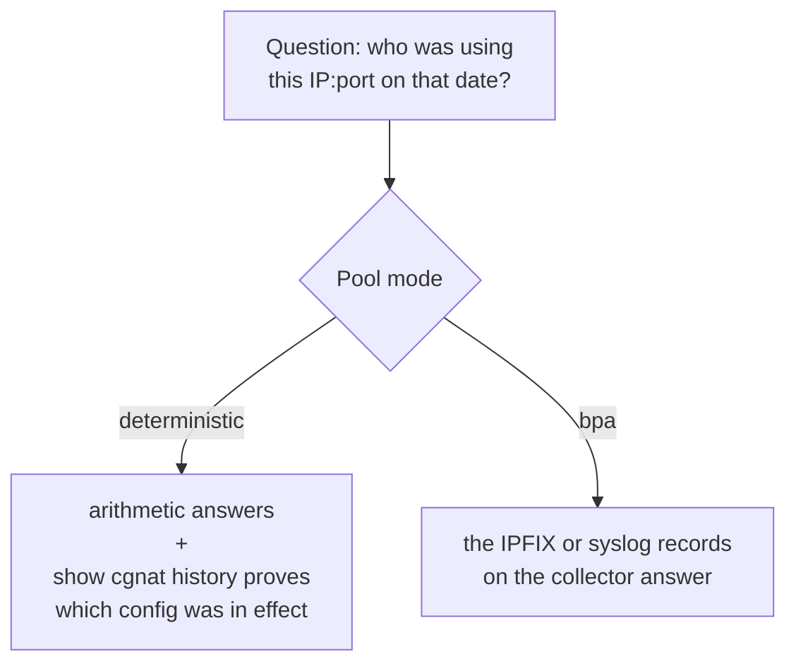
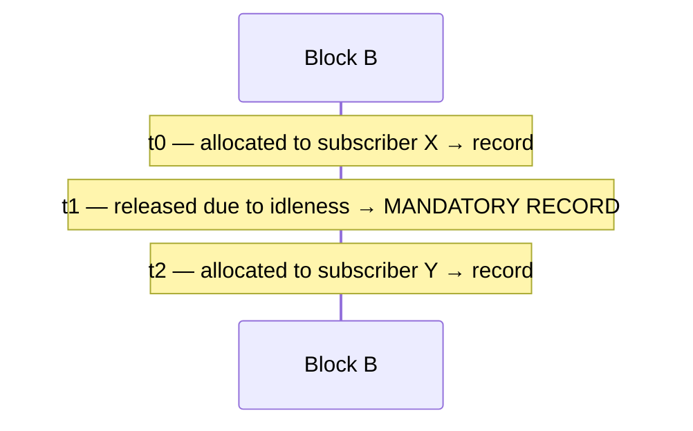

# IPFIX logging and audit trail

Two different things with the same goal — being able to answer *"who was using this public IP, on this port, at this instant?"* — and that apply to different modes.




:::info
**The box does not keep connection records: it exports them, and whoever keeps the year of retention is your collector.** The box's log volume holds only two things: the configuration trail and the exporter spill, the records that a collector that is down has not yet received. Each transport's spill stops at 256 MB whatever the size of the volume: that ceiling is what says how long the box can keep exporting to an unreachable collector, and nothing there is history.

:::

# Deterministic mode: the configuration **is** the log

There are no per-subscriber allocation events, so there is nothing to export. The evidence offered to an authority is:

> the algorithm, plus the configuration that was in effect at that instant

That only holds as long as it is known **which** configuration was in effect. That is what the **configuration trail** exists for.

**One exception: the** `**reserve**`**.** A deterministic pool with `reserve` keeps blocks outside the formula to hand to whoever fills their own block. These are precisely the blocks the formula does **not** produce, so each one goes out as `natEvent 16` when handed out and `natEvent 17` when it comes back, just like a block of a BPA pool — and such a pool needs export turned on like a BPA pool.

## The configuration trail

Properties that are not accidental:

* **Append-only** — nothing is rewritten.
* `**fsync**` **on every entry** — survives a power loss.
* **Carries the whole definition, not a diff** — rebuilding the state on a date by adding up diffs from the beginning is fragile; keeping the complete state is not.
* **Records the operator who made the change**, captured at the instant the change is applied.
* **Not only the pool definition**: every forward added or removed, and every interface attached to or detached from CGNAT, with the side (`inside` or `outside`) on the line. Pools say *how* to translate and interfaces say *where*; a trail that omitted the second would describe a mapping that might not even have been in effect.
* **Each entry ends with a sequence number and a SHA-256 digest**, which is what makes it possible to prove it was not edited (further below).

Each entry names who made the change in one of these formats:

| On the line | What it means |
|-------------|---------------|
| `by marina uid 1001 via api` | the VTY knew the account name and the uid it was acting with |
| `by marina uid 0 via api` | marina, **acting as root** — which neither field says on its own |
| `by uid 1001 via api` | the system could not name the account; the number is what is known |
| `by unattributed via cli` | typed directly into the dataplane, where there is no session to ask |
| `by unattributed via api` | an API client that sent no identity at all |

An entry that cannot be attributed to someone **says so**, with the word `unattributed`. Omitting the field would be indistinguishable from an entry for which no one was responsible — and a request with no name and no uid is recorded as unattributed, never credited to root.


:::info
**What attribution is, and what it is not.** It is the record of which operator did what among the people who already have access to the box — which is what an audit trail is. It is not evidence against those who have access: the client declares its own identity, and whoever reaches the API can already reconfigure the box.

:::

```
show cgnat history
```

In the trail, a BPA pool appears as `mode dynamic`, the word from before 0.151.0: an entry is never reworded, and new ones use the same word as the old ones.

# BPA mode: per-block IPFIX

One record per **block allocation** (RFC 8158) — not per flow. It is the difference between a few records per subscriber per day and one per connection.

Three transports, which can be on at the same time:

| Transport | Where it goes out | When to use |
|-----------|-------------------|-------------|
| IPFIX over UDP | through the box's log container, from a socket on the `src` address; through the dataplane itself when the exporter is in a VRF, when the container cannot use that address or when it is not running | telemetry. Loses records under congestion, without warning |
| IPFIX over TCP | through the box's Linux (the log container; the dataplane itself if the container is not running), with spill to disk if the collector goes down | **legal retention**. Carries the subscriber identity, like syslog; UDP does not |
| syslog (RFC 5424 over TCP) | through Linux, with the same spill | the collector that only reads syslog, which is most of them |


:::warning
**A BPA pool with no export at all is a pool that cannot answer a court order.** In BPA mode the exported record is the only evidence of who held a public port. `commit check` and `commit` warn, naming the pool, when a BPA pool — or deterministic with `reserve` — is going to sit on a box where nothing exports: neither UDP on with a collector, nor a TCP collector, nor syslog. It is a warning and not a refusal, because a pool set up before the collector exists is a correct configuration; but do not leave it carrying subscribers like that.

:::

## Configuring

UDP export needs to know **where** to go before it is turned on. It is two commands, in this order:

```
configure
 nat
  cgnat
   logging udp <collector> src <source> [port <n>]   UDP destination
   logging enable                                  turns on UDP export
   exit
  exit
 commit
```

`src` is the source address of the IPFIX packets and **is not optional**: without it the box refuses. Use an address the collector recognizes as being this box — normally the management one. Without `port`, 4739 applies, the port registered by RFC 7011.

The other commands, all under `nat` > `cgnat`:

| Command | What it does |
|---------|--------------|
| `logging tcp <collector> [port <n>]` | export over TCP |
| `logging tcp disable` | turns off the TCP transport |
| `logging syslog <collector> enterprise <n> [port <n>] [facility <0-23>] [severity <0-7>]` | exports the same events as syslog lines (RFC 5424) |
| `logging syslog disable` | turns off the syslog transport |
| `logging udp disable` | clears the UDP destination |
| `logging disable` | turns off UDP export |

The UDP destination comes back in `show running-config`, survives `save`, `rollback` and boot — and is reapplied in the right order, the destination before the state.

### If you turn on export without saying where

`commit check` refuses before applying anything:

```
error: cgnat logging enable: UDP export has no collector
    nothing would leave this box; add 'logging udp <collector> src <source>'
    beside it under 'nat' / 'cgnat', or export over TCP with 'logging tcp
    <collector>'
    the dataplane refuses the statement, and it would refuse it half way
    through this commit
```

`logging tcp` does **not** satisfy this requirement: the two transports are independent paths, and `logging enable` turns on the UDP one.

The refusal applies when it is **this change** that creates the problem. On a box that is already in that state — export on and the destination cleared underneath it — the same sentence comes out as `warning:` and the commit goes through, because otherwise the only configuration the box could not apply would be precisely the one that fixes it.


:::warning
**In versions up to 0.63.0, UDP export did not work on any installed appliance.** There was no VTY command to say which collector to send to, so the dataplane refused `logging enable` — and, up to 0.63.0, `commit` answered `commit complete` over that refusal. An operation that believed it was keeping legal retention records was keeping nothing.

If you run BPA mode (called `dynamic` until 0.151.0) and turned on UDP export on an earlier version, treat it as a retention gap for that period: the records from that interval do not exist. TCP export was never affected.

:::

### Checking that it is actually exporting

```
show cgnat logging       export state and where it goes
```

An `exporter` line with an address is proof that a destination exists; `exporter none` means nothing goes out over UDP, **even with the state** `**enabled**` — clearing the destination does not turn off export, it just leaves it with nowhere to go.

The same screen has one part for the TCP transport and another for syslog. Each says the collector and whether it is `connected`, `connecting` or `disconnected`, how much has been sent and how much is pending, and the `spill` line: bytes on disk, how many have already gone back to the collector and how many were discarded. A transport that is off shows as `disabled`.

Above the two, a line says who carries the TCP streams: `TCP streams carried by the log container`, the box's log container, or `TCP streams carried by the dataplane` when it is not running. In the UDP part, the `sender` line says the same for IPFIX over UDP and, when it is the dataplane, why. And each transport's `file` line says how many bytes the spill file holds now, its ceiling (256 MB) and how much the ceiling has already refused.

The boot self-test also checks this, and compares two different things: what the box was told to do and what the dataplane actually has. If the configuration asks for export and the dataplane does not have it, the boot fails and says which of the two halves did not take — because a refused configuration is indistinguishable from one that is working when you only look at the file.

```
show cgnat logging       export state
show cgnat blocks        currently allocated blocks (and how many are pinned)
```

The blocks in use now; the records already exported are on the collector.

### Watching the records live

`show cgnat logging` shows counters. To see the actual records the box is exporting, one per line, as they happen:

```
monitor cgnat logging
```

```
monitor cgnat logging   Ctrl-C to stop
  each block event as the dataplane exports it, at the time its record carries.
  Whether an event reached a collector is not known one by one: the '--' lines
  say what each stream sent.
21:26:05 BOOT      this dataplane has been up since 2026-10-02 21:26:01
21:26:10 ALLOC     100.64.0.5      > 200.150.0.16    1024-17407  pool din
21:26:10 EXHAUSTED 100.64.0.12     no free block in pool din
21:26:12 RELEASE   100.64.0.5      > 200.150.0.16    1024-17407  pool din
21:26:15 -- ipfix-udp 10.0.0.2:4739  by the dataplane:  +7 sent
21:26:15 -- +30 exhaustion repeats held back
```

Each line is a block event: `ALLOC` (the subscriber received the block), `RELEASE` (returned it), `EXHAUSTED` (asked and there was no free block; one per subscriber every 10 seconds, not one per refused packet), with the subscriber IP, the public IP, the port range and the pool by name. The time is the same one that goes in the record. When the box knows the subscriber's identity (PPPoE or DHCP login), it appears right below.

The `--` lines come out every 10 seconds, only when something changed, and say per transport how much was sent, how much is waiting and how much was lost. The screen does not know whether **one** specific record reached the collector — export counts per transport, not per record — and says so in the header.

Filters, which can be combined:

```
monitor cgnat logging subscriber 100.64.0.5      only this subscriber
monitor cgnat logging public 200.150.0.16:2000   only whoever uses this public port
monitor cgnat logging event release              only one event type
monitor cgnat logging pool din                   only this pool
monitor cgnat logging seconds 60                 stops on its own after 60 s
monitor cgnat logging raw                        the wire form
```

With `raw`, each event comes out as the IPFIX record field by field (323 time, 230 event type, 8 subscriber, 225 public IP, 361/362 ports, 283 pool, 371 identity) and, if syslog is configured, the RFC 5424 line exactly as the collector receives it.

The monitor only reads: it does not stop, delay or take anything from the export. If it falls behind (a slow terminal, for example), it says how many lines it did not show.

## A block pinned by a port forward is also an event

A [Port forwarding](/s/wiki-en/doc/port-forwarding-uB5xjjtTNS) in a BPA pool pins the subscriber's block for as long as the forward exists. Pinning generates an **allocation** and unpinning generates a **release**, like any other block: in BPA mode the log is the only record of who held a block, and a block held without a record is a mapping no one can attribute afterwards.

A second forward inside a block that is already pinned does **not** generate another record — the event belongs to the block, not to the forward. Two allocations of the same block without a release between them is exactly the gap that makes a future query answer wrong.

## Why TCP exists

With UDP, the question *"did the collector receive it?"* has no answer — and the question that really matters is **"what happens when the collector goes down?"**. With UDP, the answer is silence: legal retention records disappear with nothing to indicate it.

That is exactly the case the product verifies: take the collector down and check what happens to the records.

# Naming the subscriber in the record

A court order names a person. The record names a private address at an instant. Joining the two used to require a second system and a manual step, done under pressure by whoever is on call — which is exactly the condition under which the wrong answer gets sent.

The box now carries the identity in the record itself:

```
nat
 cgnat
  identity file /etc/prisma-routing/subscribers.map
  identity none
  exit
 exit
```

The file is one subscriber per line, written by your provisioning system:

```
# comments and blank lines are ignored
100.64.0.5   joao.silva@isp
100.64.0.6   pppoe-4471
```

**Or directly from your DHCP lease file**, if you run IPoE and already have the answer:

```
nat
 cgnat
  identity dhcp-leases /var/lib/dhcp/dhcpd.leases
  exit
 exit
```

The grammar is that of ISC dhcpd. The identity is the `client-hostname` when the lease has one, and the `hardware ethernet` address when it does not — the first is what support recognizes, the second is what always exists. A lease with neither does not become an entry, and that address stays `unknown` instead of getting something made up.

**Only** `**active**` **leases count.** The file keeps every lease the server has ever written, and a `free` one still carries the name of the last client — naming a subscriber from one of those is giving a court order the wrong answer with the look of a right one. A renewed address appears several times and **the last one wins**, which is the opposite of the static map's rule; that is why there are two commands and not one that guesses from the start of the file.

**The file is read whole or refused whole.** A line that is neither a comment nor `<address> <identity>` is refused stating which line, and the table in effect does not change — a provisioning run that wrote one crooked line may have written another, and a table silently missing a subscriber is precisely the failure this exists to prevent. A repeated address is also refused: two identities for one address are two answers to the question the judge asks, and choosing one would be the box deciding which subscriber to name. A name longer than 31 characters is taken in part, and `show cgnat identity` counts how many were truncated: the subscriber exists, and a partial name is better than no record.

**Or from the accounting your BNG already sends**, if authentication is PPPoE and the answer already exists in a RADIUS:

```
nat
 cgnat
  identity radius secret <shared secret> [port <n>]
  identity radius disable
  exit
 exit
```

Without `port`, the box listens on 1813, the RADIUS accounting port. `identity radius disable` closes the listener.

Here the box is not the RADIUS server: it authenticates no one and does not answer Access-Request. It is a second destination for accounting, reading only one thing from it — which subscriber is at which address. A `Start` or an `Interim` that carries an address and a name says who is there, a `Stop` removes the name, and an `Interim` without an address changes nothing, because guessing which address it was about is exactly how a subscriber ends up named in someone else's record.

**The secret is mandatory and checked on every packet**, and a packet that does not match is discarded without reply. Without this check, anyone who reaches the port could name any subscriber at any address, and the compliance log would start taking dictation. The two refusals are counted separately — a bad authenticator is someone else's box (or this one's secret is wrong), a malformed packet is someone's broken client:

```
prisma> show cgnat identity
identity table: 3 entry(s), read 2026-09-18T06:41:02Z
radius accounting: listening on port 1813
  packets    2 received, 1 applied, 1 answered
  refused    1 bad authenticator, 0 malformed
```

**The secret does not come back on any screen.** `show configuration` prints `secret <set, not shown>`, and the saved file keeps the real value — the box needs to bring up its own listener after a reboot. It is the same treatment the SNMP community already has.

**The identity is taken at the instant of allocation**, not at the time the record goes out. Between one and the other the lease may have changed owner, and a record naming whoever has the address afterwards is a well-formed record, kept, and wrong.

**And the release repeats the name the allocation stated.** The block keeps the name it was announced with, and the release record reads that name back, even if the table changed in the meantime - a lease that changed owner, a RADIUS `Stop`, a rewritten map. That way either of the two records answers a court order on its own, and what it says about last month is what was true last month. When there is no stored name - a subscriber the table never had -, the release consults the table in effect at that instant.

**An address the box does not know becomes** `**unknown**`**, and the record goes out anyway.** A missing record is worse than an incomplete one, and the collector needs to distinguish "the box does not know" from "the box did not say".

**It is personal data, and nothing prints an entry.** `show cgnat identity` says how many entries exist and when the file was read - and, on a box without a table, that every record will say `unknown`:

```
prisma> show cgnat identity
identity table: 3 entry(s), read 2026-09-18T06:41:02Z
```

No other screen on this box carries identity. Its presence in the log is the reason the log is protected.

**On the two transports that carry it:** in syslog it goes as `subscriberId` inside the structured data; in IPFIX over TCP it goes as element **371** `**userName**`. The block record's template id went from 256 to 258 because of this — IPFIX does not allow one id to mean two sets of fields, and a collector with 256 cached would read the first bytes of the identity as a pool id. If your collector keeps templates, it will simply wait for the new one, which the box resends every minute.

The **UDP** exporter did not change: it keeps the seven RFC 8158 fields and no identity.

**IPv6-only subscriber, from a** [**NAT64 pool**](/s/wiki-en/doc/nat64-ipv6-only-subscribers-in-the-same-public-space-ryyEIrqWdV)**:** what names it is the `Delegated-IPv6-Prefix` (RFC 4818 attribute 123), the prefix the BNG delegated. The record carries the name of the delegation that **covers** the subscriber's prefix: a /56 delegated to each customer of a pool cut into /56s, or a /48 that covers all of a company's /56s. A delegation longer than the subscriber — a /60 inside a /56 — covers only part of it, and the record says `unknown`. A new delegation replaces any other it overlaps: the delegated prefix now belongs to that customer, and the old entry is a `Stop` that did not arrive.

**When the box itself is the BNG** (PPPoE), it records who held each inside address itself: the session history, `show pppoe history`, written at the start and the end of each session, whether or not RADIUS answers, hash-chained like the configuration trail and kept on the same log volume. The inside address and the instant of a block record lead to the subscriber with `show pppoe history address <address> at <time>`; see [PPPoE configuration](/s/wiki-en/doc/pppoe-configuration-XpY0C0K81I).

**Accounting is read every second, with or without export on.** Before, it was only read after the first IPFIX template went out — up to one template interval after `logging enable` —, and every block allocated in the meantime went out `unknown` even though the BNG had already said who it was.

# When your collector only speaks syslog

Most ISP collectors read syslog and nothing else. The same events go out as **RFC 5424** lines, without changing what is recorded: one record per allocation and per release, never per flow.

```
nat
 cgnat
  logging syslog 10.0.0.9 enterprise 44444
  exit
 exit
```

An allocation line arrives like this:

```
<134>1 2026-09-18T02:40:59.123Z cgnat-sp-01 prisma-cgnat - BLOCK-ALLOC
[cgnat@44444 natEvent="16" subscriber="100.64.0.5" public="200.150.0.16"
portStart="1024" portEnd="1027" pool="0" subscriberId="joao.silva@isp"]
100.64.0.5 -> 200.150.0.16 ports 1024-1027 pool 0
```

(broken here into three lines to fit the page; it arrives as a single line.)

The field that comes after `prisma-cgnat -` says what the line is, and it is what you filter on:

| Name | Event |
|------|-------|
| `BLOCK-ALLOC` | block allocated (`natEvent` 16) |
| `BLOCK-RELEASE` | block released (`natEvent` 17); the sentence at the end says `released` in place of the arrow |
| `PORTS-EXHAUSTED` | ports exhausted (`natEvent` 12) |
| `BOOT-MARKER` | the restart marker, with the instant this incarnation of the dataplane started |

`subscriberId` always comes: with the name from the identity table, or `unknown` when the box does not know who was at the address.

**The time is the same as the IPFIX record's, with the same millisecond precision, in UTC.** That is what lets you put the two side by side: a log whose clock cannot be compared with the other corroborates nothing — and corroborating is the reason a second transport exists.

**The enterprise number is yours, and there is no default.** RFC 5424 reserves a structured data name without an `@enterprise` suffix for names registered with IANA, and this product does not have one. Making one up would put, in every operator's log, a name that tomorrow means something else to whoever registers it. So the box **refuses** the command without `enterprise <n>` — at the prompt, where it can be fixed, and not in a year of lines the collector interpreted wrongly.

The transport is TCP, with octet-counting framing (RFC 6587): the length and a space before each line. The default port is 601. The same applies as for IPFIX over TCP — if the collector goes down, the bytes go to a spill file on the box itself and come back on reconnection, in order. Each transport has its own file.

Both can be on at the same time: the ISP's collector reading syslog and another reading IPFIX. `logging syslog disable` turns off only syslog.

| You typed | The box says |
|-----------|--------------|
| `logging syslog 10.0.0.9` | `an enterprise number is required`, with the reason |
| `... enterprise 9 sideways 2` | `not an option of this statement`, listing those that are |
| `... enterprise 9 port 70000` | `port is 0-65535` |
| `... enterprise 9 facility 24` | `facility is 0-23` |

# The record format (RFC 8158)

Each exported record has these fields:

| IE  | Name | Bits | Mandatory | Content |
|----:|------|-----:|-----------|---------|
| 323 | `observationTimeMilliseconds` | 64   | yes       | instant of the event, in UTC |
| 230 | `natEvent` | 8    | yes       | 16, 17 or 12 |
| 8   | `sourceIPv4Address` | 32   | yes       | subscriber address |
| 225 | `postNATSourceIPv4Address` | 32   | yes       | assigned public address |
| 361 | `portRangeStart` | 16   | yes       | start of the block |
| 362 | `portRangeEnd` | 16   | no        | end of the block |
| 283 | `natPoolId` | 32   | no        | pool index |

And a **second template**, with two fields, which carries the restart marker:

| IE  | Name | Bits | Content |
|----:|------|-----:|---------|
| 323 | `observationTimeMilliseconds` | 64   | instant the marker was written |
| 160 | `systemInitTimeMilliseconds` | 64   | instant this incarnation of the dataplane started |


:::warning
**Records collected over TCP in versions up to 0.34.0 have this field wrong.** They carried seconds since VPP boot instead of the time of day — the collector decoded an allocation as `00:00:05`. The UDP exporter, carrying the same events, decoded the right time.

Three consequences, and the third is the one that matters for legal retention:

* records from different boots **cannot be ordered**, because the clock goes back to zero at every restart and the log runs backwards;
* the two transports could not corroborate each other, which is the only reason to run both;
* **a request that names a time of day — which is every request this log exists to answer — could not be resolved.**

Fixed in **0.35.0**. A log already collected over TCP can be repaired if the box's boot time is known; **nothing recovers the ordering across restarts**. If you run BPA mode and collected over TCP on an earlier version, treat it as a retention problem, not a cosmetic one.

:::

**A** [**NAT64 pool**](/s/wiki-en/doc/nat64-ipv6-only-subscribers-in-the-same-public-space-ryyEIrqWdV) **subscriber** has its own template, because IPFIX has no field that is "an IPv4 or IPv6 address". It is the same table with the IPv6 address in place of the IPv4 one, as section 4.6.10 of RFC 8158 prescribes — plus the prefix length, which the RFC does not list and this box needs: the subscriber is the delegated prefix, and the address alone would name a /128 of it.

| IE  | Name | Bits | Content |
|----:|------|-----:|---------|
| 27  | `sourceIPv6Address` | 128  | the subscriber's delegated prefix, network address |
| 29  | `sourceIPv6PrefixLength` | 8    | its length, the pool's `subscriber-length` |

The other fields are the same and in the same order. In syslog the subscriber goes out as a prefix, `subscriber="2001:db8:1200:ab00::/56"`. A deterministic NAT64 pool records no blocks, like IPv4: the configuration trail keeps the inside IPv6 prefix, the `subscriber-length` and the `nat64-prefix`, and with them the formula answers for any instant.

The three `natEvent` values used:

| Value | Event |
|------:|-------|
| **16** | block allocated (includes extension) |
| **17** | block released |
| **12** | ports exhausted (one per subscriber every 10 seconds) |

# Why the release is mandatory

This is the easiest point to miss, and it changes the legal answer.



A judge asks who held (IP, port in B) at **t1.5**. The natural query — *"the last allocation before that instant"* — answers **X**.


:::warning
That is wrong: at t1.5 no one held that block. The ISP would hand over an innocent subscriber.

At t0.5 and t2.5 the same query gets it right. The error shows up **only in the gap**, which is exactly where no one tests.

:::

That is why `natEvent 17` on release is correctness, not fussiness.

# When the box stops, and when it crashes

The same gap appears at restart, and for a more common reason than idleness: **every planned reboot** would leave behind a block held at the instant of the shutdown, with no release at all.

The upgrade package does **not** go through this: it replaces the files and restarts nothing, so the old dataplane's blocks are closed when you restart it, at the time you choose. Reinstallation from the medium does, because it starts by stopping the box.

## Planned shutdown

An orderly shutdown of the dataplane - `system dataplane restart`, `system reboot`, `system shutdown` - **releases all blocks before exiting**. One `natEvent 17` goes out per block still held, on every transport that is on, stamped with the **instant of the shutdown**.

The same applies to a deleted pool, or one changed by a prefix or block size change: every block it held is closed with a `natEvent 17` at the instant of the change, before the pool stops knowing whose it was.

The instant is that of the shutdown and not an earlier one on purpose: the box did not observe the moment the block stopped being used, and a record that guessed that moment would be a fabricated record.

## When the collector is lagging at shutdown time

The releases are written at the instant of the shutdown, but the collector may not be ready to receive them all at once. Two cases, and the second is the common one:

* a slow collector, or one that stopped reading without closing the connection;
* a box with **many blocks held**. The shutdown writes one release per block, all at once, and that is more than fits in the socket in one pass.

In both cases the leftover bytes **are not lost** while there is somewhere to write: they go to a file on the box's own disk, `/var/log/prisma-routing/ipfix-spill.bin` for IPFIX over TCP and `/var/log/prisma-routing/syslog-spill.bin` for syslog, and come back on the next connection to the collector, in the order they were written. They are the same files that cover a collector that is down, and each one stops at 256 MB.

What this changes for the operator:

* after a reboot, some of the releases may reach the collector **a few seconds after the box comes back**, and not at the instant of the shutdown. The stamp of each record is still the instant of the shutdown, which is what answers a court order;
* until TCP export reconnects, the file stays on disk. A box shut down for good leaves these records there - copy the file before decommissioning;
* the export state shows, per transport, how many bytes went to the file, how many have already gone back and how many were discarded. Discarding only happens when there is nowhere to write or when the file has reached its 256 MB ceiling, and it is counted - never silent. A discard during the shutdown itself, when the counter dies with the process, is stated in the system log with how many bytes could not be written.

```
show cgnat logging
```


:::info
Measured with the collector reading normally and 4001 blocks held: 70 kB of releases were still in the output buffer at the instant the process ended, about 1500 records. All of them reached the collector at the next restart.

:::

## Power loss

A box that loses power, that is killed by the kernel for lack of memory or that panics **emits nothing** - and there is nothing to be done about it: there is no instant at which it could have written the record. Its allocations stay open.

That is why the orderly shutdown alone does **not** solve the problem. It closes the cases the box saw coming, and would leave whoever reads the log convinced that every open allocation is an allocation in effect - getting it wrong precisely on the boxes that crashed.

## The restart marker

To separate the two cases, the box announces **when this incarnation of the dataplane started**, in a second template, in the `systemInitTimeMilliseconds` field (IE 160) - which IANA registers exactly as *"the absolute timestamp of the last (re-)initialization of the IPFIX Device"*. The announcement goes out every 30 seconds over UDP, and once per boot, at the start of the stream, over TCP and syslog.

With that, an allocation without a release has three readings, not two:

| What the collector has | Reading |
|------------------------|---------|
| allocation and release | the subscriber held those ports between the two instants - exact answer |
| allocation without release, and the marker value did **not** change afterwards | **still in effect**: the subscriber holds those ports now |
| allocation without release, and the marker announced a **new** value afterwards | **ended at that restart**: the box crashed holding the block and did not observe the end. The honest answer is the window between the last record of the previous incarnation and the new start instant - not an instant |


:::info
The marker value is **latched** at process start and is not recomputed. What matters is that it **changes** when the process is replaced; a value recomputed on every send would jump with every clock adjustment and be read as a restart that did not happen.

On the other hand, a box whose clock was still wrong when the dataplane came up carries a wrong absolute value until it is restarted. It is still different from the previous incarnation's, which is what the collector reads it for.

:::


:::warning
**A collector that does not know IE 160 keeps seeing open allocations and cannot tell them apart.** This is not a defect of the box: the records go out, the second template is announced along with the first, and whoever decodes is the collector. When choosing or configuring a collector for legal retention, confirm that it keeps `systemInitTimeMilliseconds` per exporter and reprocesses open allocations when that value changes.

:::

## Checking

The marker line appears in the export state, with the template that carries it, how many have gone out and the start instant of this incarnation:

```
show cgnat logging
```

If the number of markers sent does not move from zero with export on, the collector has no way to separate the two cases above - treat it as export being broken, not as cosmetic.

# Verifying that the trail was not tampered with

Each trail entry carries a sequence number and a SHA-256 digest over **the previous digest and its own text**. Changing one byte changes the digest of that entry and of all following ones — an alteration cannot be made to "close" just by fixing the line it is on.

```
show cgnat history verify
  7 entries checked, chain intact
  head  seq 7 sha256 4e98de83…81f4
```

Three ways for a trail to be wrong, and they are reported **separately**:

| What was done | What is reported |
|---------------|------------------|
| the text of an entry was altered | `BROKEN at entry 2` — the whole entry, and that it does not match its own digest |
| an entry was removed from the middle | `BROKEN before entry 4` — the sequence jumps from 2 to 4 |
| entries were removed from the end | `TRUNCATED: the file ends at entry 5 and this dataplane wrote up to 7` |

The **sequence is checked before the digest**, and that order is the diagnosis: removing an entry also breaks the digest of the following one, so a verifier that looked at the hash first would report every removal as an alteration — of the innocent line after the gap, sending whoever investigates to a line no one touched.

Entries written before the chain existed remain readable and are reported as **not covered**, never counted as clean. A file with no chained entries at all is reported as `no chained entries: nothing here is covered` — never as intact, because losing the whole chain is the first thing someone would try.


:::info
**What this proves, and what it does not.** It detects a trail that was **edited**, and says where. What it does not do is prevent someone with write access to the file **and** to this algorithm from rewriting the whole trail recomputing all the digests. A chain that verifies proves the file was not edited — not that it is the same file. Compare the head digest with the copy in your remote syslog.

:::

# What is refused

**Per-flow logging does not exist and will not exist.** It is precisely what the port block was made to avoid. A CGNAT logging every flow generates a volume no ISP can keep for a year in a useful way.

# See also

* [show commands](/s/wiki-en/doc/show-commands-3WvebaLZkm) — how to read `show cgnat translation` and what it proves
* [Day-to-day recipes](/s/wiki-en/doc/day-to-day-recipes-KCc5cOuBip) — the runbook for answering a court order
* [Port forwarding](/s/wiki-en/doc/port-forwarding-uB5xjjtTNS) — the block pinned by a forward, and why it is an allocation
* [Taking the box to a new version](/s/wiki-en/doc/taking-the-box-to-a-new-version-spJOdnrvOD) — what the log volume keeps, and what a reinstallation wipes
* [Sending the box's event log to the NOC's syslog](/s/wiki-en/doc/sending-the-boxs-event-log-to-the-nocs-syslog-ZSBceClGhA) — the box's own event log (commits, links, logins) is a different stream
