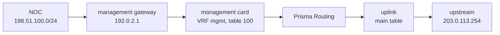
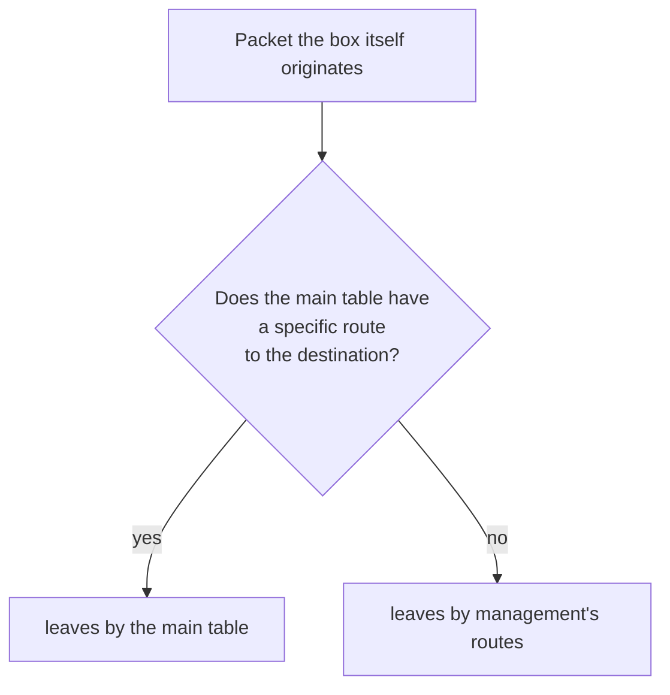

# Management in a VRF of its own

How to put the management card in a VRF of its own, so the main table's default route is free for the subscribers and the box keeps answering SSH, the API and SNMP through the management gateway. For whoever is putting a box into production with a management network separate from the uplink — or already has, and found the subscribers' default does not take.

# Why separate them

At installation the box is given a management address and a **gateway**. That gateway is its default route, and it sits in the main table — the same table the dataplane forwards the subscribers in.

When you write the subscribers' default in the routing (`router static`, `0.0.0.0/0 next-hop` to the upstream), the two defaults compete for the same table, and **the installer's wins**: it goes into Linux with a higher priority than any route from the routing. What that does depends on the management card:

* on a card the dataplane paired, the subscribers' traffic leaves through the **management** gateway;
* on a card only Linux has, the routing's default is set aside and the dataplane is left with **no default at all** for the subscribers: traffic to the internet is dropped.

The way out is not to delete the installer's default — it is the path you reach the box by. It is to take management out of the main table: the management card and its routes go into a VRF of their own, and the main table keeps only what is the subscribers'.



# Before you start: which management card you have

The configuration is the same for both kinds of card, but what the box does underneath is different, and so is what the interface block accepts:

| The management card is… | Where it shows | What its `interface` block accepts |
|-------------------------|----------------|------------------------------------|
| **paired by the dataplane** — the box took the card and the management address lives on the Linux pair the dataplane keeps for it (a one-card box, or a card named under `system` > `dataplane`) | in `show interface`, as a dataplane port | `vrf` and the rest of the block, like any interface |
| **Linux's only** — the card reserved for Linux at installation; on a virtual machine, usually a virtio card beside the cards the dataplane takes | in `show hardware`, under `Reserved for Linux:` | `vrf` only |

:::info
**A card only Linux has: from 0.155.19.** Up to 0.155.18 the `commit` passed `commit check` and failed at apply (`the dataplane does not have it`). On an older box, upgrade before following this page.
:::

On a card only Linux has, the address, MTU and description stay Linux's — the address stays where the installer put it, in `/etc/network/interfaces.d/prisma-routing` — and `commit check` refuses anything but `vrf` in its block.

# 1. Write the configuration

With management on `192.0.2.10/24` and `2001:db8:6::10/64` on card `enp1s0`, the management gateway at `192.0.2.1` and `2001:db8:6::1`, the NOC on `198.51.100.0/24` and the subscribers' upstream at `203.0.113.254`:

```
configure
 vrf mgmt table 100
 interface enp1s0
  vrf 100
  exit
 vrf mgmt
  ip route 0.0.0.0/0 192.0.2.1
  ip route 198.51.100.0/24 192.0.2.1
  ipv6 route ::/0 2001:db8:6::1
  exit
 router static
  0.0.0.0/0 next-hop 203.0.113.254
  exit
 system
  management
   vrf mgmt
   exit
  exit
```

| Line | What it changes |
|------|-----------------|
| `vrf mgmt table 100` | makes the VRF `mgmt` in Linux, on table 100 |
| `interface enp1s0` / `vrf 100` | the management card goes into table 100, with its addresses, IPv4 and IPv6 |
| `vrf mgmt` / `ip route`, `ipv6 route` | management's routes, inside the VRF: both defaults and any other network you administer the box from |
| `router static` / `0.0.0.0/0 next-hop` | the subscribers' default, in the main table — which now has nothing to compete with |
| `system` > `management` > `vrf mgmt` | tells the box its own services live in the VRF: without it the card goes into the VRF and the box does **not** answer on it |

`router static` is the main table only. A VRF's static routes go in its `vrf <name>` block, closed by `exit` or `exit-vrf`. An interface's `vrf` and Linux's VRFs are in [Interface configuration](/s/wiki-en/doc/interface-configuration-1Pq7NRieCn). The next hop of each of the VRF's routes has to be on a network the management card reaches; otherwise `commit check` refuses it with `this next hop is on no connected network:`.

For SSH to answer **only** on management, list both of its addresses in `ssh listen-address`, as in `snmp` and `api`: `ssh listen-address 192.0.2.10 2001:db8:6::10`. With management in the VRF, `commit` accepts those addresses.

# 2. Check before applying

```
commit check
```

What it refuses, and why:

| The refusal starts with | What is missing |
|-------------------------|-----------------|
| `management vrf mgmt: no such VRF here` | the line `vrf mgmt table 100` |
| `management vrf mgmt: no interface is in it` | the `vrf 100` on the management card: with nobody in it, the box's own traffic would go to a table with no way out |
| `interface enp1s0: Linux's, so 'vrf' alone applies` | the card is Linux's only and its block has something besides `vrf` |
| `interface enp1s0: vrf 100 has no VRF device` | the card is Linux's only and no `vrf <name> table 100` makes its table |
| `this next hop is on no connected network:` | a route in the VRF points at a gateway the management card does not reach |

`commit check` also refuses a `vrf` on an interface neither the dataplane nor Linux has — usually a mistyped name.

# 3. Apply with `commit confirmed`

You are changing the path you reach the box by. Apply it with a way back:

```
commit confirmed 10
```

Then **open a new session** to the management address, over IPv4 and over IPv6, and confirm from it:

```
commit
```

The session you typed `commit confirmed` in usually stays alive across the change, but what proves it worked is a new connection arriving through the VRF.

If nothing reaches the box any more, nobody confirms, and in 10 minutes it undoes everything on its own: the card leaves the VRF, the rules and the kernel settings go, and — on a card only Linux has — the installer's default goes back into the main table. The box answers SSH, the API and SNMP on the main table again. The revert is armed on the box, not in your session: losing the connection does not cancel it — the mechanism is in [commit, rollback and save](/s/wiki-en/doc/commit-rollback-and-save-HVsz5GElE1).

:::warning
**Taking management out of the VRF ends the SSH sessions opened through it.** That holds for a `commit confirmed` that expires and for `no vrf` under `management`. The box answers new connections on the main table.
:::

# 4. Save

`commit` puts it in effect; only `save` makes it survive a reboot. After confirming, in operational mode:

```
save
```

A `save` inside the `commit confirmed` window writes a change that is not confirmed yet, and the box warns you. Confirm first, save after.

# What arrives and what leaves

**What arrives.** sshd, the API and snmpd keep listening in the main table; with `system` > `management` > `vrf`, the box turns on the kernel settings that let a main-table service answer a connection arriving on the VRF, listen on the management address even though it is in the VRF, and keep the card's IPv6 when it changes table. The reply follows the connection. A service that was up before the `commit` answers after it, with no restart.

**What leaves.** What the box itself originates goes through two rules, per family: first the main table **without its default**, then management's table. In practice:



The subscribers' default never carries the box's own traffic: it is exactly the route the first rule ignores.

| Traffic | Leaves by |
|---------|-----------|
| SSH, the API, prisma-web, SNMP queries (inbound, IPv4 and IPv6) | management: the reply follows the connection |
| SNMP traps | management |
| DNS, NTP, `system upgrade`'s downloads, RADIUS | management, unless the main table has a specific route to the server |
| `system logging` (the event log) | management, unless the main table has the route; a destination with `vrf mgmt` goes through the VRF regardless |
| the log container's syslog and IPFIX over TCP | management, unless the main table has a specific route to the collector — a collector on the subscribers' side is reached by its route in main |
| IPFIX over UDP sent by the dataplane | **the main table**, always |

:::warning
**IPFIX over UDP does not follow management.** The dataplane builds those packets and sends them through its own forwarding table, never through Linux's rules. A collector reachable only over the management network needs a specific route to it in the main table — or the TCP export. Without that, the translation records do not reach the collector.
:::

A service listening in the main table also answers on a tenant VRF whose Linux side reaches the box's address. Keep that in mind if a tenant VRF has a route to the management network.

# What survives a reboot

With the configuration saved, every boot puts it all back, in this order:

1. before the dataplane, snmpd, sshd and the API start, the box turns on the kernel settings and the rules for its own traffic — they name table 100, not the device, so they do not depend on the VRF existing yet;
2. loading the configuration makes the VRF `mgmt` and puts the card in it;
3. management's way back — the installer's default — goes into the VRF's table, never the main one, where it would beat the subscribers' default again.

On a card only Linux has, the boot starts with the card as the installer left it, address and default in the main table; loading the configuration moves it into the VRF with its addresses and its defaults. A Linux-only card with `vrf` and nothing else is not treated as a missing card: it is applied at boot.

The same rules and settings are put in again at every `commit` that changes `system` > `management`, and the card's VRF is read back from Linux: `show running-config` shows the `vrf 100`, and the next `commit` leaves the card alone.

# How to check

**1. The box says where management is:**

```
show system management
```

With management in the VRF and all of it in effect, the screen is:

```
configured:
  management VRF       mgmt, table 100
in effect:
  the box's own        by table 100, after main without its default
  listeners            answer on a VRF, and may bind its addresses
  IPv6 addresses       kept when a card moves between VRFs
  interfaces in it     enp1s0
```

`configured` is what the configuration asks for; `in effect` is what the host has now. If the two differ, the screen ends by saying so — a `commit` that changes `system` > `management`, or the next boot, brings them into line. With no management VRF, the `management VRF` line says `none: the main table`.

**2. The subscribers' default is in the dataplane:**

```
show route 0.0.0.0/0
```

With more than one table the screen separates the VRFs. In the main table the default must point at the upstream (`203.0.113.254` in the example), not at the management gateway, and must not be dropping. Management's routes are in the routing, in `show ip route vrf mgmt`.

**3. Management answers:** from outside, a new SSH session to `192.0.2.10` and another to `2001:db8:6::10`, and an SNMP query to each, if you use SNMP.

:::success
`show system management` with `in effect` matching `configured`, the main table's default pointing at the upstream, and a new SSH session coming in on both management addresses: the subscribers have the main table to themselves, and management has its own path.
:::
