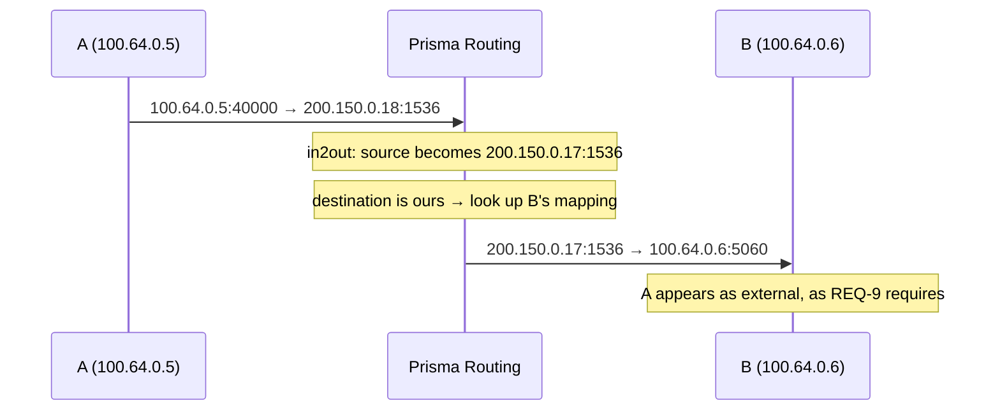

# NAT behavior and compatibility

Whether your subscribers' applications will work behind this CGNAT, and what changes when you tighten filtering. For those who get tickets about gaming, cameras, VoIP or peer-to-peer.

# This equipment is full cone

There are three properties, and all three are present:

| Property | RFC 4787 | What it means in practice |
|----------|----------|---------------------------|
| Endpoint-independent mapping | REQ-1    | an internal socket keeps the same external port whoever it talks to |
| Endpoint-independent filtering | REQ-8    | any host can reach an open mapping |
| Hairpinning | REQ-9    | one subscriber reaches another through the public address |

This is not a promise: each one is verified **on the packet**, and the third by delivering a packet coming from a host the subscriber never talked to.

# One subscriber, one public address

A fourth property, **address pairing** (RFC 4787 REQ-2, which RFC 6888 makes the required default for a CGN): all of a subscriber's traffic leaves through the **same** public address. A subscriber that sends from one address and receives on another breaks applications that check where the answer came from, because they see two different peers where there is only one.

| Where | How it works |
|-------|--------------|
| deterministic pool without `reserve` | always paired: the subscriber has a single block, and the formula puts it on a single address |
| dynamic pool, or deterministic with `reserve` | **preference**, not a rule. When the subscriber fills the block and gets another (up to `max-blocks`), or receives several at once with `initial-allocation`, the box first looks for a free block on the public address it already uses. If there is none, it takes one on another address instead of refusing — refusing would cost the customer traffic |

Because it is a preference, the box shows the rate of **your** pool instead of promising one. In `show cgnat blocks`, every pool in which a subscriber can get more than one block has a line starting with `RFC 4787 REQ-2 paired:`, with how many extensions landed on the subscriber's own address against the total. A rate far from all of them is a pool short on public addresses, not a defect: it is the number to bring to the capacity conversation.

# Hairpinning: the symptom nobody attributes to CGNAT

Two subscribers behind the same CGNAT reaching each other through the public address.



Without hairpinning the packet leaves correctly translated and is routed to an address the box itself owns, with nothing to send it back. The symptom is specific and hard to attribute:

* a camera that answers from the street but not from the neighbor;
* a service hosted at home that works for everyone **except** those on the same provider;
* a game that hosts matches for everyone, except players on the same ISP.

B sees A by A's **public** address, as the RFC requires. Showing the private address would leak the internal topology and break the answer, because B would reply to an address it does not know how to route.

A packet addressed to one of our public addresses **with no session on that port** is dropped, not forwarded — and counted separately from a successful hairpin, so the two can be told apart.

# Filtering: who can answer

Two modes, per pool:

| Mode | Who reaches an open mapping | Cost |
|------|-----------------------------|------|
| `filter endpoint-independent` (default) | anyone                      | unsolicited traffic reaches the subscriber |
| `filter address-dependent` | only the remote the subscriber contacted | some peer-to-peer applications stop working |

```
configure
 nat
  cgnat
   pool residencial
    filter address-dependent
    exit
   exit
  exit
 commit
```

It is a setting **applied in place**: it does not drop sessions.

A [Port forwarding](/s/wiki-en/doc/port-forwarding-uB5xjjtTNS) stays **outside** this filtering. `address-dependent` asks "did the subscriber talk to you before?", and on a forward the answer is no by definition; if it went through the filter, the open port would work only for whoever the subscriber last answered.


:::info
The choice is yours, not the product's. `address-dependent` reduces scanning and unsolicited traffic reaching the subscriber; in exchange, it breaks part of peer-to-peer and games that depend on a connection coming from a third party. `endpoint-independent` is the default because it is what keeps those applications working.

:::

The check is **not** part of the lookup key, on purpose. Putting the remote address in the key would give the subscriber a different external port per destination — destination-*dependent* mapping — and would break exactly the peer-to-peer applications this product exists to keep working. Filtering and mapping are separate decisions, and only the first changes here.

# Fragments

A fragment that is not the first one **carries no layer-4 header**, and so has no port to match against a session. Without handling it is dropped, and large DNS, VPN and games break **intermittently** — the hardest symptom to diagnose there is.

VPP does a shallow virtual reassembly: it keeps the ports of the first fragment and attaches them to the following ones. There is nothing to configure; it is on in the path.


:::info
It is worth knowing that this handling has an expensive failure mode: if the stored ports are read in the wrong byte order, the node does not find the session and opens another — **burning one port per fragment**. A subscriber that fragments a lot exhausts its own block by itself. If you see a subscriber consuming ports with no traffic to justify it, that is the first hypothesis to check.

:::

# ICMP errors, and why some sites do not load

An ICMP error — *fragmentation needed*, *time exceeded*, *destination unreachable* — is not a packet about itself. It carries **inside it** a copy of the packet that caused the error, and it is that embedded copy that says which session it is about. The address in there is the subscriber's, private, written before translation.

A box that translates the outer header and ignores the inner one hands the subscriber a notice about a connection it does not recognize. Its stack drops it, and the notice is lost. Two things break when that happens:

| What is lost | The symptom that reaches support |
|--------------|----------------------------------|
| PMTUD (*fragmentation needed*) | "some sites do not load" — the connection opens, exchanges a little, and hangs on the first large packet |
| *time exceeded* | the subscriber's `traceroute` stops working |

This box rewrites the embedded packet. And it rewrites along with it what almost everyone forgets: the **ICMP checksum covers the whole embedded packet**, including the checksum of the IP header inside it. Translating with the wrong checksum is worse than not translating — the subscriber's stack drops the packet, PMTUD stays broken, and the equipment's counter says it worked.


:::info
For plain TCP there is a second safety net, the *MSS clamp* (`tcp-mss` in the pool), which avoids the problem before it needs a notice. **Inside a tunnel there is no MSS to adjust**, and there the ICMP error is the only signal the subscriber has — that case is detailed in [Protocols and ALGs](/s/wiki-en/doc/protocols-and-algs-z0NTWXgdda), with what it requires of you and where it stops.

:::

# The honest limit

The session remembers **one** remote address, updated with every outbound packet. A source port reused for two remotes only accepts answers from the most recent.

It is an approximation, and it is stated because whoever operates deserves to know where it stops: tracking the set of remotes would mean per-remote state in a data path whose purpose is precisely to have none.

# How to check

```
show cgnat subscriber <inside-ip>
show cgnat drops
show cgnat blocks
```

If an inbound application does not work, `show cgnat drops` separates the reason — a packet with no session on the port is counted separately from a hairpin that worked. If the complaint is about an application that is puzzled by the source address, the `RFC 4787 REQ-2 paired:` line of `show cgnat blocks` says how much of the pool is paired.

# See also

* [Protocols and ALGs](/s/wiki-en/doc/protocols-and-algs-z0NTWXgdda) — when the problem is not filtering, it is the protocol carrying an address in the payload
* [When a subscriber's block fills up](/s/wiki-en/doc/when-a-subscribers-block-fills-up-NvSSgpWda1) — the extended blocks, where the pairing rate comes from
* [Pool configuration](/s/wiki-en/doc/pool-configuration-wkJ1DcmG2Y) — `filter` and the other fields applied in place
* [Timeouts and the RFC floors](/s/wiki-en/doc/timeouts-and-the-rfc-floors-HmiUW10Fkh) — the other common cause of "it disconnects on its own"
