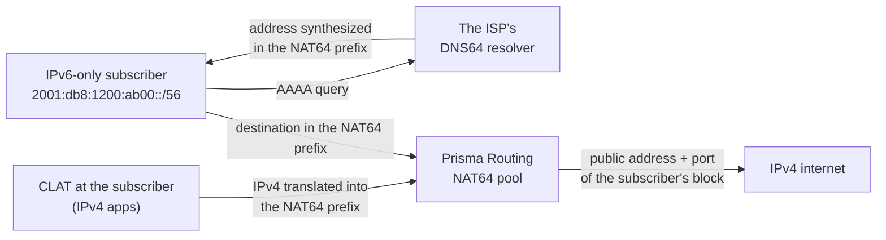

# NAT64 — IPv6-only subscribers in the same public space

How to put a NAT64 pool into service for subscribers who get IPv6 only — FTTH or mobile access with a delegated prefix — and have them reach the IPv4 internet through the same public space, split into port blocks, that the CGNAT already uses. For whoever operates the box and answers for its records.

# When to use it

A NAT64 pool is the CGNAT with an IPv6 inside. The outside is the same scarce IPv4 address, shared by port in blocks, and the question it has to answer is the same: who held that public address and that port at that instant. So it uses the same session table, the same blocks, the same logging and the same configuration trail.

| Situation | What to use |
|-----------|-------------|
| Subscriber with a private IPv4 address (100.64.0.0/10), with or without IPv6 | a pool under `nat` > `cgnat` |
| **IPv6-only** subscriber, with a delegated prefix, who needs to reach IPv4 destinations | a pool under `nat` > `nat64`, this page |
| An IPv4 application inside an IPv6-only subscriber (a game, a VPN, a literal address) | the same NAT64 pool, with a CLAT on the subscriber's side (464XLAT) |

DS-Lite, MAP-E/MAP-T and NPTv6 are not part of the product.

**The subscriber is the prefix, never the /128.** A host's address inside a /64 changes with privacy extensions, so a deterministic mapping tied to it could not exist. The delegated prefix is stable, and it is what RADIUS attributes to a person (Delegated-IPv6-Prefix). The pool cuts its inside prefixes at the `subscriber-length`, and each piece is one subscriber with its block.



# Before you start

You need three things decided:

| What | Example on this page | Why |
|------|----------------------|-----|
| The subscribers' IPv6 prefixes and the size each one gets | `2001:db8:1200::/48`, each subscriber a /56 | they are the pool's inside |
| The public IPv4 prefix | `203.0.113.0/29` | it is the outside, as in an IPv4 pool |
| The NAT64 prefix (RFC 6052) | `64:ff9b:1::/48` | it is where the subscriber sends traffic meant for IPv4 |

The NAT64 prefix is 32, 40, 48, 56, 64 or 96 long. Without `nat64-prefix` the pool uses the well-known prefix `64:ff9b::/96` — and, under it, IPv4 addresses that are not global (private, shared, loopback, documentation and the like) are never reached, as RFC 6052 requires.

# Step by step

1. **Mark the subscribers' interface as the inside.** It is the same marking as for an IPv4 pool: the NAT64 translation runs on the `cgnat inside` interfaces, and only while a NAT64 pool exists.

   ```
   configure
    interface enp2s0
     ipv6 address 2001:db8:ffff::1/64
     cgnat inside
     exit
   ```

   The public interface keeps `cgnat outside`, as for any pool.

2. **Create the pool under** `nat` **>** `nat64`. An IPv6 prefix in `prefix-inside` is what makes it a NAT64 pool.

   ```
    nat
     nat64
      pool v6
       prefix-inside 2001:db8:1200::/48
       subscriber-length 56
       nat64-prefix 64:ff9b:1::/48
       prefix-outside 203.0.113.0/29
       block-size 1024
       exit
      exit
     exit
   ```

   The capacity sum is an IPv4 pool's: a /48 in /56s is 256 subscribers; 8 public addresses, each with 63 blocks of 1024 ports (ports 1024 to 65535), give 504 places. A pool takes up to 2^28 subscribers, and with IPv6 that is a refusal you really meet: `2001:db8::/32` in /56s fits; in /64s it does not.

3. **Give the network the two routes the pool needs.** The NAT64 prefix has to reach this box on the IPv6 side, and the subscribers' prefixes need a route back — as IPv4 subscribers behind a BNG do.

   ```
    router static
     64:ff9b:1::/48 next-hop blackhole
     2001:db8:1200::/48 next-hop 2001:db8:ffff::2
     exit
   ```

   The `blackhole` route catches no subscriber traffic: the translation happens before the route lookup. It only gives BGP something to announce. If the box runs BGP, announce the NAT64 prefix in the IPv6 family (`network 64:ff9b:1::/48` under `address-family ipv6 unicast`); when nothing announces it, `commit check` warns, and the warning already carries the two lines that fix it. The public IPv4 prefix is announced as any pool's is.

4. **Check and apply.**

   ```
    commit check
    commit
    exit
   save
   ```

   `commit check` refuses by name what a NAT64 pool does not take (see **Limits**) and a pool written in the old place, inside `cgnat`.

5. **Announce the NAT64 prefix to the CLATs (PREF64).** For 464XLAT the subscriber's CLAT has to know the NAT64 prefix, and on a box with more than one pool, or with a prefix that is not the well-known one, it cannot guess it. The box puts the prefix in its router advertisements (the PREF64 option, RFC 8781), on the subscribers' interface:

   ```
   configure
    interface enp2s0
     no ipv6 nd suppress-ra
     ipv6 nd nat64 64:ff9b:1::/48
     exit
    commit
   ```

   `ipv6 nd nat64` with no prefix announces `64:ff9b::/96`, and the line may repeat, one prefix per line. `commit check` refuses the line on an interface that does not advertise, and refuses a prefix no NAT64 pool on the box translates — a CLAT that learned that prefix would send its IPv4 to a place the box drops.

6. **Configure DNS64 on your resolver, with the same prefix.** The box is not the subscriber's resolver, so it does not synthesize AAAA records nor answer `ipv4only.arpa` (RFC 7050). The DNS64 resolver you run has to synthesize with the same prefix the pool translates and the box announces; if the two differ, the two discovery methods disagree, and some CLATs prefer the DNS answer.

:::warning
**Before upgrading a box that has a NAT64 pool inside** `cgnat`**.** The old form — a NAT64 pool written inside `nat` > `cgnat` — is refused at `commit check` and when the saved file is loaded, naming the new form, and nothing moves it on its own. Rewrite the pool under `nat` > `nat64` before the upgrade, or the box comes up without accepting that file.
:::

# The pool's fields

`nat64` holds pools and nothing else. The interfaces, the logging, the timeouts and the memory stay under `cgnat`, shared by both kinds of pool. A pool name is one pool across both levels: there is no `v6` under `cgnat` and another `v6` under `nat64`.

| Field | What it does for you |
|-------|----------------------|
| `prefix-inside <IPv6 prefix>` | the subscribers' prefixes; may repeat. IPv6 is what makes the pool NAT64, and an inside is of one family only |
| `subscriber-length <32-128>` | the length of one subscriber's prefix; required on a NAT64 pool, and no `prefix-inside` may be longer than it |
| `nat64-prefix <IPv6 prefix>` | where IPv4 destinations are (RFC 6052); `no nat64-prefix` goes back to `64:ff9b::/96` |
| `prefix-outside <IPv4 prefix>` | the public space, as in an IPv4 pool; never IPv6 |
| `block-size`, `ports`, `policy` | each subscriber's block, by the same formula as an IPv4 pool |
| `mode deterministic` or `mode bpa` | block by formula or on demand; under `mode bpa`, `max-blocks`, `initial-allocation` and `block-stride` apply, as in an IPv4 pool |
| `reserve` | extra blocks for whoever fills their own, on a deterministic pool; logged by prefix |
| `forward <proto> <port> to <IPv6 host> <port>` | a public port of the subscriber's block pinned to one host of their prefix — see [Port forwarding](/s/wiki-en/doc/port-forwarding-uB5xjjtTNS) |
| `tcp-mss` | MSS clamping both ways; `auto` is 20 below IPv4's, the IPv6 header's extra size |
| `vrf`, `outside-vrf` | the subscribers' IPv6 table and the IPv4 table translated traffic leaves by; two tenants may have the same inside prefix and the same NAT64 prefix in different VRFs |
| `max-sessions`, `max-session-rate`, `utilisation-alarm` | the same limits and the same alarm as an IPv4 pool |
| `alg ftp on` | FTP64 (RFC 6384): translates the IPv6 client's EPSV/EPRT into the IPv4 server's PASV/PORT. **Off unless you ask**, unlike the IPv4 ALGs |

Changing what defines the mapping — prefixes, `subscriber-length`, `nat64-prefix`, `block-size`, `ports`, `policy`, `mode`, `reserve` or VRF — rebuilds the pool, as for an IPv4 pool: see [Pool configuration](/s/wiki-en/doc/pool-configuration-wkJ1DcmG2Y).

# How the records look

The logging is the CGNAT's, configured under `cgnat`, and follows the same rules — [IPFIX logging and audit trail](/s/wiki-en/doc/ipfix-logging-and-audit-trail-mrQPyuvc8g) has the rest. What changes is how the subscriber is named: **always by the delegated prefix**, never by the internal index the pool's arithmetic uses — that index, read as an IPv4 address, would point at an unrelated customer.

| Where | How a NAT64 subscriber appears |
|-------|--------------------------------|
| IPFIX | a template of its own: `sourceIPv6Address` (the prefix's network address) and `sourceIPv6PrefixLength` (the `subscriber-length`) in place of the IPv4 source address, with the public address, the block's start and end and the pool |
| Syslog | `subscriber="2001:db8:1200:ab00::/56"` |
| RADIUS | the Delegated-IPv6-Prefix is what ties the prefix to a person |
| Configuration trail (`show cgnat history`) | the pool recorded by its IPv6 inside, its `subscriber-length` and its `nat64-prefix` — what lets the mapping of any instant be recomputed |

The events are the IPv4 ones: allocation, release and block exhausted (recorded once per interval, however many packets are refused).

:::info
**A deterministic pool produces no block events**, as with IPv4: the mapping is the formula plus the dated configuration in the trail. To answer a court order about a deterministic pool, the trail is the proof; for a `mode bpa` pool, it is the exported record.
:::

# Looking up and clearing

The `show nat64` commands answer for NAT64 only. Asked about an IPv4 subscriber, or about a public address of a CGNAT pool, they refuse and say which `show cgnat` answers it. `show cgnat` is still the whole box: NAT44 and NAT64 share the session table, the blocks and the public space.

| Command | What it answers |
|---------|-----------------|
| `show nat64 pool` | the NAT64 pools as the dataplane holds them — the ones carrying an `inside6` row; with none, the answer is `no NAT64 pools configured` |
| `show nat64 subscriber <IPv6 address>` | everything about one subscriber, by **any** address inside their prefix: the public address and the block |
| `show nat64 translation <public address> <port>` | who was behind that address and port: the subscriber's prefix, the pool and the block. On a deterministic pool the answer holds for any instant (it is the formula); on a `mode bpa` pool, only for now — for the past, the answer is the record |
| `clear nat64 subscriber <IPv6 address>` | ends every session of one subscriber, by any address of the prefix; on a `mode bpa` pool, the block becomes free again after the hold-down |
| `show cgnat top`, `blocks`, `forward`, `alg`, `drops`, `memory` | both kinds of pool together; `top` names a NAT64 subscriber by its prefix |

# In an active/standby pair

The high-availability model is the IPv4 one: nothing is synchronized between the boxes, and a deterministic pool puts the same prefix on the same public address and the same block on both, because the block is a function of the configuration. `subscriber-length` and `nat64-prefix` are part of the pair's mapping comparison, so `show cgnat ha` and the commit refusal on a diverging pair see both.

What a NAT64 pool needs on top is an IPv6 gateway that follows the master. An IPv6 address under a `vrrp <vrid>` on the subscribers' interface builds that id's IPv6 virtual router, with the IPv4 one's priority, tracking and preempt:

```
interface enp2s0
 ipv6 address 2001:db8:ffff::2/64
 ipv4 address 100.64.3.252/22
 vrrp 1 address 100.64.3.254
 vrrp 1 address fe80::1
 vrrp 1 address 2001:db8:ffff::1
 vrrp 1 priority 200
 vrrp 1 track enp1s0 decrement 150
 exit
```

* **The link-local first** (RFC 5798): it is what the subscribers — or the BNG in front of them — point their route at. `commit check` refuses an IPv6 router with no link-local.
* **The box's router advertisements are not the virtual router's.** A subscriber that takes its default route from an advertisement points at the box's own link-local, which does not move. Point at the virtual link-local.
* **Tracking is per family.** An IPv4 router tracking an IPv6-only subscriber side never sees it up, and `commit check` warns: give that side an IPv4 address or track something else.
* On a pair whose virtual routers are all IPv4, `commit check` warns about each NAT64 pool: the IPv6 subscribers' gateway would not follow the master.

Measured in the lab with an IPv6-only subscriber: translated traffic came back between 2.8 and 4.0 seconds after a pulled uplink cable, a stopped dataplane and a killed dataplane, always on the same public address and a port of the same block. Open connections drop, as with IPv4: a UDP flow comes back on a new port of the same block, a TCP connection is reset.

:::info
**A** `mode bpa` **NAT64 pool in a pair has no such measurement.** As with an IPv4 BPA pool, the new master allocates from scratch, so the subscriber's block — and possibly the address — changes across a takeover. The pair's step by step is in [Setting up an active/standby pair](/s/wiki-en/doc/setting-up-an-activestandby-pair-YclNlmh15V).
:::

# Limits

| What | Why |
|------|-----|
| `bypass` is refused, for good | an IPv6 packet to the NAT64 prefix reaches IPv4 only translated; there is no untranslated path for a bypass to name |
| Every ALG but FTP is refused, for good | RTSP and SIP carry addresses in the body, which no RFC translates between IPv6 and IPv4; PPTP uses GRE and IPsec uses ESP, which stateful NAT64 does not carry. IPsec crosses as NAT-T over UDP 4500, with no ALG |
| `prefix-list-inside` and `prefix-list-outside` are refused | they are IPv4 sets; a NAT64 pool's sides are its prefixes |
| An inside with IPv4 and IPv6 together is refused | a NAT44 pool and a NAT64 pool are two pools |
| An IPv6 `prefix-outside` is refused | the outside is always IPv4 |
| A public address belongs to one pool | NAT44 or NAT64, never both |
| A NAT64 session costs about a third more memory than an IPv4 one | the inside key carries the whole IPv6 address |
| An unsolicited packet to the public port is dropped and counted as `no session`, with no answer | as on an IPv4 pool |
| A fragmentable IPv4 datagram that would exceed 1280 bytes as IPv6 is cut to 1280 | the path to the subscriber is not known to be any larger |

The translation follows RFC 7915: TCP and UDP (an IPv4 UDP datagram with a zero checksum gets one, because IPv6 does not accept zero), ICMP echo both ways, ICMP errors with the quoted packet translated too, and fragments both ways.

# How to check

```
show nat64 pool
```

The pool appears with its `inside6` row. If the answer is `no NAT64 pools configured`, the pool did not reach the dataplane: go back to `commit check`.

```
show nat64 subscriber 2001:db8:1200:ab00::10
```

Any address inside a subscriber's /56 gives back their public address and block. Send traffic from that subscriber to an IPv4 destination and check the way back:

```
show nat64 translation 203.0.113.3 44100
```

With a public address and a port inside the subscriber's block, the answer is their prefix. `show cgnat top` shows the subscriber by prefix, with the ports in use. At the collector, a `mode bpa` pool's record carries the prefix (`sourceIPv6Address` and `sourceIPv6PrefixLength` in IPFIX, `subscriber="…/56"` in syslog).

On the subscriber's side: a CLAT listening to the interface's advertisements should learn the NAT64 prefix from the PREF64 option, and an AAAA query for an IPv4-only name to your resolver should come back inside the same prefix.

:::success
The pool listed in `show nat64 pool`, the subscriber with the right block in `show nat64 subscriber`, the translation answering with their prefix and the collector receiving the record with the prefix: your IPv6-only subscribers are leaving through the CGNAT's same public space, and every port is still answerable.
:::
