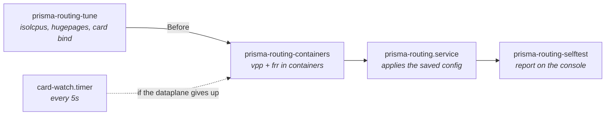
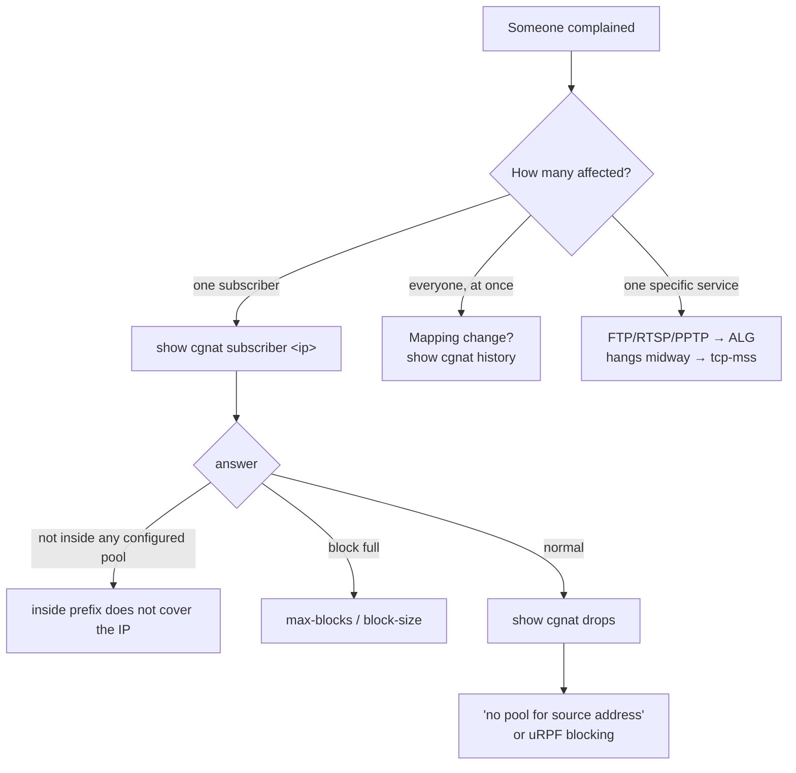

# Operations and troubleshooting

The rules that prevent incidents, the order in which the machine comes up, and where to start when someone complains. For those running the box in production.

# Rules that prevent incidents

## Which card the dataplane takes, and which stays with Linux

DPDK takes the NIC away from Linux: the card the dataplane takes stops existing for the system, and whatever reached the box through it now arrives through the pair the dataplane keeps on the Linux side.

Without anyone configuring anything, the box takes **all** the network cards it has, except **one reserved for Linux** — the management network given at installation; whoever answered `none` there, which is the installer default, reserved none. The reserve never keeps the last card: on a single-card box, that card goes to the dataplane, and the management address goes with it to the pair on the Linux side, with the same MAC and the same gateway. `show hardware` says which cards the box took, which one carries the default route, and why.

The way back — address, MAC and gateway — is read **from the card itself, at the boot that takes it**, before it leaves Linux. A card whose way back cannot be read **is not taken**. And if the dataplane cannot come up, the box gives the cards back to the kernel driver on its own.

To choose the card by hand — on a machine with several cards, where only one carries subscribers —, say which one under `system` > `dataplane`:

```
configure
system
dataplane
interface enp2s0
commit
```

The named card is taken **whatever route it carries**, and becomes the only one. There is no longer a refusal at the prompt for being the card you are connected through: a new box is configured at the console, and that is where this decision is made. `no interface`, in the same place, hands the choice back to the box — the automatic rule above.


:::warning
`**commit**` **stores the choice and does not restart the dataplane.** The card changes owner at the next boot, or with `system dataplane restart` — both bring forwarding down for a few seconds and throw away every subscriber's port block. The `commit` itself says whether the chosen card is the one carrying your session. Choose the window.

:::

## A remote change goes with a safety net

```
commit confirmed 5
```

It applies now and undoes itself in 5 minutes if you do not confirm. If the change cuts your own access, the machine recovers.

The deadline belongs to the **equipment**, not the session: leaving the VTY, losing SSH, closing the console or restarting the machine does not cancel the undo. Only `commit` cancels it. And three changes become `commit confirmed 10` even without you asking — anything in `ssh`, anything in `user`, and a `commit cutoff` —, because those are the ones that can cut the session you are typing in.

Handing the card the box is reached through to the dataplane is **not** among them: the box reads the way back from the card at the boot that takes it, and there is no window at all to confirm that handover. **A procedure that says to restart, log back in and type** `**commit**` **to keep the card no longer applies**, and the extra `commit` does nothing.

## `commit` is not `save`

`commit` makes it take effect now. `save` writes it to disk. A configuration that was committed and not saved **disappears at the next boot**.

## Before touching a pool prefix

```
show configuration compare    what changes
commit check                  validates without touching the equipment
commit                        applies, or refuses if there is re-mapping
```

`commit check` reports the re-mapping: the exact count and two example subscribers, without touching the equipment. If it appears, you will drop every subscriber of that pool when applying. That is expected — but it has to be a decision, with a window. The plain `commit` refuses the change until it is asked for by name, with `commit remap`.

## Recovering a box that became unreachable

If the dataplane took the card the box was managed through and the way back did not work, the box left the network the instant the dataplane came up. From the console, point the dataplane at the subscriber card, and only at it:

```
prisma> configure
prisma# [edit] system
prisma# [edit system] dataplane
prisma# [edit system / dataplane] interface enp2s0
prisma# [edit] commit
prisma# [edit] exit
prisma> save
```

With one card named, all the others stay with Linux. **Then restart** — or use `system dataplane restart`, which gives all the cards back to the kernel, redoes the choice and brings the dataplane up again.


:::warning
Restarting is not overcaution: `commit` only stores the choice, because changing the card's owner brings down forwarding and every subscriber's port block. You choose the window — and until then the card stays with whoever had it.

:::

A box with no dataplane interface looks like a working box — it answers, logs and accepts configuration, it just does not forward. That is why the self-test says it has no dataplane interface and says what to type to give it one.

## The self-test says the card was handed over and nothing carries the address

When the dataplane takes the card the box is reached through - on a single-card box, that is what happens without anyone asking -, the box reads from that card, in the same boot and before taking it from Linux, the management path it will need back: the address with the mask, the MAC and the gateway. That address goes back to the interface's `linux_cp` pair, and the default route to Linux behind it. That pair is how the box is reached from then on.

If the pair does not exist, there is nowhere for the address to go back to. The box comes up forwarding and **with nobody able to reach it** - only from the console, where it physically is. The self-test says so on the console, at every boot, and says it as a failure, not as a warning:

```
  [FAIL] this box handed its only card over and NO pair carries the address
        The card this box is reached on was given to the dataplane, and the
        linux_cp pair is where the address the box answers on goes back.
        Without one it comes up forwarding and unreachable from anywhere but
        its console.
        the way back it computed on this boot: enp1s0 192.0.2.10/24
        52:54:00:00:00:01
        without a pair: enp1s0
        give each one an 'interface' block in prismash, and commit:
        the block pairs it under its own name.
```

The management path line is the one that matters first: it is the address the box had, and whoever is at the console has nowhere else to get it from. The fix is to give the port an `interface` block: the card carries in the dataplane the name it had in Linux, and any block for it creates the pair with that same name. `linux-name` is only needed to choose another:

```
configure
interface enp1s0
 no shutdown
 exit
commit
```

Then `exit` and `save`. The `save` is not optional here: without it the pair vanishes at the next boot and the box ends up in the same place.


:::info
A box that handed over **no** card and runs **no** routing protocol still gets only a warning for not having a pair - `[warn] no linux_cp pair on:`. It is not broken: forwarding CGNAT without a routing protocol is a legitimate configuration of this product, and a check that turned red on it would be a check everyone learns to ignore.

:::

## A disk died under the records mirror

On a box installed with the records on two disks, the death of one of them **brings nothing down**: the volume stays mounted, writing continues, the box keeps forwarding. Only the self-test warns, and it warns at every boot:

```
  [FAIL] the records mirror is DEGRADED: 1 of 2 disks (vda3)
```

That calls for a site visit, even with the box working: what is left is a single copy, and the next failure loses the whole year. To check without waiting for the next boot:

```
cat /proc/mdstat
```

`[2/2] [UU]` is both disks; `[2/1] [U_]` is only one.

After replacing the disk, partition it and give the partition back to the array:

```
printf 'label: gpt\n,,R\n' | sfdisk --wipe=always /dev/<new disk>
mdadm --add /dev/md0 /dev/<new disk>1
```

The copy restarts on its own and the self-test starts saying `REBUILDING` with the percentage - that is the fix happening, not a defect. When it finishes, it goes back to `[ ok ] records mirrored on 2 disks`.


:::info
**Was it the system disk that died, and not the mirror one?** The box does not come up on its own - it is a reinstall. The records on the surviving disk remain readable on another machine: mount its partition on any Linux with `mdadm --assemble --run /dev/md0 /dev/<partition>` and then `mount /dev/md0 /mnt`. Nothing is lost by not having the other disk.

:::

## The self-test says the SSH keys were not generated on this box

At every boot the self-test compares the SSH host keys with the filesystem they are stored on. A file cannot have content older than itself: if the keys are older than the filesystem, they were not born on this box — they came ready-made, inside the system image. In that case the self-test warns, and warns as a failure:

```
  [FAIL] the ssh host keys were not generated on this box
```

This matters because a host key that came ready-made from outside is the same on every box installed from that medium, and its private half is wherever the medium is. Whoever has that half can impersonate this box in an SSH session, **and the administrator's client does not complain**: the fingerprint it stored is exactly the one it received.

The fix is for the box to generate its own. At the console:

```
rm /etc/ssh/ssh_host_*_key /etc/ssh/ssh_host_*_key.pub
ssh-keygen -A
systemctl restart ssh
```


:::warning
**After that, every machine that already had this box in** `**known_hosts**` **will refuse the next connection** and say the host key changed. That is the fix happening, not an attack — and it is its price. On each machine that manages the box, delete the old entry with `ssh-keygen -R <box address>` and check the new fingerprint on the first connection, reading it from the box's console: it is the only place where it cannot have been swapped along the way.

:::

When the keys belong to the box itself, the line is different and asks for nothing:

```
  [ ok ] the ssh host keys were generated on this box, not handed to it
```

### The same thing shows up when logging in to the box

The self-test report is written to the console, at boot. A racked box is reached over SSH, and nobody is looking at that console - so the box repeats the warning in the banner, every time someone logs in to the VTY, exactly on the boxes where it is true:

```
This box's ssh host keys were not generated on it:
    ssh_host_ecdsa_key ssh_host_ed25519_key ssh_host_rsa_key
    they came in with the system image, so every box installed from that
    medium answers with this same key and the private half of it is in the
    published download. This ssh session can be impersonated and your client
    will not object, because the fingerprint it pinned is the fingerprint it
    was handed.
regenerate them, in a shell on this box ('start shell'):
    rm /etc/ssh/ssh_host_*_key /etc/ssh/ssh_host_*_key.pub
    ssh-keygen -A
    systemctl restart ssh

    every client that pinned the old fingerprint will then refuse to connect
    and report that the host key changed. That is this being fixed, not an
    attack, and it is the cost of fixing it.
```

On a box that generated its own keys the banner says nothing about this. And the answer is measured at each login, not remembered from the last boot: after regenerating, the warning disappears at the next login, without having to restart the box.

There are two more neighboring lines, which do not mean the same thing:

* `[FAIL] no ssh host keys in /etc/ssh: sshd cannot start` — there is no key at all. SSH does not come up and the box is only reachable from the console; `ssh-keygen -A` followed by `systemctl restart ssh` fixes it.
* `[warn] cannot tell where these ssh host keys were made` — the filesystem does not record when each file was created, so there is nothing to compare against. It is not a defect, and it is not an endorsement either.

## The self-test says files on this box are not from the version it reports

The first line of the self-test, and the answer of `show version`, is the box's version. That line is a single statement about some thirty files: the command interpreter, the dataplane plugin, the utilities, the service units and the installed documents. When installation finishes, it leaves next to the version the list of what it put on the box, with a checksum for each file. At every boot the self-test recomputes those checksums and compares.

With everything in order, it is a single line:

```
  [ ok ] all 31 files of that build are the ones it shipped
```

When some file does not match, the self-test says which:

```
  [FAIL] 1 file(s) on this box are not from 0.72.0 (beefcaf):
          usr/bin/prisma-routing-tune
```

This happens in three ways, and all of them are common: someone copied a file from another version onto the box (usually to test a fix, and then it stayed), an installation stopped halfway, or an upgrade went through part of the box and not the rest. In any of the three cases the box keeps working and keeps forwarding, and that is why the line matters: without it, the reported version keeps being read as the truth, and every diagnosis from then on is made against the notes of another version.

The fix is to install again, in full, the version the box reports. The page **Moving the box to a new version** describes the procedure and what it costs. If you were the one who put the file there on purpose, this line is the box reminding you it is still there.


:::info
**The three configuration files never appear in this list.** `tune.env`, `vpp-base.conf` and `prisma-routing.conf` are written only once, at the first installation, and from then on they are yours: the upgrade does not replace them, and the self-test has no opinion on their content. Editing `tune.env` is the file doing its job, not a defect, and a check that complained about it would be a check nobody would leave turned on.

:::

There are two more neighboring lines, and neither of them accuses the box of anything:

* `[warn] no /usr/share/prisma-routing/MANIFEST, so nothing checked that line`: the list is not there. Every installation leaves one, so either it was deleted, or the installation did not finish. Nothing was measured, which is different from nothing being wrong.
* `[warn] /usr/share/prisma-routing/MANIFEST names no files, so it checked nothing`: the list is there and it is empty. Same reading: nothing was compared.

# Services and boot order

**Since 0.117.0 the dataplane and routing run in containers.** The installed box enables `prisma-routing-containers.service` and disables `vpp.service` and `frr.service` — the three cannot run together, because they compete for the same sockets, the same hugepages and the same card.



| Service | Function |
|---------|----------|
| `prisma-routing-tune` | boot tuning (isolcpus, hugepages); runs at **every** boot, with no sentinel, and again at each `system dataplane restart` |
| `prisma-routing-containers` | brings up the dataplane, routing, the management plane (the VTY), the CGNAT records exporter and, with PPPoE configured, the PPPoE control plane as containers |
| `prisma-routing-doors` | runs on the host what the VTY asks for (accounts, sshd, SNMP, reboot), only in the shapes it knows; each request becomes a line in the journal. Changes are root's; upgrade, reboot, shutdown and dataplane restart also belong to whoever has `operator`; questions that only read, to any account |
| `prisma-routing-card-watch.timer` | every 5 seconds: puts the configuration back on a dataplane Docker started again after a crash, and notices a dataplane that Docker gave up restarting, records the reason and gives the card back to the kernel |
| `prisma-routing-backplane` | the containers' own internal network, in a separate VRF, which does not leak into the main table |
| `prisma-routing.service` | applies the saved configuration (`prismash --load`) |
| `prisma-routing-selftest` | checks and reports on the console |

**The VTY runs in the management container** (`prisma-routing_mgmt_1`). Login lands in it with the user's own user and groups, so each account's role is the same as before. The container has only its own internal network, which reaches the host and nothing beyond it, and reads from the host, read-only, what the VTY needs to know about the box: the cards, the routes, the cores, whether the box is on the installation medium. What acts on the host goes through the host: `ping`, `traceroute` and `mtr` go out through the host's network; `install`, `system upgrade` and `system dataplane restart` run in the host's VTY, in the same terminal (for an account with `operator` that is not root, the upgrade and the dataplane restart run on the host as a unit of their own, and the VTY shows what it writes); `start shell` opens a shell on the host, and only for `root` and for accounts with the `administrator` role - any other account gets the refusal, and a command it passes through `ssh` is executed by the VTY, with its role, and not by a shell. If the container is not up, the VTY runs on the host, and nobody is locked out. To move the VTY back to the host on a box: `touch /etc/prisma-routing/vty-on-host`.

```
docker ps --format "{{.Names}} {{.Status}}"
```

On a healthy box, the list shows `prisma-routing_vpp_1` (the dataplane), `prisma-routing_frr_1` (routing), `prisma-routing_mgmt_1` (the VTY) and `prisma-routing_logger_1` (the exporter of the CGNAT records over TCP, syslog and UDP), all `Up`; with PPPoE configured, also `prisma-routing_bng_1`. Without the `logger` the box keeps recording: the dataplane itself goes back to sending the records, and `show cgnat logging` says who is sending.

Before compose sees the file, the unit does three things, and each one exists because a box that skipped that step came up wrong:


1. **loads the images** the medium brought (`/usr/lib/prisma-routing/images.tar.gz`) and writes the tag it found where compose reads it — without this the box would ask a registry for an image, and an appliance has no route to any;
2. **writes the device node of the card** this boot bound, because which node it is depends on the driver the box managed to use;
3. after coming up, **hands the binary API segment to the** `vpp` **group**, which is what lets an operator account configure the box.

### When the dataplane gave up

The containerized dataplane tries to come up five times. After that Docker gives up, and every 5 seconds the watcher checks: finding the dataplane stopped, it **records why** — the container state, the exit code and the last eighty lines the dataplane wrote — in `/var/log/prisma-routing/why-the-dataplane-stopped`, and only then gives the card back to the kernel, once per boot.

The same watcher handles two cases before that one. A dataplane that crashed and that Docker started again comes back with no configuration at all, and the watcher puts the configuration in effect on it, a few seconds later. And a dataplane that exited by itself with status 0, with nobody asking (Docker does not restart that one), is started again, up to five times per boot.

That file is the first thing to read on a box that came up without forwarding. Restarting the box erases the container log, and the file stays precisely because restarting is the first thing anyone does. When it exists, the VTY and the self-test point to it instead of telling you to look at the container log, which on that box is empty.

Two decisions worth understanding:

* **No unit "pulls in" a dataplane.** `Requires=` and `Wants=` *start* what they name: on a containerized box that would bring up a second dataplane beside the one running. What exists is `After=`, which only orders.
* **There is no** `**ExecStop**` **that erases configuration.** The configuration lives in VPP. Stopping the service does **not** erase production pools — removing a pool is an operator action, through the VTY.

### Going back to the units

Two commands, and the box keeps answering through the card after them:

```sh
systemctl disable --now prisma-routing-containers.service
systemctl enable --now vpp.service frr.service
```

These two commands are walked through at every release, on a really installed box, which is then checked: it answers through the card again and applies the saved configuration at boot again. A way back nobody has walked is not a way back.

`prisma-routing.service` waits for the dataplane to **accept commands** before applying configuration: the container is created before the VPP inside it is serving — and, with the units, systemd considers `vpp.service` started as soon as the process comes up. In both cases the CLI socket and the plugins take a little longer, and applying before that fails intermittently.

That wait **explains itself on the console**, which is where the person is:

```
waiting for the dataplane to accept commands
(VPP is up; its CLI socket and plugins take a moment longer)
still waiting: 5s of at most 60s
the dataplane answered after 5s
```

Three outcomes, stated in different ways: a wait short enough for nobody to notice **says nothing**; one that ends normally **leaves no warning**; and a timeout says what it cost — *the CGNAT configuration was NOT applied*.


:::info
The 60-second limit is generous on purpose: VPP answers in 5 to 21 seconds on a VM without hugepages and with one worker, and a box with 32 GB of hugepages and sixteen workers takes longer.

:::

The tuning runs at every boot precisely so that a change in `tune.env` or a NIC swap is honored.

### `rx queues`: what the card opened, not just what was asked for

The self-test reads, from the running dataplane, how many receive queues each card actually opened, and compares it with what the boot tuning asked for that card:

```
  [ ok ] rx queues: 1 of 1 on enp6s0, as requested (1)
```

`1 of 1` is what the card opened and the maximum it has; the name is the one the dataplane gives the card, which is the name it had in Linux. When what was opened differs from what was asked, the line becomes a warning and says why it matters:

```
  [warn] rx queues: 1 of 1 on enp6s0, 4 requested
         the tuner asked for one queue per worker, capped at
         what the card reported, and the dataplane opened 1:
         at most 1 worker(s) receive from this card, and the
         other workers receive nothing from it.
```

The boot tuning sizes the workers by the processor and asks for one queue per worker, capped at what the card reported. Each queue is handed to one worker: a card with fewer queues than requested delivers what it has, only that number of workers receive from it, and the others receive nothing from that card. The box forwards, but with a fraction of what the processor could do.

There is a worse case: the driver refuses the card and opens no queue at all, although the dataplane still lists the count it was configured with. The self-test reads the driver state along with the count and treats this as a failure, not as an open queue:

```
  [FAIL] rx queues: none opened on enp6s0
        'show hardware-interfaces' marks the card pmd-init-fail, so the
        1 of 1 it lists were configured and never opened:
        the driver refused the port and the card carries no
        traffic. 'journalctl -u vpp' has the driver's reason.
```

That same card appears as an interface in `error` state, a few lines below.

The word `requested` is reserved for the box on which nothing could be read. The number is what was **asked for**, and the line below says that is all it is:

```
  [ ok ] rx queues requested: num-rx-queues 4
         what the dataplane opened could not be read: it is not
         answering, so the count in effect is unknown on this box.
```

On a box that handed no card to the dataplane, and so asked for nothing, the line says so in full instead of coming out empty:

```
  [ ok ] rx queues requested: default (1 per interface, one worker takes all)
         the dataplane holds no card that reports its queues, so
         there is no count in effect to read back.
```

In that same boot, what the box **asked for** and what it **got** are checked against each other — and what is read back is what the **kernel** is doing, not what the generated file asked for. A parameter can get lost in three places: `update-grub` did not run, the box has not rebooted since, or the kernel saw it and refused it. An appliance that calls itself tuned when the kernel did not accept the parameter is worse than one that says nothing.

There are **four** answers per rule, and none of them can be mistaken for another:

| Line in the self-test | What it means |
|-----------------------|---------------|
| `[ ok ] every tuning rule this box can read back is in effect (2)` | everything that could be checked is in effect, and it says how many rules there were |
| `[warn] requested and NOT in effect: isolcpus` | it was asked for and the kernel is not doing it. The line below says what it is doing instead |
| `[info] cannot be read on this box: nohz_full` | this box exposes no way to read whether it took. It is neither "took" nor "did not take" |
| `[info] not requested on this box: 99-prisma-routing.conf` | nobody asked for this tuning here. A deliberate box cannot look like a broken box |

Measured on a box whose kernel refused the isolation:

```
  [warn] requested and NOT in effect: isolcpus
         cpu(s) 1-3 were asked for and the kernel is not isolating them
```

The green line **does not appear** beside a refused rule: a box with half its tuning on the floor is not a tuned box. And two rules fall into `cannot be read` on real hardware — `rcu_nocbs`, which has no reading outside a root-only debugfs, and the `irqbalance` CPU list, which lives in the daemon's environment.

Three other lines are worth recognizing on the console:

| What appears | What it means |
|--------------|---------------|
| `deep C-states left enabled on purpose` | you set `PRISMA_LOW_LATENCY=0` and the box is doing what it was told. It is not a warning |
| `booted a command line older than that file` | `tune.env` was edited and the box has not rebooted since. Reboot for it to take effect |
| `the kernel exposes no idle-state driver` | on a virtual machine there is no power state to turn off, so this tuning changes nothing there |

A value the box does not accept in `tune.env` also shows up there, with the values it accepts in its place. What each variable accepts is in *Sizing and requirements*.

### When the whole boot line was lost, it is **one** line

If the generated file asks for eleven parameters and the boot brought none of them, that is a single fact about the box — `update-grub` did not run, or it has not rebooted since — and not eleven facts. The self-test says it once:

```
  [warn] requested and NOT in effect: the kernel command line
         the generated file asks this boot for 11 parameter(s) and it carries
         none of them: update-grub has not run since that file was written, or
         the box has not rebooted since. Run update-grub and reboot
```

Eleven copies of the same sentence on an eighty-column console are twenty-two lines pushing everything else off the screen, and a screen that does not fit is a screen nobody reads.

### And when the checker itself is not there

Two lines separate *"the tuning did not take"* from *"nobody managed to check"*:

| Line in the self-test | What it means |
|-----------------------|---------------|
| `[warn] prisma-routing-tune is not on this box, so what the kernel did with the tuning cannot be read here at all` | there is no checker on this box. Nothing was measured |
| `[warn] prisma-routing-tune could not say what tuning is in effect, so this box is unmeasured rather than confirmed` | the checker is there and did not answer. It was not measured either |

Neither of the two says the tuning is in effect, and neither says it is not. An **unmeasured** box and a **checked and good** box cannot look the same on screen, which is what the absence of a line would do to both.

There is also a fifth answer that a delivered box should not see:

```
  [warn] no way to read back a parameter this box sets: <parameter>
```

It means the box writes a parameter for which there is no read-back — that is, something it asks for and will never be able to check. If it appears, what is happening is that the box gained a new tuning without gaining its checker.

# Troubleshooting



## Where to start

| Question | Command |
|----------|---------|
| "this subscriber cannot browse" | `show cgnat subscriber <inside-ip>` |
| "packets are being dropped" | `show cgnat drops` |
| "whose was this IP:port?" | `show cgnat translation <ip> <port>` |
| "will the pool fill up?" | `show cgnat top` |
| "how many sessions, per thread?" | `show cgnat session` |
| "is the collector receiving?" | `show cgnat logging`, and `show log kind collector` for when it went away and came back |
| "what happened on the box?" | `show log` |
| "who committed, and from where?" | `show log source vty` (or `source api`) |
| "why did the dataplane restart?" | `show log source dataplane`, and the `started by:` line of `show system uptime` |
| "did this port go down? when, and how many times?" | `show log kind link` |
| "why did the BGP session drop?" | `show log kind bgp` (FRR's reason) and `show log kind bfd` |
| "who logged in to the box, and who got the password wrong?" | `show log kind login` |
| "did the pool run out?" | `show log kind pool` |
| "what was already wrong when the box came up?" | `show log` — the `standing at start:` lines of the first reading at boot |
| "I want to watch events arriving" | `monitor log` (the same filters; Ctrl-C stops) |
| "are the events reaching my syslog?" | `show system logging` — see [Sending the box's event log to the NOC's syslog](/s/wiki-en/doc/sending-the-boxs-event-log-to-the-nocs-syslog-ZSBceClGhA) |
| "who changed the pool, and when?" | `show cgnat history` |
| "what am I about to apply?" | `show configuration compare` |
| "what version is this machine?" | `show version` |
| "which routing daemons are up?" | `show version` |
| "did the port go down or did someone shut it down?" | `show interface terse` |
| "what is this port for?" | `show interface description` |
| "is the link full?" | `show interface utilization <name>` |
| "how much light reaches this port? is the module OK?" | `show interface <name> transceiver` |
| "is there room for more sessions in CGNAT memory?" | `show cgnat memory` |
| "which ALGs are in effect?" | `show cgnat alg` |
| "has the configuration trail been tampered with?" | `show cgnat history verify` |
| "which cards does the box have, and which did it take?" | `show hardware` |
| "which cores do what?" | `show system cpu` |
| "is the box's tuning right? what should change?" | `show system tuning` and `show system tuning advice` |
| "what of the saved configuration is waiting for a card?" | `show configuration pending` |
| "how busy is each core? is there steal?" | `show system cpu cores` |
| "how is memory split?" | `show system memory` |
| "is the LACP aggregate whole?" | `show lacp` |
| "does the box reach this destination?" | `ping`, `traceroute` or `mtr` |

## Known symptoms

| Symptom | Likely cause |
|---------|--------------|
| OSPF adjacency stuck in Exchange | MTU inherited from the TAP (the box default, 1500; 9000 on a box installed before 0.152.1). Adjust with `mtu` inside `interface` |
| One side complains about a drop and the configuration is up | `show interface terse`: `Admin up` with `Link down` is the cable, the transceiver or the other side |
| `show interface` notes CRC errors on a port | dirty or damaged fiber, connector, or one of the modules: compare the RX power from `show interface <name> transceiver` with the other side's TX (below) |
| `show interface` notes `rx power ... below its low warning` | little light arriving: fiber, connector, a span that is too long, or the laser on the other side |
| FTP/RTSP/PPTP connect but the transfer does not start | corresponding ALG turned off in the pool |
| Connections hang with no error, on certain paths | MSS not clamped — configure `tcp-mss auto` |
| Subscriber without translation and the pool does not fill | their prefix covered by a `bypass source` |
| Service does not come up at first boot | see `prisma-routing.service`; the self-test prints its last message |
| Self-test says `the records mirror is DEGRADED` | one of the two records disks died; the box works, the retention is hanging by a thread |
| Everything dropped at the same time, with no alarm | mapping change applied with `commit remap` |
| `show bgp` (or `ospf`, or `isis`) does not answer | `show version` names the stopped daemons; a stopped one receives configuration and gets nowhere |
| The box came up, routes and does not forward; `show interface` without the cards | the dataplane gave up coming up: read `/var/log/prisma-routing/why-the-dataplane-stopped` |
| BGP session dropped and came back without anyone seeing | `show log kind bgp`: each drop with FRR's reason, and `went down and came back between two readings` when it dropped and came back between two readings |
| A port that went down and came back too fast for anyone to see | `show log kind link`: `went down and came back between two readings (N time(s))` — the dataplane counts each link drop of the port, and Linux, those of the cards that stayed with it; the drop is recorded even if both readings saw the link up |
| The module of the management card (the one that stayed with Linux) | `show log kind transceiver`: module inserted, removed, light below the warning, with the card named `(held by Linux)` and source `host`; a virtio card, which has no module, produces no event at all |
| The box came up and part of the configuration was not applied | a card the saved configuration names was not there at boot: the rest was applied, and `show configuration pending` says what waits for it. `save` is refused while anything is pending; when the card appears, the box applies what was missing, and `clear configuration pending` gives it up |
| The box was left without cards after a restart | `show log kind gave-up`: the abandoned dataplane, or the `system dataplane restart` that did not finish, and why |
| The PPPoE subscribers all dropped together | `show log kind exit`: the PPPoE control plane stopped, and why (the code, the signal, a commit); `show log kind start` says who brought it back up |
| `show system uptime` says `restarted after the boot` | `show log source dataplane` gives the cause: a `system dataplane restart` (by whom), an upgrade, or `unexpected` — nobody asked, and `why-the-dataplane-stopped` usually has the reason |
| New sessions refused with the box up | `show cgnat memory`: CGNAT memory filled up, and the box refuses instead of crashing. `memory` under `nat` > `cgnat` gives more, from the next boot |
| Subscriber cannot reach the box itself (gateway, DNS, SSH) | versions before 0.136.1 translated traffic to the box's addresses; upgrade |

## CRC errors on an optical port

A CRC error is a frame that arrived corrupted. On an optical port, it is almost always the physical layer: dirty, bent or damaged fiber, a badly seated connector, or a module at the end of its life — on this side or the other. That is how this diagnosis was born: an X520 port counting 0.58% of frames with CRC errors, and nobody could read the optical power on the box side to compare with the switch's.


1. `show interface` shows the note when the rate goes above 0.01% since the counters started.
2. `show interface <name> transceiver` gives the RX power on **this** side, and the TX. On the switch on the other side, `display transceiver interface <port> verbose` (Huawei) or `show interfaces diagnostics optics <port>` (Junos) gives its own.
3. Compare: the RX on one side should be the other side's TX minus the link loss (fiber and connectors, a few dB on a short link). RX far below the other side's TX is loss along the path — clean and reseat the connectors, replace the patch cord. Normal RX on both sides with CRC continuing points to one of the modules.
4. The state of each line says whether the module itself considers the value out of range: `low warn` before `low alarm`.

The reading does not stop forwarding: there is no need to give the card back to Linux to use `ethtool -m`, which was the only way before 0.151.15 and brought the dataplane down. The same value goes through SNMP (`prTransceiver`, with items and triggers in the Zabbix template) and through the API (`ListTransceivers`).

## Two troubleshooting traps

**The dataplane's text CLI exits with code 0 even when it fails.** That is why the VTY does not talk to the dataplane through text: it uses the binary API, which answers whether it worked. Nothing in this wiki asks you to go down there, and the return code you would see there proves nothing.

**A counter is not evidence.** An ALG increments its counter whether the rewrite came out right or not. Check the packet, not the counter.

# Known absences

Do not report as failures — these are recorded decisions:

* **Session sync on failover** — refused due to cost. The active/standby pair exists and preserves the public address and port block; connections in progress drop, as with any NAT.
* **Throughput numbers** — bits per second were not measured on a card DPDK controls natively. What **was** measured is how much a packet costs the translation nodes, in CPU cycles. Any figure in bit/s is unverified.
* **Per-flow logging** — refused by design.
* **Graceful pool migration** — it would give one subscriber two mappings, and the reverse arithmetic could not tell them apart, giving up exactly the property deterministic mode exists to provide.

# See also

* [show commands](/s/wiki-en/doc/show-commands-3WvebaLZkm) — the reference for each troubleshooting command
* [Monitoring and SNMP](/s/wiki-en/doc/monitoring-and-snmp-GxrrkTSEJT) — the same numbers in the NMS
* [Day-to-day recipes](/s/wiki-en/doc/day-to-day-recipes-KCc5cOuBip) — the fix, after the diagnosis
