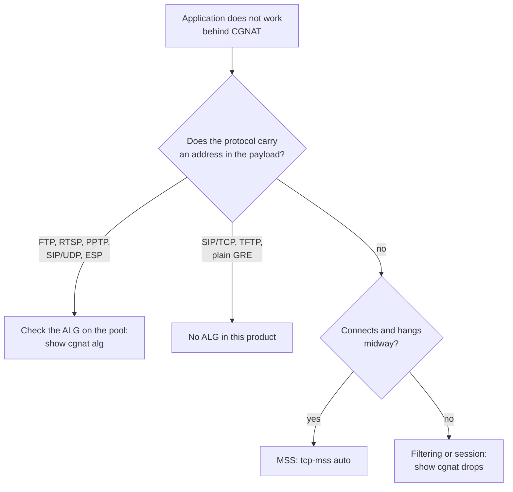

# Protocols and ALGs

Which protocols cross this CGNAT on their own, which need an ALG, and which are **not supported**. For whoever is diagnosing "it works on the LAN but not over the internet".

# Why some protocols need help

A protocol that carries an address or port **inside the payload** breaks behind any NAT, unless the NAT rewrites the payload too. The control channel comes up, announces a private address to the other side, and the data connection never gets established.

The ALG (*Application-Level Gateway*) is what rewrites that announcement.

# What is built

Five, which can be turned on and off per pool with `alg <name> <on|off>`. All come **on**: a pool that says nothing about ALGs has all five working.

| ALG | What it rewrites | Symptom without it |
|-----|------------------|--------------------|
| `ftp` | `PORT`/`EPRT` and the 227/229 replies | FTP works in passive mode and fails in active — still common in industrial and legacy equipment |
| `rtsp` | the `client_port` of the Transport header | IP cameras and some streamers: works on the LAN, black frame from outside |
| `pptp` | the control channel and the GRE data channel | VPN to an old corporate concentrator does not connect at all |
| `esp` | nothing in the payload: it only binds the tunnel to the remote gateway | several subscribers behind one public address cannot do IPsec without NAT-T |
| `sip` | `Via`, `Contact` and the SDP (`c=` and `m=`) of SIP **over UDP**, and opens the RTP/RTCP pair | VoIP registers but nobody can call the subscriber, or the call completes with no audio |

The command is for the opposite case — turning off one that gets in the way, or turning back on one someone turned off:

```
configure
 nat
  cgnat
   pool residencial
    alg sip off
    exit
   exit
  exit
 commit
```

`no alg sip`, in the same place, erases the choice and returns that ALG to the default, which is on. A setting **applied in place**: it does not drop sessions.

To see what the **dataplane** is actually applying — and not what the file says —, pool by pool, with all five and the state of each:

```
show cgnat alg
```

## On a NAT64 pool: only FTP, and off until you ask for it

On a NAT64 pool the subscriber only has IPv6 and the server only has IPv4, and the FTP problem is a different one: the IPv6 client speaks `EPSV` and `EPRT` — it has nothing else to speak — and many old IPv4 servers only understand `PASV` and `PORT`. Login works and every listing hangs. The `alg ftp` of a NAT64 pool is the RFC 6384 ALG, which translates between the two halves:

| The client sends | The server receives | The client gets back |
|------------------|---------------------|----------------------|
| `EPSV`           | `PASV`              | the server's `227` reply rewritten as `229`, with the port only |
| `EPRT` with its own IPv6 address | `PORT` with the public address and a port from the subscriber's block | the server's reply   |
| `EPSV ALL`, or `EPSV` with another protocol | a `NOOP`, in its place | `504` or `522`, answered by the box |
| `ALGS STATUS64`, `ENABLE64`, `DISABLE64` | a `NOOP`, in its place | `216`, with the translation state |

After an `AUTH` the server accepts, the box translates nothing more on that connection: the control channel has become TLS.

**It comes off**, unlike the ALGs of an IPv4 pool: RFC 6384 itself recommends turning it on only where needed, because with it the `EPSV` to a server that would understand `EPSV` becomes `PASV` for nothing. Turn it on in the NAT64 pool that serves subscribers with this problem:

```
configure
 nat
  cgnat
   pool v6
    alg ftp on
    exit
   exit
  exit
 commit
```

**The other four are refused on a NAT64 pool**, permanently and each one by name in `commit check`: RTSP and SIP carry addresses in the SDP and no RFC translates that between IPv6 and IPv4 — for SIP, RFC 6157 uses ICE and relays, not a translator rewriting the body —, and PPTP's GRE and ESP are not protocols that stateful NAT64 carries. IPsec crosses NAT64 as NAT-T, on UDP 4500, with no ALG at all.


:::info
PPTP has a problem of its own: GRE has no ports, so the **Call ID** has to play the role the port would. The rewrite changes no size, no sequence number moves, and each message is guarded by a 32-bit *magic cookie* and by its own length field before a single byte is touched.

:::

Two PPTP limits worth knowing: **incoming calls are not handled** — the subscriber dialed into, as a concentrator, has no mapping until the call arrives, and it never arrives —, and **fragmented GRE is dropped**, because the fragment does not carry the fields that identify the call.

## The tunnel that connects and hangs on the first file

The symptom is worth knowing because it does not look like a CGNAT problem, and because the subscriber will describe it in a way that sends the diagnosis to the wrong side:

> "The VPN connects fine, I browse the intranet, but when I open a big file it hangs."

What is happening is **broken PMTUD**. When a router on the path cannot carry a large packet, it sends back an ICMP *fragmentation needed* saying the size that would fit. For ordinary TCP there is a second safety net — the *MSS clamp*, which you turn on with `tcp-mss` in the pool. Inside a tunnel **there is no MSS to adjust**: the ICMP is the only warning the subscriber gets. If it is lost, small packets go through, large packets vanish, and nothing anywhere complains.

The box delivers that ICMP back to the subscriber, for both PPTP and IPsec, and rewrites the packet quoted inside it — which is the half that matters, because it is from that quoted packet that the subscriber's machine recognizes which connection the warning is about.

**What this requires from you:** that the tunnel was established *through this box*. The warning is bound to the PPTP call at the moment the server accepts it, and disappears when the call is disconnected. A tunnel that came up before the box entered the path does not have that binding until it reconnects.

**An honest limit, and only for IPsec:** two subscribers behind the **same public address** with IPsec tunnels to the **same gateway** cannot be told apart — no field on the wire separates them. The first one gets the binding; the second does not. For PPTP this does not happen, because the Call ID the server hands out separates the two calls. Whoever falls into this IPsec case is served by NAT-T, which is what a modern CPE does on its own.

# SIP, in detail

The detail is worth it because it is the ALG that raises the most questions, and because the industry went the opposite way: VoIP providers routinely ask customers to **turn off** the CPE's SIP ALG, since an ALG that misinterprets the SDP produces one-way audio and registrations that drop — failures harder to diagnose than the ones it would prevent.

It handles SIP **over UDP, on port 5060**, and is built on a single rule: **it only rewrites a literal IPv4 address equal to the subscriber's own private address.** Everything else leaves as it came in. From that come, for free, the three things that usually go wrong:

* **A phone that already knows its public address** (did STUN, or learned it from `rport`) puts the public address in `Via`, `Contact` and the SDP. None of that matches the private address, so nothing is rewritten — the two NAT traversals do not fight. It is exactly the case that usually turns into "the ALG broke my phone".
* **A response the subscriber sends** carries the caller's `Via`, not theirs. The address does not match, so it is not touched.
* **A message it cannot interpret entirely** goes through **untouched** and is counted. It is never half-rewritten.

What it rewrites, outbound:

| Field | Becomes |
|-------|---------|
| `Via` (the first) | public address\*\*:\*\*public port |
| `Contact` | public address\*\*:\*\*public port |
| SDP `c=IN IP4` | public address |
| SDP `m=` | a **reserved even port**, with the one above kept for RTCP |
| `Content-Length` | recalculated when the body changed size |

Each reserved RTP/RTCP pair waits for the first packet for the pool's `alg-expect` timeout — 60 seconds by default — and is released if nothing arrives. An SDP body opens at most four media flows: an offer with more is refused whole, instead of half-mapped. The pairs are reserved only in the outbound direction, so nothing arriving from outside can use up a subscriber's ports.

On the way back, it returns the **response**'s `Via` exactly as the phone had written it — without that the phone itself discards the response to the call it made.

What it does **not** touch, on purpose: `From`, `To`, `Call-ID` (identities, not places — and it is by them that the registration authenticates), `Route`/`Record-Route` (they belong to the proxy), the SDP `o=` (it identifies the session, it is not a destination) and the `received=`/`rport=` parameters, which are the other side telling the truth about what it saw.


:::warning
**SIP over TCP is not handled**, and that is a decision, not an oversight. A SIP message over TCP is a stream: a parser that sees one segment does not see the end of the message, and an INVITE with SDP often spans more than one segment. A TCP connection on port 5060 crosses the box like any other, with no ALG at all. SIP over TLS (port 5061) nobody can touch.

:::

# What is NOT built

| Protocol | Symptom | Status |
|----------|---------|--------|
| **SIP over TCP/TLS** | uncommon on residential CPE; TLS is untouchable by any NAT | absent, by decision |
| **TFTP** | provisioning of some CPE | absent, by decision: it will not be built |
| **Plain GRE** (without PPTP) | simple GRE tunnel, with no control channel | not translated: it has no per-flow identifier, and several subscribers behind one address would not be separable. It is dropped with its own counter |

Deliberately **not** going to be built: H.323, MGCP, SCCP, MSRPC, NetBIOS, IRC/DCC, TFTP and DNS.

# The rule that protects traffic

A malformed or unexpected payload **leaves the packet untouched** and increments a counter. It is never rewritten when in doubt.

The reason is straightforward: an ALG that rewrites a payload it misinterpreted is worse than no ALG at all, because it corrupts traffic that would merely have failed to connect.

That is why verifying an ALG means looking at the **captured packet**, not the counter — an ALG increments its counter whether the rewrite came out right or not.

Each ALG's counters appear in `show cgnat drops`, in the part that lists everything else CGNAT counted, only those not at zero: `SIP messages rewritten` next to `SIP message not understood, left untouched`, and the same pair for FTP, RTSP and PPTP. A "rewritten" counter going up says the ALG is seeing the protocol; a "not understood" counter going up says there is a device whose format it refuses to touch.

# Diagnostics



# See also

* [NAT behavior and compatibility](/s/wiki-en/doc/nat-behavior-and-compatibility-GcSwkjjgUa) — when the problem is filtering, not payload
* [Pool configuration](/s/wiki-en/doc/pool-configuration-wkJ1DcmG2Y) — the `alg` and `tcp-mss` fields
* [Day-to-day recipes](/s/wiki-en/doc/day-to-day-recipes-KCc5cOuBip) — how to turn on an ALG step by step
